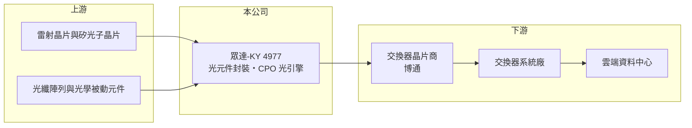

# 4977 眾達-KY

> 上市｜[[產業索引-通信網路業|通信網路業]]｜上市（櫃）日期 2013/11/20

# 第一章：企業模式與商業藍圖

> [!info] 撰寫說明
> 精簡版，由 Claude 依公開資料整理，架構比照 [[2330台積電]] 的四章研究，資料截至 2026-10-08。來源：證交所開放資料（基本資料、綜合損益、資產負債、營益分析、股利、每月營收）、Goodinfo 年度經營績效、理財周刊 2026 年 2 月文章。公開資料有限，本次未取得產品別比重、生產據點與業外收益來源，相關描述依記憶或推估，需逐條比對原始文件與年報。#待校對

本章說明眾達-KY（股票代號：4977，以下簡稱眾達）的商業模式：一家註冊在開曼群島的光通訊元件廠，傳統光元件營收大幅萎縮後，把未來押在與 [[AVGO博通]] 合作的 [[CPO]] 光引擎上。

- **核心業務：** 眾達 2007 年在開曼群島設立，2013 年在證交所上市，股本約 8.27 億元。公司從事光通訊主動元件與模組的封裝製造，核心技術是雷射光學封裝（待校對）。理財周刊 2026 年 2 月報導指出，眾達以博通 Tomahawk 5「Bailly」架構的 51.2T CPO 產品準備量產，該產品使用 8 個 6.4T 光引擎，分析師把它的競爭力歸因於雷射光學封裝技術與長期的博通合作關係。
- **營收結構：** 本次未取得產品別比重。營收從 2020 年的 33.4 億元降到 2025 年的 10.7 億元，代表傳統光元件業務大幅萎縮（原因未查得）。2025 年 EPS 4.48 元，但營業利益只有約 0.73 億元，獲利大部分來自業外收益（來源未查得，推估為投資、利息或租賃收入）。
- **營運據點：** 註冊地為開曼群島，營運與生產據點本次未查得，依記憶主要在中國與台灣（待校對）。
- **長期方向：** CPO 是把光學元件直接和交換器晶片封裝在一起的新架構，可以大幅降低 AI 資料中心的傳輸耗電。公司預期 CPO 導入時程會在 2026 至 2027 年跟上產業節奏，成為中期最主要的成長來源。若 CPO 普及，眾達有機會從萎縮的傳統元件廠轉型為先進光封裝供應商；若普及延後，公司仍需依賴業外收益支撐獲利。

# 第二章：護城河深度與競爭優勢

本章評估眾達的護城河。傳統業務的競爭力已明顯衰退，新的護城河取決於 CPO 封裝技術能否站穩，目前仍在驗證中。

- **競爭優勢：** CPO 光引擎需要把雷射、矽光子晶片與光纖以次微米精度對準封裝，良率與可靠度門檻很高，能被博通這類交換器晶片龍頭選為合作夥伴，本身就是技術能力的證明。一旦進入大型客戶的參考設計，後續世代通常會延續合作，形成轉換成本。
- **主要對手：** CPO 與矽光子封裝的競爭者包括 [[3363上詮]]、[[2330台積電]]（矽光子平台）、[[3711日月光投控]] 等封裝廠，以及國際光通訊大廠；傳統光元件則與 [[3234光環]]、[[4979華星光]]、[[4908前鼎]] 等競爭（對手名單為產業常識整理，待校對）。
- **觀察重點：** 第一，51.2T CPO 產品的量產時程與出貨量。第二，CPO 營收比重何時能讓營業利益轉正。第三，下一代 102.4T 交換器的 CPO 方案是否延續與博通的合作。

# 第三章：財務體質與盈利規模

資料日期：2026-10-08。數字取自 Goodinfo 年度經營績效與證交所開放資料，表格是撰寫當時的快照；最新月營收、毛利率、累計 EPS 由自動排程寫在本筆記的屬性欄位（月營收、毛利率、累計EPS 等）。#待校對

眾達的財務數字顯示本業營收大幅萎縮，近年 EPS 主要靠業外收益維持。

| 年度 | 營收（新台幣） | [[毛利率]] | [[營業利益率]] | EPS（元） | [[ROE]] |
|---|---|---|---|---|---|
| 2019 | 25.3 億 | 24.0% | 12.8% | 4.22 | 12.7% |
| 2020 | 33.4 億 | 23.1% | 13.7% | 8.02 | 22.0% |
| 2021 | 25.5 億 | 20.2% | 8.21% | 3.88 | 10.2% |
| 2022 | 29.7 億 | 28.6% | 19.4% | 6.20 | 14.0% |
| 2023 | 17.4 億 | 21.8% | 10.1% | 4.26 | 8.69% |
| 2024 | 10.9 億 | 22.3% | 4.58% | 3.28 | 6.71% |
| 2025 | 10.7 億 | 25.0% | 6.82% | 4.48 | 8.91% |
| 2026 上半年 | 4.31 億 | 21.48% | -6.80% | 1.50 | 未查得 |

註：2019 至 2025 年取自 Goodinfo 合併報表；2026 上半年取自證交所營益分析與綜合損益開放資料。

- **營收規模：** 2020 至 2025 年營收年複合成長率約 -20.4%（推算），五年間營收縮小到約三分之一。2026 年 1 至 8 月累計營收 8.20 億元，較去年同期增加約 13.7%，8 月單月營收 2.08 億元明顯高於上半年月均，可能與新產品出貨有關（推估）。
- **獲利：** 2026 上半年營業損失 0.29 億元，但業外收入 1.58 億元，稅後淨利 1.20 億元、EPS 1.50 元。2021 至 2025 年平均 ROE 約 9.7%（推算），但其中本業貢獻逐年下降。
- **財務特色：** 2026 年第二季底資產總計 71.5 億元、負債 28.5 億元（流動負債 11.2 億元、非流動負債 17.3 億元），股東權益 43.0 億元，每股淨值 51.99 元。以 10 億元左右的營收規模而言，資產與長期負債都偏大，推估帳上有大量投資或不動產（待校對）。2025 年度每股配發現金股利 2.25 元，相對 EPS 4.48 元，配息率約 50%（推算）。
- **[[ROIC]] 與 [[WACC]]：** 以 2025 年營業利益約 0.73 億元扣 20% 稅後約 0.58 億元，投入資本以股東權益 43.0 億元加非流動負債 17.3 億元（代替有息負債）約 60.3 億元計算，ROIC 約 1.0%（推算）；2026 上半年年化營業損失約 0.59 億元，ROIC 約 -1.0%（推算）。WACC 以 CAPM 推估：無風險利率 1.75%、市場風險溢酬 6%、β 取 1.2（推估，光通訊族群波動大），權益成本約 8.95%；稅前負債成本假設 2.5%，以權益與負債約 71:29 加權，WACC 約 6.9%（推算）。本業 ROIC 遠低於 WACC，目前的股東報酬主要來自業外收益；CPO 若能放量，才可能讓本業重新創造價值。

# 第四章：總體風險與地緣政治

本章整理眾達面對的長期風險，主要來自新技術押注與本業萎縮。

- **產業週期：** 光通訊需求跟隨雲端業者的 AI 資料中心投資，投資高峰與退潮之間落差很大。CPO 是新架構，產業導入時程多次延後的可能性不低，若延後，眾達的轉型時間表也會跟著延後。
- **營運風險：** 新產品高度依賴單一大客戶的平台，客戶策略改變或改用其他封裝夥伴，將直接影響成長。本業目前虧損，若業外收益下降，EPS 會明顯縮水。
- **其他風險：** 開曼註冊公司的資訊揭露與股東權益保護制度與台灣公司不同，投資人需留意。若生產據點在中國，美中科技管制與關稅可能影響對美系客戶出貨（待校對）。

# 專有名詞解析

## 半導體

- **[[CPO]]**：共同封裝光學，把光學收發元件與交換晶片封裝在一起，縮短電訊號距離以降低功耗。
- **[[矽光子]]**：在矽晶片上製作光學元件，以光取代電傳輸資料，可降低 AI 資料中心的傳輸耗電。

## 應用

- **[[光引擎]]**：CPO 架構中負責光電轉換的核心模組，內含雷射、調變器、檢光器與光纖耦合結構。

## 金融

- **[[業外收益]]**：非本業產生的收入，例如股利、利息、處分投資利益與匯兌利益，穩定性通常低於本業利潤。
- **[[ROIC]]**：投入資本報酬率，稅後營業利益除以股東權益加有息負債，衡量本業運用資本的效率。
- **[[WACC]]**：加權平均資金成本，股東與債權人要求報酬率的加權平均，是 ROIC 要超越的門檻。

# 核心供應鏈

- 上游：雷射晶片與矽光子晶片、光纖陣列與光學被動元件（實際供應商未公開）。
- 下游／客戶：[[AVGO博通]]（CPO 合作），透過交換器系統廠如 [[2345智邦]] 等供應雲端資料中心（系統廠供應關係為推估，待校對）。
- 同業：[[3363上詮]]、[[3234光環]]、[[4979華星光]]、[[4908前鼎]]、[[3450聯鈞]]。

## 最新新聞
<!-- news:start（自動產生，請勿手動編輯此範圍） -->
- 2026-10-12 📰 媒體 18:51｜營收速報 - 眾達-KY(4977)9月營收2.32億元年增率高達125.77％｜[鉅亨網](https://news.cnyes.com/news/id/6628391)
- 2026-10-08 🏛️ 重訊 16:49｜代子公司PCL TECHNOLOGIES TRADING, INC.公告擬增資孫公司PCL INTERNATIONAL TECHNOLOGIES (PENANG)｜[觀測站](https://mops.twse.com.tw/mops/#/web/t05st01)
- 2026-10-08 🏛️ 重訊 16:48｜代重要孫公司眾達光通科技(蘇州)有限公司公告減資事宜。｜[觀測站](https://mops.twse.com.tw/mops/#/web/t05st01)
- 2026-10-07 🏛️ 重訊 16:02｜代重要子公司PCL TECHNOLOGIES TRADING, INC.公告董事會 決議現金增資案。｜[觀測站](https://mops.twse.com.tw/mops/#/web/t05st01)
- 2026-10-06 🏛️ 重訊 17:40｜代子公司PCL TECHNOLOGIES TRADING, INC.公告新增資金貸與 金額達「公開發行公司資金貸與及背書保證處理準則」第二十二條 第一項第三款之公告標準。｜[觀測站](https://mops.twse.com.tw/mops/#/web/t05st01)

完整紀錄：[[4977眾達-KY 新聞]]
<!-- news:end -->

## 相關連結
- [公開資訊觀測站](https://mopsov.twse.com.tw/mops/web/t05st03?step=1&firstin=1&co_id=4977)
- [Goodinfo](https://goodinfo.tw/tw/StockDetail.asp?STOCK_ID=4977)
- [Yahoo 股市](https://tw.stock.yahoo.com/quote/4977)
- [鉅亨網新聞](https://www.cnyes.com/twstock/4977/news)
