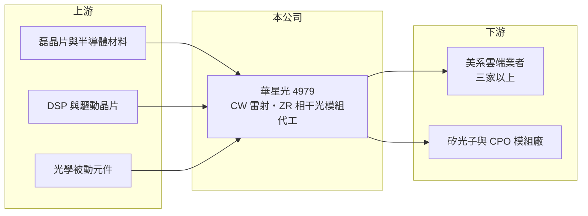

# 4979 華星光

> 上櫃｜[[產業索引-通信網路業|通信網路業]]｜上市（櫃）日期 2011/12/12

# 第一章：企業模式與商業藍圖

> [!info] 撰寫說明
> 精簡版，由 Claude 依公開資料整理，架構比照 [[2330台積電]] 的四章研究，資料截至 2026-10-08。來源：櫃買中心開放資料（基本資料、綜合損益、資產負債、每月營收、本益比殖利率）、Goodinfo 年度經營績效、理財周刊 2026 年 3 月文章、優分析 2026 年自結獲利報導。客戶名稱與生產據點未公開。#待校對

本章說明華星光通（股票代號：4979，以下簡稱華星光）的商業模式：一家從雷射元件起家，轉型為美系雲端業者高速相干光模組代工夥伴、並大幅擴充連續波雷射產能的光通訊廠。

- **核心業務：** 華星光成立於 2001 年，2011 年在櫃買中心掛牌，實收資本額約 14.3 億元。光通訊主動元件與模組占營收約 94%，產品分兩條線：一是 [[CW雷射]]（連續波雷射二極體），2026 年主力出貨 70mW 與 100mW，並布局 200mW、400mW 以上的高功率產品；二是資料中心互連使用的 [[ZR]] 相干光模組，包括 100G、400G 與 800G ZR／ZR+。
- **營收結構：** 本次未取得產品別金額比重。依理財周刊整理，100G ZR 屬成熟產品、2026 年預期持平；400G ZR 持續成長；800G ZR／ZR+ 自 2026 年 1 月起正式出貨，預期 2027 年進入高速成長。400G 與 800G ZR 多採獨家代工模式，市占率有機會達五成以上。
- **營運據點：** 生產據點本次未查得（待校對）。客戶已從單一雲端業者擴展到三家以上美系雲端業者，降低了客戶集中風險。
- **長期方向：** AI 資料中心之間、以及資料中心內部的頻寬需求持續倍增，帶動兩個長期需求：一是跨資料中心的相干光模組，二是[[矽光子]]與 [[CPO]] 架構所需的外部雷射光源。華星光的 CW 雷射產能在 2025 年底約 150 萬顆，目標 2026 年第四季提升到 300 萬至 400 萬顆；2025 年出貨量約為 2024 年的四倍。

# 第二章：護城河深度與競爭優勢

本章評估華星光的護城河。華星光的優勢來自雷射元件技術與獨家代工關係，但客戶議價能力強，屬於中等偏窄的護城河。

- **競爭優勢：** 相干光模組的光學對準、溫控與可靠度要求極高，雲端業者一旦把某一代產品交給特定代工廠，通常會延續到下一代，華星光在 400G 與 800G ZR 的獨家代工地位就是這種轉換成本的展現。另一方面，高功率 CW 雷射需要磊晶、晶片製程與封裝的長期經驗，全球能穩定量產的廠商有限，產能擴充也需要時間。
- **主要對手：** 光模組與雷射元件的對手包括 [[3450聯鈞]]、[[3081聯亞]]、[[3234光環]]、[[4908前鼎]]、[[4977眾達-KY]]，以及美國 Coherent、Lumentum 與中國的中際旭創、新易盛等大廠（對手名單為產業常識整理，待校對）。
- **觀察重點：** 第一，800G ZR／ZR+ 的放量速度與客戶數。第二，CW 雷射產能倍增後能否維持良率與價格。第三，CPO 實際量產的時程，法人認為全面量產約需 2 至 3 年。

# 第三章：財務體質與盈利規模

資料日期：2026-10-08。數字取自 Goodinfo 年度經營績效與櫃買中心開放資料，表格是撰寫當時的快照；最新月營收、毛利率、累計 EPS 由自動排程寫在本筆記的屬性欄位（月營收、毛利率、累計EPS 等）。#待校對

華星光的財務數字顯示 2022 年後成功轉型，營收四年成長超過三倍，獲利能力穩定在高檔。

| 年度 | 營收（新台幣） | [[毛利率]] | [[營業利益率]] | EPS（元） | [[ROE]] |
|---|---|---|---|---|---|
| 2019 | 11.9 億 | 3.17% | -18.9% | -2.02 | -17.0% |
| 2020 | 11.7 億 | 4.02% | -14.4% | -0.75 | -6.55% |
| 2021 | 8.66 億 | -2.01% | -23.7% | -2.22 | -20.9% |
| 2022 | 13.2 億 | 30.1% | 20.7% | 2.05 | 19.7% |
| 2023 | 29.6 億 | 19.4% | 15.0% | 3.34 | 19.9% |
| 2024 | 34.5 億 | 18.3% | 14.0% | 3.79 | 16.6% |
| 2025 | 43.8 億 | 21.0% | 16.8% | 5.43 | 20.7% |
| 2026 上半年 | 24.8 億 | 23.9% | 19.6% | 2.91 | 未查得 |

註：2019 至 2025 年取自 Goodinfo 合併報表；2026 上半年取自櫃買中心開放資料，毛利率與營業利益率由營業毛利、營業利益除以營收計算。

- **營收規模：** 2020 至 2025 年營收年複合成長率約 30.2%（推算），2025 年營收 43.8 億元、年增 27%。2026 年 1 至 8 月累計營收 35.4 億元，較去年同期增加約 20.3%。
- **獲利：** 2019 至 2021 年連續虧損，2022 年起轉型成功後營業利益率穩定在 14% 至 20%。值得注意的是毛利率只有約兩成，但營業費用率僅約 4% 至 5%，這是代工模式的特徵：毛利不高，但費用極精簡。2022 至 2025 年平均 ROE 約 19.2%（推算）；若含 2021 年虧損，2021 至 2025 年平均約 11.2%（推算）。
- **財務特色：** 2026 年第二季底資產總計 62.7 億元、負債 18.2 億元（流動負債 13.9 億元、非流動負債 4.26 億元），股東權益 44.5 億元，每股淨值 31.18 元。2025 年每股配發現金股利約 2.18 元，相對 EPS 5.43 元，配息率約 40%（推算），保留較多盈餘支應雷射產能擴充。
- **[[ROIC]] 與 [[WACC]]：** 以 2026 上半年營業利益 4.87 億元年化約 9.74 億元、扣 20% 稅後約 7.79 億元，投入資本以股東權益 44.5 億元加非流動負債 4.26 億元（代替有息負債）約 48.8 億元計算，ROIC 約 16.0%（推算）；以 2025 年營業利益約 7.36 億元計算約 12%（推算，資本以近期數字代替）。WACC 以 CAPM 推估：無風險利率 1.75%、市場風險溢酬 6%、β 取 1.3（推估，光通訊高成長股波動大），權益成本約 9.55%，負債比重低，WACC 約 8.9%（推算）。2022 年後 ROIC 持續高於 WACC 約 3 至 7 個百分點，代表轉型後的商業模式正在創造價值。

# 第四章：總體風險與地緣政治

本章整理華星光面對的長期風險，主要來自客戶集中與光通訊技術快速更替。

- **產業週期：** 營收高度依賴美系雲端業者的資料中心資本支出。AI 投資若放緩，相干光模組與雷射需求都會同步下修，過去光通訊產業曾多次出現擴產後供過於求的[[長鞭效應]]。
- **營運風險：** 獨家代工模式意味著客戶掌握設計與議價權，若客戶引入第二供應商或自行垂直整合，華星光的訂單與毛利會受衝擊。CW 雷射產能在一年內倍增，若需求不如預期，折舊會壓縮獲利。
- **其他風險：** 技術路線從可插拔模組轉向 CPO 時，ZR 模組的長期需求可能受影響，而外部雷射需求則可能增加，公司需要在兩者間正確配置資源。產品以美元計價，新台幣升值會壓縮毛利。美中科技競爭可能改變中國對手的價格策略。

# 專有名詞解析

## 半導體

- **[[CW雷射]]**：連續波雷射，持續輸出穩定光源的雷射二極體，矽光子模組與 CPO 架構需要它作為外部光源。
- **[[矽光子]]**：在矽晶片上製作光學元件，以光取代電傳輸資料，可降低 AI 資料中心的傳輸耗電。
- **[[CPO]]**：共同封裝光學，把光學收發元件與交換晶片封裝在一起，縮短電訊號距離以降低功耗。

## 應用

- **[[ZR]]**：資料中心互連用的相干光模組規格，可在 80 至 120 公里以上的距離傳輸 400G、800G 訊號，用於連接不同資料中心。

## 金融

- **[[長鞭效應]]**：終端需求的小幅變動，沿供應鏈往上游傳遞時被逐級放大，造成上游庫存與訂單劇烈波動。
- **[[ROIC]]**：投入資本報酬率，稅後營業利益除以股東權益加有息負債，衡量本業運用資本的效率。
- **[[WACC]]**：加權平均資金成本，股東與債權人要求報酬率的加權平均，是 ROIC 要超越的門檻。

# 核心供應鏈

- 上游：磊晶片與半導體材料（如 [[3081聯亞]] 屬於此類供應商，實際供應關係未公開，待校對），相干 DSP 與驅動晶片（[[MRVL邁威爾]] 等，待校對），光學被動元件。
- 下游／客戶：三家以上美系雲端業者（未具名），以及採用外部雷射光源的矽光子與 CPO 模組廠。
- 同業：[[3450聯鈞]]、[[3081聯亞]]、[[3234光環]]、[[4908前鼎]]、[[4977眾達-KY]]、[[3363上詮]]。

## 最新新聞
<!-- news:start（自動產生，請勿手動編輯此範圍） -->
- 2026-10-13 📰 媒體 16:00｜華星光(4979) 三引擎接棒！獲利高點究竟落在哪一年？｜[鉅亨網](https://news.cnyes.com/news/id/6629433)
- 2026-10-08 📰 媒體 21:20｜營收速報 - 華星光(4979)9月營收5.75億元年增率高達97.78％｜[鉅亨網](https://news.cnyes.com/news/id/6626015)

完整紀錄：[[4979華星光 新聞]]
<!-- news:end -->

## 相關連結
- [公開資訊觀測站](https://mopsov.twse.com.tw/mops/web/t05st03?step=1&firstin=1&co_id=4979)
- [Goodinfo](https://goodinfo.tw/tw/StockDetail.asp?STOCK_ID=4979)
- [Yahoo 股市](https://tw.stock.yahoo.com/quote/4979)
- [鉅亨網新聞](https://www.cnyes.com/twstock/4979/news)
