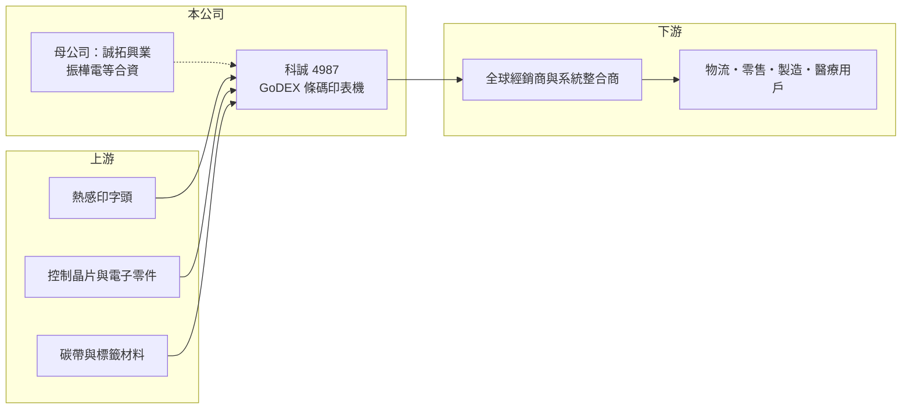

# 4987 科誠

> 上櫃｜[[產業索引-電腦及週邊設備業|電腦及週邊設備業]]｜上市（櫃）日期 2012/03/21

# 第一章：企業模式與商業藍圖

> [!info] 撰寫說明
> 精簡版，由 Claude 依公開資料整理，架構比照 [[2330台積電]]，資料截至 2026-10-08。來源：Goodinfo 經營績效頁、工商時報 2026 年 1 月公開收購報導，以及財經媒體標題。櫃買中心 2026 年 10 月的開放資料快照已查無本公司紀錄，推估已依收購計畫終止上櫃，終止日期未查得。公開資料有限。#待校對

本章說明科誠（4987）的商業模式：一家經營約 30 年、以 GoDEX 品牌行銷全球的[[條碼印表機]]廠，並在 2026 年由私募與同業合組的公司收購下櫃。

- **核心業務：** 科誠研發、製造並銷售條碼標籤印表機與相關耗材，以自有品牌 GoDEX 銷往全球，產品應用在物流倉儲、零售、製造業與醫療的標籤列印。條碼印表機是[[自動辨識]]系統的一環，需要和掃描器、資料系統搭配，因此公司也提供整合解決方案。
- **營收結構：** 公開資料沒有揭露產品與地區比重。條碼印表機的銷售通常包含硬體與後續的碳帶、標籤等耗材，耗材能帶來重複性收入，這也是公司毛利率長期維持在 40% 上下的原因之一（推估）。
- **營運據點：** 總部與研發在台灣，產品透過各地經銷商與子公司銷往美洲、歐洲與亞洲（據點細節待校對）。
- **長期方向：** 2026 年 1 月，由延拓公司、8114振樺電 與董事長戴奉義家族共同成立的誠拓興業，以每股 82 元公開收購科誠股權，收購期間為 2026 年 1 月 13 日至 2 月 4 日，未取得的股權再以現金股份轉換，完成後科誠將成為誠拓 100% 持股子公司並終止上櫃。收購目的是因應創辦人屆齡退休，由新股東導入管理資源與專業經理人接班，戴奉義轉任策略顧問。這是台灣中小型隱形冠軍以[[公開收購]]解決接班問題的典型案例。

# 第二章：護城河深度與競爭優勢

本章分析科誠的護城河：自有品牌、全球通路與長期穩定的高毛利。

- **競爭優勢：** 科誠是台灣少數在條碼印表機領域經營自有品牌的公司，品牌與全球經銷網路需要多年累積，新進者不易複製。毛利率在 2011 至 2025 年間一直維持在 34% 至 45%，十五年都沒有虧損，顯示產品定價能力與成本控管相當穩定。
- **主要對手：** 全球條碼印表機市場由美國 Zebra 斑馬技術領先，其他對手包括 Honeywell、日本 SATO、TSC 台半（TSC Auto ID）等；科誠的定位偏向中階與高性價比市場。新股東 8114振樺電 本身經營 POS 與工業電腦，可在零售與物流通路上產生綜效。
- **觀察重點：** 下櫃後外部投資人無法再追蹤財報，長期觀察重點轉為振樺電等股東如何整合科誠的品牌與通路，以及條碼印表機在電商物流與 [[RFID]] 標籤趨勢下的成長性。

# 第三章：財務體質與盈利規模

資料日期：2026-10-08，表格是撰寫當時的快照。本公司推估已終止上櫃，自動排程不再更新屬性欄位，數字以下表為準。#待校對

本章用多年度數字檢視科誠在下櫃前的獲利品質，它是一家規模不大、但獲利極為穩定的公司。

| 年度 | 營收（億元） | [[毛利率]] | [[營業利益率]] | EPS（元） | [[ROE]] |
|---|---|---|---|---|---|
| 2021 | 12.1 | 37.7% | 15.5% | 4.61 | 14.3% |
| 2022 | 12.9 | 40.3% | 17.4% | 5.95 | 18.4% |
| 2023 | 11.5 | 42.0% | 16.5% | 4.54 | 13.2% |
| 2024 | 12.9 | 42.3% | 19.7% | 6.49 | 18.0% |
| 2025 | 13.4 | 43.2% | 18.9% | 6.36 | 16.5% |

- **營收規模：** 營收從 2011 年 8.6 億元成長到 2025 年 13.4 億元，2015 至 2025 年年複合成長率約 2.1%，2020 至 2025 年約 6.3%。成長速度不快，屬於成熟利基市場中穩定經營的類型。2026 年第一季營收 3.15 億元，毛利率 45.4%。
- **獲利：** 毛利率從 2021 年的 37.7% 逐步提升到 2025 年的 43.2%，營業利益率穩定在 15% 至 20%。2011 年以來每年 EPS 都在 3.7 元以上，景氣低點的 2020 年仍有 3.76 元，顯示獲利的抗跌性。
- **財務特色：** 近 5 年（2021 至 2025）平均 ROE 約 16.1%。依公開收購的股數推算，流通股數約 3,190 萬股，股本規模很小；以 82 元收購價計算，全公司價值約 26 億元，約為 2025 年 EPS 的 13 倍（推算）。
- **[[ROIC]] 與 [[WACC]]：** 2025 年營業利益約 2.5 億元，稅後約 2.0 億元；資產負債表未查得，以淨利 2.0 億元除以 ROE 16.5% 推算權益約 12.3 億元，假設幾乎沒有有息負債，ROIC 約 16%（推算）。WACC 以 [[CAPM]] 推估：無風險利率 1.75%、市場風險溢酬 6%、β 假設 0.8（獲利穩定的利基設備股），股東權益成本約 6.55%；負債比重接近零，WACC 約 6.5%（推算）。ROIC 長期高出 WACC 約 10 個百分點，代表科誠是持續創造價值的公司，這也解釋了收購方願意溢價收購的原因。

# 第四章：總體風險與地緣政治

本章整理科誠長期要面對的風險，下櫃後這些風險主要由新股東承擔。

- **產業週期：** 條碼印表機需求跟著物流、零售與製造業的資本支出起伏，但耗材與汰換需求讓波動相對溫和，2020 年營收僅年減約 9%。
- **營運風險：** 國際大廠具有規模與品牌優勢，中國業者以低價切入中低階市場，可能壓縮科誠的價格空間。創辦人退休後的經營團隊交接，是收購後最大的執行風險。
- **其他風險：** 產品以外銷為主，匯率波動影響毛利；美國關稅與各地認證規範變動會影響出貨成本。下櫃後資訊揭露減少，原股東換得現金，不再分享後續成長。

# 專有名詞解析

## 應用

- **[[條碼印表機]]**：以熱感或熱轉印方式列印條碼標籤的專用印表機，用於物流、零售與製造業的貨物追蹤。
- **[[自動辨識]]**：以條碼、RFID 等技術自動讀取物品資訊、取代人工輸入的系統，常見於倉儲與零售。
- **[[RFID]]**：無線射頻辨識，以電波讀取晶片標籤資訊，不需對準即可批次讀取。

## 金融

- **[[公開收購]]**：收購人公告價格與期間，向不特定股東公開買進股票，常用於取得經營權或下市櫃。
- **[[CAPM]]**：資本資產定價模型，以無風險利率加上 β 乘以市場風險溢酬，推估股東要求的報酬率。

# 核心供應鏈

- 上游：熱感印字頭（多為日本廠商，待校對）、控制晶片與電子零件、碳帶與標籤材料。
- 下游／客戶：全球經銷商與系統整合商，終端為物流倉儲、零售、製造與醫療用戶。
- 同業：Zebra 斑馬技術、Honeywell、SATO、TSC 台半；關係企業 8114振樺電。

## 最新新聞
<!-- news:start -->
<!-- news:end -->

## 相關連結
- [公開資訊觀測站](https://mopsov.twse.com.tw/mops/web/t05st03?step=1&firstin=1&co_id=4987)
- [Goodinfo](https://goodinfo.tw/tw/StockDetail.asp?STOCK_ID=4987)
- [Yahoo 股市](https://tw.stock.yahoo.com/quote/4987)
- [鉅亨網新聞](https://www.cnyes.com/twstock/4987/news)
