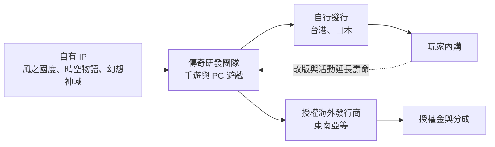
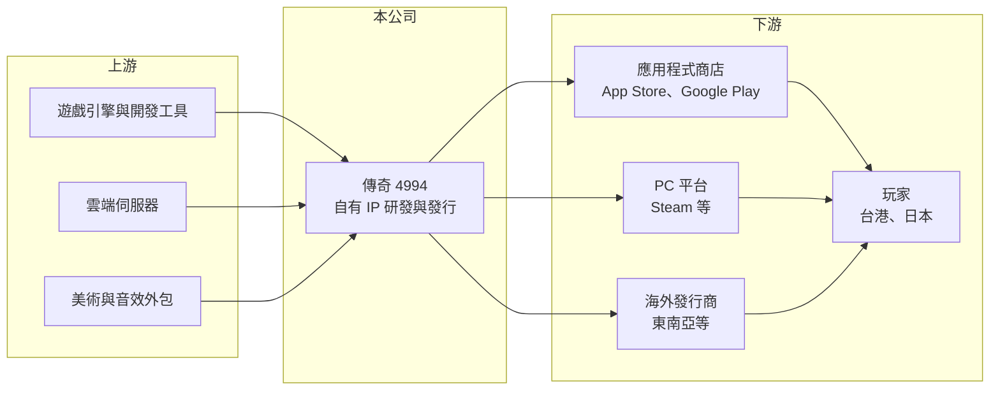

# 4994 傳奇

> 上市｜[[產業索引-資訊服務業|資訊服務業]]｜上市（櫃）日期 2013/12/25

# 第一章：企業模式與商業藍圖

> [!info] 撰寫說明
> 精簡版，由 Claude 依公開資料整理，架構比照 [[2330台積電]] 的四章研究，資料截至 2026-10-08。來源：富果研究 2026 年 6 月法說會備忘錄（主力遊戲、2026 年新作、策略）、Goodinfo 年度經營績效頁、證交所開放資料（基本資料、2026 年第二季資產負債與綜合損益、每月營收、股利）。主力遊戲上線年份、地區營收結構未查得，日本市場比重依記憶整理。#待校對

傳奇網路是台灣少數以自有 IP 經營全球市場的遊戲公司，本章說明它「研發、授權、發行」三合一的商業模式，以及主力遊戲的生命週期如何主導營收起伏。

## 一、核心定位：自有 IP 的遊戲研發與發行商

- **核心業務：** 傳奇從事遊戲研發、[[遊戲IP]]授權與全球發行，產品涵蓋手機遊戲與 PC 遊戲（富果研究）。它的特色是擁有多款自有 IP，可以自行營運，也可以授權給海外發行商，靠授權金與分成取得收入。
- **公司背景：** 傳奇成立於 2002 年、2013 年上市，董事長兼總經理為張峰旗，實收資本額約 6.64 億元（證交所開放資料）。
- **主力產品：** 手機遊戲以《風之國度》為營運最久的旗艦產品，日版已達七週年；2026 年推出《咻咻史萊姆》（台港版 3 月、日版 5 月上市）；另有《晴空物語》日版、《幻想神域 -EVOLUTION-》，以及預計 2026 年第四季在東南亞上市的《亞瑟傳奇 -Excalibur-》。PC 遊戲全球版包括《精靈樂章》、《晴空物語》、《幻想神域》與《聖境傳說》（富果研究）。
- **營收結構：** 遊戲別、地區別與自製代理的比重未查得。從產品線推估，日本與台港是主要市場（推估，待校對），收入以玩家在遊戲內購買虛寶的[[內購]]為主，加上 IP 授權金。

## 二、資本轉化邏輯：一款成功遊戲撐起多年營收

遊戲公司的成本大多在開發與行銷，遊戲上線後的營運成本相對低，因此[[毛利率]]高達 54% 至 67%（Goodinfo）。但獲利高度依賴少數爆款：新遊戲上線初期營收衝高、隨後逐年衰退，若沒有新作接棒，整體營收就會下滑。傳奇 2020 年營收 32.5 億元，到 2025 年降到 11.9 億元（Goodinfo），正是主力遊戲進入成熟期與衰退期、新作接棒不足的結果。

## 三、主力遊戲的生命週期與長期策略

- **長青遊戲的經營：** 《風之國度》日版營運七年，屬於成熟期的長青遊戲，靠改版、聯名活動與社群經營維持玩家。這類遊戲營收雖然逐年遞減，但開發成本早已回收，貢獻穩定的現金流。
- **資產活化與授權：** 公司建立跨專案的資源複用平台並導入 AI，提升開發效率；把 PC 遊戲與《Excalibur》授權給海外發行商，並與 Steam 等平台洽談聯運，以平台導入用戶、減少廣告費用（富果研究）。
- **新作策略：** 研發中有輕量化 [[MMORPG]] 與放置休閒 RPG 兩款新作，將與合作夥伴共同驗證市場，以降低高額廣告投放的風險（富果研究）。這代表公司由「重押單一大作」轉向「低成本多產品」的路線。

# 第二章：護城河深度與競爭優勢

本章分析傳奇的護城河構成，以及手機遊戲產業的競爭特性。

## 一、競爭優勢

- **自有 IP 與玩家社群：** 《風之國度》《晴空物語》《幻想神域》等 IP 已累積多年玩家，可以改編成新平台或新類型的遊戲，降低新作的獲客成本。IP 授權也讓公司不必親自進入每個市場就能取得收入。
- **日本市場經驗：** 日本是全球手遊消費力最高的市場之一，但在地化與營運要求嚴格。傳奇在日本長期營運多款遊戲，累積的營運與社群經驗具有一定門檻（推估）。
- **限制：** 遊戲產業的護城河本質上很窄，玩家偏好變化快，任何 IP 都可能在幾年內失去熱度；大型中國與韓國遊戲公司的開發與行銷預算遠大於傳奇。

## 二、主要對手

| 對手 | 定位 | 與傳奇的比較 |
|---|---|---|
| [[3293鈊象]] | 博弈類手遊研發，營運海外市場 | 台灣遊戲業獲利龍頭，產品類型不同 |
| [[5478智冠]] | 遊戲代理與金流平台 | 在台港代理營運上競爭 |
| [[6180橘子]] | 線上遊戲代理與營運 | 台灣遊戲營運商，搶同一批玩家 |
| [[3546宇峻]]、[[3687歐買尬]] | 中小型遊戲研發商 | 自研手遊的同業 |
| 中國與韓國大型遊戲公司 | 大型 MMORPG 與二次元遊戲 | 以龐大預算主導日本與東南亞市場 |

## 三、觀察重點

- **新作的成績：** 《咻咻史萊姆》與《Excalibur》的營收能否接棒，是營收止跌的關鍵。
- **授權收入比重：** 授權模式風險較低、利潤率穩定，比重提升有助於減少營收波動。
- **行銷費用效率：** 公司表示對新市場投入謹慎、下半年行銷費用將下降（富果研究），獲利率能否改善取決於新作能否以較低的廣告費取得用戶。

# 第三章：財務體質與盈利規模

資料日期：2026-10-08，表格是撰寫當時的快照；最新月營收、毛利率、累計 EPS 由自動排程寫在本筆記的屬性欄位（月營收、毛利率、累計EPS 等）。#待校對

本章用多年度數據檢視傳奇在主力遊戲生命週期下的營收起伏與資本報酬。

## 一、多年度三率與 ROE

| 年度 | 營收（新台幣） | [[毛利率]] | [[營業利益率]] | EPS（元） | [[ROE]] |
|---|---|---|---|---|---|
| 2020 | 32.5 億 | 53.1% | 17.2% | 3.91 | 26.7% |
| 2021 | 29.0 億 | 56.9% | 11.6% | 1.23 | 8.01% |
| 2022 | 18.6 億 | 54.1% | 5.29% | 0.48 | 3.37% |
| 2023 | 16.2 億 | 57.9% | 8.49% | 1.69 | 11.6% |
| 2024 | 15.8 億 | 65.9% | 20.4% | 4.78 | 26.5% |
| 2025 | 11.9 億 | 66.7% | 13.5% | 1.96 | 11.6% |
| 2026 上半年 | 6.02 億 | 67.56% | 10.27% | 0.69 | 未查得 |

註：2020 至 2025 年取自 Goodinfo；2026 上半年取自證交所綜合損益與營益分析。

- **營收規模：** 2020 至 2025 年營收年複合成長率約 -18.2%（推算），2026 年 1 至 8 月累計營收約 7.78 億元、年減約 4.0%（證交所每月營收），衰退幅度已較前幾年收斂。
- **獲利波動：** 營收下滑但毛利率由 53% 升到 67%，推估與授權收入比重提高、通路分成成本下降有關（推估）。EPS 在 0.48 元到 4.78 元之間大幅擺盪，2024 年的高獲利推估與費用縮減及授權收入有關（推估，待校對）。
- **ROE：** 2021 至 2025 年平均 ROE 約 12.2%（推算），年度間波動極大。

## 二、股利與財務結構

2025 年度配發盈餘現金股利 1.76 元，另以資本公積發放 1.24 元，合計 3.0 元（證交所股利資料），超過當年 EPS 1.96 元，配發率約 153%（推算）。2026 年第二季底權益約 8.69 億元、總負債約 6.03 億元，其中流動負債約 5.12 億元、非流動負債約 0.91 億元；流動資產約 12.2 億元（證交所資產負債）。遊戲公司幾乎不需要固定資產，流動資產推估以現金為主（推估），以資本公積配發現金代表公司選擇把多餘資金還給股東。

## 三、[[ROIC]] 與 [[WACC]]

**ROIC 推算：** 2025 年營業利益約 11.9 億元 × 13.5% ≈ 1.61 億元，扣除 20% 稅後約 1.29 億元。投入資本以權益 8.69 億元加上非流動負債 0.91 億元計算，約 9.6 億元，ROIC 約 13.4%（推算）。但以 2022 年營業利益率 5.29% 推算，當年 ROIC 只有 4% 左右（推算），說明遊戲公司的資本報酬隨產品週期大起大落。

**WACC 推算：** 公債殖利率 1.75%、市場風險溢酬 6%、β 取遊戲股常見值 1.0，權益成本約 7.75%；幾乎沒有有息負債，WACC 約 7.7%（推算）。

**結論：** 2025 年 ROIC 約 13% 高於約 7.7% 的 WACC，但以多年平均來看，利差並不穩定，低谷年份甚至低於資金成本。長期是否創造價值，取決於公司能否持續推出能接棒的遊戲，或把授權收入做成穩定的基本盤。

# 第四章：總體風險與地緣政治

本章整理傳奇長期面對的產業、營運與其他風險。

## 一、產業週期

- **遊戲生命週期：** 單款遊戲的營收通常在上線一到兩年內達到高峰，之後逐年遞減，公司營收高度依賴新作的成功率。
- **市場競爭：** 手遊市場由大型中國、韓國與日本公司主導，廣告買量成本高，中小型公司的新作曝光難度提高。

## 二、營運風險

- **新作失敗風險：** 一款新作的開發與行銷可能耗費數億元，若市場反應不佳，會直接造成虧損。公司改為與合作夥伴共同驗證市場，就是為了降低這個風險。
- **產品集中：** 營收集中在少數長青遊戲，一旦玩家流失加速，營收下滑會比預期快。
- **人才：** 遊戲企劃與美術人才的流動率高，核心團隊流失會影響開發進度。

## 三、其他風險

- **匯率：** 日本市場收入以日圓計價（推估），日圓貶值會降低換算後的營收。
- **平台與法規：** Apple、Google 的抽成政策與各國對轉蛋機率、未成年消費的規範，都可能影響營收與利潤率。

# 專有名詞解析

## 金融

- **[[ROIC]]**：投入資本報酬率，衡量企業用股東與債權人投入的資本，每年能產生多少稅後營業利益。
- **[[WACC]]**：加權平均資金成本，股東要求報酬與負債利息依資本結構加權後的平均值，是判斷是否創造價值的門檻。

## 產業

- **[[遊戲IP]]**：遊戲的智慧財產，包括角色、世界觀與名稱，可改編成續作、手機遊戲或授權給其他廠商使用。
- **[[內購]]**：玩家在免費遊戲中付費購買虛擬道具或服務，是手機遊戲最主要的收入來源。
- **[[MMORPG]]**：大型多人線上角色扮演遊戲，大量玩家在同一世界中互動，開發與營運成本都高。

# 核心供應鏈

- 上游：遊戲引擎與開發工具、雲端伺服器（例如 [[AMZN亞馬遜]]、[[GOOGL谷歌]]，產業代表，非指名合作對象）、美術與音效外包團隊。
- 下游／客戶：[[AAPL蘋果]] App Store 與 [[GOOGL谷歌]] Google Play、Steam 等 PC 平台、東南亞等海外發行商，以及台港與日本玩家。
- 同業：[[3293鈊象]]、[[5478智冠]]、[[6180橘子]]、[[3546宇峻]]、[[3687歐買尬]]。

## 最新新聞
<!-- news:start（自動產生，請勿手動編輯此範圍） -->
- 2026-10-06 🏛️ 重訊 16:43｜公告本公司115年09月份合併自結損益｜[觀測站](https://mops.twse.com.tw/mops/#/web/t05st01)

完整紀錄：[[4994傳奇 新聞]]
<!-- news:end -->

## 相關連結
- [公開資訊觀測站](https://mopsov.twse.com.tw/mops/web/t05st03?step=1&firstin=1&co_id=4994)
- [Goodinfo](https://goodinfo.tw/tw/StockDetail.asp?STOCK_ID=4994)
- [Yahoo 股市](https://tw.stock.yahoo.com/quote/4994)
- [鉅亨網新聞](https://www.cnyes.com/twstock/4994/news)
