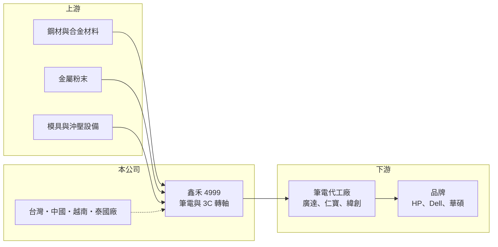

# 4999 鑫禾

> 上市｜[[產業索引-電子零組件業|電子零組件業]]｜上市（櫃）日期 2013/06/03

# 第一章：企業模式與商業藍圖

> [!info] 撰寫說明
> 精簡版，由 Claude 依公開資料整理，架構比照 [[2330台積電]] 的四章研究，資料截至 2026-10-08。來源：Goodinfo 經營績效頁、富果研究 2025 年 11 月法說會摘要、證交所開放資料快照（基本資料、2026 年第二季損益與資產負債、股利、本益比殖利率）。產品別營收比重未查得。#待校對

鑫禾是筆記型電腦轉軸（樞紐）的專業供應商，產品決定螢幕開合的手感與耐用度。本章說明它的業務組成、客戶與東南亞布局。

- **核心業務：** 鑫禾成立於 2002 年，2013 年上市，主要產品是筆電[[轉軸]]，包括一般筆電轉軸、360 度翻轉與可拆式機種轉軸、一體成形電腦（AIO）轉軸，以及 AR/VR 裝置、收銀機等利基產品與 [[MIM]] 金屬射出成形零件。轉軸看似簡單，但要在數萬次開合後仍維持相同扭力，牽涉材料、熱處理與精密沖壓，是筆電機構件中驗證時間較長的一項。
- **營收結構：** 產品別比重在本次資料中未查得，但依法說會描述，傳統筆電轉軸仍是主體，折疊螢幕筆電轉軸雖已隨 HP 機種出貨，貢獻尚不顯著。這代表鑫禾的營收仍跟著全球筆電出貨量走，TrendForce 估計 2024 至 2026 年全球筆電出貨約在 1.77 億至 1.82 億台之間，屬於成熟、低成長的市場。
- **營運據點：** 生產基地原在台灣與中國，2024 年設立越南廠並已量產，2025 年泰國廠興建中。擴建東南亞產能是為了跟隨筆電代工廠把組裝線移出中國，但新廠初期折舊與管理費用偏高，是近年虧損的主因之一。
- **長期方向：** 公司策略是垂直整合沖壓、壓鑄、MIM 等關鍵製程，並以自動化降低人力（單一產線由三、四十人降到數人）。產品面則開發掀背式、折疊螢幕與曲面螢幕轉軸，希望在筆電形態改變時提高單機價值。

# 第二章：護城河深度與競爭優勢

筆電轉軸是寡占但價格競爭激烈的零件，鑫禾在其中屬於規模較小的一家。本章分析它的競爭條件。

- **競爭優勢：** 轉軸必須與每一款筆電的機構同步設計，供應商要在新機開案時參與[[設計導入]]，成為合格供應商後通常可供貨整個機種生命週期。鑫禾與 [[2382廣達]]、[[2324仁寶]]、[[3231緯創]] 等代工廠及 HP、Dell、[[2357華碩]] 等品牌都有往來，具備一定的客戶基礎。垂直整合關鍵製程讓它在交期與成本控制上有自主空間。
- **主要對手：** 同業包括 [[3376新日興]]、[[3548兆利]]、[[6805富世達]] 等台灣轉軸廠，以及中國當地的轉軸供應商。新日興與兆利規模較大，並已延伸到折疊手機轉軸等高單價產品，在研發與議價上較具優勢。
- **觀察重點：** 第一，越南與泰國新廠的產能利用率能否提升，讓折舊與管理費用被營收攤平。第二，折疊螢幕與掀背式等新轉軸能否成為實際營收。第三，毛利率能否回到 2020 年以前兩成以上的水準，這決定公司是否重新具備獲利能力。

# 第三章：財務體質與盈利規模

資料日期：2026-10-08，表格是撰寫當時的快照；最新月營收、毛利率、累計 EPS 由自動排程寫在本筆記的屬性欄位（月營收、毛利率、累計EPS 等）。#待校對

鑫禾的財報顯示，疫情期間的筆電熱潮過後，公司經歷了營收縮減與毛利率持續下滑的過程。本章用多年度數據說明。

| 年度 | 營收（億元） | [[毛利率]] | [[營業利益率]] | EPS（元） | [[ROE]] |
|---|---|---|---|---|---|
| 2020 | 29.4 | 33.4% | 22.3% | 5.66 | 12.3% |
| 2021 | 30.5 | 22.8% | 10.3% | 2.44 | 5.18% |
| 2022 | 22.6 | 19.9% | 4.41% | 2.77 | 5.85% |
| 2023 | 19.1 | 16.4% | -1.19% | 0.05 | 0.11% |
| 2024 | 19.6 | 17.3% | -0.62% | 0.97 | 2.10% |
| 2025 | 19.5 | 13.9% | -3.63% | -1.68 | -3.73% |
| 2026 上半年 | 8.2 | 9.6% | -12.0% | -1.23 | 未查得 |

- **營收規模：** 營收從 2021 年的 30.5 億元降到 2023 年起約 19 億元的水準，2020 至 2025 年年複合成長率約 -7.9%（推算）。2026 年上半年營收約 8.2 億元，較前一年同期再減少，顯示營收尚未止跌。
- **獲利：** 毛利率從 2020 年的 33.4% 一路降到 2026 年上半年的 9.6%，營業利益率自 2023 年起轉負。這是價格競爭、新廠折舊與匯損疊加的結果。2021 至 2025 年平均 ROE 約 1.9%（推算），遠低於資金成本。
- **財務特色：** 2026 年第二季末股東權益約 31.3 億元、負債約 6.3 億元，負債比約 17%，每股淨值 42.5 元，財務結構保守。2025 年度雖虧損，仍以保留盈餘配發現金股利 0.25 元，顯示公司有累積的盈餘可動用，但配息已大幅縮小。

**[[ROIC]] 與 [[WACC]]：** 有息負債明細未查得，假設約 3 億元（推估）。2025 年營業損失約 0.71 億元（19.5 億元 × -3.63%），投入資本以股東權益約 31.3 億元加有息負債 3 億元，約 34.3 億元，ROIC 約 -2%（推算），2026 年上半年虧損擴大，ROIC 更低；2020 年營業利益約 6.6 億元，當時 ROIC 推估約 13%。WACC 用 CAPM 推估：無風險利率 1.75%、市場風險溢酬 6%、β 取 0.8（筆電零組件股常見值，假設），股東權益成本約 6.6%；負債成本 2.5%、稅率 20%，以權益 91%、負債 9% 加權，WACC 約 6.2%（推算）。ROIC 自 2023 年起持續低於 WACC，代表目前的資本配置正在侵蝕股東價值，須等東南亞新廠發揮規模效益才可能扭轉。

# 第四章：總體風險與地緣政治

鑫禾的風險集中在單一終端市場與轉型期的成本壓力。本章整理主要風險。

- **產業週期：** 筆電屬成熟市場，出貨量受換機週期、作業系統更新與企業採購影響，疫情期間的需求透支已在 2022 至 2023 年反映為營收大幅下滑，這是[[長鞭效應]]沿供應鏈放大的結果。轉軸占整機成本很低，品牌與代工廠在景氣差時壓價的空間大。
- **營運風險：** 越南、泰國新廠需要時間培養良率與人力，在產能利用率不足的期間，折舊會持續壓低毛利率。客戶集中於少數筆電代工廠與品牌，單一客戶轉單的影響明顯。
- **其他風險：** 營收以美元計價為主，新台幣升值會產生匯損，2025 年虧損即部分來自匯兌。美國關稅政策會影響代工廠的生產地選擇，進而影響鑫禾的擴廠節奏；鋼材等金屬原料價格也會影響成本。

# 專有名詞解析

## 金融

- **[[長鞭效應]]**：終端需求的小幅變動，沿供應鏈往上游傳遞時被逐級放大，造成上游庫存與訂單劇烈波動。
- **[[ROIC]]**：投入資本報酬率，稅後營業利益除以股東權益加有息負債，衡量本業運用資本的效率。
- **[[WACC]]**：加權平均資金成本，股東權益成本與負債成本依資本結構加權，是 ROIC 必須超越的門檻。

## 產業

- **[[轉軸]]**：連接筆電螢幕與機身的機構件，控制開合角度與扭力，又稱樞紐。
- **[[MIM]]**：金屬射出成形，把金屬粉末混合黏結劑射出成形後燒結，可大量生產形狀複雜的小型金屬零件。
- **[[設計導入]]**：零件被客戶選入產品設計並完成驗證，之後該產品量產期間都會持續採購，是零組件廠長期營收的來源。

# 核心供應鏈

- 上游：鋼材、合金材料與 MIM 用金屬粉末供應商（推估），以及模具與沖壓設備。
- 下游／客戶：[[2382廣達]]、[[2324仁寶]]、[[3231緯創]] 等筆電代工廠，HP、Dell、[[2357華碩]] 等品牌。
- 同業：[[3376新日興]]、[[3548兆利]]、[[6805富世達]]。

## 最新新聞
<!-- news:start -->
<!-- news:end -->

## 相關連結
- [公開資訊觀測站](https://mopsov.twse.com.tw/mops/web/t05st03?step=1&firstin=1&co_id=4999)
- [Goodinfo](https://goodinfo.tw/tw/StockDetail.asp?STOCK_ID=4999)
- [Yahoo 股市](https://tw.stock.yahoo.com/quote/4999)
- [鉅亨網新聞](https://www.cnyes.com/twstock/4999/news)
