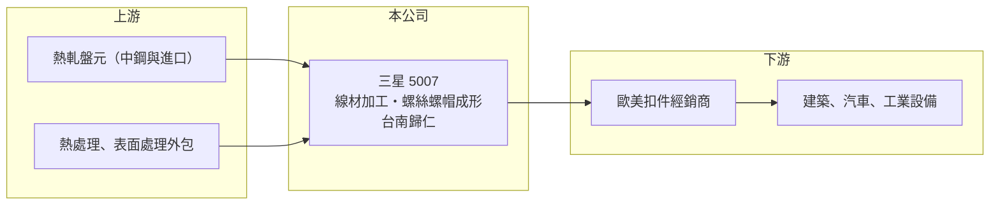

# 5007 三星

> 上市｜[[產業索引-鋼鐵工業|鋼鐵工業]]｜上市（櫃）日期 2011/09/16

# 第一章：企業模式與商業藍圖

> [!info] 撰寫說明
> 精簡版，由 Claude 依公開資料整理，架構比照 [[2330台積電]]，資料截至 2026-10-08。來源：Goodinfo 台灣股市資訊網經營績效年表（2016 至 2025 年）；nStock 公司沿革；證交所開放資料快照（基本資料、2026 年上半年資產負債與損益、營益分析、2025 年度股利、本益比淨值比）。產品別、地區別營收與主要客戶未查得，公開資料有限。#待校對

三星科技成立於 1965 年 7 月，1998 年在櫃買中心掛牌，2011 年 9 月轉到證交所上市，總部與工廠位於台南歸仁，董事長柯吉源、總經理陳信志。三星是台灣[[螺絲扣件]]業中獲利最穩定的公司之一，近十年營業利益率都在 13% 以上，財務體質保守，配息率高。

- **核心業務：** 三星經營螺絲、螺帽與鋼鐵[[線材]]，以及相關機械、零件與工具的製造、加工、買賣與出口（nStock 整理公司登記資料）。同時具備線材加工與螺絲成形能力，代表公司可以從原料端控制品質與成本，這是一般只做成形的螺絲廠沒有的垂直整合（產品細項與自製比例為待校對）。
- **營收結構：** 產品別與地區別營收比重未查得。年營收在 2016 至 2025 年介於 50 億元至 80 億元之間，2025 年約 62.2 億元（Goodinfo），以外銷為主（推估，依台灣扣件業普遍型態）。
- **營運據點：** 總部與工廠位於台南歸仁（證交所基本資料），台南與高雄岡山同屬南台灣扣件聚落，上游線材、熱處理與表面處理資源充足。海外據點未查得。
- **長期方向：** 三星的經營風格是穩健經營、維持高毛利與高配息，而不是追求快速擴張。2016 至 2025 年營收沒有明顯成長，但獲利率維持穩定，長期價值主要來自穩定的現金回饋，而非規模成長。

# 第二章：護城河深度與競爭優勢

三星的護城河在螺絲同業中相對較寬，來源是垂直整合的成本優勢、穩定品質與長期客戶關係。

- **競爭優勢：** 近十年毛利率穩定在 20% 至 26%，營業利益率在 13% 至 20%（Goodinfo），在鋼價大起大落的 2020 至 2025 年也沒有虧損，顯示產品定價與成本控制能力都優於多數同業。自有線材加工讓公司在原料價格波動時較能掌握品質與交期。
- **主要對手：** 國內上市櫃同業包括 [[2063世鎧]]、[[2065世豐]]、[[2012春雨]] 等，以及岡山、台南大量未上市扣件廠；國際上面對中國、越南與印度的低價螺絲。歐美對中國螺絲課徵[[反傾銷]]稅，長期讓台灣廠商保有一定的轉單空間。
- **觀察重點：** 毛利率 2025 年降到 23.9%，2026 年上半年回升到 28.2%、營業利益率 19.8%（證交所資料），代表獲利能力在扣件去庫存期後已經恢復。長期要看公司能否在維持高配息的同時，持續投資設備與新產品，避免競爭力隨時間流失。

# 第三章：財務體質與盈利規模

資料日期：2026-10-08，表格是撰寫當時的快照；最新月營收、毛利率、累計 EPS 由自動排程寫在本筆記的屬性欄位（月營收、毛利率、累計EPS 等）。#待校對

三星的財務特色是「穩」：十年來 EPS 落在 2 元到 3.8 元之間，ROE 大多維持在 12% 至 20%，在景氣循環明顯的鋼鐵類股中相當少見。

| 年度 | 營收（億元） | [[毛利率]] | [[營業利益率]] | EPS（元） | [[ROE]] |
|---|---|---|---|---|---|
| 2021 | 71.1 | 24.6% | 17.3% | 3.33 | 15.1% |
| 2022 | 71.7 | 26.2% | 17.7% | 3.60 | 15.7% |
| 2023 | 66.4 | 24.6% | 17.9% | 3.38 | 14.1% |
| 2024 | 68.2 | 25.8% | 17.9% | 3.58 | 14.4% |
| 2025 | 62.2 | 23.9% | 15.8% | 3.02 | 12.0% |

- **長期指標：** 2021 至 2025 年平均 ROE 約 14.3%（推算），2016 至 2025 年 EPS 全部為正，最低是疫情的 2020 年 2.04 元（Goodinfo）。營收 2020 至 2025 年複合成長率約 4%（推算），2016 至 2025 年則略為衰退，成長性有限。2025 年度配發現金 3.0 元（盈餘 2.73 元加資本公積 0.27 元），約等於全年 EPS，配發率接近 100%（證交所資料推算）。
- **[[ROIC]] 與 [[WACC]]：** 2025 年營業利益約 9.8 億元（營收 62.2 億元 × 15.8%），稅後約 7.9 億元。投入資本以 2026 年第二季權益總計 72.1 億元，加上有息負債推估約 3.8 億元（負債總計 12.6 億元的三成，官方快照未拆分）計算，2025 年 ROIC 約 10.4%（推算）；2026 年上半年營業利益 6.2 億元，年化 ROIC 約 13%（推算）。WACC 約 7.0%（推算：無風險利率 1.75%、市場風險溢酬 6%、β 取鋼鐵同業常見值 0.9，股東權益成本 7.15%；稅前負債成本 2.5%、稅率 20%，以市值約 174 億元與有息負債約 3.8 億元計算權重約 98：2）。ROIC 長期高於 WACC 約 3 至 6 個百分點，屬於持續創造價值的公司，這也反映在約 2.4 倍的股價淨值比。
- **財務特色：** 2026 年第二季總資產 84.7 億元、負債 12.6 億元，負債比率僅約 15%，幾乎沒有財務槓桿，每股淨值 23.24 元。2026 年上半年營收 31.3 億元、毛利率 28.2%、EPS 1.82 元（證交所資料）。

# 第四章：總體風險與地緣政治

三星的風險不在財務，而在成長停滯、歐美需求循環與匯率。

- **產業週期：** 扣件需求跟著歐美建築、汽車與工業景氣走，經銷商去庫存時，訂單會透過[[長鞭效應]]明顯下滑，2020 年與 2025 年的營收下降就是例子。不過三星在這些低谷年份仍維持獲利，代表抗循環能力較強。
- **營運風險：** 營收十年沒有明顯成長，高配息政策讓公司保留的資金有限，若競爭對手在自動化或新產品上投入更多，長期競爭力可能被追上。鋼材價格下跌時，原料與成品庫存可能需要提列[[存貨跌價損失]]。
- **其他風險：** 以外銷為主時，新台幣升值會壓縮獲利；美國關稅、歐盟反傾銷與碳排申報（例如 [[CBAM]] 將扣件納入範圍）可能增加出口成本與行政負擔。

# 專有名詞解析

## 金融

- **[[長鞭效應]]**：終端需求的小幅變動，沿供應鏈往上游傳遞時被逐級放大，造成上游庫存與訂單劇烈波動。
- **[[存貨跌價損失]]**：存貨的市價低於帳面成本時，依會計規定須認列的損失，會直接壓低毛利率。
- **[[ROIC]]**：投入資本報酬率，稅後營業利益除以股東權益加有息負債，衡量本業運用資本的效率。
- **[[WACC]]**：加權平均資金成本，股東與債權人要求報酬率的加權平均，是 ROIC 要超越的門檻。

## 產業

- **[[螺絲扣件]]**：用來鎖固與連接零件的螺絲、螺栓、螺帽等產品，台灣高雄岡山是全球重要的生產聚落。
- **[[線材]]**：鋼胚熱軋成捲狀的細長條鋼，是拉線、螺絲、彈簧與焊材的原料。
- **[[反傾銷]]**：進口國對低於正常價格銷售的進口商品加徵關稅的貿易救濟措施。
- **[[CBAM]]**：歐盟碳邊境調整機制，對進口鋼鐵、鋁、水泥等高碳排產品依碳含量收費。

# 核心供應鏈

- 上游：熱軋盤元，國內主要供應商為 [[2002中鋼]]（實際採購比重未查得）；熱處理與表面處理外包廠。
- 下游／客戶：歐美扣件經銷商與製造業客戶（具名客戶未查得）。
- 同業：[[2063世鎧]]、[[2065世豐]]、[[2012春雨]]；線材加工同業 [[2064晉椿]]、[[2073雄順]]。

## 最新新聞
<!-- news:start -->
<!-- news:end -->

## 相關連結
- [公開資訊觀測站](https://mopsov.twse.com.tw/mops/web/t05st03?step=1&firstin=1&co_id=5007)
- [Goodinfo](https://goodinfo.tw/tw/StockDetail.asp?STOCK_ID=5007)
- [Yahoo 股市](https://tw.stock.yahoo.com/quote/5007)
- [鉅亨網新聞](https://www.cnyes.com/twstock/5007/news)
