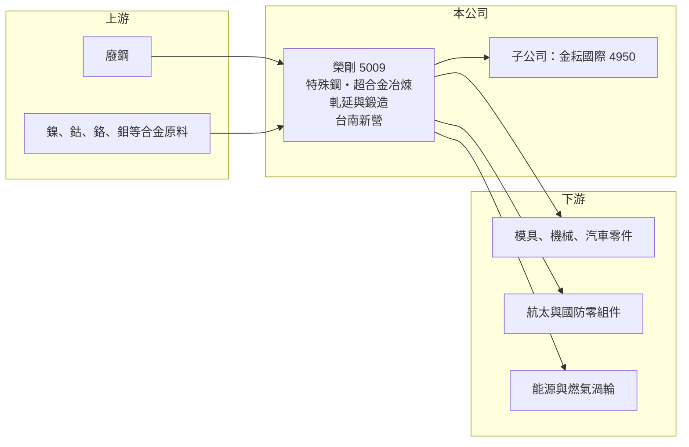

# 5009 榮剛

> 上櫃｜[[產業索引-鋼鐵工業|鋼鐵工業]]｜上市（櫃）日期 1998/10/17

# 第一章：企業模式與商業藍圖

> [!info] 撰寫說明
> 精簡版，由 Claude 依公開資料整理，架構比照 [[2330台積電]]，資料截至 2026-10-08。來源：Goodinfo 台灣股市資訊網經營績效年表（2016 至 2025 年）；nStock 公司沿革與重大訊息（2023 年鍛造廠投資）；金耘國際公司資料（2024 年起為其最終母公司）；櫃買中心開放資料快照（基本資料、2026 年上半年資產負債與損益、2026 年 8 月營收、本益比淨值比）。產品別營收比重與產能未查得。#待校對

榮剛材料科技成立於 1993 年 3 月，原名榮剛重工，1998 年 10 月在櫃買中心掛牌，1999 年改為現名，總部與工廠位於台南新營，董事長王炯棻、總經理康永昌。榮剛是台灣少數能冶煉[[特殊鋼]]與[[超合金]]的材料廠，產品從模具鋼、合金鋼延伸到航太與國防用的高溫合金，屬於鋼鐵業中技術門檻較高的一端。

- **核心業務：** 榮剛經營特殊鋼、碳鋼、合金鋼、超合金及其原料的冶煉、製造加工與銷售（nStock 整理公司登記資料）。特殊鋼是在鋼中加入鉻、鉬、鎳、釩等元素，使其具備高硬度、耐磨或耐熱等特性；超合金則以鎳、鈷為基底，能在引擎與燃氣渦輪的高溫環境中維持強度。製程上需要電弧爐之外的二次精煉與真空重熔設備（設備細節為待校對）。
- **營收結構：** 產品別營收比重未查得。年營收在 2016 至 2020 年約 76 至 106 億元，2022 至 2024 年提升到 124 至 135 億元，2025 年約 116 億元（Goodinfo）。2023 年新聞提到航太、軍工需求旺盛（nStock 新聞標題），顯示高階材料是近年獲利提升的主要來源（推估）。
- **營運據點：** 總部與主要工廠位於台南新營（櫃買基本資料）。2023 年 10 月董事會決議購置大型油壓鍛機並增建鍛造廠（nStock 重大訊息），把業務由煉鋼、軋延延伸到大型鍛件。
- **長期方向：** 榮剛的長期策略是往材料價值鏈的高端移動：一方面擴充[[鍛造]]產能，供應航太、能源與國防需要的大型鍛件；另一方面在 2024 年 9 月成為 [[4950金耘國際]] 的最終母公司，透過子公司擴大鋼鐵材料布局。這些投資的回收期長，成效要用多年時間檢驗。

# 第二章：護城河深度與競爭優勢

榮剛的護城河來自冶金技術、認證門檻與設備投資，屬於鋼鐵業中較寬的護城河。

- **競爭優勢：** 航太與國防材料需要通過客戶與系統廠的長期認證，從試樣、試產到正式供貨常要數年，且對成分控制與缺陷檢測的要求極高。榮剛具備從冶煉到鍛軋的一貫能力，可以提供客製化成分與小批量生產，這是一般碳鋼廠很難跨入的領域。2022 至 2024 年毛利率維持在 26% 至 32%（Goodinfo），明顯高於碳鋼業者。
- **主要對手：** 國際上的特殊鋼與超合金大廠包括美國 ATI、Carpenter Technology、日本大同特殊鋼與德國、奧地利的特殊鋼廠，規模遠大於榮剛（對手名單為一般產業資訊，待校對）。國內在特殊鋼棒線方面有中鋼集團與 [[2027大成鋼]] 等通路，國內航太扣件與零組件業者如 [[3004豐達科]]、[[2634漢翔]] 則屬於潛在的下游客戶。
- **觀察重點：** 2025 年毛利率降到 21.8%、營業利益率 8.3%，2026 年上半年回到 24.1% 與 11.5%（Goodinfo、櫃買資料推算）。長期要看新鍛造廠投產後能否提升高階產品比重，讓營業利益率重回 15% 以上。

# 第三章：財務體質與盈利規模

資料日期：2026-10-08，表格是撰寫當時的快照；最新月營收、毛利率、累計 EPS 由自動排程寫在本筆記的屬性欄位（月營收、毛利率、累計EPS 等）。#待校對

榮剛在 2021 年之前長期只有個位數 ROE，2022 至 2024 年隨航太與國防需求大幅提升到 15% 至 20%，是產品組合升級的典型例子；2025 年則因擴產與需求調整回落。

| 年度 | 營收（億元） | [[毛利率]] | [[營業利益率]] | EPS（元） | [[ROE]] |
|---|---|---|---|---|---|
| 2021 | 87.7 | 26.7% | 12.2% | 1.70 | 9.16% |
| 2022 | 124 | 32.0% | 19.5% | 4.52 | 20.3% |
| 2023 | 135 | 26.9% | 17.6% | 4.66 | 18.2% |
| 2024 | 129 | 26.2% | 15.2% | 4.40 | 15.2% |
| 2025 | 116 | 21.8% | 8.26% | 2.20 | 6.98% |

- **長期指標：** 2021 至 2025 年平均 ROE 約 14.0%（推算），2016 至 2020 年平均只有約 2.6%（推算），顯示獲利能力已發生結構性提升。營收 2020 至 2025 年複合成長率約 8.7%（推算，2020 年 76.4 億元）。2016 至 2025 年 EPS 全部為正（Goodinfo）。櫃買資料顯示最近一年度每股股利 1.2 元，以 2025 年 EPS 2.2 元計算配發率約 55%（推算）。2024 年稅後淨利率 20.3% 高於營業利益率 15.2%，當年有可觀的業外收益，來源未查得。
- **[[ROIC]] 與 [[WACC]]：** 2025 年營業利益約 9.6 億元（營收 116 億元 × 8.26%），稅後約 7.7 億元。投入資本以 2026 年第二季權益總計 178.0 億元，加上有息負債推估約 96.7 億元（負債總計 161.1 億元的六成，官方快照未拆分）計算，2025 年 ROIC 約 2.8%（推算）；2023 年營業利益約 23.8 億元，以相近資本估算 ROIC 約 7%（推算）。WACC 約 5.8%（推算：無風險利率 1.75%、市場風險溢酬 6%、β 取特殊鋼與航太材料常見值 1.0，股東權益成本 7.75%；稅前負債成本 2.5%、稅率 20%，以市值約 187 億元與有息負債約 97 億元計算權重約 66：34）。2022 至 2023 年 ROIC 高於 WACC，2024 年約與 WACC 持平（推算約 5.7%），2025 年跌破，主因是鍛造廠等擴產投資使資本基數變大、獲利尚未跟上；新產能能否在幾年內把 ROIC 拉回 WACC 之上，是判斷這輪資本支出是否值得的關鍵。
- **財務特色：** 2026 年第二季總資產 339.1 億元、負債 161.1 億元，負債比率約 48%，每股淨值 31.08 元，權益中含子公司的非控制權益。2026 年上半年營收 60.9 億元、EPS 1.00 元（櫃買資料）。

# 第四章：總體風險與地緣政治

榮剛的風險在於大型擴產的執行、高階材料客戶的集中度，以及合金原料的價格波動。

- **產業週期：** 特殊鋼需求一部分跟著模具、機械、汽車景氣，一部分跟著航太與國防預算；前者循環明顯，後者週期長但受政策影響大。民航機交機延誤或國防採購變化，都會影響高階材料的訂單。
- **營運風險：** 大型油壓鍛機與鍛造廠投資金額高、驗證期長，若投產後產能利用率不足，折舊與利息會壓低獲利。鎳、鈷、鉬等合金原料價格波動劇烈，價格急跌時可能需要提列[[存貨跌價損失]]，急漲時則可能來不及轉嫁。
- **其他風險：** 航太與國防材料涉及出口管制與客戶所在國的法規，地緣政治變化可能影響出貨。煉鋼耗電量大，電價、碳費與歐盟 [[CBAM]] 都可能增加成本。集團旗下子公司（如金耘國際）的經營成果與[[關係人交易]]，也會影響合併報表與小股東權益。

# 專有名詞解析

## 金融

- **[[關係人交易]]**：公司與母公司、子公司或董監事等有控制或重大影響關係的對象之間的交易，定價是否公允會影響小股東權益。
- **[[存貨跌價損失]]**：存貨的市價低於帳面成本時，依會計規定須認列的損失，會直接壓低毛利率。
- **[[ROIC]]**：投入資本報酬率，稅後營業利益除以股東權益加有息負債，衡量本業運用資本的效率。
- **[[WACC]]**：加權平均資金成本，股東與債權人要求報酬率的加權平均，是 ROIC 要超越的門檻。

## 產業

- **[[特殊鋼]]**：加入鉻、鉬、鎳、釩等合金元素，使鋼材具備高硬度、耐磨、耐熱或耐蝕等特性的鋼種，用於模具、機械與汽車零件。
- **[[超合金]]**：以鎳、鈷或鐵為基底的高溫合金，可在攝氏數百度以上維持強度，用於飛機引擎與燃氣渦輪。
- **[[鍛造]]**：以壓力或錘擊使加熱的金屬塑性變形成形的製程，可改善內部組織，是航太與能源大型零件的關鍵工序。
- **[[CBAM]]**：歐盟碳邊境調整機制，對進口鋼鐵、鋁、水泥等高碳排產品依碳含量收費。

# 核心供應鏈

- 上游：廢鋼與鎳、鈷、鉻、鉬等合金原料（具名供應商未查得）。
- 下游／客戶：模具、機械、汽車零件業者，以及航太、國防與能源設備的零組件廠（具名客戶未查得）；國內航太零組件業者如 [[3004豐達科]]、[[2634漢翔]] 屬於同一產業鏈。
- 同業：ATI、Carpenter Technology、大同特殊鋼等國際特殊鋼廠；子公司 [[4950金耘國際]]。

## 最新新聞
<!-- news:start（自動產生，請勿手動編輯此範圍） -->
- 2026-10-07 📰 媒體 20:25｜榮剛鑄鍛雙核心引擎到位 拓展AI、半導體及國防市場｜[鉅亨網](https://news.cnyes.com/news/id/6623917)

完整紀錄：[[5009榮剛 新聞]]
<!-- news:end -->

## 相關連結
- [公開資訊觀測站](https://mopsov.twse.com.tw/mops/web/t05st03?step=1&firstin=1&co_id=5009)
- [Goodinfo](https://goodinfo.tw/tw/StockDetail.asp?STOCK_ID=5009)
- [Yahoo 股市](https://tw.stock.yahoo.com/quote/5009)
- [鉅亨網新聞](https://www.cnyes.com/twstock/5009/news)
