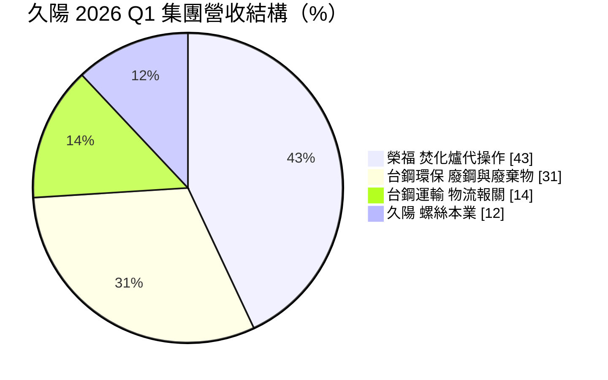
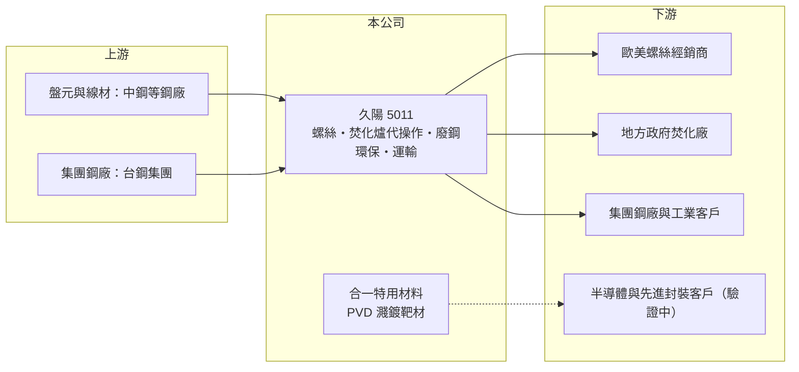

# 5011 久陽

> 上櫃｜[[產業索引-鋼鐵工業|鋼鐵工業]]｜上市（櫃）日期 1999/05/06

# 第一章：企業模式與商業藍圖

> [!info] 撰寫說明
> 本文由 Claude 依公開資料整理，架構比照 [[2330台積電]] 的四章研究，資料截至 2026-10-08。財務數字來源：Goodinfo 年度經營績效頁、富果研究 2026 年第一季法說會備忘錄、櫃買中心開放資料（基本資料、資產負債、綜合損益、每月營收）。集團歸屬與子公司取得年份未逐條比對原始文件；產業描述為整理性內容。#待校對

在評估單一個股的長期投資價值時，首要步驟是拆解企業的底層獲利邏輯。本章說明久陽精密（股票代號：5011，以下簡稱久陽）如何從一家外銷螺絲廠，變成以環保焚化與運輸服務撐起獲利的控股型公司。

## 一、核心定位：螺絲本業縮小，服務型子公司成為主體

久陽成立於 1984 年 11 月，1999 年 5 月上櫃，總部位於高雄，2026 年實收資本額約 10.1 億元，董事長為黃俊義。久陽原本是[[螺絲扣件]]製造商，母公司生產 M3 至 M27 的中高碳標準螺栓，主要外銷德國、美國、義大利、荷蘭與法國等歐美市場。近年久陽成為台灣鋼鐵集團（TSG）的成員，子公司依法說會資料包括焚化爐代操作的榮福（持股 54.73%）、廢鋼與事業廢棄物處理的台鋼環保、物流報關的台鋼運輸與太陽能的台鋼能源。#待校對

這個轉變的意義在於，久陽的獲利來源已經不是螺絲。2026 年第一季集團營收中，榮福約占 43%、台鋼環保約 31%、台鋼運輸約 14%，螺絲本業只剩約 12%。螺絲業務受歐美需求疲弱、關稅與成本壓力影響，公司自己也在法說會上表示這是長期面臨困難的事業。

## 二、營運模式：以集團內需求支撐的服務業

* **環保焚化：** 榮福承接垃圾焚化爐的代操作與維護，2026 年營收主要來自新竹焚化廠第二期整改工程。[[焚化爐]]代操作屬於長約型業務，收入穩定，但大型整改工程完工後營收會回落，需要持續標到新案。
* **廢鋼與廢棄物：** 台鋼環保負責[[廢鋼]]採購與載運，並處理事業廢棄物，業務量隨集團鋼廠的原料需求成長。這類業務的優勢是客戶來源穩定，缺點是利潤率受限於集團內部交易條件。
* **運輸報關：** 台鋼運輸提供海陸空運輸與報關，主要服務集團內部需求，是典型的集團後勤單位。

## 三、長期方向：投資問路，跨入半導體材料

久陽的長期策略是降低對景氣循環型鋼鐵產品的依賴。2026 年 3 月，久陽取得合一特用材料 71.43% 股權，切入半導體與先進封裝用的 PVD 濺鍍靶材，目標在 2026 年內把試製品送客戶驗證。公司把這種作法稱為「投資問路」，也就是以小規模投資逐步試水溫，並以榮福、台鋼環保與台鋼運輸的穩定現金流支應轉型。這條路線能否成功，取決於靶材能否通過客戶認證並放量；在那之前，久陽的價值主要仍由環保與運輸服務決定。

# 第二章：護城河深度與競爭優勢

在長期價值投資中，「護城河」指企業抵禦競爭、維持超額利潤的保護機制。本章檢視久陽各事業的競爭位置：螺絲本業的護城河已相當薄弱，真正的優勢來自集團資源。

## 一、可能的優勢

* **集團內部需求：** 台鋼集團的鋼廠需要穩定的廢鋼供應、物流與廢棄物處理，久陽的子公司因此有一塊相對穩定的基本業務量。這種「集團生態系」讓久陽不必完全在公開市場上和同業競價。
* **焚化爐操作經驗：** 焚化爐代操作需要專業技術人員、環保法規經驗與政府標案的履約紀錄，新進業者不容易在短時間內取得。榮福累積的操作與整改經驗，是久陽目前最具體的能力。
* **歐洲螺絲客戶基礎：** 螺絲出口以德國為最大市場（2026 年第一季約占 35%），代表久陽仍保有一定的歐洲經銷客戶關係，但這項優勢正被中國低價產品侵蝕。

## 二、競爭對手格局

| 對手 | 定位 | 對久陽的影響 |
|---|---|---|
| [[2012春雨]]、[[2062橋椿]]、[[2069運錩]] | 岡山聚落的螺絲與線材廠 | 標準螺栓市場直接競爭 |
| 中國螺絲廠 | 規模大、享出口退稅 | 壓低歐洲標準件報價 |
| [[6803崑鼎]] 等環保服務業者 | 焚化廠興建與操作 | 公共標案競爭對手 |

## 三、守得住與守不住的地方

* **守得住：** 與集團綁定的環保、物流業務，以及已取得的焚化廠操作合約。這些收入不太受鋼價影響，是久陽轉型期間的現金來源。
* **守不住：** 標準螺栓的價格。2024 至 2025 年久陽合併毛利率為負，說明螺絲本業在國際競爭下缺乏定價能力。
* **觀察重點：** 新竹焚化廠整改完成後榮福能否接續新案、合一靶材的客戶驗證進度，以及螺絲事業是否進一步縮減或轉型。

# 第三章：財務體質與盈利規模

資料日期：2026-10-08，表格是撰寫當時的快照；最新月營收、毛利率、累計 EPS 由自動排程寫在本筆記的屬性欄位（月營收、毛利率、累計EPS 等）。#待校對

財務報表是檢驗護城河是否真實存在的最終標準。本章用多年度三率、ROE 與資本報酬，檢視久陽轉型期間的獲利品質。

## 一、多年度獲利

| 年度 | 營收（新台幣） | [[毛利率]] | [[營業利益率]] | EPS（元） | [[ROE]] |
|---|---|---|---|---|---|
| 2019 | 11.5 億 | 3.98% | -4.47% | -0.73 | -5.48% |
| 2020 | 18.3 億 | 3.33% | -3.24% | -1.66 | -11.3% |
| 2021 | 37.6 億 | 7.83% | 3.78% | 1.74 | 9.97% |
| 2022 | 48.2 億 | 9.35% | 4.86% | 3.02 | 11.1% |
| 2023 | 43.2 億 | 1.98% | -2.35% | 1.51 | 5.75% |
| 2024 | 41.4 億 | -3.41% | -7.61% | -0.36 | -4.83% |
| 2025 | 50.6 億 | -3.26% | -7.16% | -1.61 | -17.7% |
| 2026 上半年 | 21.8 億 | 6.31% | 2.95% | 0.46 | 未查得 |

* **營收規模跳升來自併入子公司：** 2019 年營收只有 11.5 億元，2021 年後跳到 40 億元以上，主因是環保與運輸子公司併入合併報表（併入年份未查得），不是螺絲本業成長。#待校對
* **獲利不穩定：** 2021 至 2022 年受惠鋼價上漲與螺絲需求旺盛而獲利，2024 至 2025 年毛利率轉負，2025 年 EPS -1.61 元。2026 年上半年在焚化爐整改工程挹注下轉為獲利，EPS 0.46 元。
* **非控制權益：** 2026 年第二季權益總計 26.1 億元，其中[[非控制權益]]約 6.7 億元，主要來自持股 54.73% 的榮福，因此合併獲利有一部分不屬於久陽股東。

## 二、長期指標

* **平均 ROE：** 2021 至 2025 年平均約 0.9%（推算），遠低於資金成本。
* **營收年複合成長率：** 2019 至 2025 年約 28%（推算），但主要來自合併範圍擴大，不能視為內生成長。
* **股利：** 2025 年虧損，櫃買中心資料顯示近期未配息；歷年平均現金股利約 0.35 元（Goodinfo）。
* **財務結構：** 2026 年第二季流動資產 19.8 億元、流動負債 21.9 億元，流動比率約 90%（推算），短期資金偏緊；榮福規劃的現金增資即是為了償還負債。

## 三、[[ROIC]] 與 [[WACC]]：價值創造利差

**ROIC 推算：** 2025 年營業利益約 -3.6 億元（50.6 億元 × -7.16%），虧損不計稅盾。投入資本以 2026 年第二季權益 26.1 億元加負債 29.6 億元計（有息負債明細未查得，以負債總額代替會高估投入資本），ROIC 約 -6.5%（推算）；只以權益計算約 -14%（推算）。2022 年獲利較佳時，以同樣方法估算 ROIC 約在 4% 上下（推算）。

**WACC 推算：** 以 [[CAPM]] 推估，台灣 10 年期公債 1.75%、市場風險溢酬 6%、β 取 0.9（鋼鐵與金屬製品業常見值，非來源數字），權益成本約 7.15%；負債成本假設 3%，稅後 2.4%。依帳面權益約 47%、負債約 53% 計算，WACC 約 4.5%；若只計有息負債，WACC 約 5% 至 6.5%（推算）。

**結論：** 久陽過去七年的 ROIC 多數時間低於 WACC，近兩年更是負值，整體尚未替股東創造價值。轉型能否成功，要看服務型子公司的穩定獲利能否持續、螺絲本業的虧損能否止血。

# 第四章：總體風險與地緣政治

任何企業都無法脫離宏觀環境獨立存在。本章分析久陽在轉型期必須面對的產業、營運與外部風險。

## 一、產業週期

* **螺絲需求循環：** 標準螺栓用於建築、機械與汽車，跟著歐美景氣與經銷商庫存循環。經銷商去化庫存時訂單會急凍，久陽 2026 年法說會即預期螺絲出口至少到第三季都偏弱。
* **鋼價循環：** 螺絲原料是[[盤元]]與線材，鋼價下跌時售價先跌，容易出現[[存貨跌價損失]]。

## 二、營運風險

* **工程收入一次性：** 2026 年獲利主要來自新竹焚化廠整改工程，屬於階段性收入，完工後營收可能明顯回落。
* **轉型執行：** 半導體靶材是全新領域，需要長時間的客戶驗證與技術累積，失敗機率不低。
* **集團依賴：** 環保與運輸業務高度依賴台鋼集團內部需求，集團鋼廠景氣或內部交易條件改變，會直接影響久陽。

## 三、其他風險

* **貿易壁壘：** 美國 [[232 條款]]鋼鋁關稅與歐盟對中國扣件的[[反傾銷]]措施，會改變出口競爭條件；台灣螺絲廠雖可受惠歐盟對中國的反傾銷，但美國關稅仍壓縮出口。
* **環保法規：** 焚化爐與廢棄物處理受環保法規與地方政府政策影響，標案條件或排放標準改變會影響營運。
* **匯率：** 螺絲以美元與歐元計價出口，新台幣升值會壓縮毛利。

# 專有名詞解析

## 金融

- **[[非控制權益]]**：合併子公司中不屬於母公司股東的權益部分，相關獲利不計入母公司 EPS。

## 產業

- **[[螺絲扣件]]**：用來鎖固與連接零件的螺絲、螺栓、螺帽等產品，台灣高雄岡山是全球重要的生產聚落。
- **[[焚化爐]]**：以高溫燃燒處理垃圾並回收熱能發電的設施，興建後通常委由專業業者長期代操作與維護。
- **[[廢鋼]]**：回收的鋼鐵料，是電弧爐的主要原料，價格隨國際供需每日變動，占電爐廠成本最大比重。
- **[[反傾銷]]**：進口國對低於正常價格銷售的進口商品加徵關稅，以保護本國產業的貿易救濟措施。
- **[[232 條款]]**：美國以國家安全為由對進口鋼鋁等產品加徵關稅的法律依據。

# 核心供應鏈

## 1. 上游：原料
- 盤元與線材：[[2002中鋼]] 等鋼廠（實際供應商未查得）
- 集團關係：台灣鋼鐵集團（同集團上市公司 [[6248沛波]]）

## 2. 本公司與同業
- 螺絲同業：[[2012春雨]]、[[2062橋椿]]、[[2069運錩]]、[[8415大國鋼]]
- 環保服務同業：[[6803崑鼎]]

## 3. 下游：客戶
- 德國、美國、義大利、荷蘭、法國的螺絲經銷商
- 新竹等地方政府焚化廠
- 台鋼集團內部鋼廠（廢鋼與物流需求）

## 最新新聞
<!-- news:start -->
<!-- news:end -->

## 相關連結
- [公開資訊觀測站](https://mopsov.twse.com.tw/mops/web/t05st03?step=1&firstin=1&co_id=5011)
- [Goodinfo](https://goodinfo.tw/tw/StockDetail.asp?STOCK_ID=5011)
- [Yahoo 股市](https://tw.stock.yahoo.com/quote/5011)
- [鉅亨網新聞](https://www.cnyes.com/twstock/5011/news)
