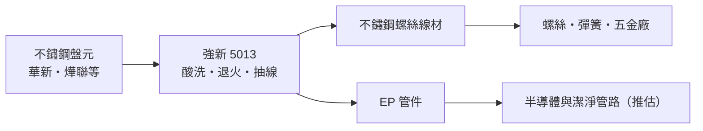
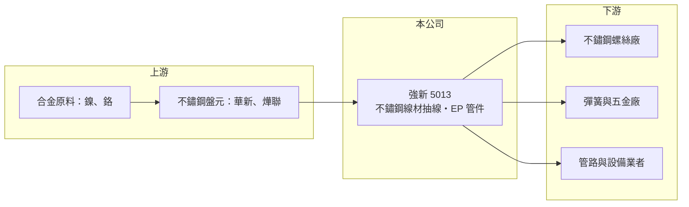

# 5013 強新

> 上櫃｜[[產業索引-鋼鐵工業|鋼鐵工業]]｜上市（櫃）日期 2000/05/08

# 第一章：企業模式與商業藍圖

> [!info] 撰寫說明
> 本文由 Claude 依公開資料整理，架構比照 [[2330台積電]] 的四章研究，資料截至 2026-10-08。財務數字來源：Goodinfo 年度經營績效頁、nStock 公司資料（營業項目）、工商時報 2024 年 1 月報導標題（與華新麗華合作開發 WLS 550 線材）、CMoney 投資快訊標題（螺絲線材製造商定位）、櫃買中心開放資料（基本資料、資產負債、綜合損益、每月營收、本益比殖利率）。公開資料有限，產品營收比重、產能、子公司與生產據點未查得；產業描述為整理性內容。#待校對

在評估單一個股的長期投資價值時，首要步驟是拆解企業的底層獲利邏輯。本章說明強新工業（股票代號：5013，以下簡稱強新）在不鏽鋼產業鏈中扮演的角色，以及它靠什麼賺取加工價差。

## 一、核心定位：替螺絲廠把盤元抽成線材

強新成立於 1993 年 11 月，2000 年 5 月上櫃，2026 年實收資本額約 13.3 億元，董事長為吳孟縈。依公司登記的營業項目，強新從事[[線材]]與電解拋光不鏽鋼管件（EP 管件）的製造、加工與買賣；財經媒體把強新定位為「螺絲線材製造商」與「抽線大廠」。

抽線（拉線）是把鋼廠生產的[[盤元]]，經過酸洗、退火與多道模具拉伸，製成尺寸精準、表面平滑的線材，再賣給螺絲、彈簧與五金廠。強新位於不鏽鋼產業鏈的中游：上游是華新麗華、燁聯等不鏽鋼盤元廠，下游是台灣的[[螺絲扣件]]聚落。這個位置的特性有兩個：

* **賺加工費與價差：** 抽線廠的毛利主要來自加工附加價值與原料進出價差。不鏽鋼價格隨鎳價大幅波動，原料上漲時有[[庫存利益]]，下跌時則有跌價壓力。
* **品質決定溢價：** 螺絲廠對線材的尺寸公差、硬度與表面品質要求嚴格，品質穩定的抽線廠能取得長期訂單與較好的價格。

## 二、產品開發：與上游鋼廠共同開發新鋼種

2024 年 1 月，強新與華新麗華合作開發 WLS 550 不鏽鋼線材，這種新鋼種硬度較高，可協助螺絲廠提升產品品質，也讓強新能切入原本不鏽鋼螺絲做不到的應用。這類與上游共同開發的模式，代表強新不只是單純的代工抽線，而是試圖用材料規格建立差異化。

## 三、長期方向

強新近年營收維持在 75 億至 90 億元之間，相對同規模的抽線廠屬於大型業者（推估）。長期價值取決於三件事：高附加價值鋼種（如 WLS 550）的推廣、EP 管件等非螺絲用途的拓展，以及台灣螺絲產業在國際競爭中能否維持出口規模。由於強新的客戶多是外銷型螺絲廠，它的景氣其實間接反映歐美的扣件需求。

# 第二章：護城河深度與競爭優勢

在長期價值投資中，「護城河」指企業抵禦競爭、維持超額利潤的保護機制。本章評估強新作為抽線加工廠的競爭位置。

## 一、競爭優勢

* **規模與交期：** 抽線屬於規格多、批量小的加工業，規模大的業者可以備齊更多尺寸與鋼種，快速交貨給下游螺絲廠。強新的營收規模顯示它具備一定的備料與產能優勢（推估）。
* **與上游合作開發：** 與華新麗華共同開發新鋼種，讓強新能較早取得新材料並建立應用經驗，這是一般小型抽線廠做不到的。
* **聚落地利：** 台灣螺絲產業集中在南部，就近供貨可降低運輸成本並縮短交期。

## 二、競爭對手格局

| 對手 | 定位 | 對強新的影響 |
|---|---|---|
| [[1605華新]] | 不鏽鋼盤元與線材大廠，也是合作夥伴 | 上游可垂直整合抽線 |
| [[2007燁興]] | 不鏽鋼線材廠 | 線材市場直接競爭 |
| [[5015華祺]] | 不鏽鋼螺絲兼營線材 | 國內線材市場競爭 |
| 中國與東南亞抽線廠 | 原料成本低 | 壓低外銷線材與螺絲價格 |

## 三、守得住與守不住的地方

* **守得住：** 對國內螺絲廠的穩定供貨與品質口碑，以及新鋼種帶來的差異化。
* **守不住：** 不鏽鋼價格的大波動。2021 年鎳價上漲時 ROE 達 19.4%，2023 至 2025 年價格回落後 ROE 降到 7% 至 8%，顯示獲利仍受原料循環主導。
* **觀察重點：** 營收能否維持 2026 年的成長（1 至 8 月累計年增約 13%）、毛利率是否回到 15% 以上，以及子公司的獲利貢獻。

# 第三章：財務體質與盈利規模

資料日期：2026-10-08，表格是撰寫當時的快照；最新月營收、毛利率、累計 EPS 由自動排程寫在本筆記的屬性欄位（月營收、毛利率、累計EPS 等）。#待校對

財務報表是檢驗護城河是否真實存在的最終標準。本章用多年度三率、ROE 與資本報酬，檢視強新的獲利能力。

## 一、多年度獲利

| 年度 | 營收（新台幣） | [[毛利率]] | [[營業利益率]] | EPS（元） | [[ROE]] |
|---|---|---|---|---|---|
| 2019 | 62.4 億 | 11.2% | 5.81% | 1.24 | 7.62% |
| 2020 | 57.7 億 | 13.3% | 7.49% | 1.58 | 9.1% |
| 2021 | 86.4 億 | 17.5% | 11.9% | 4.41 | 19.4% |
| 2022 | 90.3 億 | 16.0% | 10.3% | 4.06 | 15.6% |
| 2023 | 75.8 億 | 13.6% | 7.57% | 1.93 | 8.29% |
| 2024 | 79.4 億 | 11.5% | 5.83% | 1.66 | 7.59% |
| 2025 | 77.3 億 | 12.5% | 6.68% | 1.45 | 7.05% |
| 2026 上半年 | 41.5 億 | 13.8%（推算） | 8.09%（推算） | 1.36 | 未查得 |

* **獲利穩定但不高：** 七年都有獲利，毛利率在 11% 至 18% 之間，比一般大宗鋼品穩定，代表抽線加工有一定的附加價值。
* **2021 至 2022 年是高峰：** 鋼價與鎳價上漲帶來庫存利益，EPS 超過 4 元；之後回到 1.5 元上下的常態水準。
* **非控制權益比重高：** 2026 年第二季權益總計 53.4 億元，其中[[非控制權益]]約 14.0 億元；2026 年上半年淨利 2.31 億元中約 0.49 億元屬於非控制權益，顯示強新有持股未達百分之百的重要子公司（名稱未查得）。#待校對

## 二、長期指標

* **平均 ROE：** 2021 至 2025 年平均約 11.6%（推算），但 2023 年後降到 7% 至 8%。
* **營收年複合成長率：** 2019 至 2025 年約 3.6%（推算）。
* **股利：** 最近一次現金股利 0.7 元（櫃買中心資料）；2023 年曾配發 1.6 元。歷年平均約 0.53 元（Goodinfo）。
* **財務結構：** 2026 年第二季流動資產 54.6 億元、流動負債 22.0 億元，流動比率約 2.5 倍（推算），負債比約 41%，財務穩健。

## 三、[[ROIC]] 與 [[WACC]]：價值創造利差

**ROIC 推算：** 2025 年營業利益約 5.2 億元（77.3 億元 × 6.68%），稅後約 4.1 億元（稅率 20%）。投入資本以 2026 年第二季權益 53.4 億元加負債 37.0 億元計（有息負債明細未查得，以負債總額代替會高估投入資本），ROIC 約 4.6%（推算）；只以權益計算約 7.7%（推算）。2021 年高峰時同法估算約 10% 以上（推算）。

**WACC 推算：** 以 [[CAPM]] 推估，台灣 10 年期公債 1.75%、市場風險溢酬 6%、β 取 0.9（鋼鐵業常見值，非來源數字），權益成本約 7.15%；負債成本假設 2.5%，稅後 2%。依帳面權益約 59%、負債約 41% 計算，WACC 約 5%；若有息負債比重較低，WACC 接近 6% 至 7%（推算）。

**結論：** 強新的 ROIC 在常態年度大致與 WACC 打平，只有鋼價上漲期明顯超越。這是典型的循環型加工業：長期能維持獲利與配息，但要創造超額報酬，需要靠高附加價值產品拉高毛利率。

# 第四章：總體風險與地緣政治

任何企業都無法脫離宏觀環境獨立存在。本章分析強新必須面對的產業、營運與外部風險。

## 一、產業週期

* **鎳價與不鏽鋼價格：** 不鏽鋼線材的成本以鎳、鉻合金為主，中國與印尼以[[鎳生鐵]]大量擴產後，不鏽鋼價格長期承壓，價格急跌時抽線廠會出現存貨跌價。
* **螺絲出口循環：** 強新的客戶多為外銷螺絲廠，歐美經銷商的庫存調整會沿供應鏈傳到線材訂單。

## 二、營運風險

* **上游整合：** 盤元廠若擴大自製線材，抽線廠的生存空間會被壓縮。
* **客戶集中於單一產業：** 螺絲產業景氣下滑時，線材需求同步下降，缺乏其他產業分散風險。
* **工安：** 2024 年曾有報導指出強新受鄰近公司火災波及（詳情未查得），抽線廠的酸洗與熱處理製程也需注意工安與環保。#待校對

## 三、其他風險

* **貿易壁壘：** 美國 [[232 條款]]與[[對等關稅]]會影響台灣螺絲出口，間接減少線材需求；各國對不鏽鋼的[[反傾銷]]措施也會改變原料價格。
* **碳成本：** 退火與酸洗屬於耗能製程，台灣碳費與歐盟 [[CBAM]] 將逐步增加成本。
* **匯率：** 原料以美元計價，下游出口也以美元計價，新台幣大幅波動會影響價差。

# 專有名詞解析

## 金融

- **[[庫存利益]]**：原料或產品價格上漲時，先前以低價買進的庫存被以較高售價賣出所產生的額外利潤。
- **[[非控制權益]]**：合併子公司中不屬於母公司股東的權益部分，相關獲利不計入母公司 EPS。

## 產業

- **[[線材]]**：鋼胚熱軋成捲狀的細長條鋼，是拉線、螺絲、彈簧與焊材的原料。
- **[[盤元]]**：鋼胚熱軋成捲狀的圓形條鋼，是線材與螺絲的原料。
- **[[螺絲扣件]]**：用來鎖固與連接零件的螺絲、螺栓、螺帽等產品，台灣高雄岡山是全球重要的生產聚落。
- **[[鎳生鐵]]**：以紅土鎳礦冶煉的低品位含鎳生鐵，成本低於純鎳，是中國與印尼不鏽鋼廠的主要原料。

# 核心供應鏈

## 1. 上游：不鏽鋼盤元
- [[1605華新]]（WLS 550 共同開發夥伴）
- 燁聯鋼鐵（未上市，供應關係待校對）
- [[2035唐榮]]（是否為供應商未查得）

## 2. 本公司與同業
- 線材同業：[[2007燁興]]、[[5015華祺]]

## 3. 下游：客戶
- 螺絲扣件廠：[[2012春雨]]、[[2062橋椿]]、[[2069運錩]] 等南部螺絲聚落（是否為強新客戶未查得）
- 彈簧、五金與管路設備業者

## 最新新聞
<!-- news:start（自動產生，請勿手動編輯此範圍） -->
- 2026-10-06 🏛️ 重訊 14:43｜本公司有價證券近期多次達公布注意交易資訊標準，故公告 相關訊息，以利投資人區別暸解｜[觀測站](https://mops.twse.com.tw/mops/#/web/t05st01)

完整紀錄：[[5013強新 新聞]]
<!-- news:end -->

## 相關連結
- [公開資訊觀測站](https://mopsov.twse.com.tw/mops/web/t05st03?step=1&firstin=1&co_id=5013)
- [Goodinfo](https://goodinfo.tw/tw/StockDetail.asp?STOCK_ID=5013)
- [Yahoo 股市](https://tw.stock.yahoo.com/quote/5013)
- [鉅亨網新聞](https://www.cnyes.com/twstock/5013/news)
