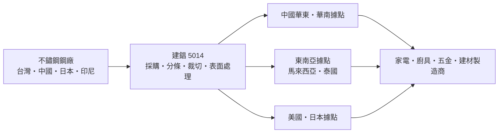
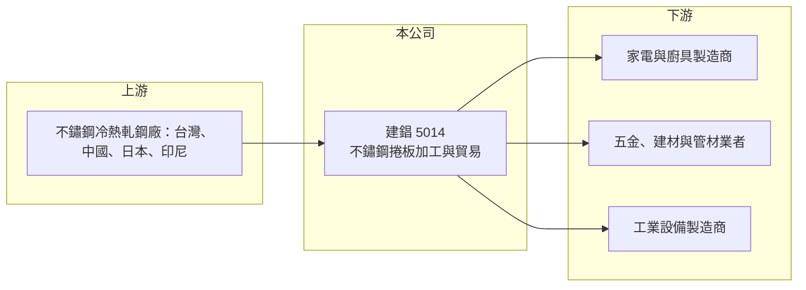

# 5014 建錩

> 上櫃｜[[產業索引-鋼鐵工業|鋼鐵工業]]｜上市（櫃）日期 2001/02/15

# 第一章：企業模式與商業藍圖

> [!info] 撰寫說明
> 本文由 Claude 依公開資料整理，架構比照 [[2330台積電]] 的四章研究，資料截至 2026-10-08。財務數字來源：Goodinfo 年度經營績效頁、富果研究 2025 年 12 月法說會備忘錄、櫃買中心開放資料（基本資料、資產負債、綜合損益、每月營收、本益比殖利率）。各據點產能與客戶結構未查得；產業描述為整理性內容，尚未逐條比對原始文件。#待校對

在評估單一個股的長期投資價值時，首要步驟是拆解企業的底層獲利邏輯。本章說明建錩實業（股票代號：5014，以下簡稱建錩）作為不鏽鋼加工通路商的商業模式，以及為什麼它營收很大、利潤卻很薄。

## 一、核心定位：跨國布局的不鏽鋼金屬服務中心

建錩成立於 1983 年 7 月，2001 年 2 月上櫃，2026 年實收資本額約 18.3 億元，董事長兼總經理為李慶柏。建錩的本業是不鏽鋼捲板的加工與貿易，依 2025 年 1 至 9 月資料，不鏽鋼捲板占營收約 99.7%，不鏽鋼管與其他產品合計不到 0.3%。

建錩屬於[[金屬服務中心]]的商業模式：向鋼廠大量採購不鏽鋼捲，依客戶需求做分條、裁切、毛絲面與拋光等表面處理，再搭配倉儲物流少量多樣地交貨。這種模式的價值在於替下游中小型製造商省下庫存與加工設備，但代價是利潤率很低，獲利高度取決於採購時機與庫存管理。

## 二、營運據點：以中國為主的海外布局

建錩總部在台灣，海外據點包括中國無錫（建錩中國精密）、昆山（建昌金屬）、佛山（建春友、佛山建錩），以及馬來西亞、泰國、美國洛杉磯與日本。中國華東與華南是不鏽鋼家電、廚具與五金的主要製造區，建錩在這些地方設點，是為了就近服務當地製造商。

## 三、長期方向：往深加工移動

建錩在 2025 年法說會提出的方向是「深加工」：提高特殊表面處理等高附加價值加工的比重，改善產品組合，並以集中採購與加快存貨週轉降低原料價格風險。同時，透過多國據點分散關稅與單一地區景氣的衝擊。這是金屬服務中心在大宗價差日益稀薄時常見的轉型路線，成效要看毛利率能否從目前的 2% 至 5% 拉回到過去的 6% 至 7%。

# 第二章：護城河深度與競爭優勢

在長期價值投資中，「護城河」指企業抵禦競爭、維持超額利潤的保護機制。本章評估建錩作為加工通路商的競爭位置。

## 一、競爭優勢

* **據點與規格齊全：** 在中國、東南亞、美國與日本都有據點，可以替跨國客戶在不同地區供貨，並備齊多種規格，符合下游「快速交貨、客製化、品質穩定」的要求。
* **採購規模：** 年營收約 150 億元，採購量大，有機會向鋼廠取得較好的價格與配額（推估）。
* **加工服務：** 分條、裁切、拋光等加工讓建錩不只是貿易商，客戶轉換供應商時需重新確認尺寸與表面品質。

## 二、競爭對手格局

| 對手 | 定位 | 對建錩的影響 |
|---|---|---|
| [[2027大成鋼]] | 不鏽鋼與鋁材通路，美國布局深 | 通路與加工服務競爭 |
| [[2035唐榮]]、燁聯 | 台灣不鏽鋼冷軋廠 | 上游直接銷售給大客戶 |
| 中國不鏽鋼鋼廠與加工中心 | 青山、太鋼等大廠及在地服務中心 | 在中國市場價格競爭激烈 |

## 三、守得住與守不住的地方

* **守得住：** 對中小型製造商的少量多樣服務與交期，這部分鋼廠不願意直接處理。
* **守不住：** 價差。2025 年毛利率只剩 2.45%，營業利益轉為虧損，顯示在中國產能過剩與價格競爭下，單純的加工貿易幾乎沒有定價能力。
* **觀察重點：** 深加工比重能否提升、存貨週轉能否加快，以及業外匯損能否透過避險控制。

# 第三章：財務體質與盈利規模

資料日期：2026-10-08，表格是撰寫當時的快照；最新月營收、毛利率、累計 EPS 由自動排程寫在本筆記的屬性欄位（月營收、毛利率、累計EPS 等）。#待校對

財務報表是檢驗護城河是否真實存在的最終標準。本章用多年度三率、ROE 與資本報酬，檢視建錩低毛利模式的獲利品質。

## 一、多年度獲利

| 年度 | 營收（新台幣） | [[毛利率]] | [[營業利益率]] | EPS（元） | [[ROE]] |
|---|---|---|---|---|---|
| 2019 | 166 億 | 4.38% | 1.11% | 0.09 | 0.29% |
| 2020 | 143 億 | 4.29% | 0.73% | 1.06 | 8.81% |
| 2021 | 186 億 | 7.36% | 4.15% | 3.14 | 22.6% |
| 2022 | 191 億 | 6.66% | 3.22% | 2.04 | 13.4% |
| 2023 | 156 億 | 3.88% | 0.68% | 0.14 | 0.85% |
| 2024 | 163 億 | 3.59% | 0.20% | 1.17 | 6.88% |
| 2025 | 150 億 | 2.45% | -0.63% | -2.37 | -14.9% |
| 2026 上半年 | 80.5 億 | 4.96%（推算） | 2.10%（推算） | -0.19 | 未查得 |

* **薄利多銷：** 毛利率長期在 2.5% 至 7.4% 之間，營業利益率多數年度不到 1%。這代表一點點的價格波動或匯率變化，就足以決定全年是賺是賠。
* **業外影響大：** 2020 年與 2024 年營業利益率不到 1%，EPS 卻超過 1 元，代表業外收益（匯兌、投資或處分利益）貢獻大；2025 年則因第二季匯損擴大，EPS -2.37 元。2026 年上半年本業轉為獲利，但業外損失 1.74 億元使稅前仍為小幅虧損。
* **營收規模大、波動也大：** 營收隨不鏽鋼價格在 140 億至 190 億元間擺盪，2026 年 1 至 8 月累計年增約 18%。

## 二、長期指標

* **平均 ROE：** 2021 至 2025 年平均約 5.8%（推算），且高度集中在 2021 至 2022 年的漲價期。
* **營收年複合成長率：** 2019 至 2025 年約 -1.7%（推算），規模沒有成長。
* **股利：** 最近一次現金股利 0.5 元；歷年平均約 0.42 元（Goodinfo）。
* **財務結構：** 2026 年第二季負債 64.6 億元、權益 26.6 億元，負債比約 71%，流動比率約 1.0 倍（推算）。通路商需要大量營運資金支應庫存，槓桿偏高，鋼價急跌時壓力會放大。

## 三、[[ROIC]] 與 [[WACC]]：價值創造利差

**ROIC 推算：** 2025 年營業利益約 -0.9 億元（150 億元 × -0.63%），ROIC 為負。以 2026 年第二季權益 26.6 億元加負債 64.6 億元為投入資本（以負債總額代替有息負債會高估投入資本），ROIC 約 -1%（推算）。2021 年高峰時，營業利益約 7.7 億元，同法估算 ROIC 約 6% 至 7%（推算）。

**WACC 推算：** 以 [[CAPM]] 推估，台灣 10 年期公債 1.75%、市場風險溢酬 6%、β 取 0.9（鋼鐵業常見值，非來源數字），權益成本約 7.15%；負債成本假設 3%，稅後 2.4%。依帳面權益約 29%、負債約 71% 計算，WACC 約 3.8%；若只計有息負債，約 4% 至 5%（推算）。

**結論：** 建錩的 ROIC 只有在 2021 至 2022 年鋼價大漲時接近或超過 WACC，其他年度都低於資金成本。高槓桿、低毛利的通路模式，長期很難替股東創造超額價值。

# 第四章：總體風險與地緣政治

任何企業都無法脫離宏觀環境獨立存在。本章分析建錩必須面對的產業、財務與外部風險。

## 一、產業週期

* **不鏽鋼價格循環：** 不鏽鋼價格由鎳價與中國產能決定，價格下跌時通路商手上的庫存立即產生[[存貨跌價損失]]，上漲時則有[[庫存利益]]。
* **中國產能過剩：** 中國與印尼以[[鎳生鐵]]一貫化生產大量擴產，部分地區供過於求，壓縮加工通路的價差。

## 二、財務與營運風險

* **匯率：** 建錩在多國營運、以美元採購，2025 年第二季即因匯率劇烈波動產生大額匯損，使全年轉虧。
* **營運資金：** 高負債比與流動比率約 1 倍，代表資金周轉依賴銀行授信，景氣急轉時須留意。
* **中國曝險：** 主要海外據點在中國，受當地景氣、政策與兩岸關係影響。

## 三、其他風險

* **貿易壁壘：** 美國 [[232 條款]]與各國不鏽鋼[[反傾銷]]措施，會改變不同據點的貨源與價格。
* **碳成本：** 歐盟 [[CBAM]] 與各國碳定價，未來可能反映在不鏽鋼原料價格上。

# 專有名詞解析

## 金融

- **[[庫存利益]]**：原料或產品價格上漲時，先前以低價買進的庫存被以較高售價賣出所產生的額外利潤。
- **[[存貨跌價損失]]**：存貨的市價低於帳上成本時必須提列的損失，常見於原物料價格急跌時。

## 產業

- **[[金屬服務中心]]**：向鋼廠或鋁廠大量採購金屬材料，再依客戶需求裁切、加工並少量配送的通路業者，美國代表為 Reliance、Ryerson。
- **[[鎳生鐵]]**：以紅土鎳礦冶煉的低品位含鎳生鐵，成本低於純鎳，是中國與印尼不鏽鋼廠的主要原料。
- **[[反傾銷]]**：進口國對低於正常價格銷售的進口商品加徵關稅，以保護本國產業的貿易救濟措施。

# 核心供應鏈

## 1. 上游：不鏽鋼鋼廠
- 台灣：[[2035唐榮]]、燁聯鋼鐵（實際採購對象未查得）
- 海外：中國與印尼不鏽鋼廠、日本鋼廠（未查得具體名單）

## 2. 本公司與同業
- 通路同業：[[2027大成鋼]]
- 不鏽鋼加工同業：[[2034允強]]、[[2032新鋼]]

## 3. 下游：客戶
- 中國華東、華南的家電、廚具與五金製造商
- 東南亞、美國與日本當地的金屬加工業者

## 最新新聞
<!-- news:start -->
<!-- news:end -->

## 相關連結
- [公開資訊觀測站](https://mopsov.twse.com.tw/mops/web/t05st03?step=1&firstin=1&co_id=5014)
- [Goodinfo](https://goodinfo.tw/tw/StockDetail.asp?STOCK_ID=5014)
- [Yahoo 股市](https://tw.stock.yahoo.com/quote/5014)
- [鉅亨網新聞](https://www.cnyes.com/twstock/5014/news)
