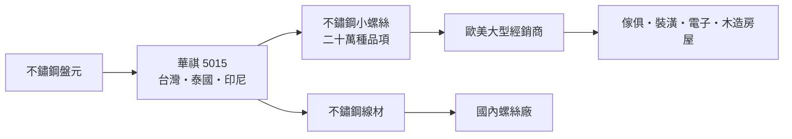
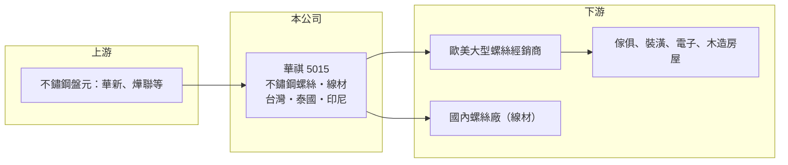

# 5015 華祺

> 上櫃｜[[產業索引-鋼鐵工業|鋼鐵工業]]｜上市（櫃）日期 2000/12/15

# 第一章：企業模式與商業藍圖

> [!info] 撰寫說明
> 本文由 Claude 依公開資料整理，架構比照 [[2330台積電]] 的四章研究，資料截至 2026-10-08。財務數字來源：Goodinfo 年度經營績效頁、富果研究法說會備忘錄（內容為 2023 年前三季資料，發布標示為 2025 年 11 月）、櫃買中心開放資料（基本資料、資產負債、綜合損益、每月營收、本益比殖利率）。產品營收比重與產能未查得；產業描述為整理性內容，尚未逐條比對原始文件。#待校對

在評估單一個股的長期投資價值時，首要步驟是拆解企業的底層獲利邏輯。本章說明華祺工業（股票代號：5015，以下簡稱華祺）如何以「品項多、批量小」的不鏽鋼螺絲建立利基，以及這個模式的景氣敏感度。

## 一、核心定位：二十萬種品項的不鏽鋼小螺絲

華祺成立於 1984 年 5 月，2000 年 12 月上櫃，2026 年實收資本額約 6.1 億元，董事長為葉明彥，英文品牌為 RODEX。華祺專營不鏽鋼[[螺絲扣件]]與不鏽鋼[[線材]]，主打規格繁多的小螺絲，品項超過二十萬種，應用於傢俱、裝潢、電子設備與木造房屋。

* **螺絲外銷歐美：** 螺絲主要賣給歐洲與美國的大型經銷商，而不是終端使用者。經銷商再把產品分銷給五金行、建材通路與組裝廠。
* **線材內銷：** 線材主要在國內銷售給下游螺絲廠，形成一部分的上游自製能力。
* **[[接單生產]]：** 價格在接單時確定，原料依訂單採購，因此較少承擔鋼價大漲大跌帶來的存貨利益或損失。

## 二、生產據點：台灣加東南亞

華祺以台灣為總部與主要生產基地，2003 年投資泰國 Tula 廠，2007 年投資印尼巴淡島的 PD 協昌廠，兩者原本都是競爭對手，以併購方式取得。東南亞據點的意義在於分散生產地、降低人工成本，並在部分市場享有較有利的關稅條件。

## 三、長期方向與資產

華祺在 2020 年底至 2021 年購入台北社子島土地，帳列為投資性不動產（約 2.72 億元），目前閒置並等待台北市府的開發計畫。這筆資產與營運無關，但長期可能帶來處分或開發利益。本業方面，華祺的長期課題是：如何在中國低價競爭與美國高關稅下，維持歐美經銷商的訂單與價格。公司未提出明確的新產能或轉型計畫。

# 第二章：護城河深度與競爭優勢

在長期價值投資中，「護城河」指企業抵禦競爭、維持超額利潤的保護機制。本章評估華祺在小螺絲利基市場的競爭位置。

## 一、競爭優勢

* **品項廣度：** 二十萬種品項代表龐大的模具與規格資料庫。經銷商偏好向能一次備齊多種規格的供應商採購，這讓華祺在少量多樣的訂單上比大量生產標準件的工廠更有優勢。
* **不鏽鋼專業：** 不鏽鋼螺絲的冷鍛與熱處理難度高於碳鋼，加上自有線材，能控制原料品質與交期。
* **多國生產：** 台灣、泰國、印尼三地生產，可依客戶與關稅條件調配產地。

## 二、競爭對手格局

| 對手 | 定位 | 對華祺的影響 |
|---|---|---|
| 中國螺絲廠 | 據報享有約 13% 出口退稅，價格低 | 在歐洲市場削價競爭 |
| [[5538東明-KY]] | 中國最大的扣件經銷與製造商之一 | 標準件與通路規模優勢 |
| [[8415大國鋼]] | 北美扣件通路商 | 美國市場的競爭者，也可能是客戶 |
| [[2012春雨]]、[[2062橋椿]]、[[2069運錩]] | 台灣螺絲廠 | 外銷市場競爭 |

## 三、守得住與守不住的地方

* **守得住：** 規格多、批量小的訂單，以及長期往來的歐美經銷商。
* **守不住：** 景氣循環下的價格。2022 年歐美補庫存時 EPS 達 9.46 元，2023 年後需求降溫，2025 年 EPS 只剩 0.06 元，代表華祺的獲利高度依賴經銷商的庫存週期。
* **觀察重點：** 美國客戶庫存回補的速度、歐洲景氣，以及中國同業的價格策略。

# 第三章：財務體質與盈利規模

資料日期：2026-10-08，表格是撰寫當時的快照；最新月營收、毛利率、累計 EPS 由自動排程寫在本筆記的屬性欄位（月營收、毛利率、累計EPS 等）。#待校對

財務報表是檢驗護城河是否真實存在的最終標準。本章用多年度三率、ROE 與資本報酬，檢視華祺的獲利循環。

## 一、多年度獲利

| 年度 | 營收（新台幣） | [[毛利率]] | [[營業利益率]] | EPS（元） | [[ROE]] |
|---|---|---|---|---|---|
| 2019 | 24.2 億 | 16.0% | 7.61% | 2.38 | 11.8% |
| 2020 | 21.3 億 | 16.5% | 7.75% | 1.94 | 10.2% |
| 2021 | 24.3 億 | 24.7% | 13.9% | 4.10 | 21.1% |
| 2022 | 27.3 億 | 32.8% | 22.5% | 9.46 | 40.4% |
| 2023 | 15.4 億 | 18.3% | 6.61% | 1.34 | 5.47% |
| 2024 | 15.6 億 | 19.7% | 6.44% | 2.51 | 11.2% |
| 2025 | 14.8 億 | 16.7% | 3.38% | 0.06 | 0.26% |
| 2026 上半年 | 5.97 億 | 20.4%（推算） | 2.80%（推算） | 0.58 | 未查得 |

* **2022 年是異常高峰：** 疫情後歐美補庫存，毛利率衝到 32.8%，ROE 40.4%。之後營收從 27 億元掉到 15 億元左右，回到正常甚至偏低的水準。
* **業外影響大：** 華祺持有大量美元存款，匯率波動會造成明顯的匯兌損益。2023 年前三季曾因約 6,400 萬元匯損由盈轉虧；2025 年本業仍有獲利，EPS 卻只有 0.06 元。
* **營收持續萎縮：** 2026 年 1 至 8 月累計營收 8.69 億元，年減約 19%。

## 二、長期指標

* **平均 ROE：** 2021 至 2025 年平均約 15.7%（推算），但被 2022 年拉高，扣除該年平均約 9.5%（推算）。
* **營收年複合成長率：** 2019 至 2025 年約 -7.9%（推算）。
* **股利：** 最近一次現金股利 0.5 元；歷年平均約 1.78 元（Goodinfo），配息隨獲利大幅波動。
* **財務結構：** 2026 年第二季流動資產 19.5 億元、流動負債 13.3 億元，負債比約 53%；在營收萎縮下負債比偏高，可能與以美元存款搭配台幣借款的資金安排有關（推估）。

## 三、[[ROIC]] 與 [[WACC]]：價值創造利差

**ROIC 推算：** 2025 年營業利益約 0.5 億元（14.8 億元 × 3.38%），稅後約 0.4 億元。投入資本以 2026 年第二季權益 12.0 億元加負債 13.5 億元計（以負債總額代替有息負債會高估投入資本），ROIC 約 1.6%（推算）；只以權益計算約 3.3%（推算）。2022 年高峰時同法估算 ROIC 約 20% 以上（推算）。

**WACC 推算：** 以 [[CAPM]] 推估，台灣 10 年期公債 1.75%、市場風險溢酬 6%、β 取 0.9（金屬製品業常見值，非來源數字），權益成本約 7.15%；負債成本假設 2.5%，稅後 2%。依帳面權益約 47%、負債約 53% 計算，WACC 約 4.4%；若有息負債比重較低，約 5% 至 6.5%（推算）。

**結論：** 華祺的 ROIC 在景氣高峰遠高於 WACC，在低谷則明顯低於。長期是否創造價值，取決於景氣循環的平均；以 2019 至 2025 年來看，平均 ROE 約 14%（推算）高於權益成本，但近三年已明顯轉弱。

# 第四章：總體風險與地緣政治

任何企業都無法脫離宏觀環境獨立存在。本章分析華祺必須面對的產業、營運與外部風險。

## 一、產業週期

* **經銷商庫存循環：** 螺絲是標準化程度高的消耗品，歐美經銷商在景氣好時大量備貨、景氣差時去化庫存，訂單波動遠大於終端需求，是典型的[[長鞭效應]]。
* **房市與傢俱景氣：** 華祺螺絲用在裝潢、傢俱與木造房屋，歐美房市與利率走勢會直接影響需求。

## 二、營運風險

* **中國低價競爭：** 中國同業以出口退稅搶攻歐洲市場，壓縮華祺的價格空間。
* **營收規模縮小：** 營收萎縮時固定成本分攤變重，營業利益率從 2022 年的 22.5% 降到 2025 年的 3.4%，顯示[[營運槓桿]]明顯。
* **閒置資產：** 社子島土地的開發時程取決於台北市府計畫，短期無法產生收益。

## 三、其他風險

* **美國關稅：** 美國對鋼鋁衍生產品適用 [[232 條款]]關稅，稅率最高達 50%，對外銷美國的螺絲影響直接。
* **匯率：** 大量美元部位使匯率波動成為獲利的主要變數之一。
* **反傾銷：** 歐盟對中國扣件的[[反傾銷]]措施若調整，會改變台灣與中國業者在歐洲的競爭條件。

# 專有名詞解析

## 金融

- **[[長鞭效應]]**：終端需求的小幅變動，沿供應鏈往上游傳遞時被逐級放大，造成上游庫存與訂單劇烈波動。
- **[[營運槓桿]]**：固定成本占比高的企業，營收小幅變動會造成獲利大幅變動的現象。

## 產業

- **[[螺絲扣件]]**：用來鎖固與連接零件的螺絲、螺栓、螺帽等產品，台灣高雄岡山是全球重要的生產聚落。
- **[[線材]]**：鋼胚熱軋成捲狀的細長條鋼，是拉線、螺絲、彈簧與焊材的原料。
- **[[接單生產]]**：接到訂單後才採購原料並排產，價格在接單時確定，可降低原料價格波動造成的存貨風險。
- **[[232 條款]]**：美國以國家安全為由對進口鋼鋁等產品加徵關稅的法律依據。

# 核心供應鏈

## 1. 上游：原料
- 不鏽鋼盤元：[[1605華新]]、燁聯鋼鐵（實際供應商未查得）

## 2. 本公司與同業
- 台灣螺絲同業：[[2012春雨]]、[[2062橋椿]]、[[2069運錩]]、[[5011久陽]]
- 不鏽鋼線材同業：[[5013強新]]、[[2007燁興]]
- 國際同業：[[5538東明-KY]]

## 3. 下游：客戶
- 歐洲與美國的大型螺絲經銷商（具名客戶未查得）
- 北美扣件通路：[[8415大國鋼]]（是否為華祺客戶未查得）

## 最新新聞
<!-- news:start（自動產生，請勿手動編輯此範圍） -->
- 2026-10-13 🏛️ 重訊 15:06｜115年9月為他人背書保證累計至本月止最高餘額誤植更正｜[觀測站](https://mops.twse.com.tw/mops/#/web/t05st01)

完整紀錄：[[5015華祺 新聞]]
<!-- news:end -->

## 相關連結
- [公開資訊觀測站](https://mopsov.twse.com.tw/mops/web/t05st03?step=1&firstin=1&co_id=5015)
- [Goodinfo](https://goodinfo.tw/tw/StockDetail.asp?STOCK_ID=5015)
- [Yahoo 股市](https://tw.stock.yahoo.com/quote/5015)
- [鉅亨網新聞](https://www.cnyes.com/twstock/5015/news)
