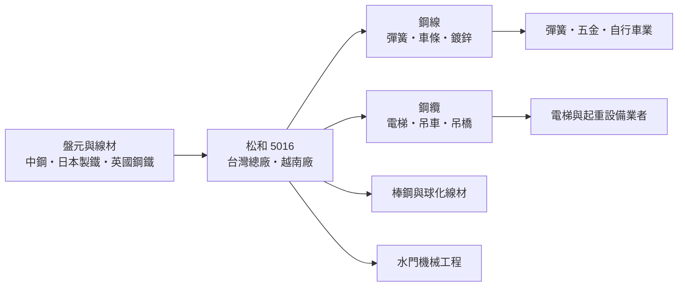
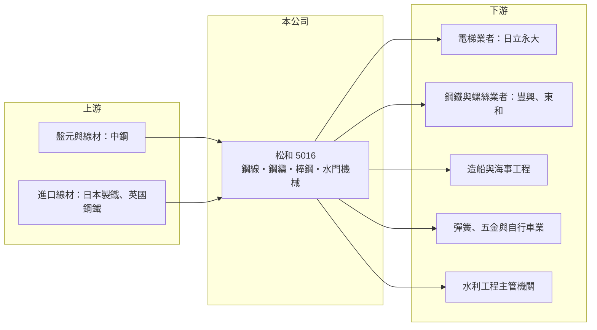

# 5016 松和

> 上櫃｜[[產業索引-鋼鐵工業|鋼鐵工業]]｜上市（櫃）日期 2001/03/05

# 第一章：企業模式與商業藍圖

> [!info] 撰寫說明
> 本文由 Claude 依公開資料整理，架構比照 [[2330台積電]] 的四章研究，資料截至 2026-10-08。財務數字來源：Goodinfo 年度經營績效頁、富果研究 2025 年 4 月法說會備忘錄、櫃買中心開放資料（基本資料、資產負債、綜合損益、每月營收、本益比殖利率）。產品營收比重、產能與越南廠成立年份未查得；產業描述為整理性內容，尚未逐條比對原始文件。#待校對

在評估單一個股的長期投資價值時，首要步驟是拆解企業的底層獲利邏輯。本章說明松和工業（股票代號：5016，以下簡稱松和）如何把鋼廠的線材加工成鋼線與鋼纜，並在電梯鋼纜這類高規格市場建立位置。

## 一、核心定位：鋼線與鋼纜的二次加工廠

松和成立於 1972 年 9 月，是本組中歷史最久的公司之一，2001 年 3 月上櫃，2026 年實收資本額約 5.0 億元，董事長為林廷芳。松和向鋼廠買進[[盤元]]與線材，再加工成以下幾類產品：

* **鋼線：** 硬鋼線、鍍鋅鋼線、退火鋼線、彈簧用鋼線與車條（自行車輻條）用鋼線，供應彈簧、五金與自行車產業。
* **[[鋼纜]]：** 用於吊車、吊橋、天車與高品級電梯，其中電梯鋼纜是技術門檻最高、也最能展現品質的產品。
* **棒鋼與球化線材：** 快削棒鋼、合金棒鋼，以及以歐洲設備生產的[[球化線材]]，供應螺絲與機械零件業者。
* **水門機械：** 承攬水利工程，施作鋼纜式閘門、自動倒伏堰與提桿式閘門，是鋼纜技術延伸出來的工程業務。

## 二、原料與客戶：與中鋼合作逾 40 年

松和的原料主要來自 [[2002中鋼]]（雙方簽約超過 40 年），另向日本製鐵與英國鋼鐵公司採購。下游客戶涵蓋 [[2015豐興]]、[[2006東和鋼鐵]] 等鋼鐵業者，以及造船、海事工程與電梯業者。電梯鋼纜方面，日立永大電梯全面採用松和產品，依法說會估計，日立電梯約七至八成的鋼支繩由松和供應。

## 三、長期方向：高品級路線與越南布局

松和的長期策略是堅持高品級、高附加價值產品，避開中低階產品的價格戰，並持續引進歐洲與日本設備朝自動化發展。生產據點除台灣總廠外，越南廠主要生產鋼線、鋼纜、鋼纜末端加工與麻繩，是拓展東南亞市場的據點。北美市場占比不高，因此美國關稅的直接影響有限。另一個值得關注的方向是海底電纜用鋼線，若能打入離岸風電與海纜供應鏈，將是高品級路線的延伸。

# 第二章：護城河深度與競爭優勢

在長期價值投資中，「護城河」指企業抵禦競爭、維持超額利潤的保護機制。本章評估松和在鋼線與鋼纜市場的競爭位置。

## 一、護城河組成

* **電梯鋼纜的認證門檻：** 電梯鋼纜攸關乘客安全，必須通過電梯廠的嚴格測試與長期驗證。松和能取得日立永大的全面採用，代表在這個利基市場已建立高轉換成本。
* **長期穩定的原料關係：** 與中鋼四十多年的供料關係，讓松和在原料品質與供應穩定度上有保障，這對生產高規格鋼線很重要。
* **產品線廣與工程延伸：** 從鋼線、鋼纜到水門機械，松和能提供材料加工與工程整合，客戶面較分散。

## 二、競爭對手格局

| 對手 | 定位 | 對松和的影響 |
|---|---|---|
| 中國與東南亞鋼線鋼纜廠 | 成本低、產能大 | 中低階鋼線價格壓力 |
| 日韓鋼纜大廠 | 高階鋼纜技術領先 | 高品級市場的國際競爭者 |
| [[2010春源]]、[[2028威致]] 等國內鋼品加工廠 | 鋼材加工 | 部分鋼線與棒鋼市場重疊 |

## 三、守得住與守不住的地方

* **守得住：** 電梯鋼纜等需要認證的高品級產品，以及長期客戶。
* **守不住：** 一般鋼線的價格。2025 年法說會時公司認為，國內市場至少半年到一年內前景不樂觀，主因是中國與東南亞鋼廠的競爭加劇。
* **觀察重點：** 高品級產品比重、越南廠的獲利貢獻，以及海纜用鋼線能否打開新市場。

# 第三章：財務體質與盈利規模

資料日期：2026-10-08，表格是撰寫當時的快照；最新月營收、毛利率、累計 EPS 由自動排程寫在本筆記的屬性欄位（月營收、毛利率、累計EPS 等）。#待校對

財務報表是檢驗護城河是否真實存在的最終標準。本章用多年度三率、ROE 與資本報酬，檢視松和的獲利穩定度。

## 一、多年度獲利

| 年度 | 營收（新台幣） | [[毛利率]] | [[營業利益率]] | EPS（元） | [[ROE]] |
|---|---|---|---|---|---|
| 2019 | 23.9 億 | 10.0% | 5.30% | 1.91 | 7.23% |
| 2020 | 23.9 億 | 13.3% | 8.48% | 3.15 | 11.6% |
| 2021 | 29.4 億 | 16.0% | 10.7% | 4.75 | 16.1% |
| 2022 | 25.3 億 | 11.0% | 5.96% | 2.02 | 6.69% |
| 2023 | 20.1 億 | 8.14% | 3.10% | 0.93 | 3.19% |
| 2024 | 20.3 億 | 10.4% | 4.97% | 1.71 | 5.76% |
| 2025 | 20.5 億 | 9.75% | 4.19% | 1.50 | 5.00% |
| 2026 上半年 | 11.1 億 | 12.1%（推算） | 6.44%（推算） | 1.12 | 未查得 |

* **連續獲利：** 2019 年以來每年都有獲利，最差的 2023 年 EPS 仍有 0.93 元，代表高品級產品提供了一定的防禦力。
* **毛利率跟著原料走：** 2021 年鋼價上漲時毛利率 16%，2023 年降到 8%；2024 年因市場回溫與原料成本處於低檔回升到 10.4%。
* **2026 年改善：** 上半年 EPS 1.12 元，已接近 2025 年全年的 1.50 元，1 至 8 月營收年增約 6%。

## 二、長期指標

* **平均 ROE：** 2021 至 2025 年平均約 7.3%（推算）。
* **營收年複合成長率：** 2019 至 2025 年約 -2.5%（推算），規模大致持平。
* **股利：** 2024 年度配發現金股利 1.2 元（配息率約 70%，推算），最近一次為 1.0 元；歷年平均約 1.47 元（Goodinfo），配息穩定。
* **財務結構：** 2026 年第二季流動資產 16.7 億元、流動負債 5.7 億元，流動比率約 2.9 倍（推算），負債比約 43%，2024 年因借款減少負債比由 45% 降到 42%，財務保守。

## 三、[[ROIC]] 與 [[WACC]]：價值創造利差

**ROIC 推算：** 2025 年營業利益約 0.86 億元（20.5 億元 × 4.19%），稅後約 0.69 億元。投入資本以 2026 年第二季權益 15.1 億元加負債 11.5 億元計（以負債總額代替有息負債會高估投入資本），ROIC 約 2.6%（推算）；只以權益計算約 4.6%（推算）。2021 年高峰時同法估算約 9% 至 12%（推算）。

**WACC 推算：** 以 [[CAPM]] 推估，台灣 10 年期公債 1.75%、市場風險溢酬 6%、β 取 0.9（鋼鐵業常見值，非來源數字），權益成本約 7.15%；負債成本假設 2.5%，稅後 2%。依帳面權益約 57%、負債約 43% 計算，WACC 約 4.9%；若只計有息負債，約 5.5% 至 6.5%（推算）。

**結論：** 松和近三年的 ROIC 低於 WACC，只有 2020 至 2021 年明顯超過。它的特色是穩定與保守，而不是高報酬；長期能否創造價值，要看高品級產品比重能否拉高毛利率到 12% 以上。

# 第四章：總體風險與地緣政治

任何企業都無法脫離宏觀環境獨立存在。本章分析松和必須面對的產業、營運與外部風險。

## 一、產業週期

* **鋼價循環：** 盤元與線材是最大成本，鋼價上漲期有[[庫存利益]]，下跌期毛利率被壓縮。
* **營建與機械景氣：** 鋼纜與棒鋼用於起重、營建與機械，跟著國內營建與資本支出景氣循環。

## 二、營運風險

* **低價進口：** 中國與東南亞鋼線鋼纜以低價進入台灣，國內一般鋼線市場競爭加劇。
* **客戶集中：** 電梯鋼纜高度依賴少數電梯廠，客戶策略改變會影響這項高毛利產品。
* **規模有限：** 年營收約 20 億元，資本與研發資源有限，追趕國際大廠的高階鋼纜技術需要持續投資。

## 三、其他風險

* **美國關稅：** 北美占比不高，直接影響有限，但美國[[對等關稅]]可能使中國與東南亞產品轉往其他市場，加劇區域競爭。
* **越南營運：** 越南廠面臨當地工資上升、匯率與法規變動風險。
* **碳成本：** 退火、鍍鋅等熱處理製程耗能，台灣碳費與歐盟 [[CBAM]] 會逐步增加成本。

# 專有名詞解析

## 金融

- **[[庫存利益]]**：原料或產品價格上漲時，先前以低價買進的庫存被以較高售價賣出所產生的額外利潤。

## 產業

- **[[盤元]]**：鋼胚熱軋成捲狀的圓形條鋼，是線材與螺絲的原料。
- **[[鋼纜]]**：由多股鋼線絞合而成的纜索，用於電梯、起重機、吊橋與海事工程，安全要求高、需經長期驗證。
- **[[球化線材]]**：經球化退火處理、讓碳化物呈球狀的線材，延展性佳，適合冷鍛成螺絲與精密零件。
- **[[對等關稅]]**：美國依各國對美貿易條件課徵的對應關稅，2025 年起實施，影響出口美國的產品價格。

# 核心供應鏈

## 1. 上游：原料
- [[2002中鋼]]（簽約逾 40 年的主要供應商）
- 日本製鐵、英國鋼鐵公司

## 2. 本公司與同業
- 鋼品加工同業：[[2010春源]]、[[2028威致]]

## 3. 下游：客戶
- 電梯：日立永大電梯
- 鋼鐵業者：[[2015豐興]]、[[2006東和鋼鐵]]
- 造船與海事：[[2208台船]]（法說會稱「中船」，對應公司待校對）、長榮海工
- 彈簧、五金、自行車輻條業者

## 最新新聞
<!-- news:start -->
<!-- news:end -->

## 相關連結
- [公開資訊觀測站](https://mopsov.twse.com.tw/mops/web/t05st03?step=1&firstin=1&co_id=5016)
- [Goodinfo](https://goodinfo.tw/tw/StockDetail.asp?STOCK_ID=5016)
- [Yahoo 股市](https://tw.stock.yahoo.com/quote/5016)
- [鉅亨網新聞](https://www.cnyes.com/twstock/5016/news)
