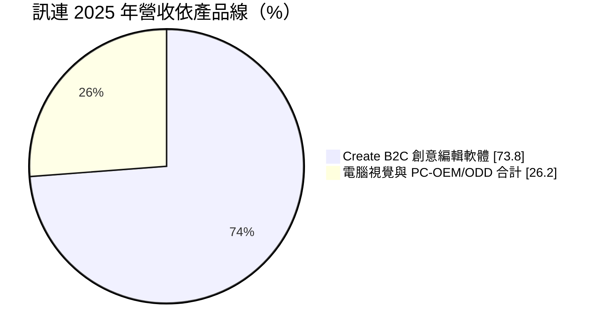
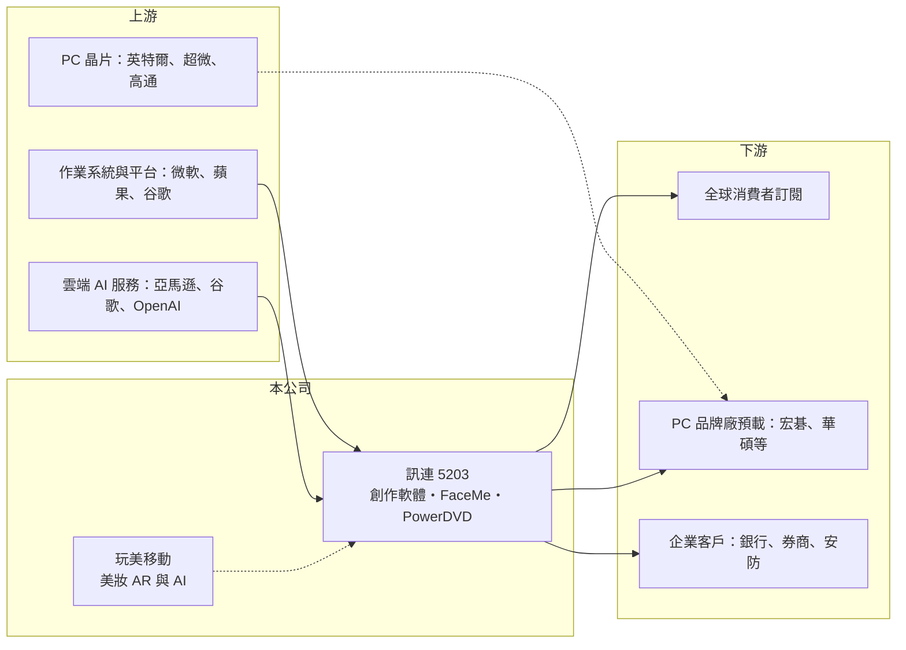

# 5203 訊連

> 上市｜[[產業索引-資訊服務業|資訊服務業]]｜上市（櫃）日期 2004/09/27

# 第一章：企業模式與商業藍圖

> [!info] 撰寫說明
> 精簡版，由 Claude 依公開資料整理，架構比照 [[2330台積電]] 的四章研究，資料截至 2026-10-08。來源：證交所開放資料快照（基本資料、2026 年第二季資產負債與綜合損益、股利、本益比殖利率）、Goodinfo 經營績效頁（2020 至 2025 年）、富果研究 2026 年 2 月法說會摘要、公開資訊觀測站 2026 年 10 月重大訊息標題。玩美移動的持股與分拆歷史部分憑記憶整理，已標註待校對。#待校對

訊連科技（股票代號 5203）是台灣少數以自有品牌軟體賣向全球消費者的公司。理解訊連的關鍵，在於它如何從「隨電腦附贈的播放軟體」轉型為「消費者按月付費的創作工具」，以及這個轉型如何改變它的獲利結構。

## 一、核心定位：從 PC 預載軟體到訂閱制創作工具

- **核心業務：** 訊連成立於 1990 年，2004 年上市，董事長黃肇雄為創辦人。早期以 PowerDVD 播放軟體聞名，靠電腦品牌廠預載授權收費；近十年主力轉向 PowerDirector（威力導演）、PhotoDirector（相片大師）等影音與相片編輯軟體，並以[[訂閱制]]直接賣給全球消費者。這個轉變很重要，因為預載授權的價格由電腦品牌廠決定，訂閱制則讓訊連直接掌握使用者與定價。
- **營收結構：** 依富果整理的法說會內容，2025 年全年營收 24.6 億元，其中創意編輯軟體（Create B2C）18.1 億元、占 73.8%；以 FaceMe 為主的[[電腦視覺]]業務年增 44.4%，PC 預載與光碟播放（PC-OEM/ODD）年增 13.5%。創作軟體與電腦視覺合計約占八成，代表公司已不再依賴光碟與 PC 預載這類衰退中的業務。
- **營運據點：** 總部位於新北市新店，在美國、日本等地設有子公司。依富果側欄引用的 2024 年前三季資料，美洲約占營收六成、日本約占兩成七，台灣本地市場比重很小。這讓訊連的營收以外幣計價為主，匯率波動會直接影響帳面獲利。

## 二、長期方向：AI 功能、人臉辨識與玩美移動

- **生成式 AI 整合：** 訊連已在創作軟體中整合十種以上 AI 模型，並推出統一操作介面。管理層在 2026 年初的法說會表示不自建算力，改向 [[AMZN亞馬遜]]、[[GOOGL谷歌]] 或 OpenAI 等雲端服務採購。這代表訊連的定位是「把 AI 能力包裝成好用的工具」，競爭重點在產品設計與使用者經驗，而非模型本身。
- **FaceMe 與 B2B 業務：** FaceMe 是訊連的[[人臉辨識]]引擎，應用在金融業的線上開戶身分驗證（[[eKYC]]）與智慧安防，2025 年新增電子支付、券商、銀行與半導體廠客戶。管理層表示短期內占比不會快速升到兩三成，但這是訊連少數能累積企業客戶的業務。
- **玩美移動的私有化：** 玩美移動（Perfect Corp.）原為訊連旗下的美妝[[擴增實境]]業務，分拆後於 2022 年經 SPAC 在美國紐約證交所掛牌（待校對）。2026 年 10 月，玩美移動股東臨時會通過下市及私有化提案，訊連隨後公告因私有化完成而取得玩美移動控制力。這是改變訊連長期結構的事件：玩美移動未來可能由[[權益法]]投資轉為合併子公司，營收規模、費用結構與資本配置都會跟著改變，後續財報需重新檢視。#待校對

# 第二章：護城河深度與競爭優勢

消費性軟體產業的門檻看似不高，但要長期向全球用戶收取訂閱費並不容易。本章說明訊連能持續收費的原因，以及它面對的大型競爭者。

## 一、護城河組成

- **品牌與長期累積的使用者基礎：** 威力導演在 Windows 消費級影片編輯市場經營多年，加上 PowerDVD 時期與電腦品牌廠的合作，讓訊連擁有大量既有用戶。訂閱用戶熟悉操作流程、累積了素材與專案檔，換用其他軟體的[[轉換成本]]雖不算高，但足以支撐穩定的續訂率。
- **高毛利的軟體模式：** 訊連的[[毛利率]]長年維持在 83% 至 86% 之間，因為軟體多賣一份幾乎沒有額外成本。這讓公司即使營收規模不大，也能把大部分毛利投入研發與數位行銷，持續更新功能。
- **跨平台與 AI 功能迭代速度：** 訊連同時經營 Windows、Mac 與手機 App，並快速把生成式 AI 功能加入產品。小型軟體公司的優勢在於決策快，能比大型軟體商更快針對消費者需求調整，這是它在大廠夾擊下生存的關鍵。

## 二、主要對手

| 對手 | 定位 | 對訊連的威脅 |
|---|---|---|
| Adobe | 專業創作軟體龍頭，Premiere、Photoshop | 掌握專業市場，並以 Express 等工具向下延伸 |
| CapCut（字節跳動） | 免費或低價手機與桌機剪輯 | 以免費策略搶年輕創作者，壓縮付費意願 |
| Canva | 線上設計平台 | 以瀏覽器為主，吸走輕度相片與影片編輯需求 |
| Corel 等 | 老牌消費級編輯軟體 | 在 Windows 消費市場直接競爭 |

## 三、觀察重點

- **訂閱用戶的成長與流失：** 訊連的長期價值取決於訂閱用戶數與續訂率。2026 年初法說會提到搜尋引擎流量減少與行銷活動延遲影響營收，顯示數位行銷成本與管道變化是持續的挑戰。
- **營業利益率能否站穩：** 2025 年[[營業利益率]]回升到 15%，若能在 AI 功能投入下維持兩位數，代表訂閱模式的規模經濟開始顯現。
- **玩美移動併入後的資本配置：** 取得控制力後，訊連如何整合兩家公司的 AI 與影像技術、是否影響高配息政策，是未來數年的重點。

# 第三章：財務體質與盈利規模

資料日期：2026-10-08，表格是撰寫當時的快照；最新月營收、毛利率、累計 EPS 由自動排程寫在本筆記的屬性欄位（月營收、毛利率、累計EPS 等）。#待校對

財務數字用來檢驗訂閱轉型是否真的改善獲利品質。訊連的特色是毛利率極高、營業利益率偏低，而且股東權益中有相當比重是轉投資與現金，因此 ROE 偏低。

## 一、多年度財務

| 年度 | 營收（億元） | [[毛利率]] | [[營業利益率]] | EPS（元） | [[ROE]] |
|---|---|---|---|---|---|
| 2020 | 16.4 | 82.8% | 14.5% | 2.26 | 4.71% |
| 2021 | 15.8 | 83.8% | 12.5% | -7.21 | -17.3% |
| 2022 | 16.9 | 86.5% | 11.7% | 2.34 | 4.99% |
| 2023 | 18.7 | 85.6% | 8.05% | 2.81 | 4.88% |
| 2024 | 20.7 | 84.5% | 8.49% | 3.98 | 6.86% |
| 2025 | 24.6 | 84.5% | 15.0% | 3.63 | 6.13% |

- **營收成長：** 2020 至 2025 年營收從 16.4 億元成長到 24.6 億元，年複合成長率約 8.4%（推算）。對一家曾以光碟播放軟體為主的公司來說，這代表訂閱轉型已帶來實質成長，而不只是替代衰退業務。
- **獲利結構：** 毛利率穩定在八成以上，但營業利益率長期只有 8% 至 15%，因為研發與數位廣告費用占營收比重很高。2025 年營業利益 3.68 億元、年增 109.5%，但稅後淨利 2.87 億元反而年減 8.8%，主因是約 6,000 萬元的外匯損失與海外子公司股利扣繳稅，說明匯率與稅務會讓本業和最終獲利走勢不同。
- **2021 年虧損：** 2021 年 EPS 為負 7.21 元，與營運本業無關，推估主要來自當時轉投資玩美移動相關的評價損失（推估，待校對）。近 5 年（2021 至 2025）平均 ROE 約 1.1%，排除 2021 年則約 5.7%（推算）。

## 二、股利與資本配置

- **高配息政策：** 2025 年度配發現金股利 3.6 元，對照當年 EPS 3.63 元，配發率接近 100%；Goodinfo 統計的歷年平均現金股利約 3.79 元。公司章程規定現金股利不低於股利總額的 20%，實際上長年以接近全額配息的方式回饋股東，管理層也表示會同時考慮[[庫藏股]]。
- **資產負債：** 2026 年第二季資產總計 60.9 億元、股東權益 43.8 億元，負債 17.1 億元多為流動負債，推估主要是訂閱預收款與應付費用，未見大額借款（推估）。訂閱制先收款、後認列營收，讓訊連長期擁有正的營運現金流。

## 三、[[ROIC]] 與 [[WACC]]

- **ROIC（推算）：** 以 2025 年營業利益 3.68 億元 ×（1－20%）＝稅後營業利益約 2.94 億元，除以 2026 年第二季股東權益 43.8 億元加有息負債（推估約 0），ROIC 約 6.7%（推算）。由於權益中含大量現金與轉投資，若只計算軟體本業實際使用的資本，ROIC 會高得多。
- **WACC（推算）：** 假設台灣 10 年期公債殖利率 1.75%、市場風險溢酬 6%、β 取軟體同業常見值 0.8，股東權益成本約 6.6%；公司幾乎沒有有息負債，WACC 約等於 6.5% 至 7%（推算）。
- **價值創造判讀：** 以帳面資本計算，訊連 ROIC 與 WACC 大致相當，代表整體資本只賺到接近資金成本的報酬。但這主要是被閒置現金與轉投資稀釋；軟體本業本身的資本報酬很高，真正的問題在於多餘資本如何配置，這也是玩美移動私有化之後最值得追蹤的部分。

# 第四章：總體風險與地緣政治

軟體公司沒有工廠與庫存風險，但它的風險來自技術變化、流量管道與匯率。本章整理訊連長期需要面對的主要風險。

## 一、產業週期與技術風險

- **生成式 AI 降低製作門檻：** AI 讓一般人用一句指令就能剪片或修圖，可能讓功能完整的編輯軟體失去部分吸引力。訊連目前把 AI 整合進產品來因應，但若大型平台直接把同等功能免費內建，付費訂閱的價值會被壓縮。
- **PC 換機週期：** PC 預載業務與 Windows 用戶成長仍和個人電腦出貨有關。管理層預期 [[AI PC]] 效益在 2026 年下半年較明顯，但 DRAM 漲價可能推高電腦售價、抑制換機需求。

## 二、營運風險

- **流量與行銷成本：** 訊連主要靠數位廣告與搜尋引擎取得新用戶，搜尋演算法改變或廣告價格上升，都會直接影響新訂閱數與營業利益率。2026 年初 SEO 流量下滑與 App 短暫下架的狀況，就是這類風險的實例。
- **雲端 AI 成本：** 不自建算力代表 AI 功能的成本取決於雲端供應商定價。用戶越常使用 AI 功能，推論成本越高，若無法反映在訂閱價格上，毛利率可能逐步下滑。
- **併購整合：** 取得玩美移動控制力後，兩家公司的整合、跨國管理與商譽評價都是新增的營運風險。

## 三、其他風險

- **匯率：** 營收以美元與日圓為主，新台幣升值或日圓貶值會壓縮換算後的營收與獲利，2025 年的外匯損失已顯示這個影響。
- **個資與法規：** FaceMe 人臉辨識涉及生物特徵資料，各國對人臉辨識與個資保護的法規趨嚴，可能限制應用場景或增加合規成本。

# 專有名詞解析

## 應用

- **[[電腦視覺]]**：讓電腦從影像或影片中辨識物體、人臉與場景的技術，是人臉辨識與自動駕駛的基礎。
- **[[人臉辨識]]**：以演算法比對臉部特徵來確認身分的技術，常用於門禁、支付與線上開戶。
- **[[eKYC]]**：電子化的認識客戶程序，金融機構透過線上身分證件與人臉比對完成開戶驗證。
- **[[擴增實境]]**：把虛擬影像疊加在真實畫面上的技術，例如手機鏡頭中的虛擬試妝。

## 金融

- **[[權益法]]**：持股具重大影響力但未達控制時，按持股比例認列被投資公司損益的會計方法。

## 產業

- **[[訂閱制]]**：使用者按月或按年付費取得軟體或服務的使用權，取代一次性買斷，讓營收更穩定可預測。

# 核心供應鏈

- 上游：作業系統與 App 商店 [[MSFT微軟]]、[[AAPL蘋果]]、[[GOOGL谷歌]]；雲端 AI 服務 [[AMZN亞馬遜]]、[[GOOGL谷歌]]、OpenAI；AI PC 晶片 [[INTC英特爾]]、[[AMD超微]]、[[QCOM高通]]。
- 下游／客戶：全球消費者（以美洲、日本為主）；PC 品牌廠 [[2353宏碁]]、[[2357華碩]] 等預載合作（待校對）；FaceMe 的銀行、券商、電子支付與安防客戶。
- 同業：Adobe、CapCut（字節跳動）、Canva、Corel；轉投資子公司玩美移動（Perfect Corp.）。

## 最新新聞
<!-- news:start（自動產生，請勿手動編輯此範圍） -->
- 2026-10-19 🏛️ 重訊 19:00｜代子公司CyberLink International Technology Corp.公告 投票支持Perfect Corp.下市及私有化提案，該提案業經 Perfect Corp.股東臨時會通過｜[觀測站](https://mops.twse.com.tw/mops/#/web/t05st01)
- 2026-10-14 🏛️ 重訊 14:19｜訊連科技(5203)將於10月28日(三)召開法人說明會｜[觀測站](https://mops.twse.com.tw/mops/#/web/t05st01)

完整紀錄：[[5203訊連 新聞]]
<!-- news:end -->

## 相關連結
- [公開資訊觀測站](https://mopsov.twse.com.tw/mops/web/t05st03?step=1&firstin=1&co_id=5203)
- [Goodinfo](https://goodinfo.tw/tw/StockDetail.asp?STOCK_ID=5203)
- [Yahoo 股市](https://tw.stock.yahoo.com/quote/5203)
- [鉅亨網新聞](https://www.cnyes.com/twstock/5203/news)
