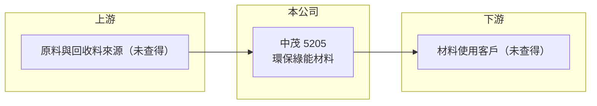

# 5205 中茂

> 上櫃｜[[產業索引-綠能環保|綠能環保]]｜上市（櫃）日期 2001/05/14

# 第一章：企業模式與商業藍圖

> [!info] 撰寫說明
> 精簡版，由 Claude 依公開資料整理，架構比照 [[2330台積電]]，資料截至 2026-10-08。來源：Goodinfo 經營績效年表（2019 至 2025 年）；富邦 e 點通（MoneyDJ）公司基本資料（2025 年營收比重）；科技新報公司資料頁標題（公司全名）；櫃買中心開放資料快照（基本資料、2026 年第二季資產負債與上半年損益）。具體產品、客戶與廠區未查得，公開資料有限，本文寫得較短。#待校對

中茂（公司全名為中茂能資系統整合科技）成立於 1989 年 12 月、2001 年 5 月上櫃，總部在高雄市苓雅區，董事長為李建賢，總經理為詹益國。它是台股中規模極小的公司，年營收不到 0.5 億元、實收資本額約 1.4 億元，長年本業虧損，屬於需要特別謹慎看待的微型股。

- **核心業務：** 依 2025 年營收比重，中茂的營收 100% 來自「環保綠能材料」，被歸類在綠能環保產業。具體是哪一類材料（例如回收再生料、廢棄物處理衍生材料或節能材料）、賣給哪些客戶，公開資料這次未查得。
- **營收規模：** 依 Goodinfo，2020 至 2025 年營收每年只有 0.14 至 0.31 億元，2026 年上半年櫃買資料為 0.16 億元。這樣的規模代表公司尚未形成穩定的商業模式，營收可能來自少數幾筆訂單。
- **營運據點：** 總部登記在高雄市，生產廠區與員工規模未查得。2026 年第二季資產僅約 1.08 億元，顯示公司幾乎沒有大型生產設備。
- **長期方向：** 公開資料未揭露明確的發展策略。對這類公司，長期觀察重點不是產業前景，而是能否找到可持續獲利的業務、經營團隊與大股東是否穩定，以及資金來源是否足以支撐營運。

# 第二章：護城河深度與競爭優勢

中茂目前看不到明確的護城河：營收規模極小、毛利率接近零甚至為負，代表產品沒有定價能力。

- **競爭優勢：** 依現有資料無法辨識具體的競爭優勢。2024 與 2025 年毛利率只有 1.16%，2022 與 2023 年更是負值，表示產品售價連直接成本都難以涵蓋，與同業相比沒有成本或技術優勢。
- **主要對手：** 綠能環保材料領域的上市櫃公司包括回收與廢棄物處理業者，例如 [[1337再生-KY]]、[[8936國統]]（環保工程）等，但因中茂的實際產品未查得，與哪些公司直接競爭無法確認。
- **觀察重點：** 營收能否突破每年 1 億元、毛利率能否轉為穩定正值，以及公司是否透過增資或引進新股東改變業務方向。若業務方向大幅改變，應以新業務重新評估。

# 第三章：財務體質與盈利規模

資料日期：2026-10-08，表格是撰寫當時的快照；最新月營收、毛利率、累計 EPS 由自動排程寫在本筆記的屬性欄位（月營收、毛利率、累計EPS 等）。#待校對

中茂近七年幾乎年年本業虧損，股東權益靠增資維持，財務數字的意義在於檢視公司的存續能力。

| 年度 | 營收（億元） | [[毛利率]] | [[營業利益率]] | EPS（元） | [[ROE]] |
|---|---|---|---|---|---|
| 2019 | 0.01 | 33.2% | -1163% | -0.94 | -148% |
| 2020 | 0.28 | 9.57% | -46% | -0.58 | -210% |
| 2021 | 0.24 | 8.9% | -57.3% | -1.69 | -252% |
| 2022 | 0.14 | -12.7% | -138% | 1.02 | 26.3% |
| 2023 | 0.20 | -11.7% | -98.4% | -1.55 | -26.4% |
| 2024 | 0.31 | 1.16% | -58.9% | -1.49 | -17.9% |
| 2025 | 0.25 | 1.16% | -100% | -1.43 | -19.4% |
| 2026 上半年 | 0.16 | 6.0% | -75.2% | -0.89 | 未查得 |

註：2019 至 2025 年取自 Goodinfo（頁面數據有不一致處，待校對），2026 年上半年取自櫃買中心開放資料推算（毛利 0.01 億、營業損失 0.12 億）。2022 年營業虧損但 EPS 為正，推估來自業外收益；2019 至 2021 年 ROE 低於 -100%，代表當時淨值極低。

- **長期指標：** 營收長期停滯在 0.3 億元以下，2021 至 2025 年平均 ROE 約 -57.9%（推算），沒有替股東創造報酬。股利紀錄未查得，以連年虧損推估未配息。
- **[[ROIC]] 與 [[WACC]]：** 2025 年營業損失約 0.25 億元（0.25 億 × -100%），2026 年上半年營業損失 0.12 億元、年化約 0.24 億元。第二季權益 0.75 億元，總負債 0.32 億元中有息負債未查得，假設約 0.1 億元，投入資本約 0.85 億元，ROIC 約 -28% 至 -29%（推算，虧損不計稅盾）。WACC 以無風險利率 1.75%、市場風險溢酬 6%、β 1.2（微型股常見的偏高假設）、權益比重約 90% 以上計算約 8.8%（推算）。ROIC 遠低於 WACC，代表每投入一元資本都在虧損，公司目前是在消耗而非創造價值。
- **財務特色：** 2026 年第二季資產 1.08 億元、負債比率約 30%，每股淨值 5.51 元、低於面額。以目前的虧損速度，若沒有新的資金挹注或業務改善，淨值會持續下降。

# 第四章：總體風險與地緣政治

中茂最主要的風險是存續與治理風險，產業景氣反而是次要因素。

- **產業週期：** 環保綠能材料的需求理論上受惠於減碳與循環經濟政策，但中茂的營收並未隨產業成長而放大，顯示問題在公司本身而非產業週期。
- **營運風險：** 營收極小且連年虧損，持續經營需要依賴增資或借款；少數訂單的變化就會讓營收大幅波動。業務內容揭露有限，投資人難以評估實際營運狀況。
- **其他風險：** 微型股的股權結構與經營權變動頻繁，董事或主管異動可能改變公司方向；股價容易受題材影響而大幅波動，與基本面脫節；若淨值持續下降，可能面臨交易方式變更等主管機關措施（推估）。

# 專有名詞解析

## 金融

- **[[每股淨值]]**：股東權益除以流通股數，代表每股在帳上的價值；低於面額 10 元通常表示公司累積虧損。
- **[[ROIC]]**：投入資本報酬率，稅後營業利益除以股東權益加有息負債，衡量本業運用資本的效率。
- **[[WACC]]**：加權平均資金成本，股東與債權人要求報酬率的加權平均，是 ROIC 要超越的門檻。

## 產業

- **[[循環經濟]]**：把廢棄物重新轉為原料或產品、減少資源消耗的經濟模式，是環保材料業的主要政策驅動力。

# 核心供應鏈

- 上游：供應商未查得。
- 下游／客戶：客戶未查得。
- 同業：綠能環保類股中的回收與環保業者，例如 [[1337再生-KY]]（是否直接競爭未查得）。

## 最新新聞
<!-- news:start（自動產生，請勿手動編輯此範圍） -->
- 2026-10-08 🏛️ 重訊 15:12｜本公司有價證券近期股價異常，故公告相關 訊息以利投資人區別瞭解。｜[觀測站](https://mops.twse.com.tw/mops/#/web/t05st01)

完整紀錄：[[5205中茂 新聞]]
<!-- news:end -->

## 相關連結
- [公開資訊觀測站](https://mopsov.twse.com.tw/mops/web/t05st03?step=1&firstin=1&co_id=5205)
- [Goodinfo](https://goodinfo.tw/tw/StockDetail.asp?STOCK_ID=5205)
- [Yahoo 股市](https://tw.stock.yahoo.com/quote/5205)
- [鉅亨網新聞](https://www.cnyes.com/twstock/5205/news)
