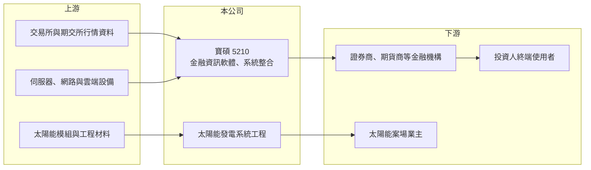

# 5210 寶碩

> 上櫃｜[[產業索引-資訊服務業|資訊服務業]]｜上市（櫃）日期 2002/04/25

# 第一章：企業模式與商業藍圖

> [!info] 撰寫說明
> 精簡版，由 Claude 依公開資料整理，架構比照 [[2330台積電]] 的四章研究，資料截至 2026-10-08。來源：櫃買中心開放資料快照（基本資料、2026 年第二季資產負債與損益、本益比殖利率、每月營收）、Goodinfo 經營績效年度表、nStock 與玩股網公司簡介。公開資料有限，產品與客戶描述部分依撰寫者既有知識整理，已標「待校對」。#待校對

寶碩財務科技（以下簡稱寶碩）是一家規模很小的金融資訊軟體公司，本章說明它的業務組成、收入來源，以及近年加入太陽能工程後的事業結構。

- **核心業務：** 寶碩成立於 1988 年，原名儒碩，後更名為寶碩財務科技，2002 年在櫃買中心掛牌。依公司登記與財經網站資料，主要業務為應用與系統軟體設計開發、電子資訊供應、系統整合服務，以及太陽能發電設備與系統工程。從公司名稱與英文代號 APEX 來看，它的本業定位是替金融業（特別是證券商）提供行情資訊、看盤與交易相關的軟體系統（待校對）。這類業務的特點是一旦系統導入客戶端，後續有維護、授權與資訊服務費，形成[[經常性收入]]。
- **營收結構：** 公開資料未查得產品別營收比重。從財報結構可以推估本業以軟體與資訊服務為主：2026 年上半年營收 1.32 億元、[[毛利率]]約 70%，高毛利是軟體授權與資訊服務的典型特徵；太陽能工程屬於一次性、毛利較低的承攬收入，占比推估不高（推估）。全年營收規模只有 2.5 億至 3 億元，在上市櫃公司中屬於極小型。
- **營運據點：** 公司總部位於台北市松山區八德路，營運以台灣市場為主。2023 年公告子公司寶錸證券投資顧問停業，代表公司收縮了投顧相關業務，把資源集中在軟體與系統服務。實收資本額約 8.22 億元，其中包含 2,000 萬股私募股。
- **長期方向：** 寶碩的長期課題是在金融科技（FinTech）競爭下維持本業客戶，同時找出第二成長來源。太陽能發電系統工程是公司已登記的業務，可以視為分散營收來源的嘗試；但由於公開資料有限，綠能業務的規模、案場數量與長期策略未查得，只有在公司揭露明確的案場或轉型計畫後，才適合判斷這條路線對公司結構的影響。

# 第二章：護城河深度與競爭優勢

護城河決定一家公司能否長期賺得比資金成本更多的報酬。本章評估寶碩在金融資訊軟體市場的競爭位置，以及這個位置能帶來多少保護。

- **競爭優勢：** 金融資訊系統的轉換成本是寶碩最主要的保護。券商的行情、下單與後台系統需要和交易所、期交所的連線規格、法規申報流程緊密整合，更換供應商牽涉資料轉換、人員訓練與主管機關檢查，客戶通常不會輕易更換（待校對）。此外，維護與資訊服務費帶來的經常性收入，讓營收在景氣變動時相對穩定，2020 至 2025 年營收都落在 2.2 億至 3.1 億元之間，波動幅度不大。
- **優勢的侷限：** 寶碩的護城河很窄。它的規模太小，研發與行銷資源有限，在券商紛紛自建 App 或改用大型資訊服務商整合方案的趨勢下，議價能力不足。過去六年有四年營業虧損，代表高毛利並不足以支撐人事與研發費用；只有營收規模擴大或費用控制到位時，[[營業槓桿]]才會轉為正面。
- **主要對手：** 金融業資訊系統的主要對手包括 [[6214精誠]] 這類大型系統整合商，以及嘉實資訊、三竹資訊等專門提供看盤軟體與行動下單平台的業者（後兩者未上市櫃）。券商自行開發 App 與國際金融資訊供應商也會壓縮小型業者的市場空間。在太陽能工程方面，則要面對眾多專業 [[EPC]] 統包商與綠能開發商的競爭。
- **觀察重點：** 判斷寶碩護城河是否改善，可以看三件事：毛利率能否穩定維持在 7 成左右，代表軟體與服務收入的比重沒有被低毛利工程稀釋；營業利益能否連續多年為正，證明 2025 年轉盈不是一次性；以及綠能業務是否有明確、可持續的收益模式。2026 年 10 月公司曾就媒體報導的綠能案件發布說明，綠能業務的實際內容值得持續追蹤。

# 第三章：財務體質與盈利規模

資料日期：2026-10-08，表格是撰寫當時的快照；最新月營收、毛利率、累計 EPS 由自動排程寫在本筆記的屬性欄位（月營收、毛利率、累計EPS 等）。#待校對

財務數字能檢驗一家公司的商業模式是否真的能賺錢。本章用多年度資料說明寶碩長期虧損、近年轉盈的過程，並推算它的資本報酬與資金成本。

| 年度 | 營收（億元） | [[毛利率]] | [[營業利益率]] | EPS（元） | [[ROE]] |
|---|---|---|---|---|---|
| 2020 | 2.25 | 57.3% | -45.9% | -1.26 | -13.1% |
| 2021 | 2.57 | 71.8% | -14.8% | -0.37 | -4.3% |
| 2022 | 3.10 | 72.0% | -4.7% | -0.20 | -2.4% |
| 2023 | 2.62 | 60.7% | -35.1% | -1.56 | -20.8% |
| 2024 | 2.53 | 68.0% | -23.6% | -0.83 | -9.7% |
| 2025 | 2.78 | 73.7% | 12.0% | 0.73 | 7.8% |

資料來源：Goodinfo 經營績效頁；2025 年營收與 EPS 和 nStock 數字相符。

- **營收規模：** 營收長期在 2.2 億至 3.1 億元之間，2020 至 2025 年年複合成長率約 4.3%（推算），屬於低成長、規模極小的公司。2026 年前 9 月累計營收年增約 6%，延續緩步成長。營收規模小意味著任何單一客戶或專案的增減，都會明顯影響全年獲利。
- **獲利：** 毛利率長年在 6 至 7 成，但營業費用吃掉大部分毛利，2020 至 2024 年連續虧損，近五年（2021 至 2025）平均 ROE 約 -5.9%（推算）。2025 年首度轉為營業獲利，營業利益率 12%、EPS 0.73 元。2026 年上半年 EPS 0.50 元，但營業利益只有約 1,072 萬元，稅前淨利中約 2,010 萬元來自業外收入，另有約 1,061 萬元所得稅利益，本業貢獻占比不高，評估獲利品質時應以營業利益為準。
- **財務特色：** 2026 年第二季底資產總計約 10.1 億元，負債只有約 1.64 億元，股東權益約 8.45 億元，負債比約 16%，幾乎沒有財務槓桿；流動資產約 5.35 億元，資金相對充裕。不過保留盈餘為 -1.32 億元，累積虧損尚未彌補，因此近五年沒有配息，在虧損彌補完畢前也難以配發股利。
- **[[ROIC]] 與 [[WACC]]：** 以 2025 年營業利益約 3,340 萬元（營收 2.78 億元 × 12%）、稅率 20% 計算，稅後營業利益約 2,670 萬元；有息負債金額未查得，因負債總額僅 1.64 億元，假設有息負債趨近於零，投入資本以股東權益 8.45 億元計，ROIC 約 3.2%（推算）；若以 2026 年上半年營業利益年化，ROIC 約 2%（推算）。WACC 以 CAPM 推估：無風險利率 1.75%、市場風險溢酬 6%、β 假設 1.0（小型資訊服務股常見值），幾乎無負債，WACC 約 7.5% 至 8%（推算）。ROIC 仍低於 WACC，代表寶碩即使轉盈，本業報酬尚不足以覆蓋股東要求的報酬，需要營收規模進一步擴大才會開始創造價值。

# 第四章：總體風險與地緣政治

小型軟體公司的風險往往集中在客戶、人才與產業變革。本章整理寶碩長期需要面對的主要風險。

- **產業週期：** 金融資訊系統的需求和證券市場景氣有關。股市熱絡時券商願意投資新系統與擴充服務，成交量萎縮時則會縮減資訊支出、壓低維護費。這種間接的景氣連動，加上寶碩營收規模小，使它的獲利在不同年度之間大幅擺盪，2023 年營業利益率 -35% 就是例子。
- **營運風險：** 寶碩的收入可能集中在少數金融業客戶（待校對），一旦主要客戶轉換供應商、合併或改為自行開發，營收會受到明顯衝擊。軟體公司最重要的資產是工程人才，台灣軟體人才長期被大型科技公司與金融業吸走，小公司在薪資與發展機會上不易競爭。太陽能工程則屬於專案型收入，承攬風險、工程進度與收款都可能帶來波動。
- **其他風險：** 金融資訊系統受到金管會資安與委外作業法規的規範，法規要求提高時，系統更新與資安投入會增加成本。綠能業務則受台灣再生能源政策、土地與併網審查影響。公司股本中有私募股，加上股價淨值比明顯高於帳面價值，市場對其轉型題材的預期與實際營運之間可能存在落差。

# 專有名詞解析

## 金融

- **[[經常性收入]]**：客戶持續支付的維護費、授權費或訂閱費，不需每年重新爭取，可讓營收較穩定。
- **[[營業槓桿]]**：固定成本占比高時，營收小幅變動會造成營業利益大幅變動的效果。

## 產業

- **[[EPC]]**：設計、採購、施工統包工程，承包商負責從規劃到完工交付的整個建置流程。
- **[[綠電]]**：太陽能、風力等再生能源所產生的電力，可透過憑證或轉供方式賣給用電企業。

# 核心供應鏈

- 上游：證交所、櫃買中心與期交所的行情與交易資料源；伺服器、網路與雲端基礎設施供應商；太陽能工程所需的模組，例如 [[3576聯合再生]]、[[6443元晶]]（以產業常見供應商列示，實際採購對象未查得）。
- 下游／客戶：證券商、期貨商等金融機構（實際客戶名單未查得，待校對）；最終使用者為透過券商系統看盤下單的投資人；太陽能案場業主。
- 同業：[[6214精誠]]（金融系統整合）、嘉實資訊、三竹資訊（未上市櫃）；綠能工程 [[6806森崴能源]]。

## 最新新聞
<!-- news:start -->
<!-- news:end -->

## 相關連結
- [公開資訊觀測站](https://mopsov.twse.com.tw/mops/web/t05st03?step=1&firstin=1&co_id=5210)
- [Goodinfo](https://goodinfo.tw/tw/StockDetail.asp?STOCK_ID=5210)
- [Yahoo 股市](https://tw.stock.yahoo.com/quote/5210)
- [鉅亨網新聞](https://www.cnyes.com/twstock/5210/news)
