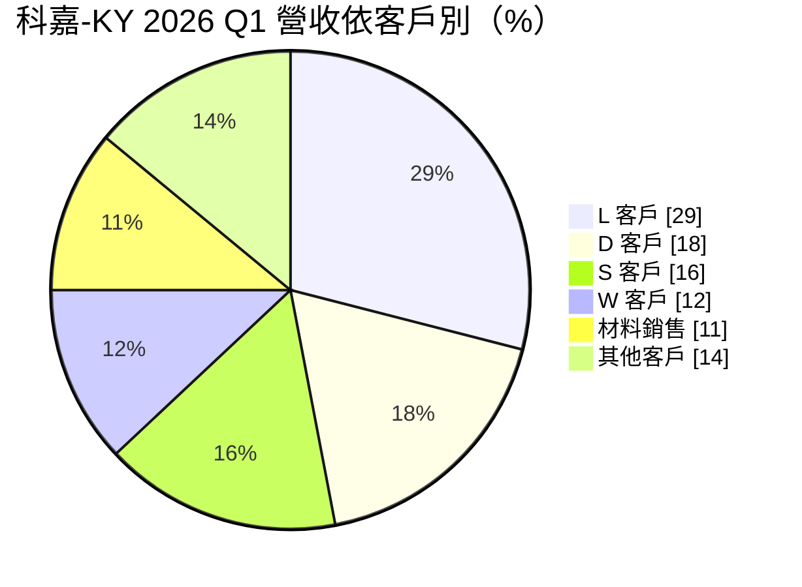
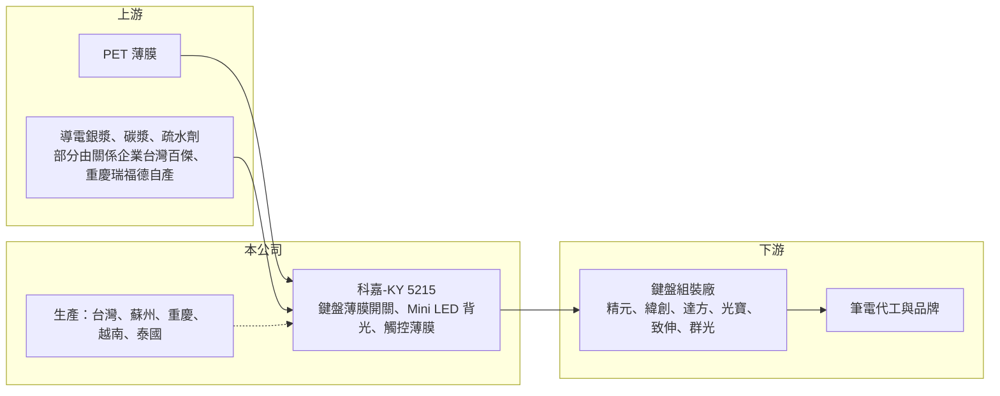

# 5215 科嘉-KY

> 上市｜[[產業索引-電腦及週邊設備業|電腦及週邊設備業]]｜上市（櫃）日期 2011/12/26

# 第一章：企業模式與商業藍圖

> [!info] 撰寫說明
> 精簡版，由 Claude 依公開資料整理，架構比照 [[2330台積電]] 的四章研究，資料截至 2026-10-08。來源：證交所開放資料（基本資料、2026 年第二季綜合損益與資產負債、股利、本益比殖利率）、MoneyDJ 理財網年度財務比率表、富果投研平台 2026 年 6 月法說會摘要、科技新報月營收報導。2020 年營收金額與來源推算不一致，寫為未查得；競爭對手與產業描述部分為整理性內容，尚未逐條比對原始文件。#待校對

科嘉-KY 是筆記型電腦鍵盤的關鍵零件供應商，主力產品是鍵盤底下的導電薄膜電路。開曼控股公司 2009 年成立、2011 年在台灣上市，屬於[[KY股]]，但集團的業務源頭可追溯到 1975 年。本章說明它在鍵盤供應鏈中的位置與收入來源。

- **核心業務：** 科嘉的主力是筆電鍵盤用的[[薄膜開關]]，也就是印有銀線路的多層塑膠薄膜，按鍵壓下時上下兩層線路接觸，鍵盤才會送出訊號。除此之外，公司也做桌上型鍵盤電子膜、遊戲手把用的可調式電阻膜、電子儀器的觸控薄膜開關，以及鍵盤用的 [[Mini LED]] 背光模組。這些產品共用同一套網版印刷與薄膜加工技術，是公司所有業務的底層能力。
- **營收結構：** 依 2026 年第一季法說資料，客戶別比重為 L 客戶 29%、D 客戶 18%、S 客戶 16%、W 客戶 12%、材料銷售 11%、其他客戶 14%。公司點名的客戶都是台灣鍵盤大廠，包括 [[2387精元]]、[[3231緯創]]、[[8163達方]]、[[2301光寶科]]、[[4915致伸]]、[[2385群光]]，但匿名代號與公司名稱的對應未公開。換句話說，科嘉的營收高度集中在少數幾家鍵盤組裝廠，而這些廠商的訂單最終取決於全球筆電出貨量。
- **營運據點：** 生產基地分布在台灣、中國蘇州、重慶，以及越南與泰國。越南廠已經量產，泰國廠的主要任務是貼近當地鍵盤廠、縮短薄膜交期。筆電鍵盤組裝近年隨品牌客戶的要求往東南亞移動，科嘉跟著客戶設廠，是維持供應商地位的必要條件。
- **長期方向：** 公司的長期策略有三條線。第一是往上游材料垂直整合，透過關係企業台灣百傑與重慶瑞福德生產導電銀漿、疏水劑與鍵帽塗料，把關鍵材料成本握在自己手上。第二是多地生產，讓客戶可以彈性選擇中國或東南亞出貨。第三是把印刷技術延伸到非筆電領域，例如血糖貼片、心電圖貼片等醫療電子，目標是降低對筆電景氣的依賴，但目前規模仍小。

# 第二章：護城河深度與競爭優勢

鍵盤薄膜是單價低、但不可或缺的零件。本章分析科嘉憑什麼長期留在筆電鍵盤供應鏈中，以及它的議價能力為何近年明顯下滑。

- **競爭優勢：** 科嘉的優勢在於規模與材料整合。筆電鍵盤每個機種都要重新設計線路並通過品牌驗證，供應商需要同時具備快速打樣、穩定良率與多地交貨的能力，新進者不容易一次滿足。加上集團自產導電銀漿與疏水劑，能在銀價波動時比只買材料的同業多一層成本緩衝。這些條件讓科嘉長年留在台灣主要鍵盤廠的供應名單上。
- **主要對手：** 主要競爭來自中國的薄膜開關與軟性線路廠，以及鍵盤廠自行或透過關係企業生產的薄膜（具體廠商名單未查得，待校對）。由於薄膜本身技術門檻不算高，競爭多半落在價格與交期上。科嘉的議價能力取決於客戶是否需要中國以外的產能，以及它能否提供背光、材料等附加價值。
- **觀察重點：** 2020 年科嘉毛利率曾達 38%，2025 年降到 22%，顯示護城河並不深，一旦筆電需求從疫情高峰回落，價格壓力就直接反映到毛利。長期要觀察三點：一是東南亞產能能否在客戶移轉後維持合理利用率；二是 Mini LED 背光、[[LED背光鍵盤]] 這類較高單價產品能否提高營收占比；三是醫療電子貼片能否從試產走到量產，成為第二條成長曲線。

# 第三章：財務體質與盈利規模

資料日期：2026-10-08，表格是撰寫當時的快照；最新月營收、毛利率、累計 EPS 由自動排程寫在本筆記的屬性欄位（月營收、毛利率、累計EPS 等）。#待校對

財務數字最能看出一家零件廠的景氣敏感度。本章用 2020 年以來的財務資料，檢視科嘉在筆電景氣高峰與谷底之間的獲利波動，以及它的資本報酬是否高於資金成本。

| 年度 | 營收（新台幣） | [[毛利率]] | [[營業利益率]] | EPS（元） | [[ROE]] |
|---|---|---|---|---|---|
| 2020 | 未查得 | 38.37% | 28.79% | 13.11 | 30.99% |
| 2021 | 約 36.7 億（推算） | 31.21% | 20.62% | 8.76 | 17.78% |
| 2022 | 約 24.6 億（推算） | 25.32% | 11.31% | 4.62 | 8.40% |
| 2023 | 約 25.2 億（推算） | 26.96% | 9.23% | 2.75 | 5.32% |
| 2024 | 27.06 億 | 26.93% | 8.88% | 3.74 | 6.97% |
| 2025 | 25.79 億 | 21.97% | 5.15% | 2.04 | 4.03% |
| 2026 上半年 | 15.86 億 | 20.19% | 4.85% | 1.77 | 未查得 |

註：2021 至 2023 年營收以 MoneyDJ 每股營業額乘以目前股本 6.43 億元推算，與營收成長率互相吻合；2020 年兩種推算結果不一致，寫為未查得。

- **營收規模：** 科嘉年營收在 2020 至 2021 年疫情帶動的筆電高峰約 37 億元，2022 年筆電需求回落後掉到約 25 億元，之後一直在 25 億至 27 億元之間。2021 至 2025 年營收年複合成長率約 -8.5%（推算），若從 2022 年谷底起算則約 +1.5%，代表公司營收規模已經回到正常水位，但沒有明顯成長。2026 年前八個月累計營收 21.01 億元、年增約 27%，是近年少見的成長年。
- **獲利：** 毛利率從 2020 年的 38% 一路降到 2025 年的 22%，營業利益率從 29% 降到約 5%，EPS 從 13.11 元降到 2.04 元。2025 年第一季曾因關稅與匯率波動出現單季虧損，第二季起轉盈。2026 年上半年稅後純益率 7.13% 高於營業利益率 4.85%，差額主要來自業外收益，本業獲利率仍在低檔。近 5 年（2021 至 2025）平均 ROE 約 8.5%（推算），但呈逐年下滑。
- **財務特色：** 科嘉的資產負債表非常保守，2026 年第二季底總資產 50.4 億元、股東權益 37.4 億元、總負債只有 13.0 億元，負債比約 26%，流動資產 37.5 億元占總資產七成以上。每股淨值約 56.68 元，2026 年 10 月初股價淨值比約 0.67 倍，市場給的評價低於帳面價值。股利方面，2025 年度配發現金股利 2.0 元，與當年 EPS 2.04 元幾乎相同，配發率接近 100%，顯示公司在缺乏高報酬投資機會時傾向把盈餘發還股東。長期自由現金流紀錄未查得。

**[[ROIC]] 與 [[WACC]]：** 以 2025 年營業利益率 5.15% 乘以營收 25.79 億元，得營業利益約 1.33 億元，扣除 20% 稅率後稅後營業利益約 1.06 億元（推算）。有息負債金額未查得，若投入資本只算股東權益 37.4 億元，ROIC 約 2.8%；若把總負債 13.0 億元全部算入，ROIC 約 2.1%，因此 2025 年 ROIC 約在 2% 至 3%（推算）。由於公司帳上流動資產多，若扣除閒置現金，實際營運資產的報酬會略高一些。WACC 用 CAPM 推估：無風險利率 1.75%、市場風險溢酬 6%、β 取低負債零組件同業常見值 0.8，股東權益成本約 6.55%；有息負債比重低，假設占資本一成、稅後成本 2.0%，WACC 約 6.1%（推算）。2020 至 2021 年 ROE 高達 18% 至 31%，ROIC 遠高於資金成本；2023 年以後 ROIC 明顯低於 WACC，代表公司目前並沒有創造經濟價值，股價淨值比低於 1 倍正反映這一點。

# 第四章：總體風險與地緣政治

科嘉的命運和全球筆電出貨量緊緊綁在一起。本章整理它長期面對的景氣、客戶與地緣政治風險。

- **產業週期：** 筆電是成熟市場，出貨量大致跟著企業換機與教育採購的週期起伏。2020 至 2021 年遠距工作與學習帶來一次性高峰，之後兩年快速回落，科嘉的營收與毛利也跟著大幅下滑。未來 AI PC 換機潮或 Windows 版本更新可能帶來短期需求，但筆電整體不再是成長市場，公司很難只靠鍵盤薄膜維持長期成長。
- **營運風險：** 第一是客戶集中，前四大客戶合計約占營收七成五，任何一家鍵盤廠轉單或自製，都會明顯影響營收。第二是價格壓力，薄膜屬於標準化程度高的零件，客戶每年要求降價，毛利率長期下滑的趨勢若無法透過高單價產品扭轉，獲利會持續被壓縮。第三是新事業的不確定性，醫療電子貼片需要醫療法規認證與通路，從技術延伸到商業化通常要很多年。
- **其他風險：** 原料方面，導電銀漿的主要成本是銀，銀價大漲時薄膜成本上升，雖有自製材料可以緩衝，但無法完全轉嫁。匯率方面，營收以美元計價，2025 年第一季的單季虧損就與匯率波動有關。地緣政治方面，公司主要產能仍在中國蘇州與重慶，美國對中國製筆電的關稅會推動客戶把鍵盤組裝移往東南亞，科嘉必須持續投資越南、泰國廠，短期內會增加折舊與管理成本。作為 KY 公司，資訊揭露與股東權益保障也較一般台灣公司更需要留意。

# 專有名詞解析

## 金融

- **[[KY股]]**：在海外（多為開曼群島）註冊、回台灣上市櫃的公司，股票代號後加 KY，資訊揭露與公司治理適用的法規和本國公司不同。

## 產業

- **[[薄膜開關]]**：由多層塑膠薄膜與印刷線路組成的開關，按壓時上下線路接觸導通，是筆電與桌上型鍵盤的核心電路零件。
- **[[Mini LED]]**：晶粒尺寸約 100 至 200 微米的 LED，可做成更薄、分區更細的背光，用於電視、筆電螢幕與鍵盤背光。
- **[[LED背光鍵盤]]**：在按鍵底下加入發光層，讓使用者在暗處也能看清按鍵，單價高於一般鍵盤。

# 核心供應鏈

- 上游：PET 等塑膠薄膜、導電銀漿、碳漿、絕緣油墨與疏水劑；銀漿與疏水劑部分由關係企業台灣百傑、重慶瑞福德生產，其他外部供應商名單未查得。
- 下游／客戶：鍵盤組裝廠 [[2387精元]]、[[3231緯創]]、[[8163達方]]、[[2301光寶科]]、[[4915致伸]]、[[2385群光]]；鍵盤再交給筆電代工廠如 [[2382廣達]]、[[2356英業達]]，最終供應 [[2357華碩]]、[[2353宏碁]] 及聯想、惠普、戴爾等品牌（品牌與科嘉的直接關係未查得）。
- 同業：中國薄膜開關與軟性線路廠，以及鍵盤廠自有的薄膜產線；具體上市同業名單未查得。

## 最新新聞
<!-- news:start（自動產生，請勿手動編輯此範圍） -->
- 2026-10-08 🏛️ 重訊 15:55｜代子公司蘇州嘉吉/科德/嘉財/艾普來/百宏/嘉皇/嘉駿 公告一年內累積處分同一有價證券達實收資本額20%｜[觀測站](https://mops.twse.com.tw/mops/#/web/t05st01)
- 2026-10-08 🏛️ 重訊 15:55｜代子公司蘇州嘉吉/科德/嘉財/艾普來/百宏/嘉皇/嘉駿 公告一年內累積取得同一有價證券達實收資本額20%｜[觀測站](https://mops.twse.com.tw/mops/#/web/t05st01)

完整紀錄：[[5215科嘉-KY 新聞]]
<!-- news:end -->

## 相關連結
- [公開資訊觀測站](https://mopsov.twse.com.tw/mops/web/t05st03?step=1&firstin=1&co_id=5215)
- [Goodinfo](https://goodinfo.tw/tw/StockDetail.asp?STOCK_ID=5215)
- [Yahoo 股市](https://tw.stock.yahoo.com/quote/5215)
- [鉅亨網新聞](https://www.cnyes.com/twstock/5215/news)
