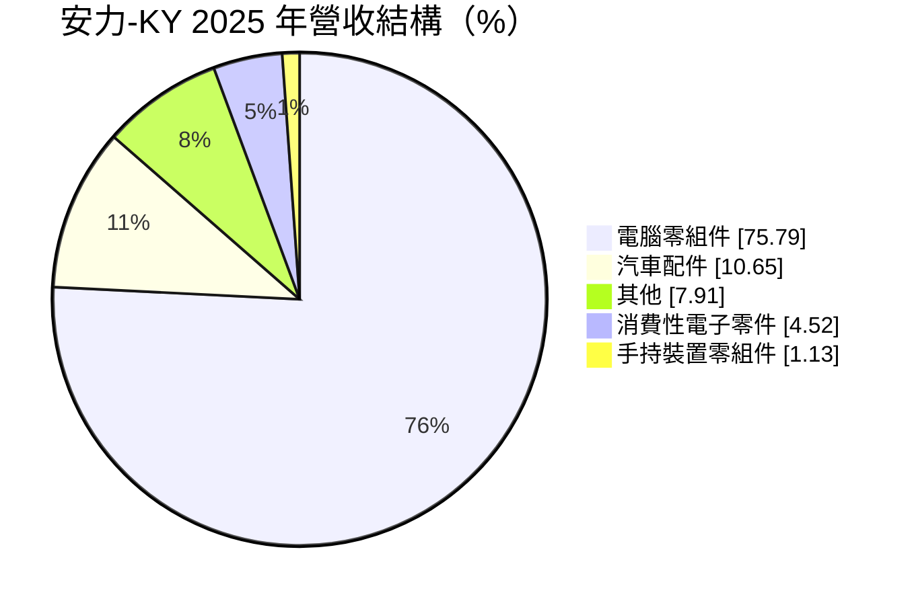
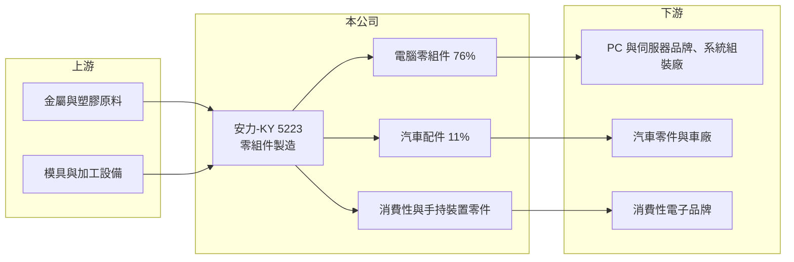

# 5223 安力-KY

> 上櫃｜[[產業索引-電腦及週邊設備業|電腦及週邊設備業]]｜上市（櫃）日期 2018/07/02

# 第一章：企業模式與商業藍圖

> [!info] 撰寫說明
> 精簡版，由 Claude 依公開資料整理，架構比照 [[2330台積電]]，資料截至 2026-10-08。來源：櫃買中心開放資料（基本資料、2026 年上半年財報、每月營收）、Goodinfo 經營績效頁、富邦證券 MoneyDJ 公司基本資料（2025 年營收比重），以及財經媒體標題。具體產品型態、生產據點與客戶未查得，公開資料有限。#待校對

本章說明安力國際（5223，以下簡稱安力-KY）的商業模式：一家海外註冊、以電腦零組件為主要營收的代工製造廠。

- **核心業務：** 安力-KY 於 2010 年註冊成立，2018 年 7 月在櫃買中心掛牌，屬於 [[KY股]]，董事長兼總經理為許振焜，台灣聯絡地址在新北市新莊。公司替品牌與系統廠生產電腦用零組件，並延伸到汽車配件、消費性電子與手持裝置零件，產品的具體型態（金屬或塑膠結構件等）在本次查得的資料中未揭露（待校對）。
- **營收結構：** 2025 年電腦零組件約占 75.8%，汽車配件約 10.7%，消費性電子與手持裝置零件合計不到 6%。高度集中在電腦產業，代表公司營收與 PC、伺服器的出貨週期高度連動。
- **營運據點：** 主要生產據點在海外（推估以中國為主，待校對），台灣端負責業務與資本市場聯絡。
- **長期方向：** 依 2025 至 2026 年媒體標題，公司正切入 AI 邊緣運算相關產品，並看好 AI 建置需求，希望藉此擺脫傳統 PC 零組件的低毛利困境。汽車配件是另一條分散客戶的路線，但目前比重仍低。

# 第二章：護城河深度與競爭優勢

本章分析安力-KY 的競爭位置：作為電腦零組件代工廠，它的議價能力有限，近年毛利持續被壓縮。

- **競爭優勢：** 公司在電腦零組件領域累積了十多年的量產經驗與客戶關係，能配合系統廠的機種開發提供零件。2020 年營業利益率曾接近 20%，說明在需求旺盛、產能滿載時，它具備相當的成本效率。
- **主要對手：** 電腦零組件與機構件的代工廠眾多，台股同業包括 [[3013晟銘電]]、[[8210勤誠]]、[[6117迎廣]]、[[2059川湖]] 等，中國本地的零組件廠也是強勁對手。
- **觀察重點：** 長期要看 AI 邊緣運算與伺服器相關產品能否帶動毛利率回到 20% 以上，以及汽車配件比重能否提升。2023 至 2025 年連續三年營業虧損，若新產品無法放量，公司的競爭力會持續被削弱。

# 第三章：財務體質與盈利規模

資料日期：2026-10-08，表格是撰寫當時的快照；最新月營收、毛利率、累計 EPS 由自動排程寫在本筆記的屬性欄位（月營收、毛利率、累計EPS 等）。#待校對

本章用多年度數字檢視安力-KY 從高獲利轉為小幅虧損的過程。

| 年度 | 營收（億元） | [[毛利率]] | [[營業利益率]] | EPS（元） | [[ROE]] |
|---|---|---|---|---|---|
| 2021 | 22.8 | 27.5% | 12.6% | 5.22 | 12.5% |
| 2022 | 20.6 | 25.8% | 9.44% | 4.40 | 9.79% |
| 2023 | 15.3 | 20.5% | -0.45% | -0.08 | -0.19% |
| 2024 | 16.6 | 18.2% | -0.52% | -0.54 | -1.22% |
| 2025 | 19.6 | 15.6% | -0.37% | -0.67 | -1.49% |

- **營收規模：** 2020 年營收 20.8 億元、2021 年 22.8 億元是高峰，2023 年降到 15.3 億元，2025 年回升到 19.6 億元。2026 年上半年營收 9.3 億元，前 8 月累計年增約 1.5%，營收規模大致持平。
- **獲利：** 毛利率從 2020 年的 34.1% 一路下滑到 2025 年的 15.6%，2026 年上半年再降到 14.2%，營業利益率 -1.9%，EPS -0.66 元。營收回升卻沒有帶來獲利，代表新接訂單的毛利偏低，或成本上漲無法轉嫁。
- **財務特色：** 近 5 年（2021 至 2025）平均 ROE 約 3.9%。2026 年第二季總資產 37.0 億元、權益 23.7 億元，負債比約 36%；上半年其他綜合損益約 4.4 億元，使其他權益增加到 3.7 億元（推估為匯率換算或資產評價變動），每股淨值約 53 元，但股價淨值比僅約 0.42 倍，反映市場對獲利能力的疑慮。近期沒有配發股利。
- **[[ROIC]] 與 [[WACC]]：** 2025 年營業損失約 0.07 億元，ROIC 約 -0.3%（推算，以權益 23.7 億元加非流動負債 4.1 億元、合計約 27.8 億元為投入資本）。對照 2020 年營業利益約 4.1 億元，當時 ROIC 約在 10% 以上（推估）。WACC 以 [[CAPM]] 推估：無風險利率 1.75%、市場風險溢酬 6%、β 假設 1.0（電子零組件股常見值），股東權益成本約 7.75%；稅後負債成本 2%、負債占資本 15%，WACC 約 6.9%（推算）。近三年 ROIC 低於零，遠低於 WACC，公司目前正在消耗股東價值，轉型成效是能否回到正利差的關鍵。

# 第四章：總體風險與地緣政治

本章整理安力-KY 長期要面對的風險。

- **產業週期：** 七成以上營收來自電腦零組件，PC 與伺服器的換機週期、品牌廠庫存調整會直接影響訂單。2023 年營收年減約四分之一，就是 PC 景氣下行的結果。
- **營運風險：** 毛利率連續多年下滑，代表價格競爭激烈、客戶議價力強。若無法開發高附加價值產品，固定成本負擔會讓虧損延續；客戶集中度高時，單一客戶轉單影響更大。
- **其他風險：** KY 公司主要營運在海外，面臨中國生產成本上升、美中關稅與客戶要求轉移產地的壓力（產地待校對）。人民幣與美元匯率波動會影響損益與權益。

# 專有名詞解析

## 應用

- **[[邊緣運算]]**：在資料產生端附近進行運算，不必全部傳回雲端，可降低延遲，AI 推論裝置是主要應用。

## 金融

- **[[KY股]]**：在海外註冊、回台灣上市櫃的公司，代號後加註 KY，主要營運多在海外。
- **[[股價淨值比]]**：股價除以每股淨值，低於 1 倍代表市場價格低於帳面淨值，常反映對獲利能力的疑慮。
- **[[CAPM]]**：資本資產定價模型，以無風險利率加上 β 乘以市場風險溢酬，推估股東要求的報酬率。

# 核心供應鏈

- 上游：金屬與塑膠原料、模具與加工設備（個別供應商未查得）。
- 下游／客戶：PC 與伺服器品牌及系統組裝廠、汽車零件與車廠、消費性電子品牌（客戶名稱未查得）。
- 同業：[[3013晟銘電]]、[[8210勤誠]]、[[6117迎廣]]、[[2059川湖]]。

## 最新新聞
<!-- news:start -->
<!-- news:end -->

## 相關連結
- [公開資訊觀測站](https://mopsov.twse.com.tw/mops/web/t05st03?step=1&firstin=1&co_id=5223)
- [Goodinfo](https://goodinfo.tw/tw/StockDetail.asp?STOCK_ID=5223)
- [Yahoo 股市](https://tw.stock.yahoo.com/quote/5223)
- [鉅亨網新聞](https://www.cnyes.com/twstock/5223/news)
