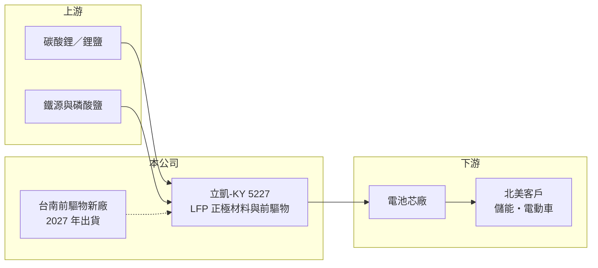

# 5227 立凱-KY

> 上櫃｜[[產業索引-電子零組件業|電子零組件業]]｜上市（櫃）日期 2013/12/09

# 第一章：企業模式與商業藍圖

> [!info] 撰寫說明
> 精簡版，由 Claude 依公開資料整理，架構比照 [[2330台積電]] 的四章研究，資料截至 2026-10-08。來源：Goodinfo 經營績效頁、優分析 2026 年報導（北美長約與台南新廠）、櫃買中心開放資料快照（基本資料、2026 年第二季損益與資產負債、本益比殖利率）。公司長年虧損、公開資料有限，過去中國產能的處理經過未查得。#待校對

立凱-KY 是台灣少數掌握[[磷酸鋰鐵]]正極材料專利與前驅物自製能力的公司，目前正處於關閉舊產線、改建北美專屬供應鏈的轉型期。本章說明它的商業模式與轉型方向。

- **核心業務：** 立凱-KY 註冊於開曼群島，2013 年上櫃，董事長為張聖時，主要產品是鋰電池用的磷酸鋰鐵（LFP）[[正極材料]]及其前驅物磷酸鐵。依報導，公司擁有 LFP 成分、結構與製程的完整專利，並能自製磷酸鐵前驅物，研發與量產基地都在台灣。正極材料是電池成本中占比最高的材料之一，掌握配方與製程就能直接影響電池的成本與壽命。
- **營收結構：** 2025 年營收約 4.01 億元（報導換算約 1,300 萬美元），規模很小；2026 年因舊產線縮減，上半年營收只剩約 0.59 億元。產品別比重未查得，但可確定目前營收全部來自 LFP 相關材料，應用在電動車與[[儲能]]。
- **營運據點：** 研發與量產基地在台灣。2026 年公司決定在台南以租賃廠房加採購設備的方式建置前驅物廠，2026 年 10 月啟動、2027 年 1 月試產、7 月出貨，初期年產能 2.5 萬至 5 萬噸，可依訂單調整到 10 萬噸。公司規劃在台灣生產、美國後段加工，以符合客戶對供應鏈安全與關稅的要求。
- **長期方向：** 2026 年公司與一家未具名的北美客戶簽訂 LFP 前驅物供貨價格協議，自 2027 年 7 月起供貨 20 年。這是公司從「小量多客戶」轉為「綁定單一大客戶的長約供應」的結構性轉變，目標是讓本業在 2028 年轉虧為盈，管理層估計產能約 5 萬噸時可接近損益兩平。

# 第二章：護城河深度與競爭優勢

立凱-KY 的潛在護城河是專利與「非中國產地」的身分，但能否轉成獲利仍待驗證。本章分析它的競爭條件。

- **競爭優勢：** 全球 LFP 正極材料產能高度集中在中國，2025 年中國產量約 360 萬噸。美國《降低通膨法案》（IRA）等政策鼓勵在地化與「[[非紅供應鏈]]」，讓少數擁有自主專利、能在中國以外量產的廠商取得談判籌碼。立凱-KY 的專利組合與前驅物自製能力，是它能拿到 20 年長約的主要原因。
- **主要對手：** 中國廠商如湖南裕能、德方納米等規模大、成本低，主導全球價格（待校對）。中國以外的新進者包括韓國 L&F（規劃 6 萬噸 LFP 產能）等；台灣同業有 [[8038長園科]] 等。立凱-KY 的規模遠小於這些對手，成本競爭力須靠新廠規模化才能建立。
- **觀察重點：** 第一，台南新廠能否如期在 2027 年 7 月出貨並達到穩定良率。第二，北美客戶的實際提貨量與價格條件，長約的價格機制決定毛利率能否轉正。第三，公司在達到損益兩平前的資金需求，以及是否需要再辦理增資。

# 第三章：財務體質與盈利規模

資料日期：2026-10-08，表格是撰寫當時的快照；最新月營收、毛利率、累計 EPS 由自動排程寫在本筆記的屬性欄位（月營收、毛利率、累計EPS 等）。#待校對

立凱-KY 的財報是典型的「技術已有、規模未到」公司：營收小、毛利率長期為負、靠增資支撐營運。本章用多年度數據說明。

| 年度 | 營收（億元） | [[毛利率]] | [[營業利益率]] | EPS（元） | [[ROE]] |
|---|---|---|---|---|---|
| 2020 | 1.43 | -105% | -264% | -4.73 | -56.1% |
| 2021 | 3.13 | -23.1% | -87.1% | -9.31 | -72.5% |
| 2022 | 7.08 | 2.57% | -53.7% | -6.00 | -65.8% |
| 2023 | 8.10 | -11.5% | -55.2% | -7.00 | -70.7% |
| 2024 | 5.91 | 10.8% | -39.6% | -3.46 | -36.8% |
| 2025 | 4.01 | -7.08% | -108% | 0.17 | 2.25% |
| 2026 上半年 | 0.59 | -109.7% | -335% | -2.87 | 未查得 |

- **營收規模：** 營收最高在 2023 年的 8.1 億元，之後因舊產線收縮而下滑，2026 年上半年只剩 0.59 億元。2020 至 2025 年的成長率因基期太低不具參考性，未來營收幾乎完全取決於 2027 年下半年起的北美長約。
- **獲利：** 六年中五年虧損，毛利率多數年度為負，代表售價連變動成本都無法完全涵蓋。2025 年營業利益率 -108%，但全年 EPS 為 0.17 元，顯示當年有大額業外收益（原因未查得）。2021 至 2025 年平均 ROE 約 -48.7%（推算）。
- **財務特色：** 2026 年第二季末股本約 9.7 億元、股東權益約 6.3 億元，每股淨值 7.99 元，已低於面額，代表累積虧損侵蝕資本。負債約 2.5 億元，負債比約 28%。公司長期未配發股利，營運資金主要來自增資，子公司台灣立凱電能也曾辦理現金增資。

**[[ROIC]] 與 [[WACC]]：** 有息負債明細未查得，假設約 1.5 億元（推估）。2025 年營業損失約 4.3 億元，投入資本以股東權益約 6.3 億元加有息負債 1.5 億元，約 7.8 億元，ROIC 約 -55%（推算），是負值且幅度很大。WACC 用 CAPM 推估：無風險利率 1.75%、市場風險溢酬 6%、β 取 1.3（虧損中的電池材料股波動較大，假設），股東權益成本約 9.6%；負債成本 3%、稅率 20%，以權益 80%、負債 20% 加權，WACC 約 8.2%（推算）。ROIC 遠低於 WACC，代表公司目前仍在消耗資本；投資價值完全建立在新廠量產後能否把 ROIC 拉回正值。

# 第四章：總體風險與地緣政治

立凱-KY 的風險屬於轉型期的「執行與資金」風險，比一般成熟零組件公司高很多。本章整理主要風險。

- **產業週期：** LFP 價格跟碳酸鋰價格高度連動，碳酸鋰在 2022 年暴漲後大跌，使正極材料廠的庫存與售價劇烈波動。中國產能過剩時，全球 LFP 報價會被壓低，非中國廠商必須靠政策溢價才能維持價格。
- **營運風險：** 單一北美客戶長約讓營收高度集中，客戶的電動車或儲能計畫若調整，提貨量可能低於預期。新廠從試產到穩定量產需要時間，良率不佳會延後轉盈時程。
- **其他風險：** 美國的關稅、IRA 補貼規則與「外國受關注實體」相關規範若改變，非紅供應鏈的溢價可能縮小。公司淨值已低於面額，若虧損持續，需要再籌資，現有股東會面臨稀釋。

# 專有名詞解析

## 應用

- **[[儲能]]**：把電力儲存在電池系統中，在需要時釋放，用於電網調節、再生能源平滑與資料中心備援。

## 金融

- **[[ROIC]]**：投入資本報酬率，稅後營業利益除以股東權益加有息負債，衡量本業運用資本的效率。
- **[[WACC]]**：加權平均資金成本，股東權益成本與負債成本依資本結構加權，是 ROIC 必須超越的門檻。

## 產業

- **[[磷酸鋰鐵]]**：LFP，一種鋰電池正極材料，以鐵和磷酸取代鎳鈷，成本低、壽命長、安全性高，常用於儲能與標準續航電動車。
- **[[正極材料]]**：鋰電池中儲存鋰離子的正極活性物質，決定電池的能量密度、壽命與成本，占電池材料成本比重最高。
- **[[非紅供應鏈]]**：不依賴中國生產的供應鏈，因美中競爭與美國在地化政策而受到歐美客戶重視。

# 核心供應鏈

- 上游：碳酸鋰等鋰鹽、鐵源與磷酸鹽原料（推估）。
- 下游／客戶：電池芯廠，以及 2026 年簽約的未具名北美客戶（儲能、資料中心備援與電動車應用）。
- 同業：湖南裕能、德方納米（中國，待校對）、韓國 L&F，台灣 [[8038長園科]]。

## 最新新聞
<!-- news:start -->
<!-- news:end -->

## 相關連結
- [公開資訊觀測站](https://mopsov.twse.com.tw/mops/web/t05st03?step=1&firstin=1&co_id=5227)
- [Goodinfo](https://goodinfo.tw/tw/StockDetail.asp?STOCK_ID=5227)
- [Yahoo 股市](https://tw.stock.yahoo.com/quote/5227)
- [鉅亨網新聞](https://www.cnyes.com/twstock/5227/news)
