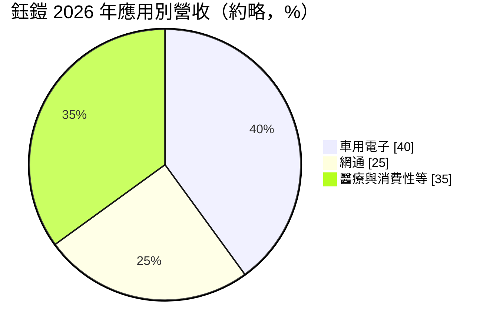
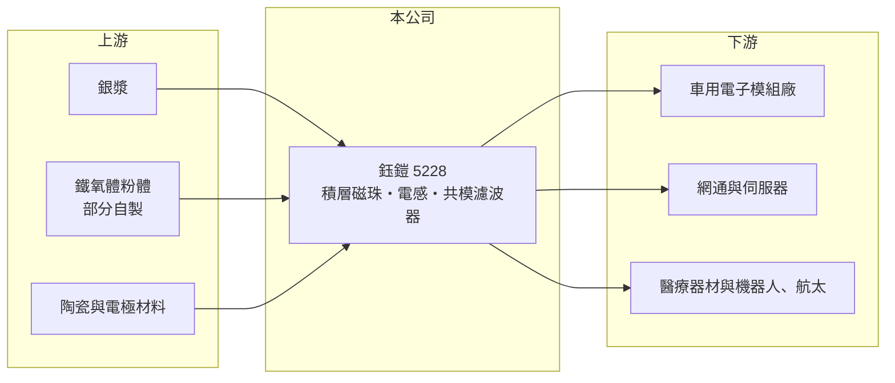

# 5228 鈺鎧

> 上櫃｜[[產業索引-電子零組件業|電子零組件業]]｜上市（櫃）日期 2022/05/20

# 第一章：企業模式與商業藍圖

> [!info] 撰寫說明
> 精簡版，由 Claude 依公開資料整理，架構比照 [[2330台積電]] 的四章研究，資料截至 2026-10-08。來源：Goodinfo 經營績效頁、富果研究 2026 年 9 月法說會摘要、CMoney 投資快訊標題、櫃買中心開放資料快照（基本資料、2026 年第二季損益與資產負債、本益比殖利率）。客戶名稱未查得。#待校對

鈺鎧是台中的積層式磁珠與電感製造商，近年把重心從消費性電子移往車用、醫療與網通。本章說明它的業務組成與轉型方向。

- **核心業務：** 鈺鎧成立於 1992 年，2022 年上櫃，主要產品是積層式晶片[[磁珠]]（抑制雜訊）、[[電感]]（射頻與電源用）與共模濾波器，另有客製化無線充電線圈與軟磁鐵氧體片。這些被動元件單價低、用量大，任何電子產品的電路板上都需要數十到上百顆。公司 2003 年切入車規產品，2006 年取得 TS16949 車用品質認證。
- **營收結構：** 依 2026 年法說會，磁珠約占營收七至八成，是最主要的產品線。應用別以車用電子約四成最大，網通約 25%，醫療與消費性電子占其餘，消費性比重持續下降。車用比重高，代表營收較少受手機與 PC 景氣影響，但也跟著汽車產量與電子化程度走。
- **營運據點：** 生產基地全部在台中精密機械科技創新園區，在台中營運超過 30 年。公司自建粉體廠掌握原料，設備也多為自製，搭配 AI 檢測與自動化生產。
- **長期方向：** 公司策略是離開價格競爭激烈的消費性市場，轉向車用、醫療（例如人工電子耳的無線充電模組、洗腎分析儀）、機器人與航太等利基應用。2026 年起投入航太用繞線電感開發，研發人力倍增，並擴大美國、日本、中東等客戶，降低對歐洲的依賴。

# 第二章：護城河深度與競爭優勢

鈺鎧的護城河來自車規與醫療認證帶來的客戶黏著度，以及原料自製的成本掌握。本章分析它的競爭條件。

- **競爭優勢：** 車用與醫療用被動元件須通過長時間的可靠度驗證，供應商一旦進入客戶的合格名單，同一平台通常會採購多年，形成[[車規驗證]]的轉換成本。鈺鎧在車用領域已有二十多年經驗，部分醫療客戶供貨超過五年。自建粉體廠讓它能調整材料配方，做出規格特殊的小量多樣產品，這是大廠較不願意承接的市場。
- **主要對手：** 磁珠與電感市場由日本村田、TDK、太陽誘電主導，台灣同業包括 [[2327國巨]]（含旗下奇力新）、[[3236千如]]、[[6284佳邦]] 等。鈺鎧規模遠小於這些對手，因此選擇避開標準品的價格戰，專攻利基應用。
- **觀察重點：** 第一，銀價成本轉嫁機制能否持續被客戶接受，銀漿約占總生產成本四成。第二，網通比重能否隨 AI 伺服器與交換器需求提升。第三，機器人與航太產品能否在 2027 年起帶來實際營收，以及夜班人力不足造成的產能瓶頸能否解決。

# 第三章：財務體質與盈利規模

資料日期：2026-10-08，表格是撰寫當時的快照；最新月營收、毛利率、累計 EPS 由自動排程寫在本筆記的屬性欄位（月營收、毛利率、累計EPS 等）。#待校對

鈺鎧的財報呈現被動元件產業典型的庫存循環：2023 至 2024 年大幅虧損，2026 年在產品組合與調價下明顯回升。本章用多年度數據說明。

| 年度 | 營收（億元） | [[毛利率]] | [[營業利益率]] | EPS（元） | [[ROE]] |
|---|---|---|---|---|---|
| 2020 | 5.11 | 25.8% | 6.99% | 0.87 | 6.09% |
| 2021 | 7.07 | 26.4% | 10.3% | 1.71 | 11.0% |
| 2022 | 6.88 | 25.2% | 7.15% | 1.38 | 8.15% |
| 2023 | 4.42 | 5.65% | -20.1% | -2.00 | -11.9% |
| 2024 | 4.30 | 4.68% | -18.9% | -2.11 | -14.5% |
| 2025 | 5.42 | 19.1% | -1.78% | -0.20 | -1.51% |
| 2026 上半年 | 3.82 | 34.3% | 17.7% | 1.80 | 未查得 |

- **營收規模：** 營收在 2021 年達 7.07 億元後，2023 至 2024 年掉到約 4.3 至 4.4 億元，2020 至 2025 年年複合成長率約 1.2%（推算）。2026 年上半年營收 3.82 億元，年增約 49%，已接近 2021 年的半年水準。
- **獲利：** 2023 至 2024 年營收下滑時毛利率跌到 5% 左右，顯示被動元件廠固定成本高、[[營業槓桿]]大。2026 年上半年毛利率回升到 34.3%，除了產能利用率回升，也包含銀價調價與低成本庫存的時間差，這部分不一定能長期維持。2021 至 2025 年平均 ROE 約 -1.8%（推算）。
- **財務特色：** 2026 年第二季末股東權益約 5.8 億元、負債約 6.7 億元，其中非流動負債約 4.5 億元，負債比約 54%，對一家小型被動元件廠而言偏高，推估與廠房設備的長期借款有關。期末現金約 0.23 億元，現金部位薄。近年未配發現金股利。

**[[ROIC]] 與 [[WACC]]：** 有息負債明細未查得，假設約 5 億元（推估，以非流動負債為主）。2026 年上半年營業利益約 0.67 億元，年化約 1.35 億元，稅後約 1.08 億元，投入資本以股東權益 5.8 億元加有息負債 5 億元，約 10.8 億元，ROIC 約 10%（推算，年化）；2025 年營業損失，ROIC 約 -1%（推算）。WACC 用 CAPM 推估：無風險利率 1.75%、市場風險溢酬 6%、β 取 1.0（被動元件股常見值，假設），股東權益成本約 7.8%；負債成本 2.5%、稅率 20%，以權益 54%、負債 46% 加權，WACC 約 5.1%（推算）。2026 年的回升讓 ROIC 暫時高於 WACC，但過去五年多數時間低於資金成本，能否長期創造價值要看利基應用的轉型是否穩定。

# 第四章：總體風險與地緣政治

鈺鎧的風險主要來自被動元件的庫存週期、原料價格與小型公司的資源限制。本章整理主要風險。

- **產業週期：** 被動元件是電子業最典型的[[長鞭效應]]產業，下游拉貨與去庫存會讓訂單大起大落，2023 至 2024 年的虧損就是去庫存造成。車用比重高雖能降低消費性景氣影響，但汽車產業同樣有庫存調整週期。
- **營運風險：** 銀漿占成本約四成，銀價大漲時若轉嫁不及，毛利率會被壓縮。產能瓶頸在人力而非設備，夜班招募困難會限制接單。公司規模小、現金部位薄，負債比偏高，景氣反轉時財務彈性有限。
- **其他風險：** 日本大廠若在車用與網通市場降價搶單，台灣小廠的價格壓力會加大。外銷比重高，新台幣升值會影響以台幣計價的獲利。醫療與航太產品的認證時間長，貢獻可能晚於預期。

# 專有名詞解析

## 應用

- **[[車規驗證]]**：車用零件須通過 AEC-Q 系列等可靠度測試與車廠認證，流程常需 2 至 3 年，因此轉換成本高。

## 金融

- **[[營業槓桿]]**：固定成本占比高時，營收小幅變動會讓營業利益大幅變動的現象。
- **[[長鞭效應]]**：終端需求的小幅變動，沿供應鏈往上游傳遞時被逐級放大，造成上游庫存與訂單劇烈波動。
- **[[ROIC]]**：投入資本報酬率，稅後營業利益除以股東權益加有息負債，衡量本業運用資本的效率。
- **[[WACC]]**：加權平均資金成本，股東權益成本與負債成本依資本結構加權，是 ROIC 必須超越的門檻。

## 產業

- **[[磁珠]]**：一種被動元件，利用鐵氧體材料吸收高頻雜訊，用於抑制電磁干擾（EMI）。
- **[[電感]]**：儲存磁能、阻擋交流變化的被動元件，常用於電源轉換與射頻電路。

# 核心供應鏈

- 上游：銀漿、鐵氧體粉體（部分自製）與電極材料供應商。
- 下游／客戶：歐洲為主的車用電子、網通、醫療器材客戶（名單未查得），逐步拓展美國、日本與中東。
- 同業：日本村田、TDK、太陽誘電；台灣 [[2327國巨]]、[[3236千如]]、[[6284佳邦]]。

## 最新新聞
<!-- news:start（自動產生，請勿手動編輯此範圍） -->
- 2026-10-13 🏛️ 重訊 14:12｜本公司有價證券近期股價量異常，故公告相關訊息， 以利投資人區別暸解｜[觀測站](https://mops.twse.com.tw/mops/#/web/t05st01)
- 2026-10-06 📰 媒體 18:50｜營收速報 - 鈺鎧(5228)9月營收9,074萬元年增率高達109.81％｜[鉅亨網](https://news.cnyes.com/news/id/6622884)

完整紀錄：[[5228鈺鎧 新聞]]
<!-- news:end -->

## 相關連結
- [公開資訊觀測站](https://mopsov.twse.com.tw/mops/web/t05st03?step=1&firstin=1&co_id=5228)
- [Goodinfo](https://goodinfo.tw/tw/StockDetail.asp?STOCK_ID=5228)
- [Yahoo 股市](https://tw.stock.yahoo.com/quote/5228)
- [鉅亨網新聞](https://www.cnyes.com/twstock/5228/news)
