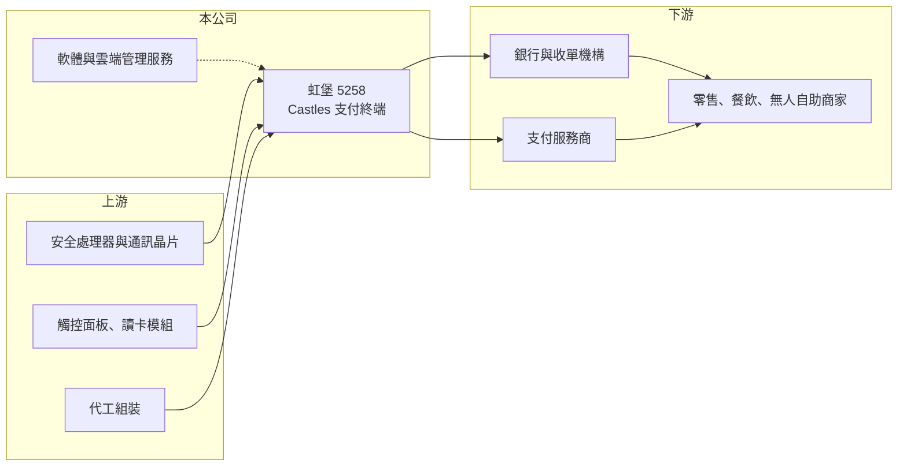

# 5258 虹堡

> 上市｜[[產業索引-電腦及週邊設備業|電腦及週邊設備業]]｜上市（櫃）日期 2016/12/30

# 第一章：企業模式與商業藍圖

> [!info] 撰寫說明
> 精簡版，由 Claude 依公開資料整理，架構比照 [[2330台積電]]，資料截至 2026-10-08。來源：證交所開放資料（基本資料、2026 年上半年財報、每月營收、股利）、Goodinfo 經營績效頁、旺得富 2026 年 5 月虹堡報導，以及財經媒體標題。地區營收比重未查得；國際競爭對手與產業背景憑過往認知整理。#待校對

本章說明虹堡科技（5258，以下簡稱虹堡）的商業模式：以 Castles 品牌在全球銷售電子支付終端機，把硬體、軟體與雲端服務打包賣給收單機構與支付業者。

- **核心業務：** 虹堡成立於 1993 年，總部在新北市新店，2016 年底上市，董事長為辛華熙。公司設計並銷售刷卡機、行動支付終端、Android 智慧 [[POS]] 終端與無人自助支付設備，產品必須通過 [[EMV]]、[[PCI]] 等國際支付安全認證，才能接上銀行與卡組織的系統。
- **營收結構：** 營收以海外為主，美國是需求最強的市場，歐洲、日本與東南亞也是重要市場（各地區比重未查得）。客戶主要是銀行、[[收單機構]]與支付服務商，它們向虹堡大量採購終端後，再租借或銷售給商家使用。
- **營運據點：** 研發與總部在台灣，並在墨西哥、紐西蘭、法國等地設立子公司提供在地服務，生產模式與廠區細節未查得（待校對）。2026 年公司表示將瞄準墨西哥、巴西、土耳其等新興市場。
- **長期方向：** 公司的目標是從硬體供應商轉型為支付終端解決方案商，整合硬體、軟體與雲端管理服務，並透過併購、策略聯盟與在地化經營擴展全球通路。全球電信業者淘汰 2G、3G 網路，以及無人商店、自助點餐等新場景，是終端汰換與新增需求的長期來源。

# 第二章：護城河深度與競爭優勢

本章分析虹堡的護城河：支付認證的門檻、與收單機構的長期合作，以及在歐美市場逐步上升的市占率。

- **競爭優勢：** 支付終端每一款新機都要通過國際安全認證與各國收單機構的系統驗證，流程常需一年以上，客戶導入後不會輕易更換，這構成明顯的轉換成本。依 Nilson Report 的統計，Castles 在美國與歐洲的出貨量排名持續上升，顯示它已打進主要市場的收單機構。
- **主要對手：** 國際龍頭包括 Ingenico、Verifone，以及中國的百富（PAX）與新大陸等，中國廠商以低價在東南亞與新興市場競爭。台股同業較少，[[6743安普新]] 等業者在部分支付與讀卡相關產品上有重疊（待校對）。
- **觀察重點：** 長期要看軟體與雲端服務收入能否提高，讓公司從一次性硬體銷售轉為經常性收入；其次是美國市場的市占能否持續擴大，以及面對中國廠商低價競爭時毛利率能否守在 30% 以上。

# 第三章：財務體質與盈利規模

資料日期：2026-10-08，表格是撰寫當時的快照；最新月營收、毛利率、累計 EPS 由自動排程寫在本筆記的屬性欄位（月營收、毛利率、累計EPS 等）。#待校對

本章用多年度數字檢視虹堡的成長與獲利循環。2022 至 2023 年是高峰，之後營收持平、費用上升，獲利逐年下滑。

| 年度 | 營收（億元） | [[毛利率]] | [[營業利益率]] | EPS（元） | [[ROE]] |
|---|---|---|---|---|---|
| 2020 | 37.3 | 25.8% | 5.98% | 2.23 | 14.6% |
| 2021 | 44.6 | 27.7% | 7.36% | 2.51 | 14.7% |
| 2022 | 74.0 | 31.3% | 13.9% | 8.19 | 34.7% |
| 2023 | 80.5 | 33.3% | 14.4% | 8.65 | 27.5% |
| 2024 | 78.3 | 33.2% | 9.79% | 6.35 | 17.3% |
| 2025 | 78.6 | 34.9% | 8.09% | 4.23 | 10.7% |

- **營收規模：** 2020 至 2025 年營收年複合成長率約 16%，主要成長發生在 2022 年，營收一年內增加約 66%，之後維持在 78 億至 80 億元。2026 年前 8 月累計營收 54.6 億元、年增約 15%，公司表示營收上下半年比重約 4 比 6，下半年是專案出貨高峰。
- **獲利：** 毛利率從 26% 穩定提升到 35%，代表產品組合與定價持續改善；但營業利益率從 2023 年的 14.4% 降到 2025 年的 8.1%，原因是推銷與研發費用隨海外據點擴張而增加。2026 年上半年毛利率 29.9%、營業利益率 3.4%、EPS 0.48 元，第一季因零組件成本、業外損失與推銷費用增加而虧損。
- **財務特色：** 近 5 年（2021 至 2025）平均 ROE 約 21%，但呈下降趨勢。2025 年度配發現金股利 1.0 元，約為當年 EPS 的四分之一，配發率偏低，保留盈餘用於海外擴張。2026 年第二季權益 46.3 億元、負債 46.7 億元，負債比約 50%，其中多數為流動負債。
- **[[ROIC]] 與 [[WACC]]：** 2025 年營業利益約 6.4 億元，稅後約 5.1 億元；以權益 46.3 億元加非流動負債 3.9 億元粗估投入資本約 50.2 億元，ROIC 約 10%（推算）。2023 年營業利益約 11.6 億元時，ROIC 推估在 20% 以上。WACC 以 [[CAPM]] 推估：無風險利率 1.75%、市場風險溢酬 6%、β 假設 0.9（電腦週邊設備股常見值），股東權益成本約 7.15%；稅後負債成本 2%、負債占資本 10%，WACC 約 6.6%（推算）。ROIC 仍高於 WACC，代表事業持續創造價值，但利差正在縮小，費用控制與服務收入的成長是維持利差的關鍵。

# 第四章：總體風險與地緣政治

本章整理虹堡長期要面對的風險。

- **產業週期：** 支付終端的需求由收單機構的換機計畫驅動，常以大型專案形式出貨，造成營收在季度間大幅波動。認證規範更新與網路世代汰換會帶來集中換機潮，換機潮結束後需求可能回落。
- **營運風險：** 客戶集中在少數大型收單機構與支付商，單一專案延後就會影響全年營收。中國廠商在新興市場以低價競爭，海外子公司擴張則推高營業費用，若營收成長跟不上，營業利益率會持續被壓縮。
- **其他風險：** 營收以美元與歐元為主，匯率波動影響毛利與業外損益；記憶體、晶片等零組件價格上漲會壓縮毛利。支付產業的資安要求與各國法規變動，可能增加認證成本；美國關稅政策也會影響出貨成本。

# 專有名詞解析

## 應用

- **[[POS]]**：銷售時點系統，商家用來結帳、刷卡與記錄交易的終端設備與軟體。
- **[[EMV]]**：由 Europay、Mastercard、Visa 制定的晶片卡支付標準，終端機必須通過認證才能受理晶片卡。
- **[[PCI]]**：支付卡產業安全標準，規範終端設備與系統如何保護持卡人資料。

## 金融

- **[[收單機構]]**：替商家處理刷卡交易並與卡組織清算的銀行或支付公司，是支付終端的主要採購者。
- **[[CAPM]]**：資本資產定價模型，以無風險利率加上 β 乘以市場風險溢酬，推估股東要求的報酬率。

# 核心供應鏈

- 上游：支付用安全處理器與通訊晶片、觸控面板與讀卡模組、組裝代工（個別供應商未查得）。
- 下游／客戶：歐美與亞洲的銀行、收單機構與支付服務商，終端使用者為零售、餐飲與無人自助商家（客戶名稱未公開）。
- 同業：Ingenico、Verifone、百富（PAX）、新大陸；台股可參考 [[6743安普新]]。

## 最新新聞
<!-- news:start（自動產生，請勿手動編輯此範圍） -->
- 2026-10-22 🏛️ 重訊 17:39｜公告本公司訂於115年10月23日發放現金股利，如因颱風 影響部分地區之現金股利發放將順延至下一個營業日｜[觀測站](https://mops.twse.com.tw/mops/#/web/t05st01)

完整紀錄：[[5258虹堡 新聞]]
<!-- news:end -->

## 相關連結
- [公開資訊觀測站](https://mopsov.twse.com.tw/mops/web/t05st03?step=1&firstin=1&co_id=5258)
- [Goodinfo](https://goodinfo.tw/tw/StockDetail.asp?STOCK_ID=5258)
- [Yahoo 股市](https://tw.stock.yahoo.com/quote/5258)
- [鉅亨網新聞](https://www.cnyes.com/twstock/5258/news)
