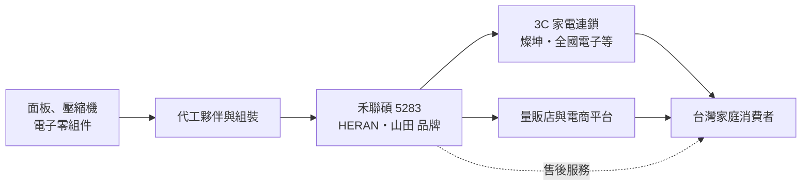
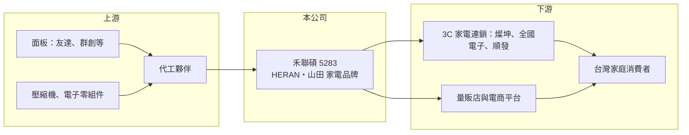

# 5283 禾聯碩

> 上市｜[[產業索引-電器電纜|電器電纜]]｜上市（櫃）日期 2019/05/24

# 第一章：企業模式與商業藍圖

> [!info] 撰寫說明
> 本文由 Claude 依公開資料整理，架構比照 [[2330台積電]] 的四章研究，資料截至 2026-10-08。財務數字來源：Goodinfo 年度經營績效頁與基本資料頁、證交所開放資料（基本資料、資產負債、綜合損益、營益分析、股利、每月營收）；品牌策略參考優分析、工商時報等新聞標題。產品別營收比重與市占率公開資料有限，部分描述憑記憶整理並標註待校對，產業描述為整理性內容，尚未逐條比對原始文件。#待校對

在評估單一個股的長期投資價值時，首要步驟是拆解企業的底層獲利邏輯。本章說明禾聯碩（股票代號：5283）如何以「HERAN 禾聯」品牌，用平價策略在台灣電視與空調市場站穩腳步。

## 一、核心定位：台灣本土的平價家電品牌

禾聯碩成立於 2002 年 5 月，2019 年 5 月在證交所上市，實收資本額約 8.76 億元（2026 年配發股票股利後，第二季資產負債表上的股本已增加到約 10.2 億元），董事長為蔡柏毅。公司以[[自有品牌]]「HERAN 禾聯」經營液晶電視、冷氣、冰箱、洗衣機與各式生活家電，主要市場在台灣。#待校對

禾聯碩的商業模式是「品牌加委外製造」：公司負責產品規劃、規格設計、品牌行銷與售後服務，大部分產品的生產交給代工夥伴，或採購面板等關鍵零組件後在台灣組裝（憑記憶，待校對）。這種模式的好處是資本支出輕，能把資源集中在通路與服務；代價是毛利率要靠品牌與產品組合撐住，而不是靠製造成本優勢。#待校對

* **電視起家：** 禾聯在 2010 年代以價格親民的液晶電視打開市場，在台灣電視銷售量排名居前（憑記憶，待校對）。電視是面板成本占比很高的產品，面板價格的起伏會直接影響毛利。
* **空調擴大規模：** 公司後來把品牌延伸到[[變頻空調]]、冰箱與洗衣機。空調是台灣家庭單價最高、換機需求穩定的家電之一，夏季旺季的出貨對全年營收很重要，2026 年 8 月營收較 7 月減少約 22%，就是旺季結束的季節性變化。

## 二、雙品牌策略

依新聞報導，禾聯碩採取雙品牌策略，主品牌 HERAN 之外另經營子品牌「山田」（子品牌的營收規模與成立時間未查得）。[[多品牌經營]]的目的通常是用不同品牌區隔價位帶與通路，例如主品牌守住量販與 3C 通路，子品牌主攻電商或特定價位，避免主品牌降價傷害形象。#待校對

## 三、長期方向

台灣家電市場規模成熟，人口與家戶數成長有限，禾聯碩的成長空間主要來自：擴充品類（大家電與小家電）、提高高單價產品比重，以及透過子品牌爭取不同客群。2026 年 6 月股東會改選董事長並解除董事競業限制，6 月底總經理退休、8 月公告新任總經理，經營團隊在 2026 年出現交接，策略延續性值得觀察。

# 第二章：護城河深度與競爭優勢

在長期價值投資中，「護城河」指企業抵禦競爭、維持超額利潤的保護機制。本章分析禾聯碩的品牌優勢與限制。

## 一、護城河的組成

* **品牌認知與性價比定位：** 在台灣消費者心中，HERAN 代表「價格實在的本土品牌」，介於日韓大品牌與無名白牌之間。這個定位讓禾聯碩的毛利率長期維持在 31% 至 39%，遠高於代工廠的水準。
* **通路覆蓋與售後服務：** 家電是需要安裝與維修的產品，全台的服務據點與通路關係是新進品牌難以短期複製的門檻（服務據點數未查得）。
* **輕資產模式：** 不自建大型工廠，資本支出低，景氣低迷時不必承擔產能閒置的成本。

## 二、競爭對手格局

| 對手 | 定位 | 對禾聯碩的影響 |
|---|---|---|
| 日系品牌（Panasonic、日立、大金、[[6753夏普]]、[[SONY索尼]]） | 中高價位、品牌形象強 | 壓縮高階市場，空調與冰箱競爭激烈 |
| 韓系品牌（[[005930三星電子]]、LG） | 電視與大家電全球領導品牌 | 電視中高階市場的主要對手 |
| 台灣本土品牌（[[2371大同]]、[[1504東元]]、[[1604聲寶]]、[[1614三洋電]]） | 本土老品牌、通路深 | 在平價與中價位直接競爭 |
| 中國品牌（[[1810小米]]、TCL 等） | 低價、規格高 | 電視與小家電價格壓力 |

## 三、守得住與守不住的地方

* **守得住：** 毛利率。2019 至 2025 年毛利率從未低於 31%，代表品牌溢價相當穩固。
* **守不住：** 費用率與成長。營業利益率從 2020 年的 18.2% 降到 2024 年的 6.87%，毛利率只降了約 7 個百分點，營業利益率卻掉了 11 個百分點，代表行銷、通路與人事費用占營收比重大幅提高，競爭變得更花錢。
* **觀察重點：** 營業費用率能否回落、子品牌是否帶來增量而非自我侵蝕，以及新經營團隊的策略。

# 第三章：財務體質與盈利規模

資料日期：2026-10-08。數字取自 Goodinfo 年度經營績效頁與證交所開放資料，表格是撰寫當時的快照；最新月營收、毛利率、累計 EPS 由自動排程寫在本筆記的屬性欄位（月營收、毛利率、累計EPS 等）。#待校對

財務報表是檢驗護城河是否真實存在的最終標準。本章用多年度三率、ROE 與資本報酬，檢視禾聯碩的獲利品質。

## 一、多年度獲利

| 年度 | 營收（新台幣） | [[毛利率]] | [[營業利益率]] | EPS（元） | [[ROE]] |
|---|---|---|---|---|---|
| 2019 | 57.9 億 | 36.2% | 16.4% | 10.73 | 22.5% |
| 2020 | 60.3 億 | 39.1% | 18.2% | 12.73 | 24.6% |
| 2021 | 63.6 億 | 36.2% | 13.2% | 10.69 | 19.8% |
| 2022 | 68.4 億 | 31.8% | 10.8% | 10.21 | 18.1% |
| 2023 | 61.9 億 | 33.5% | 9.83% | 7.78 | 13.5% |
| 2024 | 64.2 億 | 31.7% | 6.87% | 6.40 | 10.9% |
| 2025 | 64.7 億 | 33.0% | 8.30% | 5.63 | 10.8% |
| 2026 上半年 | 33.3 億 | 33.28% | 7.26% | 2.90 | 未查得 |

註：2026 年 1 至 8 月累計營收 45.8 億元，年增約 0.6%。

* **營收停滯、獲利下滑：** 七年營收在 58 億至 68 億元之間，幾乎沒有成長，稅後淨利從 2020 年高峰 9.4 億元降到 2025 年 4.93 億元。2020 年的高峰可能與疫情期間居家消費需求有關（推估）。
* **營收年複合成長率：** 2020 至 2025 年約 1.4%（推算），屬於成熟市場。
* **業外收益占比高：** 2026 年上半年營業利益 2.42 億元，業外收益 0.76 億元，業外約占稅前淨利的四分之一。

## 二、長期指標

* **平均 ROE：** 2021 至 2025 年平均約 14.6%（推算），但逐年下滑，從接近 20% 降到約 11%。
* **股利：** 2025 年度分上下半年配發，合計現金股利 0.4 元與股票股利 1.6 元，[[盈餘轉增資]]比重很高，與過去以現金股利為主（Goodinfo 統計歷年平均現金股利 4.44 元）的作法不同。配股會增加股本、稀釋每股盈餘，資本配置習慣的轉變值得追蹤。
* **資產結構：** 2026 年第二季總資產 94.4 億元，負債 44.1 億元、權益 50.4 億元，負債比約 47%；非流動資產 43.3 億元，占總資產比重偏高，可能包含不動產與長期投資（推估）。每股淨值 57.48 元。

## 三、[[ROIC]] 與 [[WACC]]：價值創造利差

**ROIC 推算：** 2025 年營業利益約 5.37 億元（64.7 億元 × 8.3%），稅後約 4.30 億元。以權益 50.4 億元計算 ROIC 約 8.5%；若把負債 44.1 億元全部計入，約 4.6%（推算）。負債中多為應付帳款等營運負債，有息負債金額未查得，實際 ROIC 應較接近 8.5%。

**WACC 推算：** 權益成本以 [[CAPM]] 估算，台灣 10 年期公債 1.75%、市場風險溢酬 6%、β 取 0.8（家電品牌業常見值，非來源數字），約 6.55%；負債成本假設 2.5%，稅後 2%。假設權益占資本 85%，WACC 約 5.9%（推算）。

**結論：** 禾聯碩在 2019 至 2021 年的 ROIC 明顯高於 WACC，是一家高報酬的輕資產品牌公司；近年 ROIC 降到 8% 左右，仍高於 WACC，但利差已大幅收窄。長期價值取決於能否止住營業利益率的下滑。

# 第四章：總體風險與地緣政治

任何企業都無法脫離宏觀環境獨立存在。本章分析禾聯碩必須面對的需求、成本與外部風險。

## 一、產業週期

* **家電換機週期：** 電視與空調的換機週期約 7 至 10 年，疫情期間提前換機的需求會在之後幾年形成空窗。
* **天氣與政策：** 空調銷售高度依賴夏季氣溫；政府節能家電補助政策的開辦或結束，會造成需求提前或遞延。

## 二、營運風險

* **面板與零組件成本：** 電視成本中面板占比很高，面板價格上漲時若無法反映在售價，毛利會被壓縮。
* **通路議價：** 家電連鎖、量販與電商平台的集中度提高，通路的上架費、促銷費與分潤會增加營業費用。
* **代工依賴：** 產品多委外生產，代工夥伴的品質或交期問題會直接影響品牌商譽。

## 三、其他風險

* **匯率：** 進口零組件與成品以美元計價，新台幣貶值會增加成本。
* **經營團隊交接：** 2026 年董事長改選與總經理更替，新團隊的策略方向尚待觀察。
* **股本膨脹：** 連續配發股票股利會讓股本增加，若獲利沒有同步成長，EPS 與 ROE 都會被稀釋。

# 專有名詞解析

## 金融

- **[[盈餘轉增資]]**：公司把可分配盈餘轉成股本、以股票形式發給股東，股東持股數增加，但每股盈餘會被稀釋。
- **[[配發率]]**：現金股利占當年度每股盈餘的比例，用來衡量公司把多少獲利分給股東。

## 產業

- **[[自有品牌]]**：公司以自己的商標銷售產品，需要負擔行銷與通路費用，但能保留品牌溢價。
- **[[變頻空調]]**：以變頻壓縮機依室溫調整運轉速度的冷氣，比定頻機種省電，是台灣空調市場的主流。
- **[[多品牌經營]]**：同一家公司同時經營多個品牌，以不同品牌區隔價位、通路與客群。

# 核心供應鏈

## 1. 上游：零組件與代工
- 液晶面板：[[2409友達]]、[[3481群創]]（是否為直接供應商未查得）
- 電視代工可參考：[[2489瑞軒]]（是否為合作夥伴未查得）
- 壓縮機與電子零組件（供應商名稱未查得）

## 2. 本公司與同業
- 台灣家電品牌：[[2371大同]]、[[1504東元]]、[[1604聲寶]]、[[1614三洋電]]
- 國際品牌：[[005930三星電子]]、[[SONY索尼]]、[[6753夏普]]、LG、Panasonic、大金

## 3. 下游：通路
- 3C 家電連鎖：[[2430燦坤]]、[[6154順發]]、全國電子（未上市）
- 量販與電商平台

## 最新新聞
<!-- news:start -->
<!-- news:end -->

## 相關連結
- [公開資訊觀測站](https://mopsov.twse.com.tw/mops/web/t05st03?step=1&firstin=1&co_id=5283)
- [Goodinfo](https://goodinfo.tw/tw/StockDetail.asp?STOCK_ID=5283)
- [Yahoo 股市](https://tw.stock.yahoo.com/quote/5283)
- [鉅亨網新聞](https://www.cnyes.com/twstock/5283/news)
