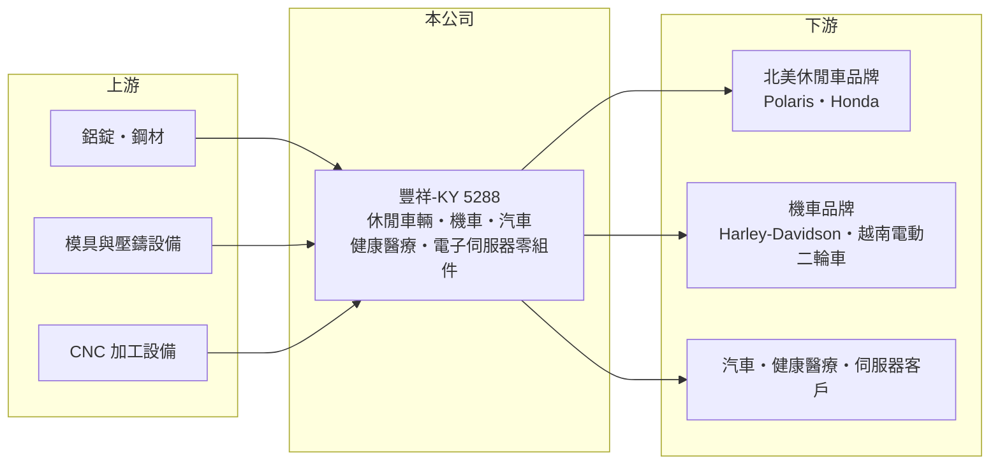

# 5288 豐祥-KY

> 上市｜[[產業索引-電機機械|電機機械]]｜上市（櫃）日期 2014/09/25

# 第一章：企業模式與商業藍圖

> [!info] 撰寫說明
> 精簡版，由 Claude 依公開資料整理，架構比照 [[2330台積電]]，資料截至 2026-10-08。來源：證交所開放資料快照（基本資料、2026 年第二季資產負債與損益、營益分析、股利、每月營收）、Goodinfo 歷年經營績效表、工商時報 2026 年 4 月報導。產品製程與生產據點部分憑既有知識撰寫，已標待校對；依產品別的營收比重未查得。#待校對

豐祥控股（豐祥-KY，以下簡稱豐祥）是北美休閒車輛與機車的金屬零組件供應商，理解它的關鍵在於：它跟著 Polaris、Honda、Harley-Davidson 這類品牌的新車款開發零件，營收隨北美休閒車市場的景氣起伏，但長期維持兩成上下的 ROE，在電機機械類股中屬於資本報酬率較高的公司。

- **核心業務：** 豐祥以開曼群島控股公司形式於 2011 年設立，2014 年 9 月在證交所上市，台灣聯絡處位於新北市新莊。公司生產休閒車輛、機車、健康醫療器材與汽車用的金屬零組件，製程以鋁合金[[壓鑄]]與後段機械加工為主（待校對）。休閒車輛指的是全地形車（[[ATV]]）與並座越野車（[[SXS]]），主要市場在北美。
- **營收結構：** 依工商時報 2026 年 4 月報導，休閒車輛是最主要的營收來源，其次為機車、健康醫療、汽車，以及 2026 年 3 月開始小量出貨的電子與伺服器產品（伺服器機櫃與散熱相關）。各產品的營收比重未查得。2025 年合併營收 68.05 億元、年減 7%，主因是機車與健康醫療營收下滑。
- **營運據點：** 生產基地位於中國大陸與越南（待校對）。董事會已通過投資 500 萬美元在越南設立新公司，生產電子相關產品，以因應美國關稅政策下電子供應鏈移往東南亞的趨勢。越南限制燃油機車帶動的電動二輪車需求，也是機車業務的新動能。
- **長期方向：** 豐祥的長期策略有兩條：一是持續承接北美客戶的新車款零件，報導指出 Honda 在 2025 年成為第三大客戶、新款 SXS 訂單 2026 年 3 月開始出貨；二是把金屬加工能力延伸到汽車（越南電動車零件）與電子伺服器，降低對休閒車市場單一循環的依賴。

# 第二章：護城河深度與競爭優勢

豐祥的護城河來自與北美休閒車品牌的長期開發合作、多地生產的成本與關稅彈性，屬於窄但穩定的護城河。

- **競爭優勢：** 休閒車輛的零件需要配合車廠新車款同步開發，從模具、試作到量產驗證需要一至兩年，供應商一旦被選定，通常會供貨到車款改款為止，轉換成本高。豐祥能同時服務 Polaris、Honda 與 Harley-Davidson 等多家品牌，代表其開發與量產能力受到不同車廠認可。營業利益率長期維持在 12% 至 15%，在汽機車零組件業中屬於較高水準。
- **主要對手：** 主要競爭者包括中國大陸與北美在地的壓鑄與機械加工廠（待校對），以及車廠自有的零件部門。國內上市櫃中，鋁合金輪圈廠 [[1563巧新]] 同樣以北美休閒與運動車輛為重要市場（待校對），越野車品牌 [[1599宏佳騰]] 則屬於同一產業的整車廠。
- **觀察重點：** 2026 年 1 至 8 月累計營收年增約 35%，公司說明主因是北美休閒車輛客戶新產品出貨。長期應追蹤客戶分散程度（Honda 的占比提升是正面訊號）、電子伺服器與汽車業務能否形成規模，以及越南產能對關稅風險的緩衝效果。

# 第三章：財務體質與盈利規模

資料日期：2026-10-08，表格是撰寫當時的快照；最新月營收、毛利率、累計 EPS 由自動排程寫在本筆記的屬性欄位（月營收、毛利率、累計EPS 等）。#待校對

豐祥的財務特色是高 ROE、幾乎沒有長期負債，以及半年配息的股利政策。

| 年度 | 營收（億元） | [[毛利率]] | [[營業利益率]] | EPS（元） | [[ROE]] |
|---|---|---|---|---|---|
| 2020 | 46.6 | 19.5% | 13.2% | 8.40 | 18.0% |
| 2021 | 57.2 | 18.5% | 11.9% | 9.53 | 19.5% |
| 2022 | 80.4 | 19.4% | 13.6% | 14.29 | 24.0% |
| 2023 | 72.7 | 21.0% | 14.9% | 15.60 | 21.8% |
| 2024 | 72.8 | 22.2% | 15.5% | 17.01 | 20.4% |
| 2025 | 68.1 | 22.4% | 13.7% | 12.25 | 13.8% |
| 2026 上半年 | 44.7 | 23.6% | 14.4% | 8.03 | 未查得 |

（來源：Goodinfo 歷年經營績效表；2026 上半年取自證交所營益分析開放資料。）

- **營收規模：** 2020 至 2025 年營收年複合成長率約 7.9%（推算）。2022 年營收衝上 80.4 億元高峰，反映疫情後北美戶外休閒需求暴增；2023 至 2025 年隨客戶去庫存逐步回落。2026 年上半年營收已達 44.7 億元，約為 2025 年全年的三分之二。
- **獲利：** 2021 至 2025 年平均 ROE 約 19.9%（推算），在汽機車零組件業中屬於突出的水準。毛利率由 2021 年的 18.5% 逐年提高到 2026 年上半年的 23.6%，代表產品組合與定價持續改善；2025 年 EPS 下滑主要是營收減少與營業利益率回落。
- **財務特色：** 依 2026 年第二季資料，總資產 86.3 億元、負債 22.7 億元、權益 63.6 億元，負債比率約 26%，其中非流動負債僅約 0.35 億元，幾乎沒有長期借款；每股淨值 91.11 元。公司章程允許每半會計年度分派盈餘，2025 年下半年配發現金股利 6.5 元，2026 年上半年則決議不配發。全年配息率與自由現金流是否長期為正未查得。
- **[[ROIC]] 與 [[WACC]]：** 2025 年營業利益約 9.33 億元（68.1 億元 × 13.7%），稅後營業利益約 7.46 億元（實際稅率約 25%，此處依統一假設 20%）；有息負債未查得，投入資本以權益 63.6 億元到權益加總負債 86.3 億元為區間，ROIC 約 8.6% 至 11.7%（推算），2022 至 2024 年高峰時推估在 15% 以上。WACC 以 CAPM 推估：無風險利率 1.75%、市場風險溢酬 6%、β 假設 1.1（汽機車零組件股常見值），權益成本約 8.4%；稅後負債成本約 2%、負債權重假設 10%，WACC 約 7.7%（推算）。豐祥的 ROIC 長期高於 WACC，即使在 2025 年的谷底仍維持正利差，代表它是持續創造經濟價值的公司。

# 第四章：總體風險與地緣政治

豐祥的風險主要來自北美休閒車市場的循環、客戶集中，以及關稅與地緣政治。

- **產業週期：** 休閒車輛屬於非必需消費品，需求受北美利率、消費信心與經銷商庫存影響，2022 年高峰後的去庫存就讓營收連續三年下滑。這種需求波動沿供應鏈向上放大，屬於[[長鞭效應]]。
- **營運風險：** 營收集中在少數北美品牌，若主要客戶的車款銷售不佳或改由其他供應商生產，影響會很大（客戶占比未查得，待校對）。電子伺服器是新業務，初期規模小、技術與客戶都需重新建立，投資回收期不確定。
- **其他風險：** 生產基地在中國大陸與越南（待校對），美國對中國與越南的關稅政策變化會直接影響客戶的採購決策；鋁價波動會影響原料成本，美元匯率則影響以新台幣計算的營收與獲利。作為 KY 公司，跨境治理與資訊揭露也是長期需關注的面向。

# 專有名詞解析

## 金融

- **[[長鞭效應]]**：終端需求的小幅變動，沿供應鏈往上游傳遞時被逐級放大，造成上游庫存與訂單劇烈波動。

## 產業

- **[[壓鑄]]**：把熔融的鋁、鋅等金屬高壓注入模具成形的製程，用於車用零件與設備外殼。
- **[[ATV]]**：All-Terrain Vehicle，全地形車的英文縮寫，國內常稱沙灘車。
- **[[SXS]]**：Side-by-Side，並座越野車，駕駛與乘客並排而坐的四輪越野車，用於休閒、農場與工作用途。

# 核心供應鏈

- 上游：鋁錠與鋼材供應商、模具與壓鑄設備、CNC 加工設備（具體供應商未查得）。
- 下游／客戶：Polaris、Honda、Harley-Davidson 等北美休閒車與機車品牌，越南電動二輪車與電動車零件客戶，健康醫療與伺服器客戶。
- 同業：[[1563巧新]]、[[1599宏佳騰]]（越野車整車廠），以及中國大陸與北美的壓鑄加工廠。

## 最新新聞
<!-- news:start -->
<!-- news:end -->

## 相關連結
- [公開資訊觀測站](https://mopsov.twse.com.tw/mops/web/t05st03?step=1&firstin=1&co_id=5288)
- [Goodinfo](https://goodinfo.tw/tw/StockDetail.asp?STOCK_ID=5288)
- [Yahoo 股市](https://tw.stock.yahoo.com/quote/5288)
- [鉅亨網新聞](https://www.cnyes.com/twstock/5288/news)
