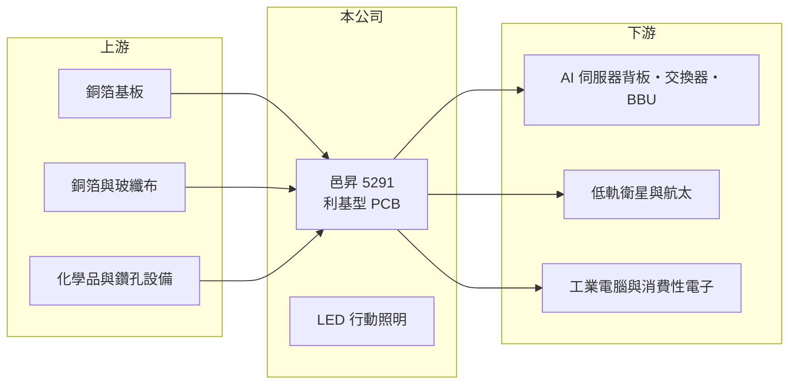

# 5291 邑昇

> 上櫃｜[[產業索引-電子零組件業|電子零組件業]]｜上市（櫃）日期 2014/12/23

# 第一章：企業模式與商業藍圖

> [!info] 撰寫說明
> 精簡版，由 Claude 依公開資料整理，架構比照 [[2330台積電]] 的四章研究，資料截至 2026-10-08。來源：Goodinfo 經營績效頁、優分析 2026 年報導、CMoney 投資快訊標題、櫃買中心開放資料快照（基本資料、2026 年第二季損益與資產負債、本益比殖利率）。產品別營收比重、工廠所在地與客戶名稱未查得，公開資料有限。#待校對

邑昇是中小型的[[印刷電路板]]（PCB）廠，近年把產品組合從工業電腦與消費性電子，轉向 AI 伺服器周邊、網通與航太衛星等利基應用。本章說明它的業務與轉型方向。

- **核心業務：** 邑昇成立於 1994 年，2014 年上櫃，本業是印刷電路板製造，另有 LED 行動照明產品。PCB 是所有電子產品承載零件與傳遞訊號的基礎，不同應用對層數、材料與可靠度的要求差異很大，中小型板廠通常靠專攻特定應用、提供少量多樣的服務生存。
- **營收結構：** 產品別比重未查得。依報導，成長動能來自 AI 伺服器背板、交換器與[[BBU]]（備援電池模組）用板，低軌衛星用板約占 PCB 業務一成；公司刻意降低技術門檻較低的工業電腦與消費性電子板比重。這樣的轉變代表營收將更多跟著資料中心與衛星的長期投資走。
- **營運據點：** 工廠所在地在本次資料中未查得。公司已取得 AS9100 航太品質認證，並宣稱加入台灣半導體相關的國產化供應鏈。
- **長期方向：** 公司自 2021 年起切入衛星市場，已成為一家全球一線客戶的合格供應商，並持續推進新專案認證、往軍用與航太高階利基應用發展。在原料面，公司採多元採購與快速替代料策略，並把部分原料漲價轉嫁給客戶。

# 第二章：護城河深度與競爭優勢

邑昇的競爭力來自利基應用的認證與少量多樣的接單彈性，而不是規模。本章分析它的競爭條件。

- **競爭優勢：** 航太與衛星用板須通過 AS9100 等品質系統與客戶的長期驗證，供應商一旦進入，轉換成本高，訂單也較不受價格戰影響。中小型板廠在小批量、高混合度的訂單上比大廠更有彈性，這是邑昇能接到一線衛星客戶的主要原因。
- **主要對手：** 台灣 PCB 產業競爭者眾多，大型廠如 [[2368金像電]]、[[3044健鼎]]、[[2313華通]] 等在伺服器與衛星板都有布局，其中華通在低軌衛星板規模領先。邑昇規模小很多，必須在大廠不願承接的小量專案中找空間。
- **觀察重點：** 第一，AI 與網通相關板材比重能否持續提高，讓營收擺脫工控與消費性景氣。第二，衛星與航太專案從認證走到量產的速度。第三，營業利益率能否回到 2021 至 2022 年一成以上的水準，這代表產品組合升級是否真的反映在獲利。

# 第三章：財務體質與盈利規模

資料日期：2026-10-08，表格是撰寫當時的快照；最新月營收、毛利率、累計 EPS 由自動排程寫在本筆記的屬性欄位（月營收、毛利率、累計EPS 等）。#待校對

邑昇的財報顯示 2021 至 2022 年是獲利高峰，2023 至 2025 年營收與獲利大幅回落，2026 年開始回升。本章用多年度數據說明。

| 年度 | 營收（億元） | [[毛利率]] | [[營業利益率]] | EPS（元） | [[ROE]] |
|---|---|---|---|---|---|
| 2020 | 12.0 | 19.0% | 7.3% | 1.86 | 8.84% |
| 2021 | 15.6 | 23.6% | 13.1% | 4.18 | 18.5% |
| 2022 | 15.5 | 24.7% | 13.0% | 4.42 | 17.6% |
| 2023 | 9.45 | 20.3% | 2.06% | 0.34 | 1.22% |
| 2024 | 9.86 | 21.5% | 0.73% | 0.39 | 約 1.6%（推算） |
| 2025 | 10.8 | 20.1% | 1.38% | 0.31 | 約 1.3%（推算） |
| 2026 上半年 | 7.14 | 21.7% | 7.0% | 0.92 | 未查得 |

註：Goodinfo 頁面 2024、2025 年的 ROE 欄位與 EPS 對不上，表中改以 EPS ÷ 每股淨值約 24 元推算。

- **營收規模：** 營收在 2021 至 2022 年約 15.5 億元，2023 年降到 9.45 億元，2020 至 2025 年年複合成長率約 -2.1%（推算）。2026 年上半年營收 7.14 億元，1 至 8 月累計約 10.4 億元，已接近 2025 年全年水準。
- **獲利：** 毛利率長期維持在 19% 至 25% 之間，相對穩定，但營業利益率在 2023 至 2025 年只剩 1% 至 2%，說明營收縮小時固定費用吃掉大部分毛利，是[[營業槓桿]]的表現。2026 年上半年營業利益率回到 7%。2021 至 2025 年平均 ROE 約 8%（推算），波動很大。
- **財務特色：** 2026 年第二季末母公司權益約 9.9 億元、負債約 12.8 億元（其中流動負債約 9.0 億元），負債比約 56%，對 PCB 廠而言中等偏高，反映營運資金與設備投資需求。近年現金股利紀錄未查得。

**[[ROIC]] 與 [[WACC]]：** 有息負債明細未查得，假設約 6 億元（推估）。2025 年營業利益約 0.15 億元，稅後約 0.12 億元，投入資本以股東權益約 10 億元加有息負債 6 億元，約 16 億元，ROIC 不到 1%（推算）；2026 年上半年年化營業利益約 1.0 億元，ROIC 約 5%（推算）；2021 至 2022 年獲利高峰時 ROIC 推估約 12%。WACC 用 CAPM 推估：無風險利率 1.75%、市場風險溢酬 6%、β 取 1.0（PCB 股常見值，假設），股東權益成本約 7.8%；負債成本 2.5%、稅率 20%，以權益 62%、負債 38% 加權，WACC 約 5.6%（推算）。邑昇在景氣高峰 ROIC 高於 WACC，但 2023 至 2025 年明顯低於資金成本，2026 年回到接近打平；長期能否創造價值，取決於高階利基板的比重能否穩定提高。

# 第四章：總體風險與地緣政治

邑昇的風險來自 PCB 產業的週期、原料成本與小型廠的規模劣勢。本章整理主要風險。

- **產業週期：** PCB 需求跟著終端電子產品與資料中心投資循環，2023 年營收大減就是工控與消費性客戶去庫存的結果，屬於[[長鞭效應]]。AI 伺服器需求目前強勁，但資料中心資本支出也有高低循環。
- **營運風險：** 銅箔基板、銅箔與玻纖布等原料價格上漲時，小型板廠轉嫁能力較弱。衛星與航太客戶數量少，單一專案延遲就會影響營收。高階板需要持續投資設備，對負債比已偏高的公司是一項負擔。
- **其他風險：** 匯率、電價與環保法規（PCB 製程的廢水處理）會影響成本。大型 PCB 廠擴充高階產能後，可能壓縮中小型廠的利基市場。

# 專有名詞解析

## 應用

- **[[BBU]]**：電池備援單元，資料中心在市電中斷時提供短時間電力的電池模組，AI 伺服器機櫃的標準配備之一。

## 金融

- **[[營業槓桿]]**：固定成本占比高時，營收小幅變動會讓營業利益大幅變動的現象。
- **[[長鞭效應]]**：終端需求的小幅變動，沿供應鏈往上游傳遞時被逐級放大，造成上游庫存與訂單劇烈波動。
- **[[ROIC]]**：投入資本報酬率，稅後營業利益除以股東權益加有息負債，衡量本業運用資本的效率。
- **[[WACC]]**：加權平均資金成本，股東權益成本與負債成本依資本結構加權，是 ROIC 必須超越的門檻。

## 產業

- **[[印刷電路板]]**：PCB，承載電子零件並以銅線路連接訊號與電源的基板，是所有電子產品的基礎零件。

# 核心供應鏈

- 上游：銅箔基板廠如 [[2383台光電]]、[[6213聯茂]]、[[6274台燿]]（推估），以及銅箔與玻纖布供應商。
- 下游／客戶：AI 伺服器與網通設備廠、全球一線衛星客戶（名稱未查得）、工業電腦廠。
- 同業：[[2368金像電]]、[[3044健鼎]]、[[2313華通]]。

## 最新新聞
<!-- news:start -->
<!-- news:end -->

## 相關連結
- [公開資訊觀測站](https://mopsov.twse.com.tw/mops/web/t05st03?step=1&firstin=1&co_id=5291)
- [Goodinfo](https://goodinfo.tw/tw/StockDetail.asp?STOCK_ID=5291)
- [Yahoo 股市](https://tw.stock.yahoo.com/quote/5291)
- [鉅亨網新聞](https://www.cnyes.com/twstock/5291/news)
