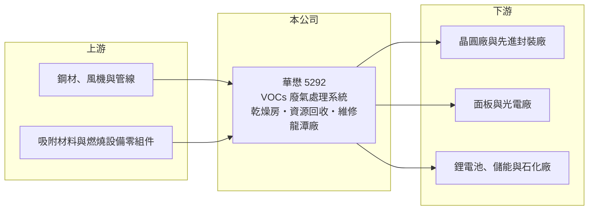

# 5292 華懋

> 上市｜[[產業索引-綠能環保|綠能環保]]｜上市（櫃）日期 2020/01/07

# 第一章：企業模式與商業藍圖

> [!info] 撰寫說明
> 精簡版，由 Claude 依公開資料整理，架構比照 [[2330台積電]]，資料截至 2026-10-08。來源：Goodinfo 經營績效年表（2019 至 2025 年）；優分析報導（產品線、產業別比重、龍潭廠與擴廠）；證交所開放資料快照（基本資料、2026 年第二季資產負債與上半年損益、股利）。具體客戶名單與產品別比重未查得。#待校對

華懋科技（以下簡稱華懋）成立於 1989 年 9 月、2023 年 11 月在證交所上市，總部在桃園市中壢區，主要工廠在桃園龍潭，董事長為鄭石治，總經理為林國源。它專做半導體與光電廠的[[揮發性有機物]]（[[VOCs]]）廢氣處理系統，是晶圓廠擴廠時必須同步採購的環保設備供應商，近五年營收成長約一倍半。

- **核心業務：** 華懋的核心產品是 VOCs 污染防治系統，用來處理晶圓廠與面板廠製程中排出的有機溶劑廢氣，避免直接排放造成空污。其他產品線包括鋰電池製程用的特殊乾燥房與節能系統、儲能與石化產業的資源回收系統，以及設備維修保養服務。VOCs 處理常見的技術是以[[沸石濃縮轉輪]]吸附濃縮廢氣後再燃燒分解（華懋採用的技術細節待校對）。
- **營收結構：** 依優分析整理，工程收入約占 86.4%，其餘為維修保養等；產業別中半導體的比重從 2022 年的 73% 提高到 2024 年超過八成，訂單以台灣市場為主。這代表華懋的成長幾乎完全綁在台灣晶圓廠的擴廠節奏上。
- **營運據點：** 龍潭廠產能已接近滿載，公司規劃購地擴廠，新廠預計 2026 至 2027 年間完工，整體產能可望擴充三成以上（待校對）。另規劃東南亞新產線，海外布局仍在早期階段。
- **長期方向：** 長期成長動能有三個：台灣晶圓廠持續擴建先進製程與先進封裝產能、環保法規與 ESG 揭露要求提高 VOCs 處理標準，以及跟隨客戶到海外設廠。維修保養收入若能隨裝機量累積而提高，可降低對新建廠工程的依賴。

# 第二章：護城河深度與競爭優勢

華懋的護城河來自半導體廠的認證與實績、客製化工程能力，以及與晶圓廠擴廠時程緊密配合的服務網絡。

- **競爭優勢：** 晶圓廠的廢氣處理系統必須 24 小時穩定運轉，一旦故障可能影響整座廠的生產與環保合規，因此客戶傾向選擇有實績、能快速維修的本土廠商。華懋在半導體廠累積多年的裝機實績，營業利益率從 2019 年的 7.14% 提升到 2023 至 2025 年的 17% 至 18%，顯示它在擴廠潮中具有議價能力。
- **主要對手：** 台灣廠務與環保工程同業包括 [[6691洋基工程]]、[[6139亞翔]]、[[2404漢唐]]、[[6196帆宣]]、[[6823濾能]]（化學濾網）等，國際上有日本西部技研、日本霓佳斯（Nichias）等沸石轉輪與廢氣處理設備商（是否直接競爭待校對）。華懋以專注 VOCs 處理的專業定位與大型廠務統包商區隔。
- **觀察重點：** 新廠完工後的產能利用率、維修保養收入占比是否提高，以及能否打入海外晶圓廠（美國、日本、東南亞）的供應鏈。

# 第三章：財務體質與盈利規模

資料日期：2026-10-08，表格是撰寫當時的快照；最新月營收、毛利率、累計 EPS 由自動排程寫在本筆記的屬性欄位（月營收、毛利率、累計EPS 等）。#待校對

華懋是這批公司中成長性與資本效率最好的一家：營收連續成長、ROE 長期超過 20%，配息穩定。

| 年度 | 營收（億元） | [[毛利率]] | [[營業利益率]] | EPS（元） | [[ROE]] |
|---|---|---|---|---|---|
| 2019 | 10.6 | 17.4% | 7.14% | 2.80 | 14.5% |
| 2020 | 11.1 | 21.0% | 13.3% | 4.33 | 21.5% |
| 2021 | 14.7 | 19.2% | 11.1% | 5.42 | 23.5% |
| 2022 | 20.2 | 20.4% | 12.4% | 7.90 | 30.4% |
| 2023 | 20.9 | 24.8% | 17.1% | 9.75 | 25.6% |
| 2024 | 22.5 | 25.4% | 18.2% | 9.86 | 24.0% |
| 2025 | 28.6 | 23.7% | 17.2% | 9.93 | 23.2% |
| 2026 上半年 | 12.76 | 25.67% | 18.58% | 4.60 | 未查得 |

註：2019 至 2025 年取自 Goodinfo，2026 年上半年取自證交所開放資料。

- **長期指標：** 2020 至 2025 年營收年複合成長率約 20.8%（推算），2021 至 2025 年平均 ROE 約 25.3%（推算）。2025 年度配發現金股利 5.5 元並擬議增資配股，現金配息率約 55%（推算）；公司另於 2026 年執行庫藏股買回。
- **[[ROIC]] 與 [[WACC]]：** 2025 年營業利益約 4.9 億元（28.6 億 × 17.2%），稅後約 3.9 億元。2026 年第二季權益 19.1 億元，總負債 26.8 億元中流動負債 26.1 億元，推估多為預收工程款等合約負債，有息負債假設約 2 億元，投入資本約 21 億元，ROIC 約 18.7%（推算）；以 2026 年上半年營業利益 2.37 億元年化計算約 18%（推算）。WACC 以無風險利率 1.75%、市場風險溢酬 6%、β 1.0（廠務工程同業常見值）、稅前負債成本 2.2%、稅率 20%、權益比重約 90% 計算約 7.2%（推算）。ROIC 比 WACC 高出 10 個百分點以上，代表華懋長期在創造顯著的超額價值。
- **財務特色：** 2026 年第二季資產 45.9 億元、負債比率約 58%，看似偏高，但主要是客戶預付的工程款，屬於「用客戶的錢做生意」的有利結構，不是借款。每股淨值 45.40 元。工程業的現金流會隨收款里程碑起伏，單季自由現金流可能為負。

# 第四章：總體風險與地緣政治

華懋的風險集中在半導體擴廠週期與客戶集中，以及工程專案的執行風險。

- **產業週期：** 營收八成以上來自半導體廠的新建與擴建工程，晶圓廠資本支出一旦放緩，新訂單會明顯減少；2024 年營收成長僅約 7.5%，部分反映 2023 年半導體資本支出的調整。維修保養收入較穩定，但目前占比不高。
- **營運風險：** 客戶集中於少數台灣晶圓大廠（名單未查得），單一客戶的擴廠計畫延後就會影響營收。工程專案若遇到工期延誤、材料漲價或驗收爭議，可能侵蝕毛利。龍潭廠接近滿載，新廠若延後完工會限制接單。
- **其他風險：** 跟隨客戶赴美、日、東南亞設廠需要建立當地施工與維修團隊，人力與成本風險高；台灣環保法規若放寬或執行不嚴，需求可能低於預期；鋼材與零組件價格波動。

# 專有名詞解析

## 金融

- **[[ROIC]]**：投入資本報酬率，稅後營業利益除以股東權益加有息負債，衡量本業運用資本的效率。
- **[[WACC]]**：加權平均資金成本，股東與債權人要求報酬率的加權平均，是 ROIC 要超越的門檻。

## 產業

- **[[揮發性有機物]]**：在常溫下容易揮發成氣體的有機化合物，如有機溶劑，是半導體與面板廠主要的空氣污染物。
- **[[VOCs]]**：揮發性有機物的英文縮寫，相關法規要求工廠以吸附、燃燒等設備處理後才能排放。
- **[[沸石濃縮轉輪]]**：以沸石吸附材料做成的旋轉轉輪，先把低濃度廢氣中的有機物吸附濃縮，再送入焚化爐分解，可大幅降低處理能耗。

# 核心供應鏈

- 上游：鋼材與零組件供應商未查得，例如 [[2002中鋼]]（實際供貨關係未查得）。
- 下游／客戶：台灣半導體廠為主（推估包括 [[2330台積電]] 等晶圓大廠，具體名單未查得，待校對）、面板與光電廠、鋰電池與石化廠。
- 同業：[[6691洋基工程]]、[[6139亞翔]]、[[2404漢唐]]、[[6196帆宣]]、[[6823濾能]]。

## 最新新聞
<!-- news:start（自動產生，請勿手動編輯此範圍） -->
- 2026-10-08 🏛️ 重訊 16:16｜公告本公司買回庫藏股期間屆滿執行情形｜[觀測站](https://mops.twse.com.tw/mops/#/web/t05st01)
- 2026-10-08 🏛️ 重訊 16:15｜公告本公司庫藏股買回達一定標準申報｜[觀測站](https://mops.twse.com.tw/mops/#/web/t05st01)

完整紀錄：[[5292華懋 新聞]]
<!-- news:end -->

## 相關連結
- [公開資訊觀測站](https://mopsov.twse.com.tw/mops/web/t05st03?step=1&firstin=1&co_id=5292)
- [Goodinfo](https://goodinfo.tw/tw/StockDetail.asp?STOCK_ID=5292)
- [Yahoo 股市](https://tw.stock.yahoo.com/quote/5292)
- [鉅亨網新聞](https://www.cnyes.com/twstock/5292/news)
