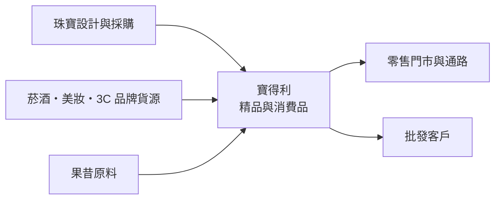
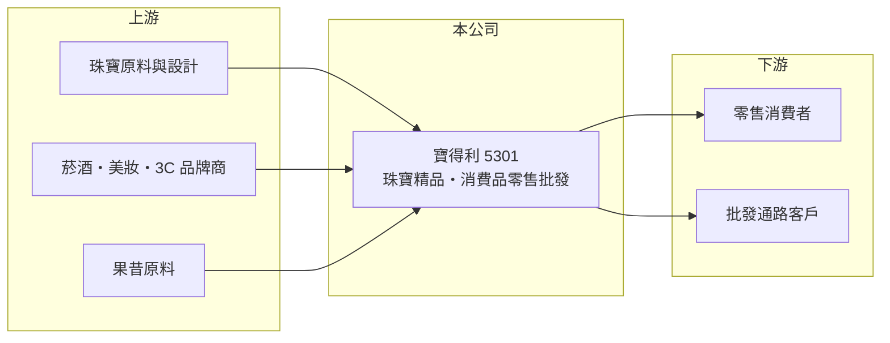

# 5301 寶得利

> 上櫃｜[[產業索引-觀光餐旅|觀光餐旅]]｜上市（櫃）日期 1990/06/25

# 第一章：企業模式與商業藍圖

> [!info] 撰寫說明
> 本文由 Claude 依公開資料整理，架構比照 [[2330台積電]] 的四章研究，資料截至 2026-10-08。財務數字來源：櫃買中心開放資料（基本資料、2026 年第二季資產負債表與綜合損益表）、Goodinfo 年度經營績效頁、nStock 公司簡介；公開資料有限，查不到各產品線的營收比重與門市數，產業描述為整理性內容，尚未逐條比對原始文件。#待校對

在評估單一個股的長期投資價值時，首要步驟是拆解企業的底層獲利邏輯。本章說明寶得利（股票代號：5301）這家老牌上櫃公司，如何把業務[[轉型]]到珠寶精品與多元消費品零售，以及為何營收規模至今仍小。

## 一、核心定位：珠寶精品加上多元消費品

寶得利於 1978 年 10 月設立，2013 年 7 月經經濟部核准變更公司名稱，產業別歸入觀光餐旅。依 nStock 整理，公司目前的主要營業項目是珠寶精品的設計與銷售，以及菸酒、美妝、3C 與果昔相關產品的批發和零售。這是一個跨度很大的產品組合：珠寶屬於高單價、低周轉的精品，菸酒與美妝屬於通路型商品，果昔則是現做飲品，三者的客群、通路與營運能力需求都不相同。

## 二、資本轉化邏輯：高毛利、低營收

寶得利的[[毛利率]]很高，2025 年約 66%，2026 年上半年更達約 85%，代表銷售的商品或服務加價空間大，或部分收入以佣金、淨額方式認列（推估）。但營收規模太小，2025 年全年只有 2.36 億元，2026 年上半年僅 0.92 億元，毛利 0.78 億元仍不足以支付 1.04 億元的營業費用。換句話說，寶得利的問題不在單品獲利，而在於銷售量撐不起門市、人事與總部的固定成本；在[[營運槓桿]]的作用下，營收每萎縮一些，虧損就被放大一截。

## 三、長期方向

寶得利目前的資產負債表相當乾淨：2026 年第二季底流動資產 6.33 億元、流動負債僅 1.85 億元，股本由基本資料所列的 5.39 億元增加到 6.59 億元，顯示公司近期辦理過增資、手上有現金可以運用。長期而言，公司需要在多元產品線中找出一個能規模化的核心事業，集中資源經營，而不是在多個小事業間分散投入。

# 第二章：護城河深度與競爭優勢

「護城河」指企業抵禦競爭、維持超額利潤的保護機制。本章說明寶得利在珠寶與消費品零售上的相對位置。

## 一、相對優勢

寶得利的優勢主要來自財務面：負債比僅約 29%、流動比率超過 300%，有足夠的資金嘗試新事業，不必急著舉債。高毛利率也代表商品組合有一定的議價能力。不過珠寶精品市場重視品牌歷史與設計能力，菸酒、美妝與 3C 零售則由大型通路主導，寶得利在兩邊都缺乏規模，目前看不出明確的護城河。

## 二、主要競爭對手

| 對手 | 定位 | 對寶得利的威脅 |
|---|---|---|
| 國際珠寶品牌與連鎖銀樓 | 品牌與設計資源豐富 | 在精品珠寶市場掌握主要客群 |
| [[5904寶雅]] | 美妝與生活用品連鎖 | 美妝零售規模遠大於寶得利 |
| [[2912統一超]] | 便利商店通路 | 菸酒與日常消費品的主要銷售通路 |
| [[1256鮮活果汁-KY]] | 果汁與飲品原料 | 飲品相關市場的專業業者 |

## 三、守得住／守不住／觀察重點

守得住的是現金部位與低負債。守不住的是營收規模：2026 年 1 至 9 月累計營收約 1.02 億元，年減約 37%（依 nStock 整理），新業務尚未帶來穩定成長。長期觀察重點是公司最終聚焦哪一條產品線、該產品線能否達到損益平衡的營收規模，以及增資資金的使用效率。

# 第三章：財務體質與盈利規模

資料日期：2026-10-08，表格是撰寫當時的快照；最新月營收、毛利率、累計 EPS 由自動排程寫在本筆記的屬性欄位（月營收、毛利率、累計EPS 等）。#待校對

財務報表是檢驗護城河是否真實存在的最終標準。本章用六年的三率、ROE 與資本報酬檢視寶得利的獲利品質。

## 一、多年度經營績效

| 年度 | 營收（新台幣） | [[毛利率]] | [[營業利益率]] | EPS（元） | [[ROE]] |
|---|---|---|---|---|---|
| 2020 | 1.33 億 | 19.2% | -225% | -3.51 | -39.1% |
| 2021 | 0.71 億 | 21.2% | -199% | -2.09 | -34% |
| 2022 | 0.54 億 | 6.69% | -140% | -0.66 | -10.8% |
| 2023 | 2.36 億 | 38.2% | -32.1% | -0.61 | -12.9% |
| 2024 | 3.67 億 | 58.4% | -22.9% | -0.44 | -10.1% |
| 2025 | 2.36 億 | 65.8% | -46.2% | -1.81 | -20.7% |
| 2026 上半年 | 0.92 億 | 84.6% | -29.0% | -0.41 | 未查得 |

資料來源：2020 至 2025 年為 Goodinfo，2026 上半年為櫃買中心開放資料。

寶得利六年來每年都是營業虧損。2023 至 2024 年營收曾回升到 3.67 億元、營業利益率改善到 -22.9%，看似轉型見效，但 2025 年營收又回落到 2.36 億元，虧損擴大。毛利率從 2022 年的不到 7% 一路拉升到 2026 年上半年的約 85%，說明產品組合大幅轉向高毛利品項，可惜營收量不足。2021 至 2025 年平均 ROE 約 -18%（推算），近五年沒有配發現金股利。

## 二、財務結構

2026 年第二季底，寶得利總資產 7.40 億元，其中流動資產 6.33 億元；負債 2.18 億元，負債比約 29%。權益總計 5.22 億元，保留盈餘 -1.47 億元，每股淨值 7.72 元。這是一家「現金多、本業弱」的公司。

## 三、[[ROIC]] 與 [[WACC]]：價值創造利差

**ROIC 推算：** 2025 年營業虧損約 1.09 億元（2.36 億 × -46.2%），虧損年度不計稅盾。2026 年第二季底權益總計約 5.22 億元，負債 2.18 億元中假設三成為有息負債約 0.65 億元（推估），投入資本約 5.9 億元，ROIC 約 -19%（推算）。由於資產中大部分是現金與流動資產，若扣除閒置現金，本業的 ROIC 會更差。

**WACC 推算：** 台灣 10 年期公債取 1.75%、市場風險溢酬 6%、β 取虧損型小型零售股 1.0，股東權益成本約 7.75%；負債成本假設 3%；權益約 89%、負債約 11%，WACC 約 7.2%（推算）。

**結論：** ROIC 低於 WACC 超過 25 個百分點，公司目前在消耗股東資本。手上的現金給了公司轉型的時間，但若新事業遲遲無法達到損益平衡，這筆現金會被逐年虧損耗盡。

# 第四章：總體風險與地緣政治

任何企業都無法脫離宏觀環境獨立存在。本章分析寶得利長期必須面對的風險。

## 一、轉型失焦風險

產品線橫跨珠寶、菸酒、美妝、3C 與果昔，每一項都需要不同的採購、通路與行銷能力。資源分散會讓每個事業都難以達到規模，這是寶得利長期虧損的核心原因之一。

## 二、消費景氣與競爭風險

珠寶精品屬於可選消費，景氣轉弱時最先被削減；國際金價大幅波動也會影響珠寶的定價與庫存價值。菸酒、美妝、3C 則面對大型連鎖通路與電商的價格競爭。

## 三、資本使用風險

公司持續以增資補充資金，若增資所得用於低報酬的新事業，股東權益會被稀釋且持續虧損。投資人應留意每次增資的用途與後續成效。

# 專有名詞解析

## 金融

- **[[營運槓桿]]**：固定成本占比高時，營收小幅變動就會讓獲利大幅增減；營收萎縮時虧損也會被放大。
- **[[ROIC]]**：投入資本報酬率，稅後營業利益除以股東權益加有息負債，衡量本業運用資本的效率。
- **[[WACC]]**：加權平均資金成本，股東與債權人要求報酬率的加權平均，是 ROIC 要超越的門檻。

## 產業

- **[[轉型]]**：企業把主要業務從原產業移往新產業，過程中營收與獲利常出現斷層。

# 核心供應鏈

## 1. 上游：商品來源
- 珠寶原料與設計、菸酒美妝 3C 品牌商、果昔原料供應商

## 2. 中游：寶得利本身
- 珠寶精品設計銷售，菸酒、美妝、3C 與果昔的批發零售

## 3. 下游與同業
- 客戶：零售消費者、批發通路
- 同業：[[5904寶雅]]、[[2912統一超]]、[[1256鮮活果汁-KY]]

## 最新新聞
<!-- news:start -->
<!-- news:end -->

## 相關連結
- [公開資訊觀測站](https://mopsov.twse.com.tw/mops/web/t05st03?step=1&firstin=1&co_id=5301)
- [Goodinfo](https://goodinfo.tw/tw/StockDetail.asp?STOCK_ID=5301)
- [Yahoo 股市](https://tw.stock.yahoo.com/quote/5301)
- [鉅亨網新聞](https://www.cnyes.com/twstock/5301/news)
