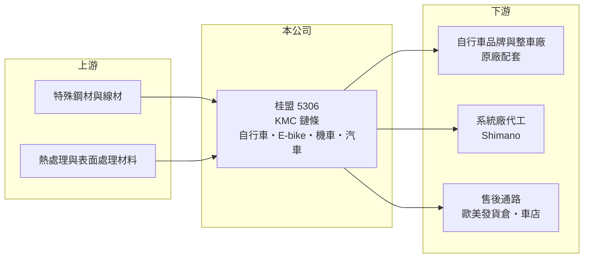

# 5306 桂盟

> 上市｜[[產業索引-運動休閒|運動休閒]]｜上市（櫃）日期 2022/03/08

# 第一章：企業模式與商業藍圖

> [!info] 撰寫說明
> 精簡版，由 Claude 依公開資料整理，架構比照 [[2330台積電]]，資料截至 2026-10-08。來源：MoneyDJ 理財網財務比率年表（2018 至 2025 年）；富果研究 2025 年 3 月法說會備忘錄（產品結構、通路、資本支出、股利政策、2024 年財務數字）；證交所開放資料快照（基本資料、2026 年上半年資產負債與損益、季度股利）。部分營收以每股營業額乘以約 1.26 億股推算；生產基地明細為整理性內容。#待校對

桂盟國際成立於 1989 年 4 月、2022 年 3 月上市，登記地址在台南永康，董事長吳盈進、總經理吳瑞章，實收資本額約 12.6 億元。桂盟以 KMC 品牌聞名，是全球主要的自行車鏈條製造商，生意看似單純，卻是一門「小零件、高毛利、品牌化」的好生意。

- **核心業務：** 桂盟生產自行車鏈條、[[E-bike]] 專用鏈條、機車鏈條、汽車正時鏈條與車庫門鏈條。鏈條是傳動系統中的耗材，騎乘一段時間就要更換，因此除了賣給整車廠配在新車上，還有大量更換需求。
- **營收結構：** 依富果整理的 2025 年 3 月法說會，自行車鏈條約占營收 70%，分為原廠配套（[[OEM]]）與售後市場（[[AM 售後市場]]）兩種通路；其餘為機車、汽車與車庫門鏈條，個別比重未揭露。汽車鏈條約六成以上面向北美售後通路。公司也替 Shimano 代工其品牌鏈條，屬於系統廠的製造夥伴。
- **營運據點：** 生產集中在亞洲，包括台灣與中國蘇州等地，越南也是成本幣別之一（越南生產細節待校對）；並在荷蘭與美國洛杉磯設有發貨倉庫，就近服務歐美售後市場。蘇州廠區正在搬遷，預計 2 至 3 年內完成，搬遷補助款也增加了公司現金。
- **長期方向：** 桂盟的策略是提高售後與高階產品比重，例如 E-bike 專用鏈條與環保的蠟鏈條，並推動生產自動化以降低對人工的依賴。資本支出每年約 3 億元，主要用於設備汰舊與自動化；股利採季配、配發率約 60%，經營層屬於保守穩健型，帳上長期保有大量現金。

# 第二章：護城河深度與競爭優勢

桂盟的護城河來自 KMC 品牌在售後市場的知名度，以及鏈條製程的規模經濟。

- **競爭優勢：** 鏈條看起來簡單，但耐磨、耐拉、抗鏽與換檔順暢度都需要精密熱處理與表面處理技術，大量生產時品質一致性尤其重要。KMC 在自行車售後市場有很高的品牌辨識度，車店與騎士換鏈條時會指名購買，這讓桂盟能享有遠高於一般零件代工的毛利率（2024 年約 42%）。同時替 Shimano 代工，也說明它的製造品質獲得系統大廠認可。
- **主要對手：** 自行車鏈條的主要對手是日本 Shimano 自有鏈條、美國 SRAM 與其他中國、台灣鏈條廠；機車與汽車鏈條則面對日本大同（DID）、椿本（Tsubakimoto）等大廠。在自行車鏈條領域，KMC 屬於全球最大的獨立鏈條品牌之一（市占數字未查得）。
- **觀察重點：** 自行車業 2023 年起去庫存，桂盟營收從 2022 年約 71 億元降到 2023 年約 47 億元，但毛利率仍維持近四成，顯示售後與品牌帶來的韌性。長期要看 E-bike 鏈條與售後比重能否持續拉高，以及汽車鏈條能否成為第二成長曲線。

# 第三章：財務體質與盈利規模

資料日期：2026-10-08，表格是撰寫當時的快照；最新月營收、毛利率、累計 EPS 由自動排程寫在本筆記的屬性欄位（月營收、毛利率、累計EPS 等）。#待校對

桂盟的毛利率約四成、營業利益率約兩成，獲利品質高，但 2023 年後營收規模明顯小於疫情高峰。

| 年度 | 營收（億元） | [[毛利率]] | [[營業利益率]] | EPS（元） | [[ROE]] |
|---|---|---|---|---|---|
| 2021 | 未查得 | 46.31% | 33.24% | 15.94 | 31.02% |
| 2022 | 約 71（推算） | 47.79% | 32.88% | 15.26 | 27.33% |
| 2023 | 約 47.2（推算） | 38.92% | 19.65% | 5.89 | 9.78% |
| 2024 | 49.6 | 41.80% | 21.75% | 7.27 | 11.48% |
| 2025 | 約 46.8（推算） | 44.23% | 21.89% | 7.66 | 11.21% |

註：2021 年上市前股數不同，未以每股營業額推算；2023 年以 2024 年營收除以 1.05（年增 5%）推算。

- **長期指標：** 近 5 年平均 ROE 約 18.2%（推算），但 2021 至 2022 年疫情熱潮時達三成左右，2023 年後回到 10% 至 11%。2022 至 2025 年營收年複合成長率約 -13%（推算），反映自行車產業由高峰回落。每股現金流量 2018 至 2025 年皆為正，股利採季配、配發率約 60%（法說會），屬於穩定配息型公司。
- **[[ROIC]] 與 [[WACC]]：** 2025 年營業利益約 10.2 億元（營收約 46.8 億元 × 21.89%），稅後約 8.2 億元（稅率 20%）。投入資本以 2026 年第二季權益總計 95.0 億元，加有息負債推估約 5 億元計算（負債總計 50.3 億元，官方快照未拆分），ROIC 約 8%（推算）；若扣除約 48 億元現金（2024 年底），營運資本報酬率約 16%（推算）。WACC 約 6.5%（推算：無風險利率 1.75%、市場風險溢酬 6%、β 取 0.8，股東權益成本 6.55%；幾乎無負債，稅率 20%）。本業 ROIC 明顯高於 WACC，但大量閒置現金拉低整體報酬，資本運用效率是長期可觀察的改善空間。
- **財務特色：** 2026 年第二季總資產 145.3 億元、負債 50.3 億元，負債比率約 35%，每股淨值 75.40 元。2026 年上半年營收 27.8 億元、毛利率 42.2%、營業利益率 22.7%、EPS 3.94 元，獲利率維持高檔。

# 第四章：總體風險與地緣政治

桂盟的風險主要是自行車產業週期、汽機車鏈條的競爭，以及生產基地的地緣政治。

- **產業週期：** 自行車屬於可選消費，2020 至 2022 年疫情帶來需求暴增，品牌與通路大量下單，之後 2023 至 2024 年全產業去庫存，原廠配套訂單大幅萎縮。售後市場比較穩定，因為鏈條是消耗品，這是桂盟的緩衝。
- **營運風險：** 原廠配套訂單受整車廠庫存影響，波動大；售後市場則需要品牌行銷與通路經營。蘇州廠搬遷期間可能影響產能與成本。汽車鏈條面對日本大廠的技術與客戶關係，擴展速度存在不確定性。
- **其他風險：** 中國生產的產品輸美可能受關稅影響；鋼材是主要原料，價格波動影響成本。營收以美元、歐元計價，新台幣升值會壓縮換算後的獲利。

# 專有名詞解析

## 金融

- **[[ROIC]]**：投入資本報酬率，稅後營業利益除以股東權益加有息負債，衡量本業運用資本的效率。
- **[[WACC]]**：加權平均資金成本，股東與債權人要求報酬率的加權平均，是 ROIC 要超越的門檻。

## 產業

- **[[E-bike]]**：電動輔助自行車，騎乘者踩踏時由電機提供輔助動力，在歐洲是成長最快的自行車品類。
- **[[OEM]]**：原廠委託製造或原廠配套，零件直接供應整車廠裝在新車上，量大但隨新車景氣波動。
- **[[AM 售後市場]]**：產品出廠後的維修與更換零件市場，需求跟著使用中的車輛數量走，波動比新車市場小。

# 核心供應鏈

- 上游：特殊鋼材與線材供應商、熱處理與表面處理材料（名單未查得）。
- 下游／客戶：自行車品牌與整車廠（如 [[9921巨大]]、[[9914美利達]] 屬此類型，實際往來未查得）；系統廠 Shimano；歐美售後通路與車店；汽車售後通路。
- 同業：Shimano、SRAM；機車與汽車鏈條的日本大同（DID）、椿本；國內自行車整車股 [[8933愛地雅]]。

## 最新新聞
<!-- news:start -->
<!-- news:end -->

## 相關連結
- [公開資訊觀測站](https://mopsov.twse.com.tw/mops/web/t05st03?step=1&firstin=1&co_id=5306)
- [Goodinfo](https://goodinfo.tw/tw/StockDetail.asp?STOCK_ID=5306)
- [Yahoo 股市](https://tw.stock.yahoo.com/quote/5306)
- [鉅亨網新聞](https://www.cnyes.com/twstock/5306/news)
