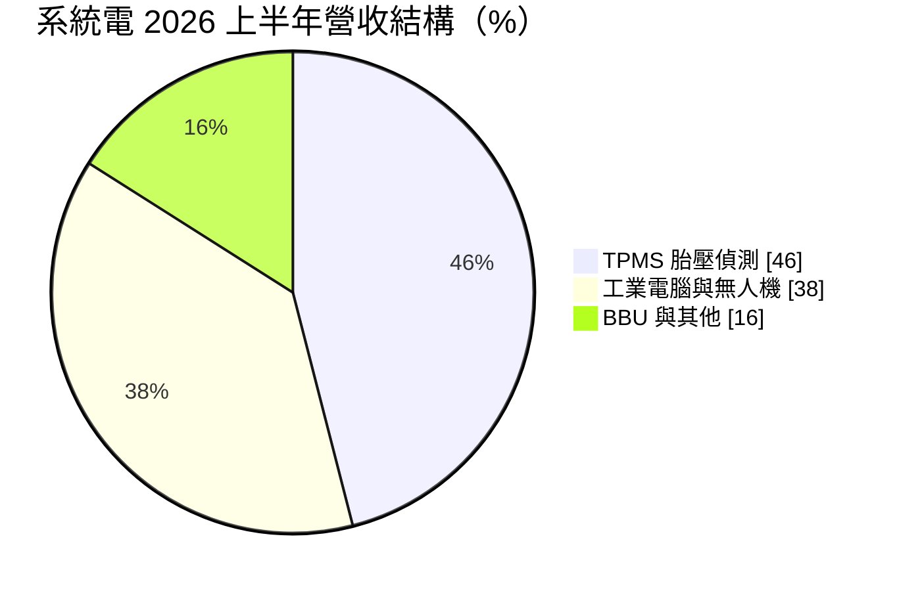
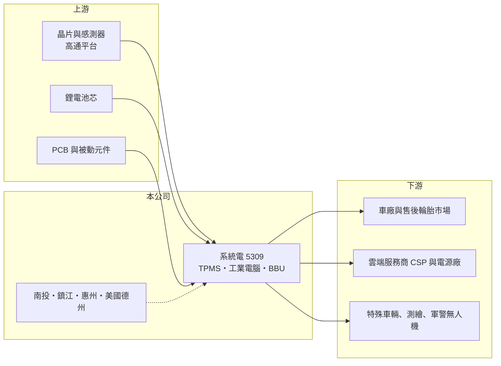

# 5309 系統電

> 上櫃｜[[產業索引-電子零組件業|電子零組件業]]｜上市（櫃）日期 1996/03/18

# 第一章：企業模式與商業藍圖

> [!info] 撰寫說明
> 精簡版，由 Claude 依公開資料整理，架構比照 [[2330台積電]] 的四章研究，資料截至 2026-10-08。來源：Goodinfo 經營績效頁、富果研究 2026 年 10 月法說會摘要、科技新報月營收報導、櫃買中心開放資料快照（基本資料、2026 年第二季損益與資產負債、本益比殖利率）。CSP 客戶名稱未查得。#待校對

系統電是一家以車用胎壓偵測器起家的電子製造公司，正在把重心轉向工業電腦、無人機與 AI 資料中心的備援電池。本章說明它的業務組成與轉型方向。

- **核心業務：** 系統電成立於 1977 年，1996 年上櫃，長期主力產品是[[TPMS]]（胎壓偵測系統）。公司表示 TPMS 曾占營收八成以上，2017 至 2020 年間從台灣前二十名做到全球前五大供應商。車用電子須通過 IATF 16949 等品質系統，這段經驗成為公司跨入其他高可靠度產品的基礎。
- **營收結構：** 2026 年上半年 TPMS 約占 46%、工業電腦（含無人機）約 38%、AI 資料中心[[BBU]] 與其他約 16%。公司設定 2028 年的目標結構為 BBU 45% 至 50%、TPMS 25% 至 30%、工業電腦 20% 至 25%，也就是讓資料中心業務取代車用成為最大板塊。
- **營運據點：** 台灣南投、中國鎮江與惠州，以及美國德州普萊諾（Plano）的完整產線，涵蓋 SMT 到組裝測試。美國廠讓公司能就近服務北美客戶，因應關稅與在地生產要求。
- **長期方向：** BBU 由子公司電統能源推動，5.5kW 機種 2026 年 10 月開始出貨，3kW 機種預計 2027 年第一季量產，目標 2028 年營收達 100 億元、成為全球前三大 BBU 供應商。2026 年 2 月 [[4938和碩]] 透過私募成為策略股東，雙方在採購、美國製造與行銷上合作；工業電腦與無人機則以 [[QCOM高通]] 平台為基礎，並與德國 Quantum Systems、美國 Vantage Robotics 合作。

# 第二章：護城河深度與競爭優勢

系統電的競爭力來自車規製造經驗與多地產能，但新事業都還在放量初期。本章分析它的競爭條件。

- **競爭優勢：** TPMS 屬於安全相關的車用電子，要通過車廠與售後市場的長期驗證，系統電已建立全球前五的地位與穩定客戶。電動車電池包、儲能櫃與車規品質系統的經驗，讓公司在資料中心 BBU 上具備電池管理與可靠度設計的基礎。台灣、中國、美國三地產線，加上和碩的策略入股，讓它能提供客戶「非中國」或「美國製造」的選項。
- **主要對手：** TPMS 的國際對手包括德國 Schrader（Sensata 旗下）、德國大陸集團等，台灣同業有 [[2231為升]] 等。BBU 領域的競爭者包括 [[2308台達電]]、[[2301光寶科]]、[[6121新普]]、[[6781AES-KY]]、[[3211順達]] 等電源與電池大廠，規模都比系統電大。
- **觀察重點：** 第一，BBU 能否如公司預期在 2027 年成長 2 至 5 倍，並取得更多雲端服務商（CSP）專案。第二，研發費用占營業費用近半，營業利益何時由負轉正。第三，TPMS 本業在汽車市場放緩下能否維持穩定現金流。

# 第三章：財務體質與盈利規模

資料日期：2026-10-08，表格是撰寫當時的快照；最新月營收、毛利率、累計 EPS 由自動排程寫在本筆記的屬性欄位（月營收、毛利率、累計EPS 等）。#待校對

系統電的財報顯示 2021 至 2022 年 TPMS 帶動營收翻倍，之後在投資新事業期間獲利逐年下滑。本章用多年度數據說明。

| 年度 | 營收（億元） | [[毛利率]] | [[營業利益率]] | EPS（元） | [[ROE]] |
|---|---|---|---|---|---|
| 2020 | 13.3 | 19.8% | -7.68% | -0.64 | -9.19% |
| 2021 | 24.5 | 19.9% | 3.40% | 0.62 | 8.39% |
| 2022 | 34.0 | 23.6% | 8.93% | 2.14 | 21.5% |
| 2023 | 32.8 | 24.7% | 5.91% | 1.41 | 10.4% |
| 2024 | 31.1 | 24.2% | 1.70% | 0.61 | 3.32% |
| 2025 | 33.9 | 23.5% | -0.50% | 0.27 | 未查得 |
| 2026 上半年 | 17.6 | 23.5% | -5.4% | 0.06 | 未查得 |

註：Goodinfo 2025 年 ROE 顯示 0.24%，與當年淨利約 0.53 億元不一致，表中列為未查得。

- **營收規模：** 營收從 2020 年的 13.3 億元成長到 2022 年的 34 億元，之後維持在 31 至 34 億元。2020 至 2025 年年複合成長率約 20.6%（推算），但主要成長集中在 2021 至 2022 年。
- **獲利：** 毛利率穩定在 23% 至 25%，但營業利益率從 2022 年的 8.9% 降到 2026 年上半年的 -5.4%，原因是研發與管理費用隨新事業擴大，2026 年上半年研發費用約 2.29 億元。2026 年上半年本業虧損，靠約 0.79 億元業外收入才維持小幅獲利。2021 至 2024 年平均 ROE 約 10.9%（推算）。
- **財務特色：** 2026 年私募後股本增至約 23.1 億元，第二季末股東權益約 56.6 億元（母公司約 53.0 億元）、負債約 27.9 億元，其中非流動負債約 16.6 億元，負債比約 33%。現金股利約 0.5 元，已高於 2025 年 EPS，代表配息並非來自當年獲利。

**[[ROIC]] 與 [[WACC]]：** 有息負債明細未查得，假設約 18 億元（推估，以非流動負債為主）。2025 年營業損失約 0.17 億元，ROIC 約 -0.2%（推算）；2026 年上半年營業損失約 0.95 億元，ROIC 更低；2022 年營業利益約 3.0 億元，當時 ROIC 推估約一成。WACC 用 CAPM 推估：無風險利率 1.75%、市場風險溢酬 6%、β 取 1.1（轉型中的電子股，假設），股東權益成本約 8.4%；負債成本 2.5%、稅率 20%，以權益 76%、負債 24% 加權，WACC 約 6.8%（推算）。目前 ROIC 低於 WACC，公司正以股東資金投資 BBU 等新事業；這些投資是否值得，要看 2027 至 2028 年 BBU 放量後 ROIC 能否超過約 7% 的資金成本。

# 第四章：總體風險與地緣政治

系統電的風險集中在新事業的執行，以及多角化帶來的管理難度。本章整理主要風險。

- **產業週期：** TPMS 跟著新車產量與售後換胎市場走，汽車景氣放緩時需求會下降。資料中心 BBU 需求跟著雲端業者的資本支出循環，目前雖處成長期，但雲端資本支出若調整，訂單也會劇烈波動。
- **營運風險：** BBU 市場已有台達電、光寶等大廠，系統電要靠價格或客製化搶單，毛利率可能受壓。新事業同時推進 BBU、工業電腦與無人機，研發與人力資源分散。兩家既有 CSP 客戶集中度高，單一客戶專案延遲影響明顯。
- **其他風險：** 無人機業務涉及軍警用途，受各國出口管制與國防預算影響。美國關稅政策、中國廠區的地緣政治風險與匯率，也會影響成本與接單。2026 年私募增資已稀釋股本，若新事業需要更多資金，可能再次增資。

# 專有名詞解析

## 應用

- **[[TPMS]]**：胎壓偵測系統，裝在輪胎內即時監測胎壓與溫度，美國、歐盟、中國等地已立法要求新車配備。
- **[[BBU]]**：電池備援單元，資料中心在市電中斷時提供短時間電力的電池模組，AI 伺服器機櫃的標準配備之一。
- **[[工業電腦]]**：用於工廠、交通、醫療等嚴苛環境的電腦，強調長期供貨與穩定性，又稱 IPC。

## 金融

- **[[ROIC]]**：投入資本報酬率，稅後營業利益除以股東權益加有息負債，衡量本業運用資本的效率。
- **[[WACC]]**：加權平均資金成本，股東權益成本與負債成本依資本結構加權，是 ROIC 必須超越的門檻。

# 核心供應鏈

- 上游：[[QCOM高通]] 晶片平台、電池芯、PCB 與被動元件供應商。
- 下游／客戶：車廠與 TPMS 售後市場、兩家未具名雲端服務商、德國 Quantum Systems、美國 Vantage Robotics；策略股東 [[4938和碩]]。
- 同業：TPMS 為 Sensata（Schrader）、大陸集團；BBU 為 [[2308台達電]]、[[2301光寶科]]、[[6121新普]]、[[6781AES-KY]]、[[3211順達]]。

## 最新新聞
<!-- news:start（自動產生，請勿手動編輯此範圍） -->
- 2026-10-06 📰 媒體 20:03｜系統電9月營收續寫歷史新高 Q3登10億元同創單季最佳｜[鉅亨網](https://news.cnyes.com/news/id/6622938)

完整紀錄：[[5309系統電 新聞]]
<!-- news:end -->

## 相關連結
- [公開資訊觀測站](https://mopsov.twse.com.tw/mops/web/t05st03?step=1&firstin=1&co_id=5309)
- [Goodinfo](https://goodinfo.tw/tw/StockDetail.asp?STOCK_ID=5309)
- [Yahoo 股市](https://tw.stock.yahoo.com/quote/5309)
- [鉅亨網新聞](https://www.cnyes.com/twstock/5309/news)
