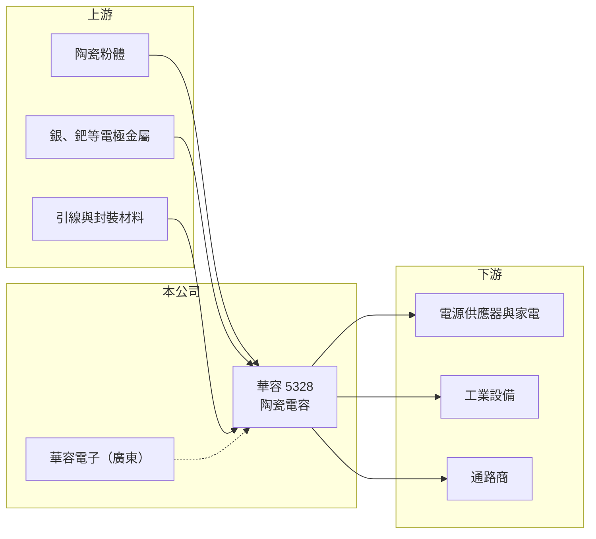

# 5328 華容

> 上櫃｜[[產業索引-電子零組件業|電子零組件業]]｜上市（櫃）日期 1997/08/28

# 第一章：企業模式與商業藍圖

> [!info] 撰寫說明
> 精簡版，由 Claude 依公開資料整理，架構比照 [[2330台積電]] 的四章研究，資料截至 2026-10-08。來源：Goodinfo 經營績效頁、富果研究 2025 年 12 月法說會摘要、櫃買中心開放資料快照（基本資料、2026 年第二季損益與資產負債、本益比殖利率）。產品線為依公司英文名 Hua Jung Components 與經銷商資料整理的記憶性描述，營收比重、客戶名稱未查得，公開資料有限。#待校對

華容是成立四十多年的老牌被動元件廠，以陶瓷電容為主要產品，近年營收規模不大、本業獲利微薄，靠資產活化與成本控制維持獲利。本章說明它的業務組成。

- **核心業務：** 華容成立於 1983 年，1997 年上櫃，英文名 Hua Jung Components（HJC），主要產品為陶瓷[[電容]]，包括引線式圓板陶瓷電容與[[MLCC]]（積層陶瓷電容）等（待校對）。電容在電路中負責儲存與釋放電荷、濾除雜訊，是用量最大的被動元件之一，從家電、電源供應器到工業設備都需要。
- **營收結構：** 產品別與應用別比重在本次資料中未查得。2025 年營收約 8.84 億元，規模在台灣被動元件廠中屬於小型，推估以電源、家電與工業用的標準型產品為主（推估）。
- **營運據點：** 公司有中國子公司華容電子（廣東），推估為主要生產基地之一（待校對）；台灣據點的生產角色未查得。
- **長期方向：** 依 2025 年法說會，管理層的策略是維持「低負債、高流動性」，透過資產活化與成本控制提升獲利，並評估策略性投資。這代表公司目前的重點在守成與財務穩健，而非大規模擴產。

# 第二章：護城河深度與競爭優勢

華容的護城河有限，主要優勢是長期經營的客戶關係與保守的財務結構。本章分析它的競爭條件。

- **競爭優勢：** 陶瓷電容屬於標準化程度高的元件，差異化空間小。華容經營四十多年，在特定規格與老客戶間建立了穩定的供貨關係，這類小量多樣的訂單是大廠較不重視的市場。財務上負債比低（2025 年第三季約 18%），讓它能撐過被動元件的景氣低谷。
- **主要對手：** MLCC 市場由日本村田、太陽誘電、韓國三星電機與台灣 [[2327國巨]]、[[2492華新科]] 主導，規模與成本都遠勝華容。引線式陶瓷電容市場則有許多中國廠商以低價競爭。華容在價格與產能上都缺乏優勢。
- **觀察重點：** 第一，本業營業利益率能否穩定在 5% 以上，而不是依賴業外收益。第二，資產活化與策略性投資的具體內容，這決定公司未來的業務方向。第三，被動元件景氣回升時，華容能否分到漲價紅利。

# 第三章：財務體質與盈利規模

資料日期：2026-10-08，表格是撰寫當時的快照；最新月營收、毛利率、累計 EPS 由自動排程寫在本筆記的屬性欄位（月營收、毛利率、累計EPS 等）。#待校對

華容的財報顯示營收長期停滯在 8 至 11 億元，毛利率有改善，但營業利益很薄。本章用多年度數據說明。

| 年度 | 營收（億元） | [[毛利率]] | [[營業利益率]] | EPS（元） | [[ROE]] |
|---|---|---|---|---|---|
| 2020 | 8.47 | 20.7% | 2.62% | 0.12 | 1.28% |
| 2021 | 10.6 | 19.0% | 2.05% | 0.20 | 2.01% |
| 2022 | 10.6 | 19.2% | 0.62% | 0.43 | 4.30% |
| 2023 | 10.2 | 25.7% | 7.40% | 0.46 | 4.57% |
| 2024 | 8.67 | 24.7% | 0.81% | 0.39 | 3.68% |
| 2025 | 8.84 | 27.3% | 4.10% | 0.39 | 3.65% |
| 2026 上半年 | 5.24 | 23.8% | 2.5% | 0.40 | 未查得 |

- **營收規模：** 營收在 8.5 至 10.6 億元之間起伏，2020 至 2025 年年複合成長率約 0.9%（推算），屬於幾乎沒有成長的公司。2026 年上半年營收 5.24 億元，較前一年同期成長，1 至 8 月累計年增約 25%。
- **獲利：** 毛利率從約 19% 提升到 2025 年的 27.3%，顯示產品組合或成本有改善，但營業費用吃掉大部分毛利，營業利益率多數年度低於 5%。EPS 中業外收益占比高，例如 2026 年上半年營業利益約 0.13 億元，業外收入約 0.79 億元，[[業外收益]]才是獲利主體。2021 至 2025 年平均 ROE 約 3.6%（推算）。
- **財務特色：** 2026 年第二季末股東權益約 22.8 億元、負債約 6.4 億元且幾乎全為流動負債，負債比約 22%，2025 年第三季流動比率約 407%。每股淨值 13.15 元。現金股利約 0.35 元，接近 2025 年 EPS 0.39 元，配息率約九成（推算）。

**[[ROIC]] 與 [[WACC]]：** 有息負債明細未查得，以公司低負債政策推估約 1 億元（推估）。2025 年營業利益約 0.36 億元，稅後約 0.29 億元，投入資本以股東權益約 22.8 億元加有息負債 1 億元，約 23.8 億元，ROIC 約 1.2%（推算）；2023 年營業利益率較高時 ROIC 約 2.6%（推算）。WACC 用 CAPM 推估：無風險利率 1.75%、市場風險溢酬 6%、β 取 0.9（被動元件小型股，假設），股東權益成本約 7.2%；因負債極低，WACC 約 7%（推算）。ROIC 長期遠低於 WACC，代表本業並未創造價值，帳上資產若無法轉為更高報酬的用途，股東報酬主要只能來自資產處分與配息。

# 第四章：總體風險與地緣政治

華容的風險在於本業競爭力不足，以及獲利對業外收益的依賴。本章整理主要風險。

- **產業週期：** 被動元件是典型的[[長鞭效應]]產業，下游拉貨與去庫存會讓訂單大起大落。華容規模小、產品標準化，在景氣下行時通常是最先被砍單、最晚恢復的一群。
- **營運風險：** 本業營業利益率低，若業外收益（資產處分、投資收益）減少，EPS 會明顯下滑。中國同業以低價搶市，可能持續壓縮毛利率。產品升級與擴產的具體計畫未見公開。
- **其他風險：** 中國子公司面臨地緣政治與當地法規變化。陶瓷粉體、銀與鈀等電極金屬價格上漲會增加成本。匯率變動也會影響外銷獲利。

# 專有名詞解析

## 金融

- **[[業外收益]]**：非本業產生的收益，如投資收益、資產處分利益與匯兌利益，通常不具持續性。
- **[[長鞭效應]]**：終端需求的小幅變動，沿供應鏈往上游傳遞時被逐級放大，造成上游庫存與訂單劇烈波動。
- **[[ROIC]]**：投入資本報酬率，稅後營業利益除以股東權益加有息負債，衡量本業運用資本的效率。
- **[[WACC]]**：加權平均資金成本，股東權益成本與負債成本依資本結構加權，是 ROIC 必須超越的門檻。

## 產業

- **[[電容]]**：儲存與釋放電荷的被動元件，用於濾除雜訊、穩定電壓，是電子產品用量最大的元件之一。
- **[[MLCC]]**：積層陶瓷電容，把陶瓷介質與金屬電極層層堆疊的晶片電容，體積小、容量大，手機一支用量可達上千顆。

# 核心供應鏈

- 上游：陶瓷粉體、銀與鈀等電極金屬、引線材料供應商（推估）。
- 下游／客戶：電源供應器、家電與工業設備廠，以及電子零件通路商（推估，名單未查得）。
- 同業：日本村田、太陽誘電、韓國三星電機；台灣 [[2327國巨]]、[[2492華新科]]、[[2478大毅]]。

## 最新新聞
<!-- news:start（自動產生，請勿手動編輯此範圍） -->
- 2026-10-13 🏛️ 重訊 15:28｜更正本公司之子公司115年9月背書保證申報資訊｜[觀測站](https://mops.twse.com.tw/mops/#/web/t05st01)

完整紀錄：[[5328華容 新聞]]
<!-- news:end -->

## 相關連結
- [公開資訊觀測站](https://mopsov.twse.com.tw/mops/web/t05st03?step=1&firstin=1&co_id=5328)
- [Goodinfo](https://goodinfo.tw/tw/StockDetail.asp?STOCK_ID=5328)
- [Yahoo 股市](https://tw.stock.yahoo.com/quote/5328)
- [鉅亨網新聞](https://www.cnyes.com/twstock/5328/news)
