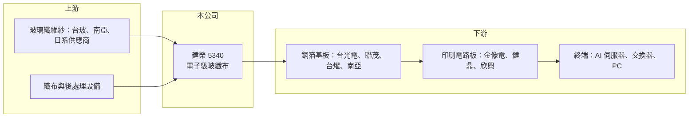

# 5340 建榮

> 上櫃｜[[產業索引-電子零組件業|電子零組件業]]｜上市（櫃）日期 1998/01/20

# 第一章：企業模式與商業藍圖

> [!info] 撰寫說明
> 精簡版，由 Claude 依公開資料整理，架構比照 [[2330台積電]] 的四章研究，資料截至 2026-10-08。來源：櫃買中心開放資料快照（基本資料、2026 年第二季資產負債與綜合損益、本益比殖利率）、Goodinfo 經營績效頁（2020 至 2025 年）、CMoney 2025 年 2 月研究筆記、Yahoo 股市與財經媒體標題。公開資料有限，產品等級、股東結構與產能未查得原始文件，相關敘述已標註待校對。#待校對

建榮工業材料（股票代號 5340）是一家生產[[玻纖布]]的台灣上游材料廠。玻纖布看起來只是一塊布，卻是每一片電路板的骨架；理解建榮，重點在於它如何從一般規格的大宗材料，轉向 AI 伺服器與高速網通所需的高階規格。

## 一、核心定位：電路板的補強材料

- **核心業務：** 建榮成立於 1992 年，1998 年上櫃，工廠位於桃園楊梅，英文名稱 BAOTEK。主要產品是把玻璃纖維紗織成的電子級玻纖布，賣給[[銅箔基板]]廠，作為[[印刷電路板]]的補強材料。玻纖布的厚薄、平整度與電氣特性，會直接影響電路板的訊號品質與尺寸穩定，因此雖然屬於材料業，品質門檻並不低。
- **營收結構：** 這次未查得依產品別的營收比重。從公開報導判斷，營收幾乎全部來自玻纖布，客戶集中在銅箔基板產業，屬於單一產品、單一產業的公司（推估）。好處是專注，壞處是景氣完全跟著電路板產業走。
- **營運據點與股東：** 生產集中在台灣楊梅廠。依證交所與櫃買中心資料，現任董事長吉田浩一、總經理石丸久幸均為日籍人士，另有 2,900 萬股私募股份，顯示主要經營權由日系股東掌握（股東身分與持股比例待校對）。日系經營團隊通常重視品質與長期供貨關係，這也影響建榮在高階市場的定位。

## 二、長期方向：從一般規格走向高階玻纖布

- **AI 伺服器與高速網通：** 依 CMoney 2025 年 2 月的研究筆記，建榮的成長動能來自 800G 交換器與 AI 伺服器使用的高階玻纖布。高速傳輸需要介電常數更低、厚度更薄更均勻的[[Low-Dk 玻纖布]]，這類產品單價與毛利都明顯高於一般規格（建榮實際量產的產品等級待校對）。
- **產品組合轉變反映在財務上：** 2023 年建榮營收 12.3 億元、[[毛利率]] 10.6%，2025 年營收成長到 22.8 億元、毛利率升到 18.6%。營收和毛利率同時上升，代表成長不只是量的增加，而是產品往較高單價的規格移動。
- **股利政策恢復：** 依 Yahoo 股市報導標題，建榮 2024 年 EPS 0.78 元，擬配發 0.2 元現金股利，是 20 年來首次發放股利；2025 年度每股股利為 0.6 元。長期未配息再恢復，說明公司過去長年處於低獲利，近兩年才轉為能穩定分配盈餘的狀態。

# 第二章：護城河深度與競爭優勢

玻纖布產業的競爭，一般規格比的是成本與規模，高階規格比的是材料配方、織造技術與客戶認證。本章分析建榮的優勢與限制。

## 一、護城河組成

- **客戶認證帶來的轉換成本：** 銅箔基板廠更換玻纖布供應商時，需要重新做電氣與可靠度測試，再送給電路板廠與終端客戶驗證。高階產品的驗證週期更長，一旦通過，客戶傾向長期合作，這是建榮在高階市場的主要屏障。
- **日系經營與品質管理：** 在日系股東主導下，建榮的經營團隊熟悉日本材料業的品質標準。高階玻纖布要求極低的瑕疵率與批次穩定性，這種製程紀律需要長期累積，是新進者短期難以複製的部分（推估）。
- **限制：規模較小：** 建榮營收約二十億元，規模遠小於南亞、台玻等一條龍業者，也無法像日東紡掌握最高階的特殊玻璃紗。因此建榮的護城河屬於「窄護城河」，優勢集中在特定客戶與規格上。

## 二、主要對手

| 對手 | 定位 | 與建榮的關係 |
|---|---|---|
| [[1303南亞]] | 玻纖紗、玻纖布到銅箔基板一條龍 | 規模最大，可內部整合供應，一般規格成本優勢明顯 |
| [[1802台玻]] | 玻纖紗與玻纖布 | 掌握上游紗源，在一般與中階規格直接競爭 |
| [[1815富喬]]、[[5475德宏]] | 台灣專業玻纖布廠 | 定位最接近，同樣在爭取高階規格認證 |
| 日東紡 | 全球最高階特殊玻纖布龍頭 | 掌握 T-Glass 等最高階規格，主導 AI 高階材料供給 |

## 三、觀察重點

- **高階產品占比：** 建榮的長期價值取決於高階玻纖布能否成為營收主力，而不是隨景氣跟漲跟跌的一般規格。毛利率能否長期維持在 15% 以上，是判斷轉型是否成功的簡單指標。
- **擴產與資本支出：** 高階玻纖布需要新的織布機與後處理設備，擴產計畫與資金來源是未來要追蹤的重點。

# 第三章：財務體質與盈利規模

資料日期：2026-10-08，表格是撰寫當時的快照；最新月營收、毛利率、累計 EPS 由自動排程寫在本筆記的屬性欄位（月營收、毛利率、累計EPS 等）。#待校對

財務數字顯示，建榮在 2024 年以前長期處於微利狀態，2024 年起才明顯改善。判讀時要區分這是景氣循環的回升，還是產品組合的結構改變。

## 一、多年度財務

| 年度 | 營收（億元） | [[毛利率]] | [[營業利益率]] | EPS（元） | [[ROE]] |
|---|---|---|---|---|---|
| 2020 | 14.5 | 12.6% | 6.01% | 0.49 | 5.56% |
| 2021 | 14.0 | 12.9% | 5.07% | 0.27 | 2.94% |
| 2022 | 13.3 | 13.3% | 4.98% | 0.43 | 4.49% |
| 2023 | 12.3 | 10.6% | 2.62% | 0.13 | 1.29% |
| 2024 | 19.7 | 14.5% | 8.50% | 0.78 | 7.49% |
| 2025 | 22.8 | 18.6% | 13.5% | 1.19 | 10.6% |

- **營收成長：** 2020 至 2025 年營收從 14.5 億元成長到 22.8 億元，年複合成長率約 9.5%（推算）。但成長幾乎都發生在 2024 與 2025 年，2020 至 2023 年營收其實是逐年下滑，顯示公司在 AI 需求出現前長期受一般規格供過於求所苦。
- **營運槓桿：** 玻纖布廠的折舊與人力成本相對固定，營收增加時利潤擴張得更快。2023 到 2025 年營收成長約 85%，營業利益率卻從 2.6% 升到 13.5%，就是典型的營運槓桿效果。
- **長期 ROE：** 近 5 年（2021 至 2025）平均 ROE 約 5.4%（推算），低於一般認為合理的資金成本；直到 2025 年才首度超過 10%。

## 二、資產負債與股利

- **低負債：** 2026 年第二季資產總計 31.3 億元、股東權益 23.7 億元，負債 7.6 億元幾乎都是流動負債，非流動負債僅約 650 萬元。財務結構保守，景氣反轉時的償債壓力不大，但有息負債金額這次未查得。
- **股利穩定度：** 建榮在 2024 年以前約 20 年未發股利，2024 與 2025 年度才分別配發 0.2 元與 0.6 元。股利紀錄很短，還不能視為穩定配息公司。自由現金流的長期資料未查得。

## 三、[[ROIC]] 與 [[WACC]]

- **ROIC（推算）：** 以 2025 年營收 22.8 億元 × 營業利益率 13.5% ≈ 營業利益 3.08 億元，×（1－20%）＝稅後營業利益約 2.46 億元；除以 2026 年第二季股東權益 23.7 億元加有息負債（未查得，暫以 0 計算），ROIC 約 10.4%（推算）。若用 2020 至 2023 年的營業利益率計算，ROIC 只有約 1% 至 3.5%（推算）。
- **WACC（推算）：** 假設台灣 10 年期公債殖利率 1.75%、市場風險溢酬 6%、β 取電子材料同業常見值 1.1，股東權益成本約 8.4%；負債比重低，WACC 約 8% 至 8.5%（推算）。
- **價值創造判讀：** 2020 至 2024 年建榮的 ROIC 都低於 WACC，代表長期沒有替股東創造價值；2025 年 ROIC 約 10% 首度超過 WACC 約兩個百分點。這個利差能否持續，取決於高階玻纖布能否讓公司擺脫一般規格的景氣循環。

# 第四章：總體風險與地緣政治

上游材料廠最大的風險是景氣循環被放大，以及客戶與產品過度集中。本章整理建榮長期需要面對的風險。

## 一、產業週期風險

- **電路板景氣循環：** 玻纖布需求完全跟著銅箔基板與電路板走，而電路板又受手機、PC、伺服器出貨影響。終端需求的小幅變化傳到上游材料時會被放大，2020 至 2023 年建榮營收連續下滑就是例子。
- **AI 需求集中：** 近年成長主要來自 AI 伺服器與高速網通。若 AI 資本支出放緩，或客戶庫存調整，高階產品的需求與價格可能同步回落。

## 二、營運風險

- **產品與客戶集中：** 建榮幾乎只賣玻纖布，客戶又集中在少數銅箔基板廠（推估）。單一大客戶轉單或改變規格，就可能顯著影響營收。
- **技術追趕：** 高階玻纖布的規格持續演進，從 Low-Dk 到更高階的 Low-Dk 第二代與石英布。若建榮的研發與設備投資跟不上，可能只能停留在中階規格，與台灣同業陷入價格競爭。
- **原料與能源：** 玻纖布的成本受玻璃纖維紗價格與電力成本影響。建榮若需向外採購紗源，原料價格上漲時毛利會被擠壓（紗源自製或外購待校對）。

## 三、其他風險

- **匯率：** 客戶多為出口導向的銅箔基板廠，報價常與美元連動，新台幣升值會壓縮毛利。
- **經營權與治理：** 公司由日系股東主導，重大策略與資本配置可能優先考量母集團的全球布局，小股東對經營方向的影響有限（推估）。

# 專有名詞解析

## 產業

- **[[玻纖布]]**：以玻璃纖維紗織成的布，作為銅箔基板的補強材料，影響電路板的電氣特性與尺寸穩定度。
- **[[Low-Dk 玻纖布]]**：介電常數較低的玻纖布，可降低高速訊號傳輸的損耗，用於 AI 伺服器與高速網通電路板。
- **[[銅箔基板]]**：由玻纖布含浸樹脂後壓上銅箔製成的板材，是製作印刷電路板的主要原料。
- **[[印刷電路板]]**：承載與連接電子零件的板子，透過銅線路讓晶片與元件互相傳遞訊號。

# 核心供應鏈

- 上游：玻璃纖維紗供應商 [[1802台玻]]、[[1303南亞]] 與日系供應商（建榮的實際紗源待校對）；織布與後處理設備。
- 下游／客戶：銅箔基板廠 [[2383台光電]]、[[6213聯茂]]、[[6274台燿]]、[[1303南亞]]（個別客戶關係待校對）；再往下為電路板廠 [[2368金像電]]、[[3044健鼎]]、[[3037欣興]]，終端是 AI 伺服器與高速交換器。
- 同業：[[1815富喬]]、[[5475德宏]]、[[1802台玻]]、[[1303南亞]]、日東紡。

## 最新新聞
<!-- news:start（自動產生，請勿手動編輯此範圍） -->
- 2026-10-08 📰 媒體 18:21｜營收速報 - 建榮(5340)9月營收2.87億元年增率高達46.69％｜[鉅亨網](https://news.cnyes.com/news/id/6625180)

完整紀錄：[[5340建榮 新聞]]
<!-- news:end -->

## 相關連結
- [公開資訊觀測站](https://mopsov.twse.com.tw/mops/web/t05st03?step=1&firstin=1&co_id=5340)
- [Goodinfo](https://goodinfo.tw/tw/StockDetail.asp?STOCK_ID=5340)
- [Yahoo 股市](https://tw.stock.yahoo.com/quote/5340)
- [鉅亨網新聞](https://www.cnyes.com/twstock/5340/news)
