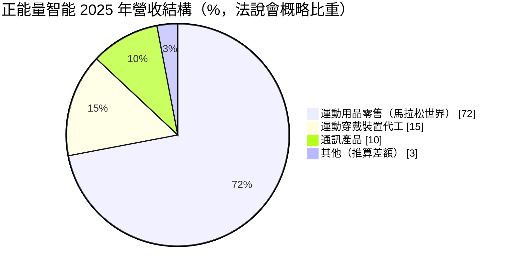
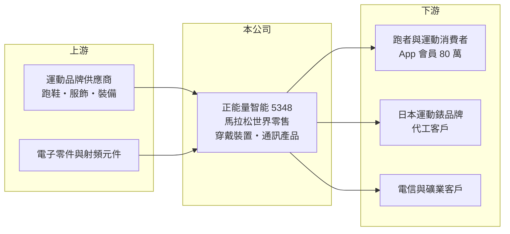

# 5348 正能量智能

> 上櫃｜[[產業索引-運動休閒|運動休閒]]｜上市（櫃）日期 2025/06/02

# 第一章：企業模式與商業藍圖

> [!info] 撰寫說明
> 精簡版，由 Claude 依公開資料整理，架構比照 [[2330台積電]]，資料截至 2026-10-08。來源：MoneyDJ 理財網財務比率年表（2018 至 2025 年）；富果研究 2025 年 12 月法說會備忘錄（沿革、營收結構、門市、會員、策略）；櫃買中心開放資料快照（基本資料、2026 年上半年資產負債與損益）。公開資料有限，改名年份與穿戴裝置客戶名稱未查得；部分營收以每股營業額乘以約 1,478 萬股推算。#待校對

正能量智能成立於 1990 年 12 月、1998 年 4 月上櫃，登記在竹南科學園區，董事長胡湘麒、總經理蕭世芳，實收資本額約 1.48 億元，是規模很小的公司。它的前身是做微波通訊硬體的系通科技，近年轉型為以「馬拉松世界」為核心的運動零售與社群公司，理解它要把它當成一家轉型中的小型零售企業來看。

- **核心業務：** 公司 2023 年取得「馬拉松世界」品牌母公司正能量運動 51% 股權，主力業務變成跑步、路跑相關運動用品零售，以線上線下整合的 [[OMO]] 模式經營。另外保留兩項舊業務：替日本前三大品牌代工高爾夫球錶等運動穿戴裝置，以及室內訊號覆蓋系統與大型礦車胎壓偵測器（[[TPMS]]）等通訊產品。
- **營收結構：** 依富果整理的 2025 年 12 月法說會，運動用品零售約占 72%、運動穿戴裝置約 15%、通訊產品約 10%。零售業務併入後，營收由 2023 年約 1.4 億元擴大到 2024 至 2025 年約 2.7 至 2.8 億元（推算），但也讓毛利結構轉向零售業。
- **營運據點：** 馬拉松世界在台北、新竹、高雄設有實體門市，第四家位於台北信義區籌備中；線上擁有約 80 萬 App 會員、15 萬活躍會員（法說會資料）。最大股東為能綠網通，持股比例未查得。
- **長期方向：** 公司計畫把馬拉松世界的跑步社群模式複製到自行車與登山戶外用品，並開發 AI 自行車車錶、智能水下推進器等自有智能產品，目標 2026 年整體損益兩平。轉型能否成功，關鍵在社群會員能否轉化為穩定的回購營收。

# 第二章：護城河深度與競爭優勢

正能量智能的潛在護城河是跑步社群與會員數據，但規模仍小，尚未形成穩固的競爭優勢。

- **競爭優勢：** 馬拉松世界長期經營路跑社群、賽事資訊與裝備評測，擁有一群高黏著度的跑者會員，這比一般運動用品店更能掌握消費者需求。結合 App 會員資料做精準行銷與庫存管理，是它相對傳統零售店的差異化。穿戴裝置代工則仰賴長期的射頻與嵌入式硬體經驗，能接日本品牌的利基型訂單。
- **主要對手：** 零售端對手是迪卡儂、各運動品牌直營店、大型電商平台（momo、蝦皮）與專業跑步用品店；運動穿戴裝置則面對 Garmin、Coros 等品牌自有產能，以及中國代工廠。這些對手的規模都遠大於正能量智能。
- **觀察重點：** 2025 年毛利率回升到約 30%，但營業利益率仍為 -8%，代表門市與行銷費用尚未被營收規模攤平。長期要看會員規模能否持續擴大、新品類（自行車、登山）能否複製跑步社群的成功，以及 2026 年損益兩平目標能否達成。

# 第三章：財務體質與盈利規模

資料日期：2026-10-08，表格是撰寫當時的快照；最新月營收、毛利率、累計 EPS 由自動排程寫在本筆記的屬性欄位（月營收、毛利率、累計EPS 等）。#待校對

正能量智能長年在損益兩平附近徘徊，2023 年轉型零售後營收擴大，但 2024 至 2025 年仍為虧損。

| 年度 | 營收（億元） | [[毛利率]] | [[營業利益率]] | EPS（元） | [[ROE]] |
|---|---|---|---|---|---|
| 2021 | 未查得 | 19.21% | -13.09% | -0.53 | -11.19% |
| 2022 | 未查得 | 28.31% | 2.83% | 0.16 | 4.56% |
| 2023 | 約 1.38（推算） | 25.40% | 3.70% | 0.22 | 5.49% |
| 2024 | 約 2.79（推算） | 25.74% | -0.90% | -0.71 | -2.96% |
| 2025 | 約 2.68（推算） | 29.77% | -8.19% | -1.49 | -9.29% |

註：2022 年以前為個別報表、2023 年起為合併報表（MoneyDJ 標示），前後不完全可比；2021 至 2022 年股數未確認，未推算營收。

- **長期指標：** 2021 至 2025 年平均 ROE 約 -2.7%（推算），5 年中有 3 年虧損。公司近年未配發股利（櫃買中心資料每股股利為 0），每股現金流量正負交錯，自由現金流無法長期為正。
- **[[ROIC]] 與 [[WACC]]：** 2025 年營業損失約 0.22 億元（營收約 2.68 億元 × -8.19%），ROIC 為負。投入資本以 2026 年第二季權益總計 1.33 億元，加有息負債推估約 0.2 億元計算，ROIC 約 -14%（推算）。WACC 約 9%（推算：無風險利率 1.75%、市場風險溢酬 6%、β 取小型轉型股常見值 1.2，股東權益成本 8.95%；負債比重低，稅率 20%）。ROIC 遠低於 WACC，代表目前仍在消耗資本，轉型是否成功要看能否先達到損益兩平，再把 ROIC 拉到 WACC 以上。
- **財務特色：** 2026 年第二季總資產 2.34 億元、負債 1.00 億元，負債比率約 43%，每股淨值 7.35 元，低於面額 10 元。2026 年上半年營收 1.42 億元、毛利率約 28%、營業損失約 0.04 億元、EPS -0.50 元，虧損較 2025 年收斂。

# 第四章：總體風險與地緣政治

正能量智能的風險在於規模小、轉型尚未獲利，以及零售業務的競爭與庫存。

- **產業週期：** 路跑熱潮與運動消費會隨景氣與流行起伏，跑鞋與裝備又屬可選消費，景氣差時消費者會延後購買。穿戴裝置代工則受日本品牌訂單週期影響，訂單量小、波動大。
- **營運風險：** 零售業務需要持續展店、備貨與行銷，若營收成長不如預期，固定費用會讓虧損擴大；運動用品更新快，庫存跌價也是風險。公司規模小、淨值低於面額，若持續虧損可能需要增資，稀釋既有股東。
- **其他風險：** 最大股東能綠網通的經營方向與集團綜效仍有不確定性；通訊產品與穿戴裝置使用的電子零件受供應鏈與匯率影響。股本小、成交量低，股價波動通常較大。

# 專有名詞解析

## 應用

- **[[TPMS]]**：胎壓偵測系統，以感測器即時監測輪胎氣壓與溫度，正能量智能用於大型礦車。

## 金融

- **[[ROIC]]**：投入資本報酬率，稅後營業利益除以股東權益加有息負債，衡量本業運用資本的效率。
- **[[WACC]]**：加權平均資金成本，股東與債權人要求報酬率的加權平均，是 ROIC 要超越的門檻。

## 產業

- **[[OMO]]**：線上線下融合，把會員、庫存與行銷在實體門市與網路渠道之間打通的零售經營方式。

# 核心供應鏈

- 上游：跑鞋、服飾與裝備的運動品牌供應商；電子零件與射頻元件供應商（名單未查得）。
- 下游／客戶：跑者與一般運動消費者；日本前三大運動錶品牌（名稱未查得）；室內訊號覆蓋與礦車胎壓偵測的企業客戶。
- 同業：迪卡儂、專業跑步用品店；運動品牌直營通路；運動錶品牌 Garmin、Coros。

## 最新新聞
<!-- news:start -->
<!-- news:end -->

## 相關連結
- [公開資訊觀測站](https://mopsov.twse.com.tw/mops/web/t05st03?step=1&firstin=1&co_id=5348)
- [Goodinfo](https://goodinfo.tw/tw/StockDetail.asp?STOCK_ID=5348)
- [Yahoo 股市](https://tw.stock.yahoo.com/quote/5348)
- [鉅亨網新聞](https://www.cnyes.com/twstock/5348/news)
