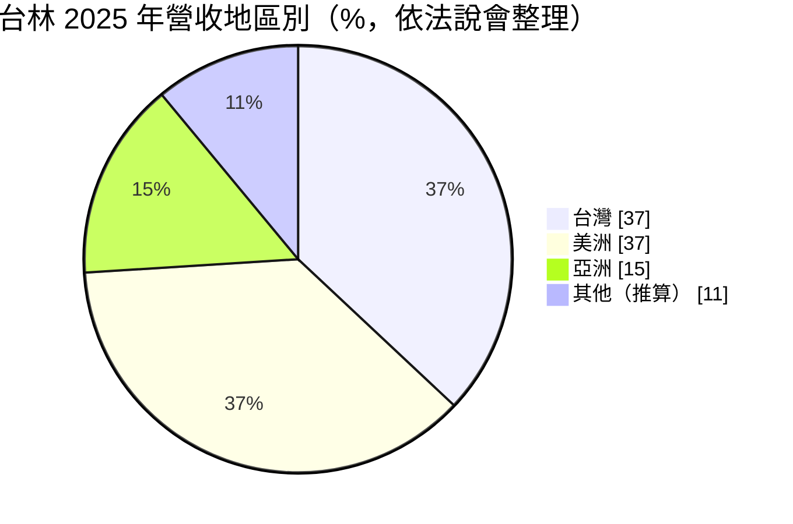
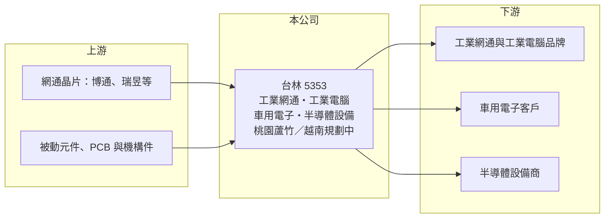

# 5353 台林

> 上櫃｜[[產業索引-通信網路業|通信網路業]]｜上市（櫃）日期 1998/05/18

# 第一章：企業模式與商業藍圖

> [!info] 撰寫說明
> 精簡版，由 Claude 依公開資料整理，架構比照 [[2330台積電]] 的四章研究，資料截至 2026-10-08。來源：櫃買中心開放資料（基本資料、綜合損益、資產負債、每月營收、本益比殖利率）、Goodinfo 年度經營績效、富果研究整理的台林 2026 年 3 月法說會內容。客戶名單未公開。#待校對

本章說明台林電通（股票代號：5353，以下簡稱台林）的商業模式：一家專做工業級網通、工業電腦、車用電子與半導體設備的少量多樣 [[ODM]] 與 [[EMS]] 廠。

- **核心業務：** 台林成立於 1980 年，1998 年在櫃買中心掛牌，實收資本額約 7.65 億元。主要產品包括工業級[[交換器]]、無線 LTE 閘道器、5G 路由器與[[時效性網路]]（TSN）設備，應用在智慧交通、工業自動化、智慧城市與電力通信。與消費性網通不同，工業網通要求寬溫、防塵、長期供貨，產品生命週期可長達十年。
- **營收結構：** 依 2026 年 3 月法說會整理，2025 年工業電腦與工業網通約占 65% 至 70%，汽車電子與半導體設備約占 30% 至 40%（原始資料區間重疊），公司預期 2026 年結構相近。地區別方面，2025 年台灣約 37%（由 54% 下降，因車用業務減少）、美洲約 37%（由 29% 提升）、亞洲約 15%（由 8% 提升）。

- **營運據點：** 生產基地在桃園蘆竹，正進行整建，第一階段為半導體設備維護服務空間，接著完成組裝製造中心。越南廠已選定地點，若進度順利預計 2027 年下半年啟用；北美設有在地服務團隊。
- **長期方向：** 公司的方向是在越南建立第二生產基地以分散關稅風險，在半導體設備領域提供在地化維修服務，並開發 AI 交換器、TSN 與光纖介面產品，因應工業網路全光化趨勢。公司也成立 AI 子公司，聚焦傳輸網路的 AI 應用。

# 第二章：護城河深度與競爭優勢

本章評估台林的護城河。工業級少量多樣的代工模式帶來一定的客戶黏著度，但規模小、議價能力有限，屬於窄護城河。

- **競爭優勢：** 工業與電力通信客戶重視可靠度與長期供貨，產品一旦通過驗證就會使用多年，供應商很少更換。台林累積四十多年的電子製造經驗，能同時提供設計與製造，對訂單量小、規格多的工業客戶有吸引力。毛利率長期維持在 20% 至 26%，高於一般 EMS 廠，就是這種利基定位的結果。
- **主要對手：** 工業網通與工業電腦的對手包括 [[3380明泰]]、[[2345智邦]] 的工業產品線、[[8114振樺電]]，以及 Moxa（四零四科技）等工業網通品牌與眾多中小型 EMS 廠（對手名單為產業常識整理，待校對）。
- **觀察重點：** 第一，美洲工業網通訂單能否持續成長，彌補車用業務的減少。第二，越南廠能否如期在 2027 年下半年投產。第三，半導體設備維修服務能否成為穩定的經常性收入。

# 第三章：財務體質與盈利規模

資料日期：2026-10-08。數字取自 Goodinfo 年度經營績效與櫃買中心開放資料，表格是撰寫當時的快照；最新月營收、毛利率、累計 EPS 由自動排程寫在本筆記的屬性欄位（月營收、毛利率、累計EPS 等）。#待校對

台林的財務數字顯示營收規模穩定在 13 億至 20 億元，毛利率逐步提升，但營業利益率仍是個位數。

| 年度 | 營收（新台幣） | [[毛利率]] | [[營業利益率]] | EPS（元） | [[ROE]] |
|---|---|---|---|---|---|
| 2019 | 17.8 億 | 19.9% | 6.09% | 1.38 | 9.06% |
| 2020 | 13.3 億 | 20.8% | 4.05% | 0.88 | 5.79% |
| 2021 | 14.2 億 | 20.1% | 4.68% | 1.01 | 6.69% |
| 2022 | 19.1 億 | 23.0% | 8.02% | 1.81 | 11.5% |
| 2023 | 19.8 億 | 25.1% | 8.47% | 2.14 | 12.7% |
| 2024 | 18.6 億 | 25.7% | 7.47% | 2.15 | 12.0% |
| 2025 | 18.3 億 | 23.7% | 5.83% | 1.38 | 7.41% |
| 2026 上半年 | 9.28 億 | 24.5% | 6.12% | 0.95 | 未查得 |

註：2019 至 2025 年取自 Goodinfo 合併報表；2026 上半年取自櫃買中心開放資料，毛利率與營業利益率由營業毛利、營業利益除以營收計算。

- **營收規模：** 2020 至 2025 年營收年複合成長率約 6.6%（推算），2022 年後穩定在 18 億至 20 億元。2026 年 1 至 8 月累計營收 12.66 億元，較去年同期增加約 6.1%。
- **獲利：** 毛利率從 2019 年的 19.9% 提升到 2023 至 2024 年的 25% 以上，2025 年因匯率波動與車用電子市場萎縮回落到 23.7%，稅後淨利 1.03 億元、年減約 36%。2021 至 2025 年平均 ROE 約 10.1%（推算）。法說會指出存貨已由 2023 年的 4.7 億元降到 2.56 億元，現金增加到 5.43 億元，營運資金管理改善。
- **財務特色：** 2026 年第二季底資產總計 22.9 億元、負債 8.27 億元（流動負債 7.32 億元、非流動負債 0.94 億元），歸屬母公司權益 14.6 億元，每股淨值 19.29 元。櫃買中心資料顯示最近一年度每股現金股利約 1 元，相對 2025 年 EPS 1.38 元，配息率約 72%（推算）。蘆竹整建與越南建廠將提高未來幾年的資本支出。
- **[[ROIC]] 與 [[WACC]]：** 以 2025 年營業利益 1.07 億元扣 20% 稅後約 0.86 億元，投入資本以歸屬母公司權益 14.6 億元加非流動負債 0.94 億元（代替有息負債）約 15.6 億元計算，ROIC 約 5.5%（推算）；2026 上半年年化約 5.8%（推算）；2023 年營業利益約 1.68 億元，當時 ROIC 推估約 9% 至 10%。WACC 以 CAPM 推估：無風險利率 1.75%、市場風險溢酬 6%、β 取 0.9（推估，工業電子股波動較低），權益成本約 7.15%，負債比重低，WACC 約 7.0%（推算）。ROIC 在 2022 至 2024 年高於 WACC，2025 年後略低，代表台林處於價值創造的邊緣，毛利率能否回到 25% 是關鍵。

# 第四章：總體風險與地緣政治

本章整理台林面對的長期風險，主要來自規模小與產品組合變動。

- **產業週期：** 工業網通與工業電腦受製造業資本支出與基礎建設投資影響，景氣循環比消費電子平緩，但 2025 年車用電子萎縮顯示個別市場仍有明顯週期。半導體設備業務則跟隨晶圓廠擴產週期起伏。
- **營運風險：** 少量多樣的生產模式使製造效率不易提升，營收規模小、固定費用占比高。越南新廠投產初期會有學習成本與折舊壓力。
- **其他風險：** 美國 301 條款與關稅政策影響對美出貨成本，這也是公司建越南廠的原因。美洲營收比重上升後，美元匯率波動對獲利影響更大，2025 年獲利下滑部分就來自匯率。

# 專有名詞解析

## 應用

- **[[時效性網路]]**：TSN，在標準乙太網路上保證封包在固定時間內送達的技術，用於工廠自動化與車用網路。

## 金融

- **[[ROIC]]**：投入資本報酬率，稅後營業利益除以股東權益加有息負債，衡量本業運用資本的效率。
- **[[WACC]]**：加權平均資金成本，股東與債權人要求報酬率的加權平均，是 ROIC 要超越的門檻。

## 產業

- **[[ODM]]**：原廠委託設計製造，代工廠可提出設計方案並負責生產，與客戶綁定較深，議價能力較高。
- **[[EMS]]**：電子製造服務，依客戶設計代為採購零件、組裝與測試，通常不負責產品設計。
- **[[交換器]]**：在資料中心或企業網路中轉送資料封包的網路設備，AI 資料中心需要 800G、1.6T 等高速規格。

# 核心供應鏈

- 上游：網通晶片 [[AVGO博通]]、[[2379瑞昱]]（法說會提及的晶片供應商），被動元件、PCB 與機構件。
- 下游／客戶：工業網通與工業電腦品牌、車用電子與半導體設備客戶，終端應用為智慧交通、工業自動化、智慧城市與電力通信；客戶名稱未公開。
- 同業：[[3380明泰]]、[[8114振樺電]]、[[2345智邦]]、[[3558神準]]。

## 最新新聞
<!-- news:start -->
<!-- news:end -->

## 相關連結
- [公開資訊觀測站](https://mopsov.twse.com.tw/mops/web/t05st03?step=1&firstin=1&co_id=5353)
- [Goodinfo](https://goodinfo.tw/tw/StockDetail.asp?STOCK_ID=5353)
- [Yahoo 股市](https://tw.stock.yahoo.com/quote/5353)
- [鉅亨網新聞](https://www.cnyes.com/twstock/5353/news)
