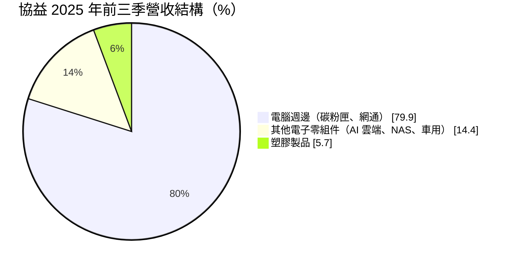
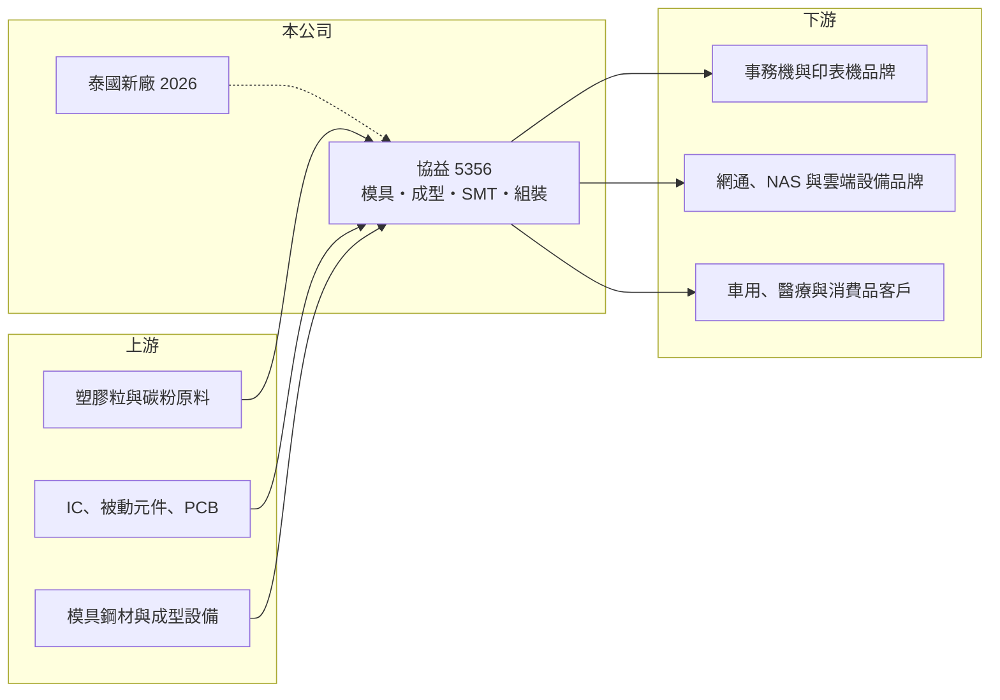

# 5356 協益

> 上櫃｜[[產業索引-電腦及週邊設備業|電腦及週邊設備業]]｜上市（櫃）日期 1998/07/20

# 第一章：企業模式與商業藍圖

> [!info] 撰寫說明
> 精簡版，由 Claude 依公開資料整理，架構比照 [[2330台積電]]，資料截至 2026-10-08。來源：櫃買中心開放資料（基本資料、2026 年上半年財報、每月營收、本益比殖利率）、Goodinfo 經營績效頁、富果研究 2025 年 12 月法說會整理。現有工廠所在地與主要客戶名稱未查得；2023 年高 EPS 的業外來源未查得。#待校對

本章說明協益電子（5356，以下簡稱協益）的商業模式：一家成立超過半世紀、從模具開發做到成品組裝測試的電子與塑膠代工廠。

- **核心業務：** 協益成立於 1969 年，1998 年在櫃買中心掛牌，董事長為林欽淼。公司提供從模具開發、塑膠[[射出成型]]、[[SMT]] 電路板打件，到終端產品測試組裝的一站式代工服務，客戶多為國際知名品牌廠。依客戶需求，可以只做純代工，也可以連同材料採購一起承包。
- **營收結構：** 2025 年前三季電腦週邊約占 79.9%，主要是事務機雷射[[碳粉匣]]與網通產品；其他電子零組件約 14.4%，包含 AI 雲端運算平台、[[NAS]] 網路儲存伺服器與車用觸控板，是毛利最高的業務；塑膠製品約 5.7%，包括醫療器材塑件、釣具齒輪與智慧門鎖。管理層粗估塑膠件約占 75%、電子件約 25%，但多數產品同時結合兩者。
- **營運據點：** 總部在台北市中正區。公司推行「China+1」與「Taiwan+1」策略，2025 年第二季開始建置泰國新廠，預計 2026 年上半年完成客戶認證並開始放量，初期以塑膠件為主。現有工廠位置在本次資料中未明列（推估在中國與台灣，待校對）。
- **長期方向：** 公司正把重心轉向高附加價值產品，特別是 AI 伺服器相關的高階電路板組裝，並推動工業 4.0 智能製造，整合電子與塑膠兩大技術。泰國廠則讓公司能承接客戶分散產地的需求。

# 第二章：護城河深度與競爭優勢

本章分析協益的競爭位置：垂直整合能力是它的主要優勢，但碳粉匣等主力產品屬於成熟、低毛利的代工市場。

- **競爭優勢：** 協益同時具備模具、塑膠成型與電子組裝能力，可以把一個產品從零件做到成品，客戶只需要面對一個供應商，這在耗材與小型電子產品的代工中相當有吸引力。與國際品牌合作多年的碳粉匣業務，需要精密模具與穩定品質，客戶不會輕易更換供應商。
- **主要對手：** 電子與塑膠整合代工的台股同業包括 [[2402毅嘉]]、[[3294英濟]]、[[6133金橋]]、[[2415錩新]] 等，東南亞與中國的模具射出廠也是競爭對手；碳粉匣則面臨副廠耗材業者的價格競爭。
- **觀察重點：** 長期要看其他電子零組件（AI 雲端、NAS、車用）的比重能否從一成多提升到三成以上，帶動毛利率站穩 15%；泰國廠能否順利取得訂單；以及事務機耗材市場萎縮下，碳粉匣業務能否維持規模。

# 第三章：財務體質與盈利規模

資料日期：2026-10-08，表格是撰寫當時的快照；最新月營收、毛利率、累計 EPS 由自動排程寫在本筆記的屬性欄位（月營收、毛利率、累計EPS 等）。#待校對

本章用多年度數字檢視協益的獲利能力：本業毛利偏低，EPS 常受業外損益影響大幅波動。

| 年度 | 營收（億元） | [[毛利率]] | [[營業利益率]] | EPS（元） | [[ROE]] |
|---|---|---|---|---|---|
| 2021 | 38.4 | 3.35% | -3.61% | -0.28 | -0.66% |
| 2022 | 37.1 | 6.93% | 0.43% | -0.60 | -1.48% |
| 2023 | 33.2 | 8.96% | 0.82% | 5.48 | 12.5% |
| 2024 | 38.8 | 13.1% | 5.52% | 2.16 | 4.77% |
| 2025 | 33.5 | 14.5% | 5.15% | 0.44 | 1.01% |

- **營收規模：** 2019 年營收 51.4 億元，之後下降到 33 億至 39 億元區間，2019 至 2025 年營收呈現萎縮。2026 年上半年營收 17.7 億元，前 8 月累計年增約 16%，有回升跡象。
- **獲利：** 毛利率從 2021 年的 3.4% 逐年改善到 2025 年的 14.5%，反映產品組合往高毛利電子零組件調整。但 EPS 與本業脫鉤：2023 年營業利益率不到 1%，EPS 卻有 5.48 元（業外來源未查得）；2025 年營業利益率 5.2%，EPS 只有 0.44 元，主因第二季約 1.8 億元的匯兌與權益法投資損失。2026 年上半年毛利率 12.1%、營業利益率 1.9%、EPS 1.02 元，其中業外收入貢獻約七成。
- **財務特色：** 近 5 年（2021 至 2025）平均 ROE 約 3.2%。2026 年第二季權益 43.9 億元，保留盈餘高達 31.6 億元，負債比僅約 28%，每股淨值約 42.6 元，股價淨值比約 0.6 倍。依櫃買中心資料，最近一次現金股利為每股 2.0 元，明顯高於 2025 年 EPS，等於動用過去累積的盈餘配發，屬於資產豐厚但本業報酬偏低的公司。
- **[[ROIC]] 與 [[WACC]]：** 2025 年營業利益約 1.7 億元，稅後約 1.4 億元；以權益 43.9 億元加非流動負債 3.9 億元粗估投入資本約 47.8 億元，ROIC 約 2.9%（推算）。WACC 以 [[CAPM]] 推估：無風險利率 1.75%、市場風險溢酬 6%、β 假設 0.8（低槓桿傳統電子代工股），股東權益成本約 6.55%；稅後負債成本 2%、負債占資本 10%，WACC 約 6.1%（推算）。ROIC 長期明顯低於 WACC，主因是大量資本停留在帳上與轉投資，未投入高報酬的本業；高配息某種程度是把低效率資本還給股東。

# 第四章：總體風險與地緣政治

本章整理協益長期要面對的風險。

- **產業週期：** 主力的雷射碳粉匣跟著事務機與辦公列印需求，長期面臨無紙化帶來的結構性萎縮；網通與 NAS 產品則受庫存週期影響。2025 年存貨週轉天數增加到約 95 天，部分原因是改為貨出海外倉、客戶拉貨才認列營收，營收認列時點因此更不穩定。
- **營運風險：** 營收集中在少數國際品牌客戶，客戶產品策略或供應商分配改變會造成大幅波動。泰國新廠初期的學習成本與折舊，可能在放量前壓縮獲利。
- **其他風險：** 匯率與權益法轉投資的損益，常讓 EPS 與本業表現背離，評估時需以營業利益為主。塑膠原料價格、中國生產成本與美中關稅政策，都會影響成本與客戶下單地點。

# 專有名詞解析

## 應用

- **[[碳粉匣]]**：雷射印表機與影印機的耗材，內含碳粉與感光鼓等精密結構，屬於重複購買的消耗品。
- **[[NAS]]**：網路附加儲存設備，透過網路提供檔案儲存與分享，常見於企業與家庭。

## 金融

- **[[CAPM]]**：資本資產定價模型，以無風險利率加上 β 乘以市場風險溢酬，推估股東要求的報酬率。

## 產業

- **[[射出成型]]**：把加熱熔融的塑膠注入模具、冷卻後成型的製程，是塑膠零組件的主要生產方式。
- **[[SMT]]**：表面黏著技術，把電子零件直接焊接在電路板表面的組裝製程。

# 核心供應鏈

- 上游：塑膠粒與碳粉原料、IC 與被動元件、印刷電路板、模具鋼材與成型設備（個別供應商未查得）。
- 下游／客戶：國際事務機與印表機品牌、網通與 NAS 設備品牌、車用與醫療器材客戶（客戶名稱未公開）。
- 同業：[[2402毅嘉]]、[[3294英濟]]、[[6133金橋]]、[[2415錩新]]、[[4924欣厚-KY]]。

## 最新新聞
<!-- news:start -->
<!-- news:end -->

## 相關連結
- [公開資訊觀測站](https://mopsov.twse.com.tw/mops/web/t05st03?step=1&firstin=1&co_id=5356)
- [Goodinfo](https://goodinfo.tw/tw/StockDetail.asp?STOCK_ID=5356)
- [Yahoo 股市](https://tw.stock.yahoo.com/quote/5356)
- [鉅亨網新聞](https://www.cnyes.com/twstock/5356/news)
