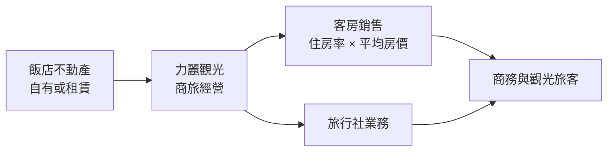
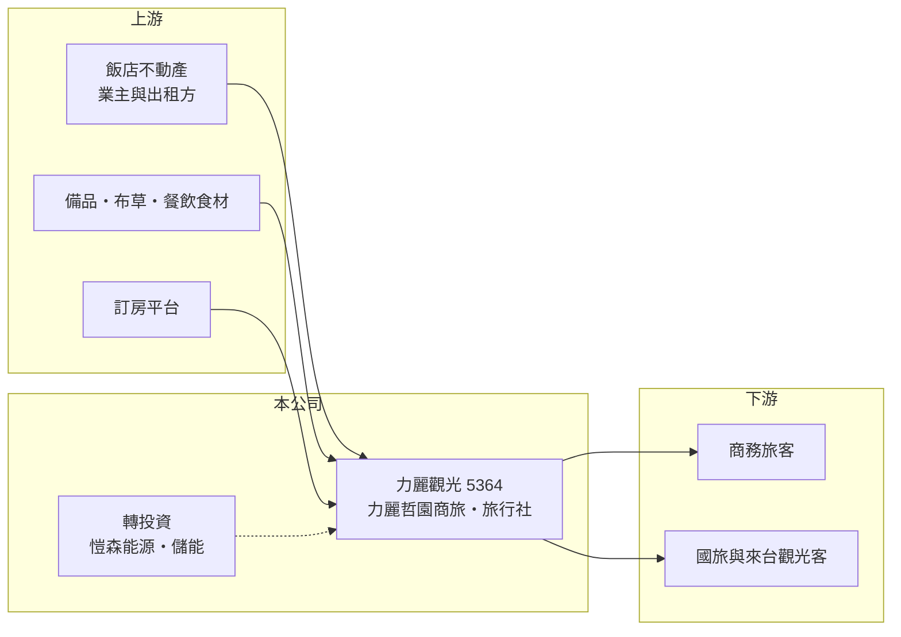

# 5364 力麗店

> 上櫃｜[[產業索引-觀光餐旅|觀光餐旅]]｜上市（櫃）日期 2013/08/26

# 第一章：企業模式與商業藍圖

> [!info] 撰寫說明
> 本文由 Claude 依公開資料整理，架構比照 [[2330台積電]] 的四章研究，資料截至 2026-10-08。財務數字來源：櫃買中心開放資料（基本資料、2026 年第二季資產負債表與綜合損益表）、Goodinfo 年度經營績效頁、nStock 公司簡介；公開資料有限，查不到各館房間數、住房率、平均房價與營收比重，產業描述為整理性內容，尚未逐條比對原始文件。#待校對

在評估單一個股的長期投資價值時，首要步驟是拆解企業的底層獲利邏輯。本章說明力麗觀光開發（股票代號：5364，以下簡稱力麗觀光）如何由科技公司外殼轉型為飯店經營者，以及商務飯店這門生意的獲利關鍵。

## 一、核心定位：由科技殼轉型的飯店經營公司

力麗觀光於 1990 年 1 月設立，1998 年 12 月在櫃買中心上櫃，原名梅捷企業，2004 年更名為浩騰科技，2012 年再更名為易福。2015 年因經營團隊改組，公司[[轉型]]為觀光飯店經營及顧問，並更名為力麗觀光開發。公司名稱與紡織集團 [[1444力麗]] 相同，推估屬同一集團（待校對）。依 nStock 整理，目前主要業務是飯店及旅行社經營。

飯店品牌方面，公司經營「力麗哲園」系列商旅，其中包括花蓮館（依新聞標題，各館數量與房間數未查得）。2022 年 9 月 1 日，子公司朝日商務飯店以簡易合併方式併入母公司，簡化集團架構。

## 二、資本轉化邏輯：重資產、高固定成本

商務飯店的營收可以拆成[[住房率]]乘上[[平均房價]]再乘上房間數，而成本中折舊、租金與人力大多是固定的，因此獲利對住房率非常敏感，這就是典型的[[營運槓桿]]。力麗觀光的毛利率在 2021、2023、2024 年都是負值，代表客房收入連直接營運成本都無法完全支應；2026 年上半年營收 0.76 億元、毛利僅 0.06 億元，營業虧損 0.22 億元。

## 三、長期方向：嘗試跨入能源

2024 年 5 月董事會決議設立能源事業部，並以參與現金增資的方式轉投資愷森能源，業務為[[儲能]]系統規畫建置及能源應用整合服務。這代表經營層在飯店本業之外尋找第二成長曲線，但能源與飯店之間沒有明顯綜效，新事業的規模與獲利仍待觀察。另外，2026 年 4 月起月營收年減約八成（依 winvest 月營收快訊標題），原因未查得，可能涉及館別調整或停業（推估，待校對），會大幅改變公司的營收基礎。

# 第二章：護城河深度與競爭優勢

「護城河」指企業抵禦競爭、維持超額利潤的保護機制。平價商旅市場供給充足，本章說明力麗觀光的相對位置。

## 一、相對優勢

力麗觀光的優勢在於集團背景與財務體質：2026 年第二季底負債比約 36%，流動比率約 137%，比多數同規模的飯店公司寬裕。然而平價與中價位商旅的差異化程度低，旅客主要透過訂房平台比價，飯店很難維持高於同業的房價；加上公司毛利率多年在零附近徘徊，目前看不出明顯的護城河。

## 二、主要競爭對手

| 對手 | 定位 | 對力麗觀光的威脅 |
|---|---|---|
| [[2706第一店]] | 台北商務飯店 | 爭奪同一批商務與觀光客 |
| [[2748雲品]] | 中高價飯店與委託經營 | 品牌知名度與規模較大 |
| [[2707晶華]] | 高端與平價雙品牌連鎖 | 以「捷絲旅」等平價品牌切入同一市場（待校對） |
| 連鎖平價旅店與民宿 | 價格彈性大 | 以低房價搶自由行旅客 |

## 三、守得住／守不住／觀察重點

守得住的是資產負債表與集團支持。守不住的是房價與住房率，在訂房平台透明比價下，商旅幾乎沒有定價權。長期觀察重點是 2026 年營收大幅下滑的原因與後續館別規劃、能源事業的實際貢獻，以及毛利率能否穩定轉正。

# 第三章：財務體質與盈利規模

資料日期：2026-10-08，表格是撰寫當時的快照；最新月營收、毛利率、累計 EPS 由自動排程寫在本筆記的屬性欄位（月營收、毛利率、累計EPS 等）。#待校對

財務報表是檢驗護城河是否真實存在的最終標準。本章用六年的三率、ROE 與資本報酬檢視力麗觀光的獲利品質。

## 一、多年度經營績效

| 年度 | 營收（新台幣） | [[毛利率]] | [[營業利益率]] | EPS（元） | [[ROE]] |
|---|---|---|---|---|---|
| 2020 | 4.69 億 | 11.0% | -0.7% | -2.11 | -7.73% |
| 2021 | 3.34 億 | -8.37% | -22.2% | -2.49 | -23.9% |
| 2022 | 4.00 億 | 6.37% | -5.01% | -1.17 | -11.6% |
| 2023 | 4.77 億 | -0.44% | -11.7% | -1.77 | -22.3% |
| 2024 | 4.21 億 | -1.47% | -18.5% | -1.41 | -21.7% |
| 2025 | 3.12 億 | 13.5% | -12.2% | -0.77 | -5.71% |
| 2026 上半年 | 0.76 億 | 7.9% | -29.3% | -0.33 | 未查得 |

資料來源：2020 至 2025 年為 Goodinfo，2026 上半年為櫃買中心開放資料。

力麗觀光六年來每年營業虧損，即使在 2023 年疫後旅遊復甦、營收回到 4.77 億元的高點，毛利率仍為負值，顯示問題出在成本結構而非單純的需求不足。2021 至 2025 年平均 ROE 約 -17%（推算），營收年複合成長率約 -2%（2021 年 3.34 億元到 2025 年 3.12 億元，推算）。近五年沒有配發現金股利。

## 二、財務結構

2026 年第二季底，力麗觀光總資產 11.1 億元、負債 4.0 億元，權益總計 7.11 億元，每股淨值 10.83 元。保留盈餘為 -0.71 億元，累積虧損不大，但其他權益為 -0.73 億元，2026 年上半年其他綜合損益 -0.22 億元，推估與持有的金融資產評價下跌有關（推估）。

## 三、[[ROIC]] 與 [[WACC]]：價值創造利差

**ROIC 推算：** 2025 年營業虧損約 0.38 億元（3.12 億 × -12.2%），虧損年度不計稅盾。2026 年第二季底權益總計約 7.11 億元，負債 4.0 億元中假設一半為有息負債約 2.0 億元（推估），投入資本約 9.1 億元，ROIC 約 -4%（推算）。

**WACC 推算：** 台灣 10 年期公債取 1.75%、市場風險溢酬 6%、β 取觀光飯店股常見值 0.9，股東權益成本約 7.15%；負債成本假設 3%；權益約 78%、負債約 22%，WACC 約 6.2%（推算）。

**結論：** ROIC 低於 WACC 約 10 個百分點，飯店本業長期未能賺回資金成本。除非營收基礎重建並讓毛利率穩定轉正，否則投入的資本持續在流失價值。

# 第四章：總體風險與地緣政治

任何企業都無法脫離宏觀環境獨立存在。本章分析力麗觀光長期必須面對的風險。

## 一、營收基礎變動風險

2026 年起營收大幅縮減，若原因是館別結束營業或租約到期，公司的飯店事業規模將明顯變小，未來營收可能長期停留在低檔。投資人需要追蹤公司是否有新館或改裝計畫。

## 二、觀光需求與競爭風險

商務飯店受來台旅客、國旅需求與企業差旅預算影響，疫情期間 2021 年營收下滑近三成的經驗說明需求面衝擊的力道。平價旅宿供給持續增加，房價競爭激烈。

## 三、成本與新事業風險

人力成本與基本工資上升、水電與備品價格上漲，都會壓縮本已偏低的毛利率。儲能事業屬於新領域，需要資金與技術投入，若成效不佳可能成為新的虧損來源。

# 專有名詞解析

## 金融

- **[[營運槓桿]]**：固定成本占比高時，營收小幅變動就會讓獲利大幅增減；營收萎縮時虧損也會被放大。
- **[[ROIC]]**：投入資本報酬率，稅後營業利益除以股東權益加有息負債，衡量本業運用資本的效率。
- **[[WACC]]**：加權平均資金成本，股東與債權人要求報酬率的加權平均，是 ROIC 要超越的門檻。

## 產業

- **[[轉型]]**：企業把主要業務從原產業移往新產業，過程中營收與獲利常出現斷層。
- **[[住房率]]**：已售出客房數占可售客房數的比例，是衡量飯店需求最直接的指標。
- **[[平均房價]]**：客房收入除以已出租房數，反映飯店的定價能力。
- **[[儲能]]**：以電池等設備儲存電力，在用電尖峰或電網需要時釋放，可參與電力交易市場賺取收入。

# 核心供應鏈

## 1. 上游：場地與營運物資
- 飯店不動產、備品與布草、訂房平台

## 2. 中游：力麗觀光與轉投資
- 力麗哲園商旅、旅行社業務；朝日商務飯店（2022 年併入）；愷森能源（2024 年轉投資）
- 關係企業（推估）：[[1444力麗]]、[[1447力鵬]]

## 3. 下游與同業
- 客戶：商務旅客、國旅與來台觀光客
- 同業：[[2706第一店]]、[[2748雲品]]、[[2707晶華]]

## 最新新聞
<!-- news:start -->
<!-- news:end -->

## 相關連結
- [公開資訊觀測站](https://mopsov.twse.com.tw/mops/web/t05st03?step=1&firstin=1&co_id=5364)
- [Goodinfo](https://goodinfo.tw/tw/StockDetail.asp?STOCK_ID=5364)
- [Yahoo 股市](https://tw.stock.yahoo.com/quote/5364)
- [鉅亨網新聞](https://www.cnyes.com/twstock/5364/news)
