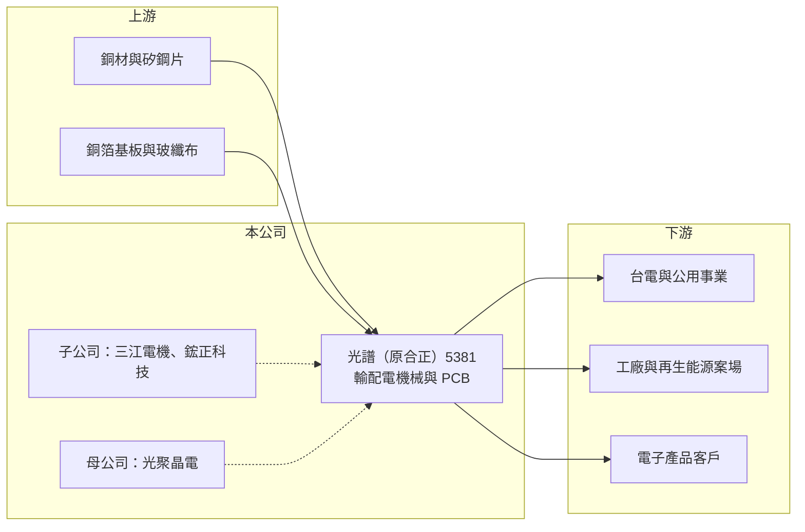

# 5381 合正

> 上櫃｜[[產業索引-電子零組件業|電子零組件業]]｜上市（櫃）日期 1999/03/19

# 第一章：企業模式與商業藍圖

> [!info] 撰寫說明
> 精簡版，由 Claude 依公開資料整理，架構比照 [[2330台積電]] 的四章研究，資料截至 2026-10-08。來源：Goodinfo 經營績效頁、nStock 公司介紹頁、Yahoo 股市公告標題、櫃買中心開放資料快照（基本資料、2026 年第二季損益與資產負債、本益比殖利率）。公司已由合正科技更名為光譜電工，櫃買中心資料簡稱為「光譜」、產業別為電機機械；更名年份、子公司三江電機的併入時間與產品細節未查得。#待校對

光譜（原合正科技）原本是桃園的印刷電路板廠，在 2021 年由光聚晶電入主後，業務擴展到發電、輸電與配電機械，營收規模在 2023 至 2024 年大幅跳升。本章說明它的業務組成與轉型。

- **核心業務：** 公司成立於 1991 年，1999 年上櫃，原名合正科技，經營多層[[印刷電路板]]、銅箔基板與玻纖膠片的製造與買賣。之後營業項目加入發電、輸電、配電機械製造，並更名為光譜電工，櫃買中心的產業別也改列為電機機械。這代表公司的主體已從電子零組件轉向[[重電]]相關設備。
- **營收結構：** 產品別比重未查得。從財報看，營收由 2022 年的 3.23 億元跳到 2024 年的 23.3 億元，推估主要來自子公司三江電機的電機與輸配電設備業務併入（推估）。PCB 業務占比已大幅縮小（推估）。
- **營運據點：** 註冊地與主要營運據點在桃園市中壢區。子公司包括鋐正科技與三江電機，其廠區與產能細節未查得。
- **長期方向：** 2021 年 8 月起，光聚晶電（原大宇資訊）成為最終母公司，公司隨之轉型。台灣電網強韌計畫與再生能源併網帶動輸配電設備需求，是公司轉向重電的主要背景。2026 年董事會通過發行第三次有擔保轉換公司債，顯示轉型仍需要外部資金支持。

# 第二章：護城河深度與競爭優勢

光譜的競爭力目前主要來自搭上台灣電網投資週期，PCB 舊業務則缺乏明顯優勢。本章分析它的競爭條件。

- **競爭優勢：** 輸配電設備須通過台電等公用事業的資格審查，取得合格供應商資格後可參與長期標案，這是新進者難以快速跨越的門檻。若三江電機已具備台電供貨資格（待校對），公司就能分享台灣電網更新的長期需求。轉型後的毛利率與營業利益率明顯高於過去單純做 PCB 時期。
- **主要對手：** 重電與配電設備市場的大廠包括 [[1519華城]]、[[1503士電]]、[[1513中興電]]、[[1514亞力]]、[[1504東元]] 等，規模與產品線都比光譜完整。PCB 業務則面對眾多中小型板廠的價格競爭。
- **觀察重點：** 第一，營收在 2025 至 2026 年由 23 億元回落到 22 億元以下，需觀察重電訂單是否穩定。第二，母公司光聚晶電的策略與關係人交易，關係到小股東權益。第三，轉換公司債轉換後的股本稀釋，以及公司何時恢復配發股利。

# 第三章：財務體質與盈利規模

資料日期：2026-10-08，表格是撰寫當時的快照；最新月營收、毛利率、累計 EPS 由自動排程寫在本筆記的屬性欄位（月營收、毛利率、累計EPS 等）。#待校對

光譜的財報清楚分成兩段：2022 年以前是小型 PCB 廠，2023 年起營收與獲利隨業務轉型跳升。本章用多年度數據說明。

| 年度 | 營收（億元） | [[毛利率]] | [[營業利益率]] | EPS（元） | [[ROE]] |
|---|---|---|---|---|---|
| 2020 | 3.43 | 30.3% | -0.25% | 0.01 | 0.39% |
| 2021 | 3.87 | 27.8% | 2.11% | 0.07 | 1.84% |
| 2022 | 3.23 | 27.4% | -2.68% | 0.10 | 2.26% |
| 2023 | 11.9 | 17.0% | 1.60% | 0.05 | 1.28% |
| 2024 | 23.3 | 22.1% | 11.0% | 0.93 | 12.4% |
| 2025 | 22.0 | 25.4% | 14.5% | 0.72 | 8.62% |
| 2026 上半年 | 9.70 | 30.5% | 18.1% | 0.49 | 未查得 |

- **營收規模：** 2020 至 2025 年營收年複合成長率約 45%（推算），但這主要來自業務併入，並非原有業務的自然成長。2026 年 1 至 9 月累計營收約 15.2 億元，年減約 10%。
- **獲利：** 轉型後營業利益率從個位數升到 2025 年的 14.5% 與 2026 年上半年的 18.1%，毛利率也回升到三成，顯示重電業務的獲利能力優於舊 PCB 業務。2021 至 2025 年平均 ROE 約 5.3%（推算），但 2024 年起已提升到 8% 至 12%。
- **財務特色：** 2026 年第二季末股本約 20.8 億元、股東權益約 23.7 億元、負債約 27.5 億元（其中非流動負債約 12.6 億元），負債比約 54%，財務槓桿偏高。每股淨值 11.1 元。近五年未配發股利，並持續以轉換公司債籌資。

**[[ROIC]] 與 [[WACC]]：** 有息負債明細未查得，假設約 15 億元（推估，含轉換公司債與長期借款）。2025 年營業利益約 3.19 億元，稅後約 2.55 億元，投入資本以股東權益約 23.7 億元加有息負債 15 億元，約 38.7 億元，ROIC 約 6.6%（推算）；2024 年約 5.5%（推算）；2022 年以前本業接近虧損，ROIC 接近零。WACC 用 CAPM 推估：無風險利率 1.75%、市場風險溢酬 6%、β 取 1.0（重電與電子股，假設），股東權益成本約 7.8%；負債成本 3%、稅率 20%，以權益 61%、負債 39% 加權，WACC 約 5.7%（推算）。轉型後 ROIC 已略高於 WACC，開始小幅創造價值，但利差不到一個百分點，且依賴推估的負債數字，須以正式財報驗證。

# 第四章：總體風險與地緣政治

光譜的風險來自轉型的持續性、公司治理與財務槓桿。本章整理主要風險。

- **產業週期：** 輸配電設備需求取決於台電與民間的電網投資計畫，政策預算與標案時程會造成營收起伏。電網投資雖屬長期趨勢，但標案集中在特定年度時，營收可能大起大落。
- **營運風險：** 營收規模在三年內擴大約七倍，管理與內控需要跟上。母公司光聚晶電持股主導，關係人交易（例如 2026 年的關係人使用權資產租約提前終止）須持續注意。PCB 舊業務規模小、競爭激烈。
- **其他風險：** 銅、矽鋼片等原料價格會影響電機設備成本。負債比偏高，利率上升會增加利息負擔；轉換公司債轉換後會稀釋每股盈餘。

# 專有名詞解析

## 金融

- **[[轉換公司債]]**：可依約定價格轉換為公司股票的債券，公司可用較低利率籌資，但轉換後會稀釋股本。
- **[[ROIC]]**：投入資本報酬率，稅後營業利益除以股東權益加有息負債，衡量本業運用資本的效率。
- **[[WACC]]**：加權平均資金成本，股東權益成本與負債成本依資本結構加權，是 ROIC 必須超越的門檻。

## 產業

- **[[印刷電路板]]**：PCB，承載電子零件並以銅線路連接訊號與電源的基板，是所有電子產品的基礎零件。
- **[[重電]]**：發電、輸電、配電用的大型電機設備，如變壓器、開關設備、配電盤，主要客戶為電力公司與大型工廠。

# 核心供應鏈

- 上游：銅材、矽鋼片（電機用）、銅箔基板與玻纖布供應商（推估）。
- 下游／客戶：台電與公用事業、工廠與再生能源案場、PCB 舊業務的電子客戶（推估，名單未查得）。
- 同業：[[1519華城]]、[[1503士電]]、[[1513中興電]]、[[1514亞力]]、[[1504東元]]；母公司 [[6111光聚晶電]]。

## 最新新聞
<!-- news:start -->
<!-- news:end -->

## 相關連結
- [公開資訊觀測站](https://mopsov.twse.com.tw/mops/web/t05st03?step=1&firstin=1&co_id=5381)
- [Goodinfo](https://goodinfo.tw/tw/StockDetail.asp?STOCK_ID=5381)
- [Yahoo 股市](https://tw.stock.yahoo.com/quote/5381)
- [鉅亨網新聞](https://www.cnyes.com/twstock/5381/news)
