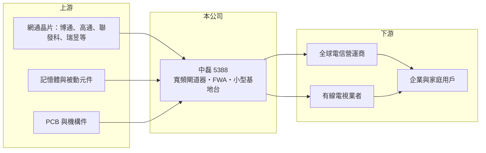

# 5388 中磊

> 上市｜[[產業索引-通信網路業|通信網路業]]｜上市（櫃）日期 2007/12/03

# 第一章：企業模式與商業藍圖

> [!info] 撰寫說明
> 精簡版，由 Claude 依公開資料整理，架構比照 [[2330台積電]] 的四章研究，資料截至 2026-10-08。來源：證交所開放資料（基本資料、綜合損益、資產負債、營益分析、股利、每月營收）、Goodinfo 年度經營績效。本次未取得產品別與地區別營收比重，產品線、客戶與生產據點依記憶整理，需逐條比對原始文件與法說會資料。#待校對

本章說明中磊電子（股票代號：5388，英文 Sercomm，以下簡稱中磊）的商業模式：一家以電信營運商為主要客戶、營收規模達數百億元的寬頻終端與小型基地台 [[ODM]] 廠。

- **核心業務：** 中磊成立於 1992 年，2007 年在證交所上市，總部位於台北市南港區，實收資本額約 30.4 億元，董事長王煒。產品涵蓋寬頻閘道器（纜線、DSL 與 [[PON]] 光纖）、4G／5G [[FWA]] 終端、[[小型基地台]]、網路攝影機與智慧家庭設備，以及企業網通設備（待校對）。中磊的客戶不是消費者，而是全球電信與有線電視營運商，由營運商把設備租給或賣給用戶。
- **營收結構：** 本次未取得產品別與地區別比重。依記憶，中磊的營收以寬頻閘道器為最大宗，北美與歐洲營運商是主要市場（待校對）。2026 年 1 至 8 月營收較去年同期增加約 55%，代表某些營運商的大型升級案正在出貨，具體產品本次未查得。
- **營運據點：** 研發總部在台北南港，生產據點依記憶包括中國蘇州、菲律賓等地，近年配合客戶要求擴大非中國產能（待校對）。
- **長期方向：** 電信網路的長期升級方向包括光纖到府、5G FWA、Wi-Fi 7 家用閘道器與 Open RAN 小型基地台。中磊的長期策略是成為營運商可以一次採購多種終端的「一站式」供應商，並以多國產能滿足各地政府與營運商的供應鏈安全要求。

# 第二章：護城河深度與競爭優勢

本章評估中磊的護城河。營運商客戶的認證門檻與長期合作關係提供了保護，但產品價格競爭激烈，屬於窄護城河。

- **競爭優勢：** 營運商採購終端設備需要長時間的互通測試、軟體客製化與資安審查，供應商一旦進入某家營運商的體系，往往能參與多代產品。中磊在小型基地台領域起步早，產品線比多數台灣同業完整，能同時供應寬頻、無線接取與家庭設備，對營運商而言可降低管理供應商的成本。營收規模也讓中磊在晶片採購上有一定議價能力。
- **主要對手：** 寬頻終端與 FWA 的對手包括 [[3596智易]]、[[3704合勤控]]、[[6285啟碁]]、[[4906正文]]、[[2419仲琦]]、[[3062建漢]]，以及中國的華為、中興與歐洲營運商自有方案（對手名單為產業常識整理，待校對）。
- **觀察重點：** 第一，2026 年的大幅營收成長能否轉成獲利率提升，而非只是低毛利的量增。第二，非中國產能的比重與成本。第三，小型基地台與 Open RAN 能否成為穩定的成長來源。

# 第三章：財務體質與盈利規模

資料日期：2026-10-08。數字取自 Goodinfo 年度經營績效與證交所開放資料，表格是撰寫當時的快照；最新月營收、毛利率、累計 EPS 由自動排程寫在本筆記的屬性欄位（月營收、毛利率、累計EPS 等）。#待校對

中磊的財務數字呈現營收大、毛利薄的 ODM 特性，獲利隨營運商投資週期明顯起伏。

| 年度 | 營收（新台幣） | [[毛利率]] | [[營業利益率]] | EPS（元） | [[ROE]] |
|---|---|---|---|---|---|
| 2019 | 318 億 | 16.0% | 3.10% | 4.21 | 14.1% |
| 2020 | 361 億 | 15.1% | 3.14% | 3.66 | 11.7% |
| 2021 | 439 億 | 12.9% | 2.40% | 3.44 | 10.8% |
| 2022 | 646 億 | 13.3% | 3.74% | 7.57 | 21.2% |
| 2023 | 626 億 | 16.4% | 4.97% | 9.17 | 20.8% |
| 2024 | 568 億 | 17.7% | 5.17% | 7.74 | 15.4% |
| 2025 | 540 億 | 15.7% | 2.97% | 4.04 | 7.43% |
| 2026 上半年 | 372.6 億 | 12.91% | 3.13% | 2.59 | 未查得 |

註：2019 至 2025 年取自 Goodinfo 合併報表；2026 上半年取自證交所營益分析與綜合損益開放資料。

- **營收規模：** 2020 至 2025 年營收年複合成長率約 8.4%（推算），2022 年在缺料與營運商備貨潮中衝上 646 億元，之後逐年回落。2026 年 1 至 8 月累計營收 522.9 億元，較去年同期 337.0 億元增加約 55%，全年有機會創新高（推估）。
- **獲利：** 毛利率在 13% 至 18% 之間、營業利益率 2% 至 5%，屬於典型電信 ODM 結構。2023 至 2024 年毛利率提升到 16% 至 18%，EPS 達 9.17 元與 7.74 元；2025 年回落到 EPS 4.04 元。2026 上半年營收大增但毛利率降到 12.9%，顯示新增訂單的毛利偏低。2021 至 2025 年平均 ROE 約 15.1%（推算）。
- **財務特色：** 2026 年第二季底資產總計 582.1 億元、負債 420.1 億元（流動負債 377.9 億元、非流動負債 42.2 億元），歸屬母公司權益 162.1 億元，每股淨值 54.08 元，負債比約 72%，主要來自營收放大帶來的應付帳款與營運資金借款（推估）。2025 年度每股配發現金股利 2.5 元，相對 EPS 4.04 元，配息率約 62%（推算）。
- **[[ROIC]] 與 [[WACC]]：** 以 2025 年營業利益約 16.0 億元（540 億元 × 2.97%）扣 20% 稅後約 12.8 億元，投入資本以歸屬母公司權益約 162 億元加非流動負債 42.2 億元（代替有息負債，流動負債中的短期借款未查得）約 204 億元計算，ROIC 約 6.3%（推算）；2026 上半年年化營業利益約 23.4 億元，ROIC 約 9.1%（推算）。若計入短期借款，實際 ROIC 會更低。WACC 以 CAPM 推估：無風險利率 1.75%、市場風險溢酬 6%、β 取 1.0（推估，網通設備股常見值），權益成本約 7.75%；稅前負債成本假設 2.5%，以權益與負債約 79:21 加權，WACC 約 6.5%（推算）。2022 至 2024 年 ROE 在 15% 至 21%，當時 ROIC 推估明顯高於 WACC；2025 年利差接近零，2026 年隨營收放大回升，代表中磊的價值創造高度依賴營運商的升級循環。

# 第四章：總體風險與地緣政治

本章整理中磊面對的長期風險，主要來自營運商投資週期與低毛利結構。

- **產業週期：** 電信營運商的寬頻與無線投資有數年一次的升級循環，2022 年缺料期間大量備貨、2025 年進入調整，中磊 EPS 由 9.17 元降到 4.04 元，呈現明顯的[[長鞭效應]]。2026 年的高成長也可能在升級案結束後回落。
- **營運風險：** 營收集中於少數大型營運商（推估），單一標案的得失可造成年度營收大幅變動。營收放大時需要大量營運資金，存貨與應收帳款升高會拉高負債比。毛利率低，晶片與記憶體成本上漲時不易轉嫁。
- **其他風險：** 美國關稅、各國對中國生產設備的限制與資安規範持續變化，生產據點配置會影響成本與接單資格（待校對）。產品以美元與歐元計價，匯率波動影響獲利。

# 專有名詞解析

## 應用

- **[[PON]]**：被動光纖網路，用一條光纖經分光器分給多戶使用的光纖到府技術，GPON、XGS-PON 為主流規格。
- **[[FWA]]**：固定無線接取，用 4G／5G 行動網路取代實體線路提供家用或企業寬頻，常用於光纖難以佈建的地區。
- **[[小型基地台]]**：發射功率小、覆蓋範圍數十至數百公尺的行動通訊基地台，用於室內、熱點與企業專網補強訊號。

## 金融

- **[[長鞭效應]]**：終端需求的小幅變動，沿供應鏈往上游傳遞時被逐級放大，造成上游庫存與訂單劇烈波動。
- **[[ROIC]]**：投入資本報酬率，稅後營業利益除以股東權益加有息負債，衡量本業運用資本的效率。
- **[[WACC]]**：加權平均資金成本，股東與債權人要求報酬率的加權平均，是 ROIC 要超越的門檻。

## 產業

- **[[ODM]]**：原廠委託設計製造，代工廠可提出設計方案並負責生產，與客戶綁定較深，議價能力較高。

# 核心供應鏈

- 上游：網通晶片 [[AVGO博通]]、[[QCOM高通]]、[[2454聯發科]]、[[2379瑞昱]] 等（實際採購比重未公開，待校對），記憶體、被動元件、PCB 與機構件。
- 下游／客戶：北美、歐洲與亞洲的電信與有線電視營運商（客戶名稱本次未查得），終端為家庭與企業寬頻用戶。
- 同業：[[3596智易]]、[[3704合勤控]]、[[6285啟碁]]、[[4906正文]]、[[2419仲琦]]、[[3062建漢]]。

## 供應鏈關係
- [[2454聯發科]] 的客戶：台灣寬頻與無線通訊代工（聯發科供應鏈 › 下游：網通、智慧顯示與終端設備客戶）

## 最新新聞
<!-- news:start（自動產生，請勿手動編輯此範圍） -->
- 2026-10-12 📰 媒體 16:18｜中磊(5388) 個股概覽 ／ 個股 - 股市｜[CMoney](https://news.google.com/rss/articles/CBMiU0FVX3lxTE1BQnRXUVB1TlRNNDVjS0VBZGxHQU1lZlNvc2FUalNkeXhnMnkzazM4UThyeUxPNVFLUlJ2YjR2YkNkWGlLWTJuU0ZBQmF4cEEwWktz?oc=5)
- 2026-10-12 📰 媒體 12:21｜中磊 5388｜[CMoney](https://news.google.com/rss/articles/CBMiWEFVX3lxTE1ib01tRlhwbGNyZkpWNG5wTGdXUjNsd0R2ZGcxQ0NKWWZOM2RyOU55ZEdDamVQQkZnelhsZHRzTXVGYmZTM3NYRW5nYzJRU01wd2lXdzZsQV8?oc=5)
- 2026-10-08 📰 媒體 17:07｜個股：中磊(5388)跨足次世代影音與AI應用，發表RDK機上盒硬體設計｜[富聯網](https://news.google.com/rss/articles/CBMiiAFBVV95cUxNeTByYmtsMGlWeGI3YlY1d2tlQ252b1NtZWJvUnE5OWhoOUdsclgxT0E5MmZDY2Z3WU1YYUpNV09wTWVJaFJwTVlhYnI3MFNVUi1NQmd2b28telZPdzIwcWh5YjVpQ3VoOG5NaUtIVXloM0N3Q00wQkdWSWsxNlR2b253WkVhaG5W?oc=5)
- 2026-10-08 📰 媒體 17:02｜中磊發表RDK機上盒硬體設計 攜手博通為次世代AI服務奠定基礎｜[鉅亨網](https://news.google.com/rss/articles/CBMiT0FVX3lxTE9fQ1M1TlVMRHhmUkdlWGpoU0ItTU9tRU5VY0VNeUhRZFNHT3NSTmlmNWc1Q2doX1djSFhLczJfVlY5WHVYUUduRHRkbjZVMnM?oc=5)
- 2026-10-07 📰 媒體 12:14｜《通網股》中磊Q3營收再創高！連6季成長、前三季已超越去年全年- 上市櫃｜[旺得富理財網](https://news.google.com/rss/articles/CBMiakFVX3lxTFBxYnR1NzlTRjl2RzFFa3A1MWdhTjI3TmJvVmVpZGttR0VTUF9OSW1aTlZ3dlhLMDFnMk4tR0tKNXFoQTRURFhOYlhZb1F3Y2FfNWlUZjJjdGlCbDFqVWU4UGhfZGIwQU16S1E?oc=5)

完整紀錄：[[5388中磊 新聞]]
<!-- news:end -->

## 相關連結
- [公開資訊觀測站](https://mopsov.twse.com.tw/mops/web/t05st03?step=1&firstin=1&co_id=5388)
- [Goodinfo](https://goodinfo.tw/tw/StockDetail.asp?STOCK_ID=5388)
- [Yahoo 股市](https://tw.stock.yahoo.com/quote/5388)
- [鉅亨網新聞](https://www.cnyes.com/twstock/5388/news)
