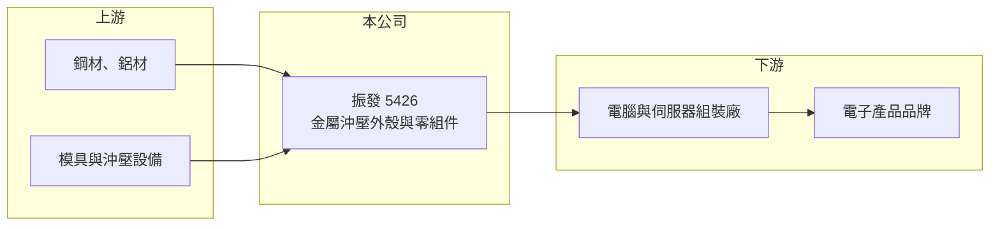

# 5426 振發

> 上櫃｜[[產業索引-電腦及週邊設備業|電腦及週邊設備業]]｜上市（櫃）日期 2000/02/09

# 第一章：企業模式與商業藍圖

> [!info] 撰寫說明
> 精簡版，由 Claude 依公開資料整理，架構比照 [[2330台積電]]，資料截至 2026-10-08。來源：櫃買中心開放資料快照（基本資料、2026 年上半年財報、每月營收）、Goodinfo 經營績效年度表、nStock 公司簡介。公開資料有限，產品應用、客戶與生產據點未查得，相關敘述為依產業常態的推估。#待校對

振發是一家成立超過半世紀的金屬加工廠，本章說明它在電腦與電子產品供應鏈中扮演的角色。

- **核心業務：** 依公司登記的營業項目，振發主要從事金屬[[沖壓]]外殼及相關零組件的加工、製造與買賣，在櫃買中心歸類為電腦及週邊設備業。金屬外殼與結構件是電子產品的「骨架」，要同時兼顧尺寸精度、散熱與電磁屏蔽，因此需要模具設計與量產管理的累積經驗。
- **營收結構：** 公開資料沒有揭露產品別營收比重。依產業分類推估，產品以電腦、伺服器或其他電子設備使用的金屬機構件為主，屬於接單生產、按件計價的代工型態（推估）。
- **營運據點：** 公司 1972 年成立，2000 年於櫃買中心掛牌，2026 年第二季實收資本額約 14.4 億元。工廠位置與海外產能分布未查得，有待從年報補充。
- **長期方向：** 2026 年 1 至 8 月累計營收年增約 21%，2026 年上半年營業利益率約 7.9%，高於過去多數年度。這代表接單結構可能正在改善，但改善是否能延續，要看公司能否打入附加價值較高的產品（例如伺服器或工控用機構件），這部分仍待查證。

# 第二章：護城河深度與競爭優勢

金屬沖壓是進入門檻不高、同業眾多的行業，本章說明振發的競爭位置。

- **競爭優勢：** 振發的優勢主要來自長年經營累積的模具開發與量產經驗，以及與既有客戶的長期合作關係。機構件一旦通過客戶驗證並開模量產，在產品生命週期內通常不會輕易更換供應商，這是代工廠最主要的黏著度來源。
- **主要對手：** 台灣電腦與伺服器機構件同業包括 [[3013晟銘電]]、[[2474可成]]、[[2354鴻準]]、[[8210勤誠]]、[[6117迎廣]]，以及大量中國本地的沖壓廠。大型同業擁有更多產能與客戶，振發規模相對小，議價能力有限。
- **觀察重點：** 過去九年振發營業利益率在負 6% 到正 8% 之間大幅擺盪，說明它缺乏穩定的定價能力。長期要觀察的是營業利益率能否穩定維持正值，以及營收成長是否來自新的產品應用，而不只是一次性的訂單。

# 第三章：財務體質與盈利規模

資料日期：2026-10-08，表格是撰寫當時的快照；最新月營收、毛利率、累計 EPS 由自動排程寫在本筆記的屬性欄位（月營收、毛利率、累計EPS 等）。#待校對

振發的營收長期在 14 億至 21 億元之間徘徊，獲利微薄且波動大，是典型的小型代工廠財務樣貌。

| 年度 | 營收（億元） | [[毛利率]] | [[營業利益率]] | EPS（元） | [[ROE]] |
|---|---|---|---|---|---|
| 2021 | 16.6 | 9.36% | -5.82% | -0.62 | -5.16% |
| 2022 | 20.7 | 17.4% | 5.16% | 1.13 | 8.24% |
| 2023 | 14.1 | 15.6% | -1.36% | 0.05 | 0.39% |
| 2024 | 15.0 | 18.2% | 1.70% | 0.99 | 6.56% |
| 2025 | 17.6 | 19.2% | 4.31% | 0.52 | 3.26% |

- **營收規模：** 2020 年營收 15.3 億元、2025 年 17.6 億元，五年年複合成長率約 2.8%（推算）。2026 年上半年營收 10.0 億元、毛利率 21.2%、營業利益率 7.9%、EPS 0.40 元，是近年較好的半年表現。
- **獲利：** 2021 至 2025 年平均 ROE 約 2.7%（推算），遠低於一般投資人要求的報酬。毛利率近三年從 15% 左右回升到 19% 至 21%，但費用占營收比重高，營業利益仍薄。依 Goodinfo，近年平均現金股利約 0.53 元，配息穩定度未逐年查得。
- **財務特色：** 2026 年第二季末總資產 31.8 億元、總負債 8.7 億元，負債比約 27%；股東權益 23.0 億元，每股淨值 15.99 元。財務結構保守，短期沒有償債壓力，但資產報酬率偏低。
- **[[ROIC]] 與 [[WACC]]：** 2025 年營業利益約 0.76 億元，稅後約 0.61 億元；有息負債未逐項查得，以股東權益約 23 億元加上假設的有息負債 2 億元計算，ROIC 約 2.4%（推算）。2026 年上半年年化稅後營業利益約 1.26 億元，ROIC 約 5%（推算）。WACC 以 CAPM 推估：無風險利率 1.75%、市場風險溢酬 6%、β 取 1.0（小型代工股常見值），股東權益成本 7.75%；負債占資本約 8%、稅後成本 2%，WACC 約 7.3%（推算）。ROIC 長期低於 WACC，代表過去多數年度並未替股東創造超額價值。

# 第四章：總體風險與地緣政治

小型代工廠最大的風險是客戶集中與價格壓力，本章整理振發面對的長期風險。

- **產業週期：** 金屬機構件需求跟著電腦、伺服器與消費電子的出貨週期起伏。2019 至 2021 年連續虧損、2023 年營收大減三成，都顯示振發的營收對下游景氣非常敏感。
- **營運風險：** 規模小、客戶資訊不透明，若主要客戶轉單或砍單，營收可能大幅波動。沖壓業競爭者多，價格長期承壓，毛利率提升的空間有限。
- **其他風險：** 鋼材、鋁材等原物料價格波動直接影響成本；若生產或客戶在中國，也需面對地緣政治與供應鏈移轉的影響（推估）。

# 專有名詞解析

## 金融

- **[[ROIC]]**：投入資本報酬率，稅後營業利益除以股東權益加有息負債，衡量本業運用資本的效率。
- **[[WACC]]**：加權平均資金成本，股東權益成本與負債成本依資本結構加權，是 ROIC 必須超越的門檻。

## 產業

- **[[沖壓]]**：用模具與沖床把金屬板材壓成特定形狀的加工方式，是電腦機殼與金屬結構件最常見的製程。

# 核心供應鏈

- 上游：鋼材、鋁材等金屬板材，模具與沖壓設備。
- 下游／客戶：電腦、伺服器與電子設備組裝廠（實際客戶未查得）。
- 同業：[[3013晟銘電]]、[[2474可成]]、[[2354鴻準]]、[[8210勤誠]]、[[6117迎廣]]。

## 最新新聞
<!-- news:start（自動產生，請勿手動編輯此範圍） -->
- 2026-10-20 🏛️ 重訊 13:52｜本公司受邀參加亞東證券舉辦之法人說明會｜[觀測站](https://mops.twse.com.tw/mops/#/web/t05st01)

完整紀錄：[[5426振發 新聞]]
<!-- news:end -->

## 相關連結
- [公開資訊觀測站](https://mopsov.twse.com.tw/mops/web/t05st03?step=1&firstin=1&co_id=5426)
- [Goodinfo](https://goodinfo.tw/tw/StockDetail.asp?STOCK_ID=5426)
- [Yahoo 股市](https://tw.stock.yahoo.com/quote/5426)
- [鉅亨網新聞](https://www.cnyes.com/twstock/5426/news)
