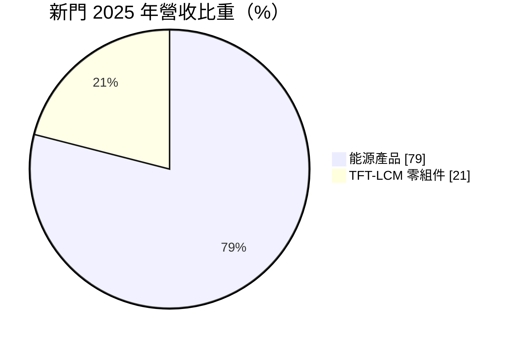
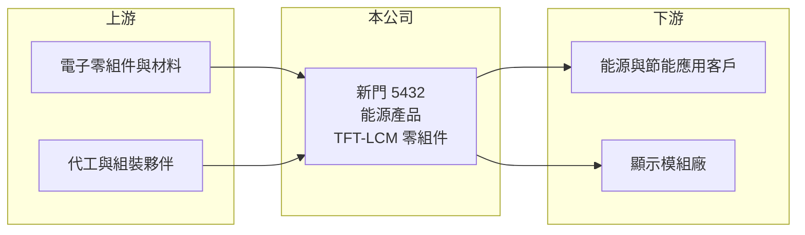

# 5432 新門

> 上櫃｜[[產業索引-綠能環保|綠能環保]]｜上市（櫃）日期 2000/03/21

# 第一章：企業模式與商業藍圖

> [!info] 撰寫說明
> 精簡版，由 Claude 依公開資料整理，架構比照 [[2330台積電]]，資料截至 2026-10-08。來源：富邦 MoneyDJ 財務比率年表（2018 至 2025 年）與基本資料（2025 年營收比重）；櫃買中心開放資料快照（基本資料、2026 年上半年資產負債與損益、本益比殖利率、每月營收）；winvest 月營收快訊標題。能源產品的具體品項、客戶與轉型過程為憑記憶整理，已標「待校對」；歷年營收由每股營業額推算。公開資料有限。#待校對

新門科技成立於 1990 年 5 月、2000 年 3 月上櫃，董事長兼總經理陳政隆，目前歸類在綠能環保類股。它早年以顯示器相關的電子零組件為主（英文名 Solomon Data，早期業務待校對），近年轉向能源產品，2025 年能源產品已占營收近八成。公司規模很小，年營收約 2 億元，獲利常受業外項目影響。

- **核心業務：** 2025 年營收中能源產品占 79%、[[TFT-LCM]] 零組件占 21%。能源產品的具體內容公開資料不多，依公司網站名稱（solomon-es）推估與能源系統或節能產品相關（品項待校對）；TFT-LCM 零組件則是液晶顯示模組使用的周邊零件，是公司較早期的業務。兩者都屬於代工或貿易性質較高的產品，規模經濟有限。
- **營收結構：** 依每股營業額推算，2025 年營收約 2.0 億元（推算），2023 年約 2.6 億元（推算）為近年高點，2020 年以前每年不到 1 億元。2022 年營收年增 107%、2021 年年增 79%，代表能源產品在這段期間快速放量，取代了原本萎縮的顯示器零組件業務。
- **營運據點：** 公司登記在台灣（生產與銷售據點待校對），資產以流動資產為主（2026 年第二季約 5.11 億元，占總資產八成），沒有大型廠房，營運模式偏輕資產。
- **長期方向：** 公司的長期方向推估是持續擴大能源產品的營收占比，讓自己從萎縮的顯示器零組件轉型為能源相關企業（具體策略未查得）。由於規模小、公開資訊有限，轉型成效主要只能從營收與毛利率的變化觀察。

# 第二章：護城河深度與競爭優勢

新門的護城河很淺，主要優勢在於小而靈活的利基經營，但缺乏規模與技術門檻的公開證據。

- **競爭優勢：** 轉型能源產品後，[[毛利率]]從 2023 年的 18.31% 回升到 2025 年的 27.26%，[[營業利益率]]也從 6.16% 升到 12.83%，顯示產品組合改善、具有一定的利基定價能力。公司負債極低、幾乎沒有借款，經營彈性大，景氣不佳時財務壓力小。
- **主要對手：** 能源產品領域的競爭者取決於實際品項（待校對），可能包括國內外大量中小型電源、儲能與節能產品廠商；顯示器零組件方面則面臨中國供應鏈的價格競爭。
- **觀察重點：** 2026 年上半年營業利益僅 1,035 萬元，但業外收益高達 1.44 億元，使 EPS 達 7.46 元，業外來源未查得（可能是處分資產或投資利益，推估）。觀察重點是本業營收能否持續成長到具經濟規模的水準，以及業外收益是否為一次性，避免把一次性收益誤當成獲利能力。

# 第三章：財務體質與盈利規模

資料日期：2026-10-08，表格是撰寫當時的快照；最新月營收、毛利率、累計 EPS 由自動排程寫在本筆記的屬性欄位（月營收、毛利率、累計EPS 等）。#待校對

新門營收規模小、獲利不穩定，近年本業獲利率改善，但 EPS 經常被業外項目放大或縮小。

| 年度 | 營收（億元） | [[毛利率]] | [[營業利益率]] | EPS（元） | [[ROE]] |
|---|---|---|---|---|---|
| 2021 | 約 1.0（推算） | 21.36% | 7.23% | 0.32 | 2.01% |
| 2022 | 約 2.1（推算） | 20.92% | 10.53% | 1.92 | 11.10% |
| 2023 | 約 2.6（推算） | 18.31% | 6.16% | 1.41 | 7.65% |
| 2024 | 約 1.9（推算） | 22.51% | 9.69% | 1.36 | 7.29% |
| 2025 | 約 2.0（推算） | 27.26% | 12.83% | 2.30 | 12.03% |

註：營收以每股營業額乘以約 2,069 萬股推算，並與 MoneyDJ 營收成長率交叉核對一致。2019 年 EPS 3.36 元主要來自業外（常續性 ROE 為 −0.17%）。2026 年上半年營收 9,171 萬元、毛利率約 27.6%、營業利益率約 11.3%、EPS 7.46 元（櫃買中心資料，比率由損益表計算）。

- **長期指標：** 2021 至 2025 年營收年複合成長率約 19%（推算，基期很低），近 5 年平均 [[ROE]] 約 8.0%（推算）。最近一次年度現金股利 1.5 元（櫃買中心殖利率資料），約為 2025 年 EPS 2.30 元的 65%。每股現金流量 2018 至 2025 年除 2021 年（−1.86 元）外皆為正，[[自由現金流]]大致為正（推估）。
- **[[ROIC]] 與 [[WACC]]：** 2025 年稅後營業利益約 2,040 萬元（營業利益率 12.83% × 營收約 2.0 億元 × 0.8），投入資本約 5.19 億元（2026 年第二季權益總計 5.19 億元，負債 1.15 億元幾乎都是流動負債，有息負債視為零），ROIC 約 3.9%（推算）；若扣除帳上可能持有的大量現金與金融資產，本業 ROIC 會更高（推估）。WACC 約 7.2%（推算：無風險利率 1.75%、市場風險溢酬 6%、β 取小型電子股常見值 0.9，股東權益成本 7.15%；無負債，權益比重 100%）。以帳面投入資本計算，ROIC 低於 WACC，代表本業規模尚不足以讓整體資本創造價值。
- **財務特色：** 2026 年第二季負債比率約 18%（負債 1.15 億元 ÷ 資產 6.34 億元），流動資產約為流動負債的 4.6 倍，財務非常保守。保留盈餘 3.39 億元高於股本 2.07 億元，2026 年上半年的業外收益讓每股淨值升到 25.07 元。股價淨值比約 7.8 倍（2026 年 10 月初快照），市場評價遠高於帳面價值。

# 第四章：總體風險與地緣政治

新門的風險集中在規模過小、資訊有限與獲利品質。

- **產業週期：** 能源產品的需求可能受再生能源政策、電價與終端景氣影響，顯示器零組件則跟著面板與消費性電子的庫存週期起伏。營收規模小，單一客戶或單一訂單的變動就足以造成大幅波動。
- **營運風險：** 公開資訊有限，產品內容與客戶結構不透明，投資人難以判斷競爭力。EPS 經常受業外收益左右，本業獲利只有每年數千萬元，業外一次性收益消失後 EPS 可能大幅回落。
- **其他風險：** 股本小、流通股數少，股價容易受題材影響而大幅波動；若轉型需要投資新產能，可能需要增資或改變目前零負債的財務結構。

# 專有名詞解析

## 應用

- **[[TFT-LCM]]**：薄膜電晶體液晶顯示模組，把液晶面板、驅動 IC 與背光等組成可直接裝進產品的顯示模組。

## 金融

- **[[ROIC]]**：投入資本報酬率，稅後營業利益除以股東權益加有息負債，衡量本業運用資本的效率。
- **[[WACC]]**：加權平均資金成本，股東與債權人要求報酬率的加權平均，是 ROIC 要超越的門檻。
- **[[自由現金流]]**：營業活動現金流減去資本支出，代表企業可自由用於配息、還債或併購的現金。

# 核心供應鏈

- 上游：電子零組件與材料供應商（名單未查得）。
- 下游／客戶：能源相關應用客戶、液晶顯示模組廠（名單未查得）。
- 同業：公開資料有限，未查得直接可比的上市櫃同業。

## 最新新聞
<!-- news:start（自動產生，請勿手動編輯此範圍） -->
- 2026-10-06 🏛️ 重訊 17:15｜公告本公司處分有價證券｜[觀測站](https://mops.twse.com.tw/mops/#/web/t05st01)
- 2026-10-06 🏛️ 重訊 17:15｜公告本公司取得有價證券｜[觀測站](https://mops.twse.com.tw/mops/#/web/t05st01)

完整紀錄：[[5432新門 新聞]]
<!-- news:end -->

## 相關連結
- [公開資訊觀測站](https://mopsov.twse.com.tw/mops/web/t05st03?step=1&firstin=1&co_id=5432)
- [Goodinfo](https://goodinfo.tw/tw/StockDetail.asp?STOCK_ID=5432)
- [Yahoo 股市](https://tw.stock.yahoo.com/quote/5432)
- [鉅亨網新聞](https://www.cnyes.com/twstock/5432/news)
