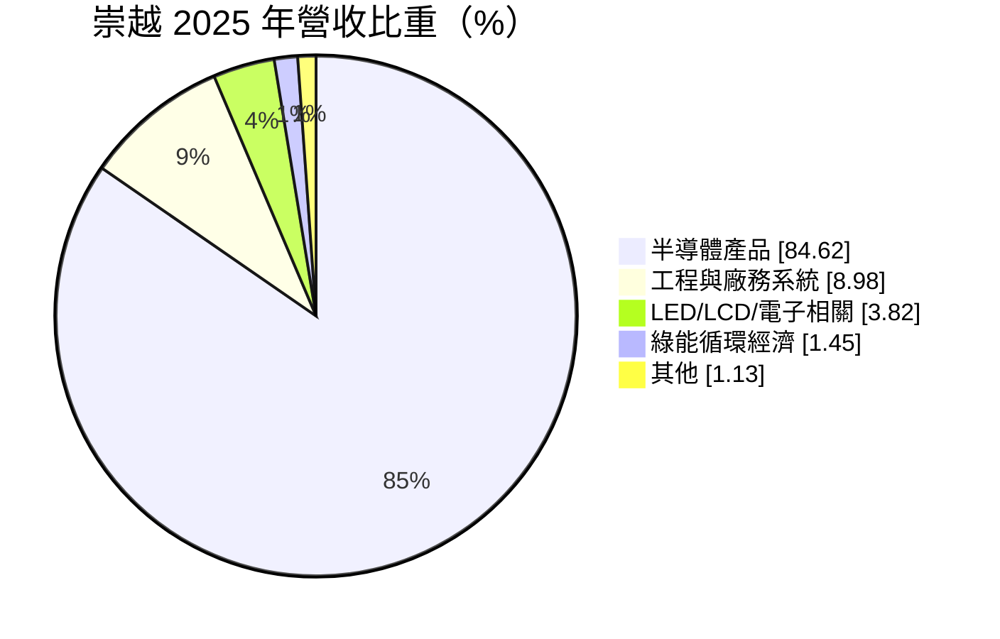
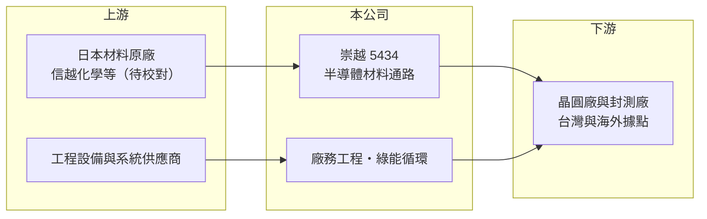

# 5434 崇越

> 上市｜[[產業索引-電子通路業|電子通路業]]｜上市（櫃）日期 2003/08/25

# 第一章：企業模式與商業藍圖

> [!info] 撰寫說明
> 精簡版，由 Claude 依公開資料整理，架構比照 [[2330台積電]]，資料截至 2026-10-08。來源：證交所開放資料（基本資料、2026 年第二季財報、股利、本益比）、Goodinfo 經營績效頁、MoneyDJ 基本資料（2025 年營收比重）、經濟日報與 MoneyDJ 影音標題（從通路走向平台）。代理原廠與主要客戶依一般產業認知整理，未逐條比對原始文件。#待校對

崇越科技是台灣最大的半導體材料通路商之一，同時經營廠務工程與綠能循環事業。它和一般電子零組件通路商最大的不同，是賣的東西是晶圓廠每天消耗的材料，並且跟著客戶到海外建廠，因此兼具通路的穩定與工程的成長性。

- **核心業務：** 崇越成立於 1990 年，2003 年上市，總部在台北內湖。主要代理矽晶圓、[[光阻]]、石英製品等半導體製程材料，長期代理日本 [[4063信越化學]] 的產品（待校對）；另透過子公司承攬晶圓廠的[[廠務工程]]，以及環保與綠能循環業務。
- **營收結構：** 2025 年半導體產品占 84.62%、工程與廠務系統占 8.98%、LED／LCD／電子相關產品占 3.82%、綠能循環經濟占 1.45%、其他占 1.13%。

- **營運據點：** 以台灣為主，配合主要晶圓廠客戶在海外設廠，提供材料供應與廠務服務（待校對）。材料通路需要在客戶工廠附近設倉儲與技術服務據點，因此客戶走到哪裡，崇越就跟到哪裡。
- **長期方向：** 媒體以「從通路走向平台」形容崇越的轉型：材料供應與廠務工程雙引擎並行，讓公司同時參與晶圓廠的建廠期（工程）與營運期（耗材）。先進製程光阻用量增加與海外建廠潮，是崇越十年尺度的成長動能。

# 第二章：護城河深度與競爭優勢

崇越的護城河建立在材料認證、原廠長期授權與晶圓廠的信任上，深度明顯高於一般電子通路商。

- **競爭優勢：** 半導體材料一旦通過晶圓廠認證，更換供應商需要重新驗證良率，客戶不會輕易轉單。崇越與日本材料原廠合作三十多年，並在客戶廠區提供倉儲、品管與即時補貨服務，這種嵌入客戶日常營運的角色，讓毛利率能長期維持在 12% 至 13.5%，高於一般電子通路商一倍以上。
- **主要對手：** 半導體材料通路方面有 [[3010華立]]、[[8070長華]]；廠務工程方面有 [[2404漢唐]]、[[6139亞翔]]、[[6196帆宣]]、[[5536聖暉]]；設備與濕製程方面有 [[3583辛耘]]。此外原廠在台灣設立直營據點，也會壓縮通路的角色。
- **觀察重點：** 營收高度依賴主要晶圓廠客戶（推估以 [[2330台積電]] 為最大客戶，待校對）。這帶來穩定成長，也意味著客戶資本支出的節奏、採購策略或海外據點選擇，都會直接影響崇越。

# 第三章：財務體質與盈利規模

資料日期：2026-10-08，表格是撰寫當時的快照；最新月營收、毛利率、累計 EPS 由自動排程寫在本筆記的屬性欄位（月營收、毛利率、累計EPS 等）。#待校對

崇越是本批通路商中資本報酬最穩定的一家，連續 6 年 ROE 約 20% 以上。

| 年度 | 營收（億元） | [[毛利率]] | [[營業利益率]] | EPS（元） | [[ROE]] |
|---|---|---|---|---|---|
| 2020 | 362 | 11.9% | 5.70% | 11.38 | 20.5% |
| 2021 | 427 | 12.2% | 5.98% | 12.63 | 20.5% |
| 2022 | 530 | 12.3% | 6.10% | 16.61 | 24.5% |
| 2023 | 493 | 13.0% | 6.49% | 15.36 | 19.9% |
| 2024 | 570 | 13.5% | 6.90% | 19.29 | 22.0% |
| 2025 | 676 | 12.8% | 6.60% | 21.81 | 21.9% |
| 2026 上半年 | 393.6 | 13.54% | 7.40% | 14.79 | 未查得 |

- **營收規模：** 2020 至 2025 年營收年複合成長率約 13.3%（推算），只有 2023 年半導體庫存調整時小幅下滑。2026 年前 8 個月營收 553.3 億元，年增 25.2%（證交所月營收）。
- **獲利：** 近 5 年平均 ROE 約 21.8%（推算），營業利益率由 5.7% 穩定提升到約 7%，顯示產品組合往高附加價值的先進製程材料移動。2026 年上半年業外收益 8.5 億元，主要應為轉投資收益（推估），使稅前純益率高於營業利益率。
- **財務特色：** 2026 年第二季總資產 482 億元、負債 259.6 億元、權益 222.4 億元，負債比約 54%，低於一般通路商。2025 年度配發現金股利 13.5 元，配發率約 62%，現金股利隨獲利逐年提高，並以現金股利為主。

**[[ROIC]] 與 [[WACC]]：** 有息負債未查得，以負債總額 40% 估約 103.9 億元（推算假設）。2025 年營業利益約 44.6 億元，稅後約 35.7 億元，除以權益 222.4 億元加有息負債 103.9 億元，ROIC 約 10.9%；2026 年上半年年化約 14.3%（推算）。WACC 以 CAPM 推估：無風險利率 1.75%、市場風險溢酬 6%、β 取 1.0（同業常見值），股權成本 7.75%；稅後負債成本 2%，股權占比約 68%，WACC 約 5.9%（推算）。ROIC 穩定高於 WACC 約 5 至 8 個百分點，是長期創造價值的典型例子。

# 第四章：總體風險與地緣政治

崇越的風險主要來自客戶集中、海外擴張與工程業務的執行。

- **產業週期：** 材料耗用量跟著晶圓廠稼動率走，景氣低迷時會下滑，但幅度遠小於設備業。2023 年營收僅年減約 7%，即顯示耗材型營收的抗跌性；廠務工程則跟隨客戶的資本支出週期，波動較大。
- **營運風險：** 客戶集中度高，主要晶圓廠的採購策略改變（例如材料在地化、直接向原廠採購）會直接衝擊營收。海外工程專案若遇到工期延誤或成本超支，可能壓縮獲利。
- **其他風險：** 主要材料來自日本，日圓匯率變動影響進貨成本；地緣政治與關稅政策影響客戶海外建廠的地點與時程；轉投資與金融資產評價波動會影響業外收益與綜合損益。

# 專有名詞解析

## 半導體

- **[[光阻]]**：塗佈在晶圓上、經曝光顯影後形成電路圖形的感光材料，是微影製程的關鍵耗材，先進製程用量與單價較高。
- **[[矽晶圓]]**：製造晶片的基板材料，由高純度單晶矽切割拋光而成，主流尺寸為 12 吋。

## 產業

- **[[廠務工程]]**：晶圓廠的無塵室、氣體化學品供應、水處理與機電系統等建置工程，隨晶圓廠擴產需求而起伏。
- **[[耗材]]**：隨生產過程持續消耗、需要定期補充的材料，營收與客戶產線稼動率連動，比設備銷售穩定。
- **[[電子通路]]**：替半導體原廠向系統廠銷售零組件、備庫存並提供技術支援的中間商，賺取買賣價差與服務價值。

# 核心供應鏈

- 上游：[[4063信越化學]] 等日本半導體材料原廠（待校對）；工程設備與系統供應商。
- 下游／客戶：晶圓代工廠與封測廠，推估以 [[2330台積電]] 為主要客戶（待校對）。
- 同業：材料通路 [[3010華立]]、[[8070長華]]；廠務工程 [[2404漢唐]]、[[6139亞翔]]、[[6196帆宣]]、[[5536聖暉]]；濕製程設備 [[3583辛耘]]。

## 最新新聞
<!-- news:start -->
<!-- news:end -->

## 相關連結
- [公開資訊觀測站](https://mopsov.twse.com.tw/mops/web/t05st03?step=1&firstin=1&co_id=5434)
- [Goodinfo](https://goodinfo.tw/tw/StockDetail.asp?STOCK_ID=5434)
- [Yahoo 股市](https://tw.stock.yahoo.com/quote/5434)
- [鉅亨網新聞](https://www.cnyes.com/twstock/5434/news)
