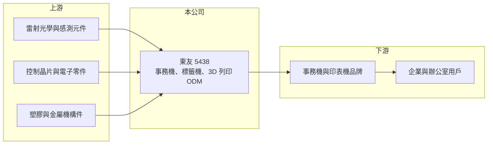

# 5438 東友

> 上櫃｜[[產業索引-電腦及週邊設備業|電腦及週邊設備業]]｜上市（櫃）日期 2000/06/17

# 第一章：企業模式與商業藍圖

> [!info] 撰寫說明
> 精簡版，由 Claude 依公開資料整理，架構比照 [[2330台積電]]，資料截至 2026-10-08。來源：櫃買中心開放資料快照（基本資料、2026 年上半年財報、每月營收）、Goodinfo 經營績效年度表、CMoney 2024 年 10 月個股快訊。產品別營收比重與客戶名單未查得；東友與東元集團的關係為記憶內容。公開資料有限。#待校對

東友是替國際品牌設計與生產影像、列印設備的代工廠，本章說明它的商業模式與轉型方向。

- **核心業務：** 依 2024 年 10 月 CMoney 報導，東友以黑白與彩色雷射[[多功能事務機]]的 [[ODM]] 為主要業務，並投入標籤列印機與 3D 列印產品的設計製造。早年東友以掃描器起家，與 [[1504東元]] 有集團淵源（待校對）。ODM 廠的價值在於替品牌客戶完成機構、光學與電子的整體設計，再負責量產。
- **營收結構：** 公開資料未揭露產品別比重。依上述報導，雷射事務機代工仍是主體，標籤機與 3D 列印屬於較小的新事業（推估）。
- **營運據點：** 公司 1997 年成立，2000 年於櫃買中心掛牌，2026 年第二季實收資本額約 11.3 億元。生產基地位置未查得，有待從年報補充。
- **長期方向：** 辦公室列印市場隨無紙化逐漸萎縮，東友營收從 2017 年 23.5 億元降到 2025 年 13.0 億元。公司長期能否回到成長，取決於標籤列印、3D 列印等利基產品能否補上主力代工的流失。

# 第二章：護城河深度與競爭優勢

事務機產業由少數日本與美國品牌主導，代工廠的議價能力有限，本章分析東友的競爭位置。

- **競爭優勢：** 雷射事務機包含精密機構、雷射光學與影像處理，開發一款新機種需要長時間與品牌共同設計。東友多年累積的機種開發經驗與既有品牌合作關係，是它維持訂單的主要基礎。
- **主要對手：** 影像與事務機相關的台灣同業有 [[2380虹光]]、[[4915致伸]]、2305全友、[[2312金寶]]，中國代工廠也持續搶單。品牌廠本身多有自有工廠，代工廠的角色常是補充產能或負責特定機種。
- **觀察重點：** 2020 年以來東友本業連年虧損，每股盈餘多半靠業外收益維持正數。長期要看新產品能否讓營業利益率回到正值，以及單一大型代工案的得失對營收的影響。

# 第三章：財務體質與盈利規模

資料日期：2026-10-08，表格是撰寫當時的快照；最新月營收、毛利率、累計 EPS 由自動排程寫在本筆記的屬性欄位（月營收、毛利率、累計EPS 等）。#待校對

東友本業自 2019 年起長期在損益兩平以下，獲利主要靠業外，這是理解它財務數字的關鍵。

| 年度 | 營收（億元） | [[毛利率]] | [[營業利益率]] | EPS（元） | [[ROE]] |
|---|---|---|---|---|---|
| 2021 | 17.7 | 16.9% | -1.35% | 0.51 | 2.64% |
| 2022 | 17.2 | 14.9% | -2.75% | 0.81 | 2.99% |
| 2023 | 12.0 | 15.4% | -7.81% | 0.09 | 0.31% |
| 2024 | 13.3 | 17.8% | -1.97% | 1.10 | 3.03% |
| 2025 | 13.0 | 15.4% | -3.03% | 0.51 | 1.24% |

- **營收規模：** 2017 年營收 23.5 億元，2025 年 13.0 億元，八年年複合成長率約 -7%（推算）。2026 年上半年營收 3.76 億元、毛利率 12.4%、營業利益率 -19.4%、EPS -0.60 元，1 至 8 月累計營收年減約 38%，衰退明顯。
- **獲利：** 2021 至 2025 年平均 ROE 約 2.0%（推算）。毛利率約 15% 至 18%，不足以支應研發與管理費用，因此營業利益長期為負；EPS 為正的年度主要來自業外收益。Goodinfo 顯示董事會決議 2026 年上半年不分派股利，逐年現金股利未查得。
- **財務特色：** 2026 年第二季末總資產 36.9 億元、總負債僅 4.5 億元，負債比約 12%；股東權益 32.4 億元，每股淨值 28.80 元。帳上資產遠大於營收規模，代表公司持有不少與本業無直接關係的資產，這也是業外收益的來源（推估）。
- **[[ROIC]] 與 [[WACC]]：** 2025 年營業損失約 0.39 億元，2026 年上半年營業損失 0.73 億元，ROIC 為負值，以股東權益 32.4 億元計約 -1% 至 -4.5%（推算，有息負債極少故略去）。WACC 以 CAPM 推估：無風險利率 1.75%、市場風險溢酬 6%、β 取 0.9（小型代工股常見值），幾乎沒有負債，WACC 約 7.2%（推算）。ROIC 持續低於 WACC，表示本業在侵蝕價值，股東權益主要靠資產本身的價值支撐。

# 第四章：總體風險與地緣政治

東友面對的是結構性萎縮的市場，本章整理長期風險。

- **產業週期：** 辦公室列印需求隨數位化與遠距辦公長期下滑，事務機換機週期也在拉長。這不是一般的景氣循環，而是市場規模的縮小，代工廠首當其衝。
- **營運風險：** 代工訂單集中在少數品牌，若主要機種停產或轉單，營收可能大幅下滑，2026 年前八個月的衰退即是例子。新事業規模小，短期難以填補缺口。
- **其他風險：** 營收以外幣計價為主，匯率波動影響毛利；零組件與晶片成本上升時，代工廠難以完全轉嫁給品牌客戶。

# 專有名詞解析

## 金融

- **[[ROIC]]**：投入資本報酬率，稅後營業利益除以股東權益加有息負債，衡量本業運用資本的效率。
- **[[WACC]]**：加權平均資金成本，股東權益成本與負債成本依資本結構加權，是 ROIC 必須超越的門檻。

## 產業

- **[[多功能事務機]]**：整合列印、影印、掃描與傳真功能的辦公設備，又稱 MFP。
- **[[ODM]]**：原廠委託設計製造，代工廠負責產品設計與生產，再以客戶品牌出貨。

# 核心供應鏈

- 上游：雷射光學與影像感測元件、控制晶片、機構件。
- 下游／客戶：國際事務機與印表機品牌（實際客戶未查得）。
- 同業：[[2380虹光]]、[[4915致伸]]、2305全友、[[2312金寶]]。

## 最新新聞
<!-- news:start -->
<!-- news:end -->

## 相關連結
- [公開資訊觀測站](https://mopsov.twse.com.tw/mops/web/t05st03?step=1&firstin=1&co_id=5438)
- [Goodinfo](https://goodinfo.tw/tw/StockDetail.asp?STOCK_ID=5438)
- [Yahoo 股市](https://tw.stock.yahoo.com/quote/5438)
- [鉅亨網新聞](https://www.cnyes.com/twstock/5438/news)
