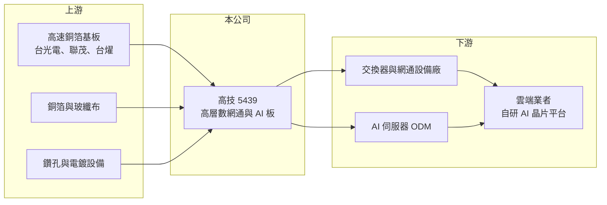

# 5439 高技

> 上櫃｜[[產業索引-電子零組件業|電子零組件業]]｜上市（櫃）日期 2000/06/26

# 第一章：企業模式與商業藍圖

> [!info] 撰寫說明
> 精簡版，由 Claude 依公開資料整理，架構比照 [[2330台積電]] 的四章研究，資料截至 2026-10-08。來源：Goodinfo 經營績效頁（含新聞標題）、工商時報 2026 年 4 月報導、優分析月營收報導標題、櫃買中心開放資料快照（基本資料、2026 年第二季損益與資產負債、本益比殖利率）。產品層數、營收比重、工廠所在地與客戶名稱未查得。#待校對

高技是以網通設備與伺服器用高階[[印刷電路板]]為主的板廠，2025 年搭上 AI 資料中心與高速交換器需求，營收翻倍成長。本章說明它的業務組成與成長來源。

- **核心業務：** 高技成立於 1988 年，2000 年上櫃，本業是印刷電路板製造，近年聚焦高階多層板。依報導，主要成長動能來自交換器與 AI 伺服器的高速運算板，並與雲端業者自研 AI 晶片的供應鏈有關，2026 年起也切入低軌衛星市場。高速網通與 AI 板需要高層數、低損耗材料與精密的阻抗控制，技術門檻與單價都明顯高於一般消費性電子板。
- **營收結構：** 產品別與客戶別比重未查得。從月營收報導看，交換器需求是 2025 年營收大增的主因，AI 相關產品比重持續提高。這代表高技的營收已高度連動資料中心網路與 AI 運算的資本支出。
- **營運據點：** 工廠所在地與產能細節在本次資料中未查得。依 2026 年報導，公司持續擴產，新產線自 2026 年第二季起開始放量，預估 2026 年全年產能較 2025 年增加約 20%。
- **長期方向：** 公司以擴充高階產能、提升產能效率與價格調整為主軸，並往低軌衛星等新應用延伸。管理層的資本配置明顯偏向成長：在高獲利期間同時擴廠與維持約五成的配息率。

# 第二章：護城河深度與競爭優勢

高技的競爭力來自高階網通板的製程能力與已打入的資料中心供應鏈。本章分析它的競爭條件。

- **競爭優勢：** 高速交換器與 AI 伺服器用板需要通過客戶的嚴格信號完整性與可靠度驗證，一旦成為合格供應商，同一平台在生命週期內會持續下單，形成[[設計導入]]的黏著度。高技在網通板領域經營多年，累積了高層數板的良率經驗，這是 2025 年能快速承接 AI 與交換器訂單的基礎。
- **主要對手：** 高階網通與伺服器板的主要競爭者包括 [[2368金像電]]、[[3044健鼎]]、[[2313華通]]、[[5469瀚宇博]]、[[3037欣興]] 等台灣大型板廠，以及中國的滬電股份、深南電路等（待校對）。金像電在伺服器板規模領先，高技屬於規模較小但成長快速的一群。
- **觀察重點：** 第一，新產線放量後能否維持 2025 年以來 15% 以上的營業利益率。第二，客戶集中度與 AI 專案的延續性，雲端業者換代時能否持續取得新平台。第三，負債比偏高下的擴產資金安排。

# 第三章：財務體質與盈利規模

資料日期：2026-10-08，表格是撰寫當時的快照；最新月營收、毛利率、累計 EPS 由自動排程寫在本筆記的屬性欄位（月營收、毛利率、累計EPS 等）。#待校對

高技的財報顯示長期穩定獲利，2025 年在 AI 與交換器需求帶動下出現跳躍式成長。本章用多年度數據說明。

| 年度 | 營收（億元） | [[毛利率]] | [[營業利益率]] | EPS（元） | [[ROE]] |
|---|---|---|---|---|---|
| 2020 | 24.9 | 21.9% | 15.6% | 3.43 | 17.3% |
| 2021 | 33.7 | 21.5% | 14.9% | 4.61 | 19.9% |
| 2022 | 32.2 | 18.0% | 11.8% | 3.98 | 15.8% |
| 2023 | 43.5 | 19.1% | 13.7% | 5.07 | 19.4% |
| 2024 | 41.8 | 15.4% | 9.7% | 3.51 | 13.2% |
| 2025 | 96.4 | 22.6% | 16.8% | 13.74 | 40.0% |
| 2026 上半年 | 55.9 | 21.5% | 15.8% | 8.15 | 未查得 |

- **營收規模：** 營收從 2020 年的 24.9 億元成長到 2025 年的 96.4 億元，年複合成長率約 31%（推算），其中 2025 年單年成長約 1.3 倍。2026 年上半年營收 55.9 億元，1 至 8 月累計約 77.5 億元，年增約 34%。
- **獲利：** 營業利益率在 2020 至 2024 年維持 10% 至 16%，在 PCB 業中屬於穩定的高水準，代表公司即使在景氣低迷時也能維持獲利。2025 年規模擴大後營業利益率達 16.8%、ROE 達 40%。2021 至 2025 年平均 ROE 約 21.7%（推算），長期資本效率優異。
- **財務特色：** 2026 年第二季末股本約 9.3 億元、股東權益約 40.3 億元、負債約 84.5 億元（其中流動負債約 53 億元），負債比約 68%，在 PCB 廠中偏高，反映快速擴產與營運資金需求。每股淨值 43.4 元。最近一次現金股利約 7.2 元，以 2025 年 EPS 13.74 元計，配息率約 52%（推算）。

**[[ROIC]] 與 [[WACC]]：** 有息負債明細未查得，假設約 40 億元（推估，負債中其餘為應付帳款等營運負債）。2025 年營業利益約 16.2 億元，稅後約 13.0 億元，投入資本以股東權益約 40 億元加有息負債 40 億元，約 80 億元，ROIC 約 16%（推算）；2020 至 2024 年以營業利益率一成以上推估，ROIC 約在 10% 至 15% 之間。WACC 用 CAPM 推估：無風險利率 1.75%、市場風險溢酬 6%、β 取 1.3（高成長 PCB 股波動較大，假設），股東權益成本約 9.6%；負債成本 2.5%、稅率 20%，以權益 50%、負債 50% 加權，WACC 約 5.8%（推算）。高技的 ROIC 長期明顯高於 WACC，2025 年利差約 10 個百分點，是本批公司中少數持續創造價值的企業。

# 第四章：總體風險與地緣政治

高技的風險主要來自 AI 與網通投資週期，以及高槓桿擴產。本章整理主要風險。

- **產業週期：** 營收高度連動雲端業者的資料中心資本支出，AI 投資若放緩或客戶庫存調整，訂單會明顯下滑，這是 PCB 產業的[[長鞭效應]]。2024 年營業利益率降到 9.7%，說明即使是高階板也會受到景氣影響。
- **營運風險：** 2025 年的爆發式成長可能集中在少數客戶與專案，客戶換代時若未能取得新平台，營收可能大幅回落。負債比約 68%，擴產若遇到需求反轉，折舊與利息將壓縮獲利。高階板良率與交期若跟不上，客戶會轉向大廠。
- **其他風險：** 銅箔基板、銅箔與玻纖布等原料在 AI 需求下供應緊張、價格上漲，轉嫁不及會壓縮毛利率。匯率、電價與美國關稅政策也會影響成本與客戶的採購地選擇。2026 年 9 月公司更換財務、會計與稽核主管，須注意管理團隊的穩定性。

# 專有名詞解析

## 應用

- **[[交換器]]**：資料中心內負責在伺服器之間轉送資料封包的網路設備，AI 叢集需要大量高速交換器。

## 金融

- **[[長鞭效應]]**：終端需求的小幅變動，沿供應鏈往上游傳遞時被逐級放大，造成上游庫存與訂單劇烈波動。
- **[[ROIC]]**：投入資本報酬率，稅後營業利益除以股東權益加有息負債，衡量本業運用資本的效率。
- **[[WACC]]**：加權平均資金成本，股東權益成本與負債成本依資本結構加權，是 ROIC 必須超越的門檻。

## 產業

- **[[印刷電路板]]**：PCB，承載電子零件並以銅線路連接訊號與電源的基板，是所有電子產品的基礎零件。
- **[[設計導入]]**：零件被客戶選入產品設計並完成驗證，之後該產品量產期間都會持續採購，是零組件廠長期營收的來源。

# 核心供應鏈

- 上游：高速銅箔基板廠 [[2383台光電]]、[[6213聯茂]]、[[6274台燿]]（推估），以及銅箔與玻纖布供應商。
- 下游／客戶：交換器與網通設備廠、AI 伺服器代工廠，終端為雲端業者如 [[AMZN亞馬遜]] 的自研 AI 晶片平台（依新聞標題，待校對）。
- 同業：[[2368金像電]]、[[3044健鼎]]、[[2313華通]]、[[5469瀚宇博]]、[[3037欣興]]。

## 最新新聞
<!-- news:start -->
<!-- news:end -->

## 相關連結
- [公開資訊觀測站](https://mopsov.twse.com.tw/mops/web/t05st03?step=1&firstin=1&co_id=5439)
- [Goodinfo](https://goodinfo.tw/tw/StockDetail.asp?STOCK_ID=5439)
- [Yahoo 股市](https://tw.stock.yahoo.com/quote/5439)
- [鉅亨網新聞](https://www.cnyes.com/twstock/5439/news)
