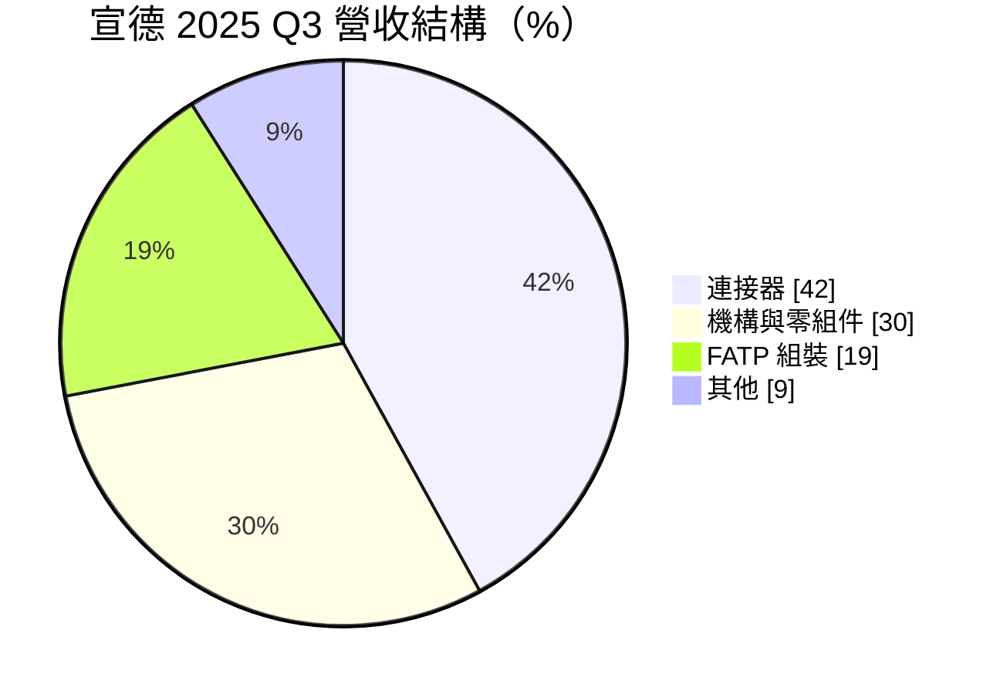
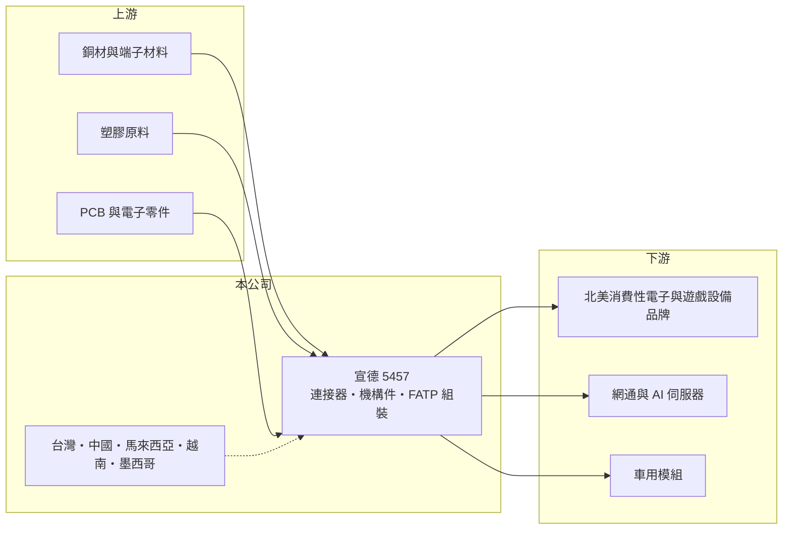

# 5457 宣德

> 上櫃｜[[產業索引-電子零組件業|電子零組件業]]｜上市（櫃）日期 2000/09/29

# 第一章：企業模式與商業藍圖

> [!info] 撰寫說明
> 精簡版，由 Claude 依公開資料整理，架構比照 [[2330台積電]] 的四章研究，資料截至 2026-10-08。來源：Goodinfo 經營績效頁（含新聞標題）、科技新報 2025 年 11 月法說會報導、櫃買中心開放資料快照（基本資料、2026 年第二季損益與資產負債、本益比殖利率）。主要客戶名稱、非控制權益的來源子公司未查得。#待校對

宣德是以連接器起家的電子零組件廠，近年從零件延伸到機構件與整機組裝，營收規模已超過 200 億元。本章說明它的業務組成與轉型方向。

- **核心業務：** 宣德成立於 1990 年，2000 年上櫃，三大業務為[[連接器]]與線材、機構與零組件，以及 [[FATP]]（最終組裝與測試）。連接器以 Type-C 等消費性電子介面為主，並開發 AI 伺服器用的高速連接器；FATP 則承接北美客戶的遊戲設備、航空塔台耳機、POS 終端與居家監控攝影機等整機組裝。
- **營收結構：** 依 2025 年第三季法說會，連接器約占 42%、機構與零組件約 30%、FATP 組裝約 19%，其餘約 9% 未說明。公司把 FATP 定位為主要成長動能，代表營收結構正從高毛利的零件，往規模大但毛利較低的組裝移動。
- **營運據點：** 全球 6 個據點、11 座工廠，分布在台灣、中國、馬來西亞、越南與墨西哥。越南是 FATP 量產中心，墨西哥服務車用模組並作為進入北美市場的基地，公司預估兩地合計可貢獻 30 至 40 億元營收。
- **長期方向：** 2025 年法說會提出四大方向：提升新廠人力效率與產能利用率、加強匯率與關稅風險控管、從傳統代工延伸到「設計加組裝」的 [[EDMS]] 模式以加深客戶黏著度，以及評估在北美設立研發或小量生產據點。

# 第二章：護城河深度與競爭優勢

宣德的競爭力來自連接器、機構件到組裝的一條龍能力，以及中國以外的多地產能。本章分析它的競爭條件。

- **競爭優勢：** 能同時提供連接器、機構件與整機組裝的供應商，可以替客戶減少供應商數量與溝通成本，這是宣德推動「設計加組裝」模式的基礎。越南、馬來西亞、墨西哥的產能讓它符合北美客戶「中國加一」的需求，這在美國關稅升高後成為接單的重要條件。
- **主要對手：** 連接器領域的競爭者包括鴻海體系的連接器事業、[[3533嘉澤]]、[[2392正崴]]、[[3605宏致]]、[[6290良維]] 等；FATP 組裝則面對 [[2317鴻海]]、[[4938和碩]] 等大型代工廠與眾多中小型組裝廠。宣德在兩個領域都不是規模最大的業者，必須靠中小型專案與彈性服務取勝。
- **觀察重點：** 第一，FATP 比重提高後，整體毛利率能否穩定在 15% 以上。第二，越南與墨西哥新廠的產能利用率與人力效率何時改善。第三，AI 伺服器高速連接器的認證能否轉為量產，這是提高產品附加價值的關鍵。

# 第三章：財務體質與盈利規模

資料日期：2026-10-08，表格是撰寫當時的快照；最新月營收、毛利率、累計 EPS 由自動排程寫在本筆記的屬性欄位（月營收、毛利率、累計EPS 等）。#待校對

宣德的財報顯示營收持續擴大，但毛利率與營業利益率隨組裝比重提高而下降。本章用多年度數據說明。

| 年度 | 營收（億元） | [[毛利率]] | [[營業利益率]] | EPS（元） | [[ROE]] |
|---|---|---|---|---|---|
| 2020 | 148 | 22.0% | 12.0% | 4.19 | 31.3% |
| 2021 | 186 | 21.6% | 10.9% | 5.11 | 24.4% |
| 2022 | 193 | 20.8% | 8.66% | 4.60 | 18.0% |
| 2023 | 167 | 20.1% | 6.09% | 1.04 | 8.15% |
| 2024 | 227 | 16.6% | 5.35% | 2.30 | 11.5% |
| 2025 | 244 | 17.8% | 5.54% | 2.77 | 11.8% |
| 2026 上半年 | 106.2 | 13.2% | 0.4% | -1.33 | 未查得 |

- **營收規模：** 營收從 2020 年的 148 億元成長到 2025 年的 244 億元，年複合成長率約 10.5%（推算）。2026 年上半年營收約 106 億元，1 至 8 月累計年減約 5%，成長暫時停頓。
- **獲利：** 毛利率從 22% 降到 2026 年上半年的 13.2%，營業利益率從 12% 降到接近零，反映組裝業務比重提高、新廠爬坡與價格競爭。2026 年上半年稅前仍有約 0.93 億元獲利，但所得稅約 1.47 億元，加上獲利集中在有少數股東的子公司，歸屬母公司淨損約 2.5 億元。2021 至 2025 年平均 ROE 約 14.8%（推算），但呈下降趨勢。
- **財務特色：** 2026 年第二季末總權益約 120.5 億元，其中歸屬母公司約 55.2 億元，[[非控制權益]]約 65 億元，比母公司權益還大，代表重要營運子公司並非全資持有。負債約 221 億元，其中流動負債約 199 億元，負債比約 65%，以應付帳款等營運負債為主（推估）。最近一次現金股利約 1.5 元，以 2025 年 EPS 2.77 元計，配息率約 54%（推算）。

**[[ROIC]] 與 [[WACC]]：** 有息負債明細未查得，假設約 70 億元（推估）。2025 年營業利益約 13.5 億元，稅後約 10.8 億元，投入資本以總權益約 120 億元加有息負債 70 億元，約 190 億元，ROIC 約 5.7%（推算）；2020 年營業利益率 12% 時 ROIC 推估約 14%；2026 年上半年本業接近損益兩平，ROIC 接近零。WACC 用 CAPM 推估：無風險利率 1.75%、市場風險溢酬 6%、β 取 1.0（連接器股常見值，假設），股東權益成本約 7.8%；負債成本 2.5%、稅率 20%，以權益 63%、負債 37% 加權，WACC 約 5.6%（推算）。宣德的 ROIC 已從過去明顯高於 WACC，下滑到 2024 至 2025 年大致打平，2026 年則低於資金成本；轉型到組裝後能否重新創造價值，要看新廠效率改善的速度。

# 第四章：總體風險與地緣政治

宣德的風險來自轉型期的獲利稀釋、客戶集中與多國營運的管理難度。本章整理主要風險。

- **產業週期：** 連接器與組裝業務跟著消費性電子、遊戲設備與網通產品的需求循環，下游庫存調整時訂單波動明顯，2023 年 EPS 從 4.60 元降到 1.04 元即是一例，屬於[[長鞭效應]]的影響。
- **營運風險：** FATP 組裝毛利率低、資本與人力密集，新廠產能利用率不足時容易虧損。北美客戶比重提高，單一客戶產品週期結束會造成營收缺口。非控制權益比重高，代表部分獲利歸屬少數股東，母公司股東實際分到的獲利可能明顯低於合併營收的規模。
- **其他風險：** 美國關稅與墨西哥、越南的貿易政策變化，可能影響產能布局的效益。新台幣、人民幣、越南盾等多種貨幣的匯率變動增加管理難度。銅與塑膠原料價格會影響連接器成本。

# 專有名詞解析

## 金融

- **[[非控制權益]]**：合併財報中屬於子公司其他股東的權益，比重高代表母公司對部分子公司未全資持有。
- **[[長鞭效應]]**：終端需求的小幅變動，沿供應鏈往上游傳遞時被逐級放大，造成上游庫存與訂單劇烈波動。
- **[[ROIC]]**：投入資本報酬率，稅後營業利益除以股東權益加有息負債，衡量本業運用資本的效率。
- **[[WACC]]**：加權平均資金成本，股東權益成本與負債成本依資本結構加權，是 ROIC 必須超越的門檻。

## 產業

- **[[連接器]]**：讓電子零件、模組或設備之間可插拔連接的元件，負責傳遞電力或訊號。
- **[[FATP]]**：最終組裝、測試與包裝，把零組件組成可出貨的整機，是電子代工的最後一道流程。
- **[[EDMS]]**：電子設計製造服務，代工廠除了生產也參與產品設計，能提高客戶黏著度與附加價值。

# 核心供應鏈

- 上游：銅材、端子材料、塑膠原料與 PCB、電子零件供應商（推估）。
- 下游／客戶：北美遊戲設備、POS、居家監控與耳機品牌，網通與 AI 伺服器廠，車用模組客戶（名單未查得）。
- 同業：[[3533嘉澤]]、[[2392正崴]]、[[3605宏致]]、[[6290良維]]；組裝為 [[2317鴻海]]、[[4938和碩]]。

## 最新新聞
<!-- news:start -->
<!-- news:end -->

## 相關連結
- [公開資訊觀測站](https://mopsov.twse.com.tw/mops/web/t05st03?step=1&firstin=1&co_id=5457)
- [Goodinfo](https://goodinfo.tw/tw/StockDetail.asp?STOCK_ID=5457)
- [Yahoo 股市](https://tw.stock.yahoo.com/quote/5457)
- [鉅亨網新聞](https://www.cnyes.com/twstock/5457/news)
