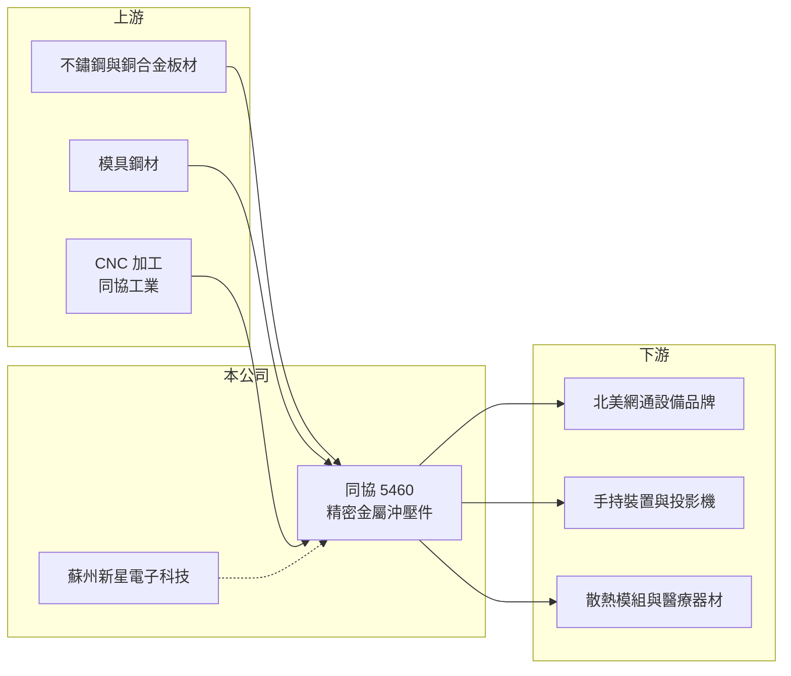

# 5460 同協

> 上櫃｜[[產業索引-電子零組件業|電子零組件業]]｜上市（櫃）日期 2000/09/28

# 第一章：企業模式與商業藍圖

> [!info] 撰寫說明
> 精簡版，由 Claude 依公開資料整理，架構比照 [[2330台積電]] 的四章研究，資料截至 2026-10-08。來源：Goodinfo 經營績效頁、富果研究 2026 年 6 月法說會摘要、櫃買中心開放資料快照（基本資料、2026 年第二季損益與資產負債、本益比殖利率）。產品別營收比重、客戶名稱未查得，公司規模小、公開資料有限。#待校對

同協是成立五十多年的精密金屬沖壓廠，產品多是電子設備內部看不見、但不可或缺的屏蔽罩、天線與散熱件。本章說明它的業務組成。

- **核心業務：** 同協成立於 1972 年，2000 年上櫃，本業是[[金屬沖壓]]零組件，產品包括網通設備的金屬[[屏蔽罩]]與框架、手持裝置的金屬天線與屏蔽件、投影機等顯示與光學產品零件，以及散熱模組與醫療器材零件。這些零件需要依客戶的電路板設計客製模具，屬於少量多樣、與客戶設計同步開發的業務。
- **營收結構：** 產品別比重未查得。依 2026 年法說會資料（未標明年度），地區別營收美洲約 56%、台灣約 23%、中國約 16%、東南亞及其他約 5%，代表主要終端客戶是北美的網通與電子品牌。
- **營運據點：** 透過境外控股公司 100% 持有中國的蘇州新星電子科技，並持有 CNC 加工關係企業同協工業約 19% 股權。台灣廠的角色與海外生產規劃細節未查得，公司表示正在評估海外生產布局。
- **長期方向：** 短期策略是深化核心客戶關係、擴展到製程相近的產業、提高自動化投資並經營 B2B 利基市場；長期則希望在客戶設計初期就參與共同開發，並導入新材料與新加工技術。公司設定每年新增 1 至 3 個策略客戶的目標。

# 第二章：護城河深度與競爭優勢

同協的競爭力來自長期的模具與沖壓經驗，但規模很小，議價能力有限。本章分析它的競爭條件。

- **競爭優勢：** 屏蔽罩與天線件必須依每款產品的電路板與機構設計客製，供應商要在新產品開案時參與，成為合格供應商後可供貨整個產品週期，形成[[設計導入]]的黏著度。同協經營五十多年、1993 年就取得 ISO 品質認證，累積了模具設計與精密沖壓的經驗，能服務少量多樣的訂單。
- **主要對手：** 金屬沖壓與屏蔽件市場的競爭者眾多，台灣同業包括 2476鉅祥、3060銘異 等，加上大量中國沖壓廠以低價競爭。大型代工廠也常有自己的機構件體系。同協在規模與成本上都不具優勢。
- **觀察重點：** 第一，營收能否止跌，2020 年 6.17 億元降到 2025 年 2.33 億元，規模已大幅縮小。第二，醫療與新產業的客戶開發能否帶來穩定訂單。第三，2026 年第一季轉盈後，營業利益能否持續為正。

# 第三章：財務體質與盈利規模

資料日期：2026-10-08，表格是撰寫當時的快照；最新月營收、毛利率、累計 EPS 由自動排程寫在本筆記的屬性欄位（月營收、毛利率、累計EPS 等）。#待校對

同協的財報顯示營收在疫情後持續萎縮，本業多年處於虧損邊緣，但財務結構非常保守。本章用多年度數據說明。

| 年度 | 營收（億元） | [[毛利率]] | [[營業利益率]] | EPS（元） | [[ROE]] |
|---|---|---|---|---|---|
| 2020 | 6.17 | 21.5% | 0.55% | 0.02 | 0.13% |
| 2021 | 5.00 | 21.4% | -0.26% | 0.01 | 0.06% |
| 2022 | 3.86 | 18.3% | -7.85% | -0.34 | -2.71% |
| 2023 | 3.58 | 19.4% | -6.78% | -0.20 | -1.67% |
| 2024 | 2.77 | 30.6% | -2.28% | 0.22 | 1.83% |
| 2025 | 2.33 | 28.0% | -7.20% | -0.17 | -1.40% |
| 2026 上半年 | 1.33 | 32.4% | -0.3% | 0.10 | 未查得 |

- **營收規模：** 營收從 2020 年的 6.17 億元降到 2025 年的 2.33 億元，年複合成長率約 -17.7%（推算），公司歸因於疫情後的停工、塞港、缺料、客戶去庫存與通膨壓抑消費。2026 年上半年營收 1.33 億元，1 至 8 月累計年增約 19%，出現止跌跡象。
- **獲利：** 毛利率從約 20% 提升到 2024 年後的 28% 至 32%，顯示產品組合有改善，但營收規模太小，固定費用使營業利益率多數年度為負。2021 至 2025 年平均 ROE 約 -0.8%（推算），本業長期未能產生報酬。
- **財務特色：** 2026 年第二季末股本約 5.9 億元、股東權益約 7.4 億元、負債僅約 0.8 億元，負債比約 10%，幾乎沒有借款壓力。每股淨值 12.67 元。近年未配發現金股利。帳上權益遠高於年營收，代表資產運用效率偏低。

**[[ROIC]] 與 [[WACC]]：** 公司負債極低，假設有息負債約 0.2 億元（推估）。2025 年營業損失約 0.17 億元，投入資本以股東權益約 7.4 億元加有息負債 0.2 億元，約 7.6 億元，ROIC 約 -2.2%（推算）；2026 年上半年營業利益接近零，ROIC 約 0%。WACC 用 CAPM 推估：無風險利率 1.75%、市場風險溢酬 6%、β 取 0.8（小型零組件股，假設），股東權益成本約 6.6%；因幾乎沒有負債，WACC 約 6.5%（推算）。ROIC 長期低於 WACC 且多數年度為負，代表公司目前沒有創造經濟價值，股東報酬取決於營收能否回到足以攤平固定成本的規模。

# 第四章：總體風險與地緣政治

同協的風險主要是規模萎縮與客戶集中，財務風險反而不高。本章整理主要風險。

- **產業週期：** 金屬沖壓件跟著網通、手持裝置與投影機等電子產品的需求走，下游去庫存時訂單會急降，這是[[長鞭效應]]的典型表現。2021 至 2025 年營收連續下滑，說明公司對週期的抵抗力弱。
- **營運風險：** 營收主要來自美洲客戶，少數客戶的產品週期結束或轉單，就會對營收造成明顯影響。規模持續縮小，模具與設備的固定成本難以攤提。若海外生產布局需要投資，回收期可能很長。
- **其他風險：** 不鏽鋼、銅合金等金屬原料價格波動會影響毛利率。中國子公司面臨地緣政治與當地法規風險，美國關稅也會影響北美客戶的採購地選擇。新台幣升值會壓縮外銷獲利。

# 專有名詞解析

## 金融

- **[[長鞭效應]]**：終端需求的小幅變動，沿供應鏈往上游傳遞時被逐級放大，造成上游庫存與訂單劇烈波動。
- **[[ROIC]]**：投入資本報酬率，稅後營業利益除以股東權益加有息負債，衡量本業運用資本的效率。
- **[[WACC]]**：加權平均資金成本，股東權益成本與負債成本依資本結構加權，是 ROIC 必須超越的門檻。

## 產業

- **[[金屬沖壓]]**：以模具與沖床把金屬板材沖切、彎折成特定形狀的加工方式，適合大量生產精密小零件。
- **[[屏蔽罩]]**：罩在電路板晶片上的金屬蓋，用來阻隔電磁干擾，手機與網通設備中普遍使用。
- **[[設計導入]]**：零件被客戶選入產品設計並完成驗證，之後該產品量產期間都會持續採購，是零組件廠長期營收的來源。

# 核心供應鏈

- 上游：不鏽鋼、銅合金板材與模具鋼材供應商（推估），CNC 加工關係企業同協工業。
- 下游／客戶：北美網通設備、手持裝置、投影機、散熱模組與醫療器材客戶（名單未查得）。
- 同業：2476鉅祥、3060銘異，以及中國金屬沖壓廠。

## 最新新聞
<!-- news:start（自動產生，請勿手動編輯此範圍） -->
- 2026-10-06 📰 媒體 18:50｜營收速報 - 同協(5460)9月營收4,025萬元年增率高達109.06％｜[鉅亨網](https://news.cnyes.com/news/id/6622886)

完整紀錄：[[5460同協 新聞]]
<!-- news:end -->

## 相關連結
- [公開資訊觀測站](https://mopsov.twse.com.tw/mops/web/t05st03?step=1&firstin=1&co_id=5460)
- [Goodinfo](https://goodinfo.tw/tw/StockDetail.asp?STOCK_ID=5460)
- [Yahoo 股市](https://tw.stock.yahoo.com/quote/5460)
- [鉅亨網新聞](https://www.cnyes.com/twstock/5460/news)
