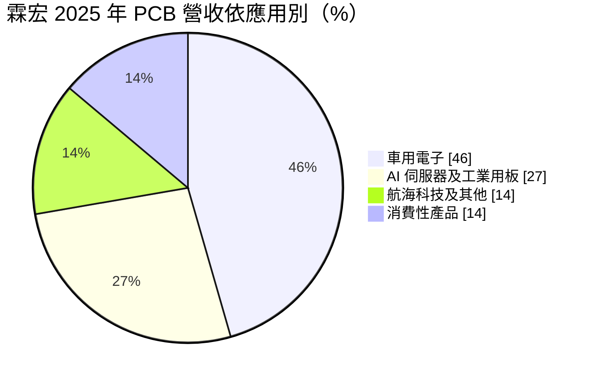
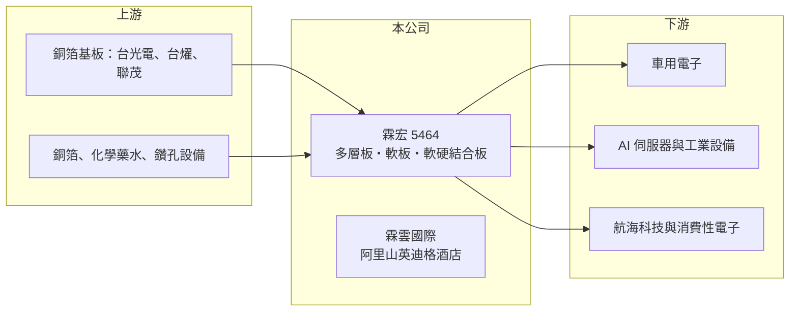

# 5464 霖宏

> 上櫃｜[[產業索引-電子零組件業|電子零組件業]]｜上市（櫃）日期 2000/11/08

# 第一章：企業模式與商業藍圖

> [!info] 撰寫說明
> 精簡版，由 Claude 依公開資料整理，架構比照 [[2330台積電]]，資料截至 2026-10-08。來源：櫃買中心開放資料快照（基本資料、2026 年第二季資產負債與損益）、Goodinfo 經營績效頁、富果 2025 年 12 月法說會摘要、nStock 公司簡介。公開資料有限。#待校對

霖宏科技（以下簡稱霖宏）是一家位於嘉義民雄的中小型電路板廠，同時透過子公司經營阿里山的國際品牌酒店。理解霖宏的關鍵在於：本業是規模不大的 [[PCB]] 製造，而觀光旅館是 2019 年跨產業投資後形成的第二支柱。

- **核心業務：** 霖宏成立於 1995 年，2000 年在櫃買中心掛牌，主力產品是多層硬板，也生產[[軟板]]與[[軟硬結合板]]。依 2025 年 12 月法說會，公司員工約 330 人，每月產能約 5 萬平方公尺，在台灣 PCB 產業中屬於小型廠。小廠的經營方式通常是少量多樣、接中小批量的工業與車用訂單，而不是和大廠拼消費性電子的大量訂單。
- **營收結構：** 2025 年前三季合併營收約 7.05 億元，其中 PCB 約占 71%、觀光旅館約占 29%。PCB 應用中，[[車用電子]]占 46%，[[AI 伺服器]]及工業用板占 27%，航海科技及其他占 14%，消費性產品占 14%。車用占比高代表訂單相對穩定，但車用板的價格與毛利並不高，因此公司的獲利仍很薄。
- **營運據點：** 生產基地與總部都在嘉義縣民雄工業區，廠區設有屋頂與廠外轉供的太陽能發電系統，用來降低電力成本。2019 年公司以現金取得霖雲國際開發全部股權，霖雲經營阿里山英迪格酒店（84 間客房），是阿里山地區第一家國際品牌精品酒店。
- **長期方向：** 公司自 2025 年起採購高精密生產與檢驗設備，預計分期裝機，目標是提高 AI 伺服器、工業用板與網通等高階應用的比重。這條轉型路線的意義在於擺脫低毛利的一般板，但小廠要打進高階板市場，需要持續投資設備並通過客戶認證，成效需要數年才能看出。

# 第二章：護城河深度與競爭優勢

霖宏的競爭位置屬於利基型小廠，護城河相當有限，長期價值更多取決於轉型能否成功。

- **競爭優勢：** 霖宏的優勢在於長期經營車用、航海與工業等中小批量訂單，這類客戶重視交期彈性與品質穩定，對大廠來說訂單規模太小，小廠反而有生存空間。車用板一旦通過驗證，通常可以供貨多年。不過這種優勢建立在服務與彈性上，而非技術或規模，容易被同類型的小廠取代。
- **主要對手：** 台灣同業中，車用板有 2355敬鵬、[[3044健鼎]]，中小型多層板廠有 [[2367燿華]]、6141柏承、8213志超，另有大量中國與東南亞的中小型板廠。這些對手大多規模比霖宏大，採購原料與設備的議價能力更強。因此霖宏只能在利基應用上找空間。
- **觀察重點：** 長期最該追蹤的是 PCB 本業能否轉為營業獲利。2019 至 2025 年霖宏每一年的營業利益率都是負值，獲利年度主要靠業外收入支撐。新設備投產後，高階應用比重是否提升、毛利率能否穩定回到兩位數，是判斷轉型是否成功的指標。飯店事業則要觀察住房率與營收貢獻能否穩定。

# 第三章：財務體質與盈利規模

資料日期：2026-10-08，表格是撰寫當時的快照；最新月營收、毛利率、累計 EPS 由自動排程寫在本筆記的屬性欄位（月營收、毛利率、累計EPS 等）。#待校對

霖宏的財務特徵是：營收規模約 10 億元，本業連年虧損，獲利年度主要來自業外，因此 EPS 與 ROE 的波動遠大於營收。

| 年度 | 營收（億元） | [[毛利率]] | [[營業利益率]] | EPS（元） | [[ROE]] |
|---|---|---|---|---|---|
| 2021 | 16.6 | 2.57% | -2.67% | 4.81 | 30.8% |
| 2022 | 13.8 | 3.04% | -4.96% | 4.05 | 21.2% |
| 2023 | 10.9 | 7.47% | -10.4% | 0.80 | 4.11% |
| 2024 | 10.5 | 5.10% | -12.6% | 1.74 | 8.96% |
| 2025 | 9.74 | 3.19% | -16.0% | -2.59 | -14.3% |

（來源：Goodinfo 經營績效頁；2019 年營收 13.7 億元、EPS -0.18 元。）

- **營收規模：** 2019 至 2025 年營收由 13.7 億元降到 9.74 億元，年複合成長率約 -5.5%（推算）。2025 年營收已包含飯店收入，代表 PCB 本業縮小的幅度比合併營收更大。2026 年上半年營收 6.17 億元，較前一年明顯回升，但仍需觀察能否延續。
- **獲利：** 近五年平均 ROE 約 10%（推算），但這個數字有誤導性：2021、2022 年 EPS 分別為 4.81 元與 4.05 元，同時營業利益率卻是負值，代表獲利來自業外收益（具體性質未查得）。2026 年上半年營業損失約 0.56 億元，業外收入 0.48 億元，稅後 EPS -0.21 元，本業仍未轉正。
- **財務特色：** 依 2026 年第二季資料，總資產約 41.5 億元，負債約 28.3 億元，股東權益約 13.2 億元，負債比約 68%，非流動負債 11.3 億元，相對營收規模偏高，可能與飯店與新設備投資有關。2024 年曾配發現金股利 1 元，2025 年度因虧損未配息，股利穩定度低。
- **[[ROIC]] 與 [[WACC]]：** 2025 年營業損失約 1.56 億元（9.74 億元 × -16.0%），稅後營業利益為負。有息負債未查得，投入資本以股東權益 13.2 億元到「權益加全部負債」41.5 億元為區間，ROIC 約 -12% 至 -4%（推算）。WACC 以 CAPM 推估：無風險利率 1.75%、市場風險溢酬 6%、β 假設 1.0（中小型 PCB 股常見值），權益成本約 7.75%；稅後負債成本假設 2%、負債占五成，WACC 約 4.9%（推算）。ROIC 長期低於 WACC，表示本業過去多年並未替股東創造價值，公司的帳面獲利主要靠業外。

# 第四章：總體風險與地緣政治

霖宏的風險集中在本業持續虧損、財務槓桿偏高，以及轉型投資能否回收。

- **產業週期：** PCB 需求跟著終端電子產品的庫存週期起伏，車用與工業用板雖然較穩，但車市下行時也會砍單。AI 伺服器帶動的是高層數、高規格板，大部分訂單集中在大廠，小廠能分到的份額有限。若轉型不順，霖宏仍會停留在價格競爭激烈的一般板市場。
- **營運風險：** 本業連續多年營業虧損，若新設備投產後良率或接單不如預期，折舊增加反而會擴大虧損。負債比接近七成，利率上升或銀行緊縮時，財務壓力會比同業更明顯。飯店事業受觀光景氣、天災與交通影響，阿里山地區的道路與天候狀況是無法控制的變數。
- **其他風險：** PCB 主要原料[[銅箔基板]]與銅價波動會直接影響毛利；新台幣升值會壓縮外銷報價。中國同業低價競爭長期壓縮一般板價格，也是霖宏毛利率長期偏低的原因之一。

# 專有名詞解析

## 應用

- **[[車用電子]]**：汽車上的電子控制與感測系統，零件需通過車規驗證，驗證期長、轉換成本高。
- **[[AI 伺服器]]**：搭載 GPU 等加速晶片、用於 AI 訓練與推論的伺服器，功耗高，對電路板層數與材料規格要求也高。

## 產業

- **[[PCB]]**：印刷電路板，用銅線路連接電子元件的基板，是所有電子產品的骨架。
- **[[軟板]]**：軟性印刷電路板，以聚醯亞胺等可彎折材料製成，用於手機、平板、筆電與車用電子的內部連接。
- **[[軟硬結合板]]**：把硬板與軟板壓合成一體的電路板，可同時提供支撐與彎折，用於相機模組、穿戴裝置與車用電子。
- **[[銅箔基板]]**：由銅箔、玻纖布與樹脂壓合而成的板材，是 PCB 的主要原料。

# 核心供應鏈

- 上游：銅箔基板供應商，例如 [[2383台光電]]、[[6274台燿]]、[[6213聯茂]]（是否為霖宏供應商未查得），以及銅箔、化學藥水與鑽孔設備廠。
- 下游／客戶：車用電子、AI 伺服器與工業設備、航海科技與消費性電子的系統廠，具體客戶名稱公開資料未點名（#待校對）。
- 同業：2355敬鵬、[[3044健鼎]]、[[2367燿華]]、6141柏承、8213志超。

## 最新新聞
<!-- news:start（自動產生，請勿手動編輯此範圍） -->
- 2026-10-15 🏛️ 重訊 15:56｜公告霖宏股份有限公司國內第二次有擔保轉換公司債(簡稱：霖宏二，代碼：54642)發行公司行使債券贖回權暨訂於115年11月30日終止櫃檯買賣等相關事宜。｜[觀測站](https://mops.twse.com.tw/mops/#/web/t05st01)

完整紀錄：[[5464霖宏 新聞]]
<!-- news:end -->

## 相關連結
- [公開資訊觀測站](https://mopsov.twse.com.tw/mops/web/t05st03?step=1&firstin=1&co_id=5464)
- [Goodinfo](https://goodinfo.tw/tw/StockDetail.asp?STOCK_ID=5464)
- [Yahoo 股市](https://tw.stock.yahoo.com/quote/5464)
- [鉅亨網新聞](https://www.cnyes.com/twstock/5464/news)
