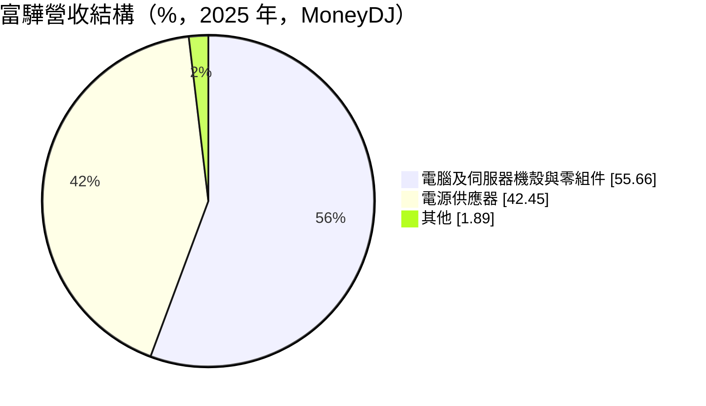
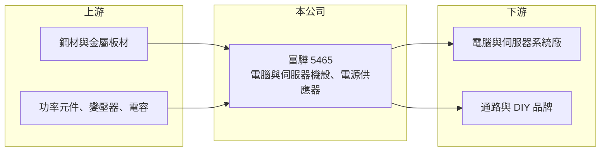

# 5465 富驊

> 上櫃｜[[產業索引-電腦及週邊設備業|電腦及週邊設備業]]｜上市（櫃）日期 2000/11/08

# 第一章：企業模式與商業藍圖

> [!info] 撰寫說明
> 精簡版，由 Claude 依公開資料整理，架構比照 [[2330台積電]]，資料截至 2026-10-08。來源：櫃買中心開放資料快照（基本資料、2026 年上半年財報、每月營收）、Goodinfo 經營績效年度表、MoneyDJ 個股基本資料（2025 年營收比重、歷年股利）。客戶與生產據點未查得。#待校對

富驊同時做電腦與伺服器機殼、以及電源供應器，本章說明這兩條產品線如何構成它的商業模式。

- **核心業務：** 依 MoneyDJ，富驊的產品分為電腦及伺服器機殼與零組件、[[電源供應器]]兩大類。機殼負責保護主機板與散熱風道，電源供應器把市電轉成電腦可用的直流電，兩者都是組裝一台電腦或伺服器必備的基礎零件。能同時供應兩項產品，客戶可以把機殼與電源一起採購，簡化供應鏈。
- **營收結構：** 2025 年電腦及伺服器機殼與零組件約占 55.7%，電源供應器約 42.5%，其他約 1.9%。兩項產品比重接近，代表公司不完全依賴單一品類。
- **營運據點：** 公司 1984 年成立，2000 年於櫃買中心掛牌，2026 年第二季實收資本額約 14.8 億元。合併報表中有約 6.4 億元的非控制權益，代表部分業務由持股未達百分之百的子公司經營。生產據點未查得。
- **長期方向：** 2018 年營收由前一年的 17.6 億元躍升至 38.3 億元，事業規模明顯擴大，原因未查得（推估與電源業務併入有關，待校對）。長期成長要看伺服器相關產品能否提高比重，因為伺服器機殼與電源的單價與技術門檻都高於一般桌機產品。

# 第二章：護城河深度與競爭優勢

機殼與電源都是競爭激烈的成熟產業，本章分析富驊的立足點。

- **競爭優勢：** 富驊的優勢在於機殼與電源兩條產品線並存，能提供整合方案，並累積了四十年的電腦零組件製造經驗。對中小型系統廠與通路品牌而言，一家供應商同時處理機殼與電源，可以降低設計搭配與採購管理的成本。
- **主要對手：** 機殼方面有 [[6117迎廣]]、[[8210勤誠]]、[[3013晟銘電]]、[[3693營邦]]；電源方面有 [[2308台達電]]、[[2301光寶科]]、[[3015全漢]]、[[6282康舒]]。大廠在伺服器電源與高瓦數產品上的規模與技術領先，富驊的位置相對偏中低階（推估）。
- **觀察重點：** 毛利率長期在 10% 至 16% 之間，屬於代工製造的水準。長期要觀察伺服器產品的比重與毛利率能否同步上升，以及營收在 2026 年明顯下滑後能否回穩。

# 第三章：財務體質與盈利規模

資料日期：2026-10-08，表格是撰寫當時的快照；最新月營收、毛利率、累計 EPS 由自動排程寫在本筆記的屬性欄位（月營收、毛利率、累計EPS 等）。#待校對

富驊的營收規模在 43 億至 61 億元之間起伏，獲利率穩定但偏低，配息相當規律。

| 年度 | 營收（億元） | [[毛利率]] | [[營業利益率]] | EPS（元） | [[ROE]] |
|---|---|---|---|---|---|
| 2021 | 55.0 | 13.1% | 5.11% | 1.27 | 9.06% |
| 2022 | 42.8 | 15.4% | 7.80% | 2.02 | 13.1% |
| 2023 | 54.4 | 12.8% | 6.59% | 1.96 | 12.8% |
| 2024 | 44.9 | 15.2% | 7.64% | 1.82 | 11.4% |
| 2025 | 54.5 | 13.0% | 6.77% | 1.29 | 7.67% |

- **營收規模：** 2020 年營收 61.2 億元為近年高峰，2025 年 54.5 億元，五年年複合成長率約 -2.3%（推算）。2026 年上半年營收 20.1 億元、毛利率 16.7%、營業利益率 8.3%、EPS 0.98 元；1 至 8 月累計營收年減約 31%，但獲利率反而上升，顯示產品組合往較高毛利移動（推估）。
- **獲利：** 2021 至 2025 年平均 ROE 約 10.8%（推算），營業利益率穩定在 5% 至 8%。依 MoneyDJ，2019 至 2025 年每年都發放現金股利，每股約 1.0 至 1.8 元，配息穩定度高。
- **財務特色：** 2026 年第二季末總資產 49.0 億元、總負債 17.9 億元（幾乎都是流動負債），負債比約 37%；權益總額 31.2 億元，其中歸屬母公司 24.8 億元，每股淨值 16.77 元。流動資產 41.2 億元遠大於流動負債，短期償債能力充足。
- **[[ROIC]] 與 [[WACC]]：** 2025 年營業利益約 3.69 億元，稅後約 2.95 億元；有息負債未逐項查得，以權益總額約 31 億元加假設有息負債 5 億元計算，ROIC 約 8.2%（推算）。2026 年上半年年化稅後營業利益約 2.67 億元，ROIC 約 7.4%（推算）。WACC 以 CAPM 推估：無風險利率 1.75%、市場風險溢酬 6%、β 取 1.1（電腦零組件股常見值），股東權益成本 8.35%；負債占資本約 15%、稅後成本 2%，WACC 約 7.4%（推算）。ROIC 與 WACC 大致相當，代表本業大約只賺回資金成本，價值創造空間有限。

# 第四章：總體風險與地緣政治

富驊的營收與電腦、伺服器出貨週期緊密相關，本章整理長期風險。

- **產業週期：** 桌上型電腦需求成熟、波動大，伺服器則跟著雲端與企業資本支出循環。富驊營收在 2020 年後多次出現兩成以上的年增減，顯示對下游週期高度敏感。
- **營運風險：** 機殼與電源都有大型競爭者，價格競爭激烈，若無法往伺服器與高瓦數產品升級，毛利率很難突破。部分業務透過非全資子公司經營，母公司股東只能分享部分獲利。
- **其他風險：** 鋼材、銅材與功率元件價格影響成本；營收以美元計價為主，匯率波動影響毛利；美國關稅與供應鏈移轉可能要求新增海外產能。

# 專有名詞解析

## 金融

- **[[ROIC]]**：投入資本報酬率，稅後營業利益除以股東權益加有息負債，衡量本業運用資本的效率。
- **[[WACC]]**：加權平均資金成本，股東權益成本與負債成本依資本結構加權，是 ROIC 必須超越的門檻。

## 產業

- **[[電源供應器]]**：把交流市電轉換成穩定直流電、供電腦或伺服器各零件使用的模組，簡稱 PSU。
- **[[伺服器機殼]]**：容納伺服器主機板、硬碟與電源的金屬機箱，需要配合機櫃規格與散熱風道設計。

# 核心供應鏈

- 上游：鋼材與金屬板材，功率半導體、變壓器、電容等電源零件。
- 下游／客戶：電腦與伺服器系統廠、通路品牌（實際客戶未查得）。
- 同業：機殼 [[6117迎廣]]、[[8210勤誠]]、[[3013晟銘電]]、[[3693營邦]]；電源 [[2308台達電]]、[[2301光寶科]]、[[3015全漢]]、[[6282康舒]]。

## 最新新聞
<!-- news:start（自動產生，請勿手動編輯此範圍） -->
- 2026-10-12 📰 媒體 18:51｜營收速報 - 富驊(5465)9月營收4.77億元年增率高達36.78％｜[鉅亨網](https://news.cnyes.com/news/id/6628392)
- 2026-10-12 🏛️ 重訊 16:44｜公告本公司115年9月份自結合併營業收入。｜[觀測站](https://mops.twse.com.tw/mops/#/web/t05st01)

完整紀錄：[[5465富驊 新聞]]
<!-- news:end -->

## 相關連結
- [公開資訊觀測站](https://mopsov.twse.com.tw/mops/web/t05st03?step=1&firstin=1&co_id=5465)
- [Goodinfo](https://goodinfo.tw/tw/StockDetail.asp?STOCK_ID=5465)
- [Yahoo 股市](https://tw.stock.yahoo.com/quote/5465)
- [鉅亨網新聞](https://www.cnyes.com/twstock/5465/news)
