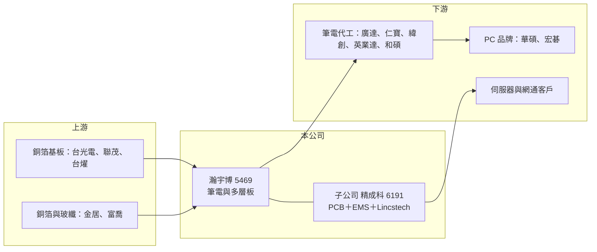

# 5469 瀚宇博

> 上市｜[[產業索引-電子零組件業|電子零組件業]]｜上市（櫃）日期 2003/08/25

# 第一章：企業模式與商業藍圖

> [!info] 撰寫說明
> 精簡版，由 Claude 依公開資料整理，架構比照 [[2330台積電]]，資料截至 2026-10-08。來源：證交所開放資料快照（基本資料、2026 年第二季資產負債與綜合損益、股利）、Goodinfo 經營績效頁（2019 至 2025 年度數據）、經濟日報 2025 年財報報導、口袋學堂精成科介紹。公開資料未查得瀚宇博本身的產品比重，產品與據點描述部分依記憶整理，標註「待校對」。#待校對

瀚宇博德（以下簡稱瀚宇博）是華新集團旗下的[[PCB]]（印刷電路板）廠，以筆電主機板起家，並透過持有 [[6191精成科]] 形成一個「電路板加組裝」的集團。理解瀚宇博，必須同時看它自己的板廠與子公司精成科。

- **核心業務：** 瀚宇博成立於 1989 年，2003 年上市，總部與台灣工廠位於桃園觀音工業區，董事長焦佑衡、總經理陶正國同時領導精成科，屬於華新集團的「華科事業群」。公司長期以筆記型電腦主機板用的多層電路板為主力，是全球主要的筆電板供應商之一（待校對）。筆電板量大、規格標準化，競爭重點在成本與交期，因此瀚宇博的經營風格偏向大量生產與成本控制。
- **營收結構：** 瀚宇博的合併營收包含子公司精成科，2025 年合併營收約 572 億元，同年精成科營收 337 億元，因此精成科貢獻超過一半（推算）。以 2026 年上半年為例，瀚宇博合併營收 325.4 億元、精成科 192.9 億元，扣除後瀚宇博本身與其他子公司約 130 億元（推算，未考慮內部交易）。產品應用以筆電與個人電腦為主，近年透過精成科的併購擴大到伺服器、車用與半導體測試板。
- **營運據點：** 台灣以桃園觀音為總部與生產基地，主要量產產能過去集中在中國大陸（待校對）。子公司精成科在廣東深圳、東莞黃江、江蘇昆山、重慶設廠，2025 年再取得日本 Lincstech，並規劃新加坡、馬來西亞與台灣新廠。集團產能由中國大陸往日本、東南亞與台灣分散，是近年最重要的結構變化。
- **長期方向：** 集團策略是由筆電板往 [[AI伺服器]] 與高階多層板升級。2025 年精成科辦理現金增資時，瀚宇博認購逾 8,157 張以維持持股，媒體報導兩家 2025 年前三季合計資本支出近 60 億元，高於 2024 年全年約 40 億元。瀚宇博扮演集團的投資控股與資金後盾角色，未來的成長主要看精成科高階板的放量。

# 第二章：護城河深度與競爭優勢

瀚宇博的護城河屬於「規模與成本型」，在標準化的筆電板市場靠量產效率生存，本章說明這種優勢的厚度與極限。

- **競爭優勢：** 第一是規模經濟，筆電板訂單量大且規格相近，產能規模大的廠商能攤低固定成本，並取得原料議價力。第二是長期客戶關係，筆電板需要配合品牌與代工廠的開發時程，供應商一旦進入合格名單，通常能長期分到穩定比例的訂單。第三是集團資源，與 [[6191精成科]]、[[8183精星]] 同屬華科事業群，從電路板、組裝到被動元件可以互相支援，並在客戶要求時提供整合方案。
- **主要對手：** 筆電與個人電腦板的主要對手是 [[3044健鼎]]、[[2368金像電]]、[[4958臻鼎-KY]]，以及中國大陸本土板廠；在伺服器板與高階多層板，則要面對 [[2368金像電]]、[[2313華通]]、[[3037欣興]] 等早已切入 AI 供應鏈的同業。筆電板市場的對手數量多、技術門檻有限，價格競爭是常態。
- **觀察重點：** 筆電板的護城河較窄，報價主要由供需決定，因此長期觀察的是集團高階板比重能否持續提升。2023 至 2024 年瀚宇博毛利率曾達 24% 至 25%，但 2025 年回落到 19.7%，顯示併購與擴產初期的成本壓力。另一個重點是集團持股結構：瀚宇博的盈餘有相當比例來自精成科，非控制權益分走的比重會影響瀚宇博股東實際分到的獲利。

# 第三章：財務體質與盈利規模

資料日期：2026-10-08，表格是撰寫當時的快照；最新月營收、毛利率、累計 EPS 由自動排程寫在本筆記的屬性欄位（月營收、毛利率、累計EPS 等）。#待校對

本章以合併報表檢視瀚宇博的長期獲利能力。由於合併報表包含精成科，數字反映的是整個集團的電路板與組裝事業。

| 年度 | 營收（億元） | [[毛利率]] | [[營業利益率]] | EPS（元） | [[ROE]] |
|---|---|---|---|---|---|
| 2019 | 431 | 17.9% | 8.2% | 6.05 | 10.2% |
| 2020 | 457 | 21.0% | 11.7% | 6.15 | 10.9% |
| 2021 | 570 | 19.7% | 11.6% | 7.05 | 14.8% |
| 2022 | 477 | 19.6% | 11.3% | 6.07 | 11.6% |
| 2023 | 430 | 25.0% | 16.1% | 5.07 | 10.7% |
| 2024 | 416 | 24.4% | 14.7% | 5.91 | 9.9% |
| 2025 | 572 | 19.7% | 10.6% | 6.05 | 9.4% |
| 2026 上半年 | 325.4 | 15.6% | 7.4% | 2.05 | 未查得 |

資料來源：2019 至 2025 年為 Goodinfo，2026 上半年為證交所開放資料。

- **營收規模：** 2019 至 2024 年營收在 410 至 570 億元之間循環，2021 年疫情帶動筆電需求時達到高峰，之後回落；2025 年因精成科併購 Lincstech 回到 572 億元。2020 至 2025 年營收年複合成長率約 4.6%（推算），屬於低成長、隨景氣起伏的型態。
- **獲利：** EPS 長期穩定在 5 至 7 元之間，2025 年歸屬母公司淨利 29.23 億元、EPS 6.05 元，創近三年新高，但第四季 EPS 只有 1.12 元，明顯低於第三季的 2.26 元。2026 年上半年毛利率 15.6%、營業利益率 7.4%，低於過去幾年水準；同期所得稅費用 10.3 億元，占稅前淨利約 39%，有效稅率偏高，加上非控制權益分走 6.4 億元，歸屬母公司淨利僅約 9.9 億元。近 5 年（2021 至 2025）平均 [[ROE]] 約 11.3%（推算），且有逐年下滑的趨勢。
- **財務特色：** 2026 年第二季權益總計 855 億元，其中歸屬母公司 619 億元、非控制權益 236 億元，「其他權益」高達 309 億元，主要來自股權投資的未實現評價利益（2026 年上半年其他綜合損益 323 億元）。這讓每股淨值高達 127 元、股價淨值比僅約 0.63，但這部分淨值會隨被投資公司股價波動，不能視為本業產生的價值。依合併報表推算，瀚宇博對精成科的持股約在三成五至四成五之間（推算）。
- **股利：** 2025 年度配發現金股利 2.52 元，配息率約 42%（推算）。Goodinfo 統計的歷年平均現金股利約 0.93 元，遠低於近年 EPS，代表過去長期保留盈餘、配息偏低，股利穩定度是近年才提升。

**[[ROIC]] 與 [[WACC]]**

ROIC（推算）：2025 年營收 572 億元乘以營業利益率 10.6%，營業利益約 60.6 億元，扣除 20% 稅率後稅後營業利益約 48.5 億元。投入資本若以權益總計扣除未實現評價的其他權益（855 − 309 ≈ 546 億元）計算，ROIC 上限約 8.9%；開放資料未拆分有息負債，若加上推估的 100 至 250 億元有息負債，ROIC 約落在 6% 至 7.5%。若以實際偏高的有效稅率計算，數字還會更低。

WACC（推算）：台灣 10 年期公債殖利率取 1.75%、市場風險溢酬 6%、β 取電路板同業常見值 1.1（非官方數字），股東權益成本約 8.4%；負債成本假設 2.5%，稅後約 2%。以市值約 390 億元（股價淨值比 0.63 乘以母公司淨值）與上述負債估計，負債占資本約 20% 至 40%，WACC 約 6% 至 7%。

ROIC 與 WACC 大致打平，代表瀚宇博長期只是勉強賺回資金成本，沒有明顯創造超額價值。股價淨值比長期低於 1，正是市場對這種「規模大但報酬率普通」型態的評價。未來要改善，關鍵是高階板拉高營業利益率，以及集團如何運用帳上龐大的股權投資。

# 第四章：總體風險與地緣政治

瀚宇博的風險結構與精成科相近，但多了控股公司特有的評價波動與少數股東分潤問題。

- **產業週期：** 筆電與個人電腦需求每隔幾年就有一次換機潮與庫存調整，營收在 2021 年高峰後連續兩年下滑就是例子。電路板是典型的接單生產行業，需求轉弱時同業會殺價搶單，產能利用率下降又會放大折舊壓力。AI 伺服器板帶來新的成長，但也使公司暴露在雲端業者資本支出的週期之下。
- **營運風險：** 集團 2025 至 2026 年大舉擴產與併購，新廠良率爬坡與跨國整合都需要時間，期間毛利率可能持續低於過去水準。銅箔、玻纖布與[[CCL]]（銅箔基板）等原料成本上漲時，標準化的筆電板較難轉嫁給客戶。
- **其他風險：** 帳上股權投資的未實現評價規模龐大，被投資公司股價下跌時淨值會大幅縮水。主要產能在中國大陸，面臨美中貿易摩擦、關稅與客戶要求移出中國的壓力；營收以美元計價為主，新台幣升值會壓縮換算後的獲利。

# 專有名詞解析

## 應用

- **[[AI伺服器]]**：搭載 GPU 或 AI 加速器的伺服器，所用電路板層數多、材料規格高，單價遠高於一般伺服器板。

## 金融

- **[[非控制權益]]**：合併報表中子公司不屬於母公司持有的那部分權益與損益，也就是少數股東應得的份額。
- **[[其他權益]]**：股東權益中未經損益表的累積評價項目，例如股權投資的未實現損益與匯率換算差額。

## 產業

- **[[PCB]]**：印刷電路板，用銅箔線路連接電子元件的基板，是所有電子產品的骨架。
- **[[CCL]]**：銅箔基板，由玻纖布、樹脂與銅箔壓合而成，是製作電路板的主要原料。

# 核心供應鏈

- 上游：銅箔基板 [[2383台光電]]、[[6213聯茂]]、[[6274台燿]]；銅箔 [[8358金居]]；玻纖布 [[1815富喬]]。
- 下游／客戶：公司未具名揭露客戶，筆電板的典型客戶為筆電代工廠 [[2382廣達]]、[[2324仁寶]]、[[3231緯創]]、[[2356英業達]]、[[4938和碩]] 與品牌廠（產業常態，非公司揭露，待校對）。
- 同業：[[3044健鼎]]、[[2368金像電]]、[[4958臻鼎-KY]]、[[2313華通]]、[[3037欣興]]；集團關係企業 [[6191精成科]]、[[8183精星]]、[[1605華新]]。

## 最新新聞
<!-- news:start（自動產生，請勿手動編輯此範圍） -->
- 2026-10-15 🏛️ 重訊 15:36｜公告本公司召開法說會相關內容｜[觀測站](https://mops.twse.com.tw/mops/#/web/t05st01)
- 2026-10-08 📰 媒體 19:51｜營收速報 - 瀚宇博(5469)9月營收71.25億元年增率高達36.25％｜[鉅亨網](https://news.cnyes.com/news/id/6625890)

完整紀錄：[[5469瀚宇博 新聞]]
<!-- news:end -->

## 相關連結
- [公開資訊觀測站](https://mopsov.twse.com.tw/mops/web/t05st03?step=1&firstin=1&co_id=5469)
- [Goodinfo](https://goodinfo.tw/tw/StockDetail.asp?STOCK_ID=5469)
- [Yahoo 股市](https://tw.stock.yahoo.com/quote/5469)
- [鉅亨網新聞](https://www.cnyes.com/twstock/5469/news)
