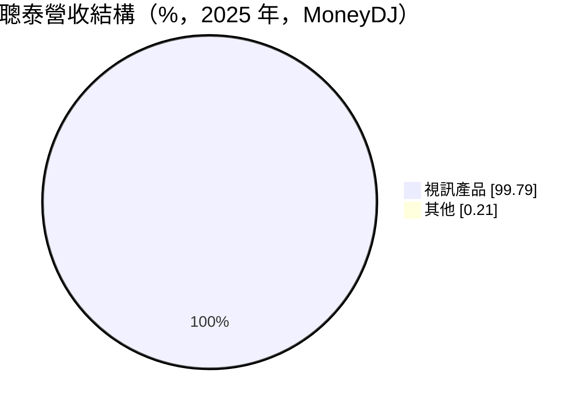
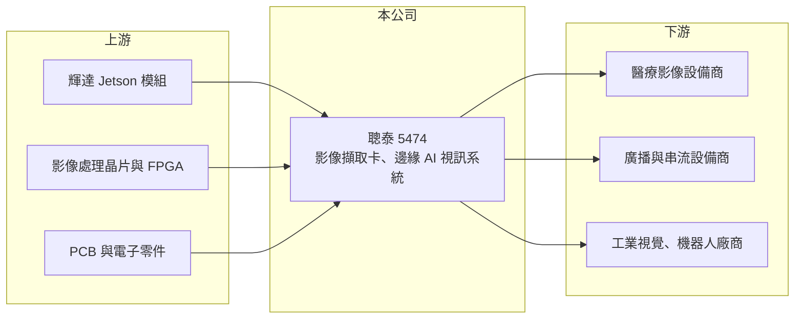

# 5474 聰泰

> 上櫃｜[[產業索引-電腦及週邊設備業|電腦及週邊設備業]]｜上市（櫃）日期 2001/03/20

# 第一章：企業模式與商業藍圖

> [!info] 撰寫說明
> 精簡版，由 Claude 依公開資料整理，架構比照 [[2330台積電]]，資料截至 2026-10-08。來源：櫃買中心開放資料快照（基本資料、2026 年上半年財報、每月營收）、Goodinfo 經營績效年度表、MoneyDJ 個股基本資料（2025 年營收比重、歷年股利）。產品應用（醫療、廣播、機器人）與 NVIDIA Jetson 合作的描述來自新聞標題與記憶，細節待查證。#待校對

聰泰是專做影像擷取與視訊處理硬體的利基型公司，本章說明它如何從擷取卡延伸到 AI 視覺應用。

- **核心業務：** 聰泰的主力產品是[[影像擷取卡]]，也就是把攝影機、醫療內視鏡或廣播設備的影像訊號接進電腦處理的介面卡。近年公司以輝達（[[NVDA輝達]]）Jetson 平台開發[[邊緣 AI]] 運算盒，把影像擷取和 AI 推論整合成一套系統（依新聞標題，待校對）。這類產品量不大，但需要長期的驅動程式與軟體支援，因此毛利率高。
- **營收結構：** 依 MoneyDJ，2025 年視訊產品占營收 99.8%，其他不到 0.2%。應用面涵蓋醫療影像、廣播與串流、工業與安控視覺，以及機器人等新領域（推估，比重未查得）。
- **營運據點：** 公司 1990 年成立，2001 年於櫃買中心掛牌，2026 年第二季實收資本額約 4.0 億元，是股本很小的公司。研發與主要營運在台灣（推估）。
- **長期方向：** AI 推論逐漸從雲端走向設備端，醫療設備、機器人與智慧工廠都需要即時處理多路影像。聰泰若能從賣擷取卡轉成提供「擷取＋運算＋軟體」的整合平台，就能分享邊緣 AI 長期成長，這是未來十年最主要的觀察主軸。

# 第二章：護城河深度與競爭優勢

聰泰的毛利率長期在四至五成，遠高於一般電腦週邊廠，本章說明背後的護城河。

- **競爭優勢：** 專業影像擷取卡要支援各種訊號規格、作業系統與客戶軟體，客戶通常把它設計進醫療或廣播設備，一用就是多年。換供應商需要重新驗證整套系統，轉換成本高，這是聰泰能維持四成以上毛利率的主要原因。
- **主要對手：** 擷取卡領域的同業有 [[2417圓剛]]，以及國外的 Blackmagic Design、Magewell、Matrox 等；邊緣 AI 運算盒則與 [[2395研華]]、[[6579研揚]]、[[6922宸曜]]、[[6166凌華]] 等工業電腦廠重疊。工業電腦大廠規模大、通路廣，聰泰的差異在於影像處理的專業深度。
- **觀察重點：** 毛利率從 2024 年 51.2% 降到 2025 年 41.0%，2026 年上半年約 41.1%，顯示產品組合往毛利較低的整機系統移動（推估）。長期要看營收規模擴大能否抵銷毛利率下滑。

# 第三章：財務體質與盈利規模

資料日期：2026-10-08，表格是撰寫當時的快照；最新月營收、毛利率、累計 EPS 由自動排程寫在本筆記的屬性欄位（月營收、毛利率、累計EPS 等）。#待校對

聰泰是高毛利、低負債、高配息的小型公司，2020 年曾因特殊需求爆發，之後回到常態水準。

| 年度 | 營收（億元） | [[毛利率]] | [[營業利益率]] | EPS（元） | [[ROE]] |
|---|---|---|---|---|---|
| 2021 | 17.9 | 44.5% | 27.0% | 9.66 | 24.3% |
| 2022 | 13.7 | 48.0% | 24.8% | 7.91 | 18.5% |
| 2023 | 11.8 | 48.7% | 20.3% | 5.07 | 11.3% |
| 2024 | 11.9 | 51.2% | 21.4% | 7.15 | 15.1% |
| 2025 | 14.7 | 41.0% | 15.1% | 5.49 | 11.0% |

- **營收規模：** 2020 年營收 27.1 億元、EPS 18.49 元是歷史高峰（當年遠距與直播需求帶動擷取卡熱銷，原因為記憶內容，待校對），之後回落。若以 2017 年 9.0 億元比 2025 年 14.7 億元，八年年複合成長率約 6.3%（推算）。2026 年上半年營收 6.85 億元、營業利益率 12.5%、EPS 2.52 元。
- **獲利：** 2021 至 2025 年平均 ROE 約 16.0%（推算）。依 MoneyDJ，2019 至 2025 年每年現金股利介於 3.5 元至 8 元，近兩年各 4 元，配息率常在七成以上，股利政策穩定。
- **財務特色：** 2026 年第二季末總資產 25.9 億元、總負債 6.3 億元，負債比約 24%；股東權益約 19.6 億元，每股淨值 49.28 元，保留盈餘 15.6 億元遠大於股本，代表多年獲利多數留在公司或發還股東，幾乎不靠借款營運。
- **[[ROIC]] 與 [[WACC]]：** 2025 年營業利益約 2.22 億元，稅後約 1.78 億元；有息負債極少，以股東權益約 19.5 億元計，ROIC 約 9.1%（推算）；2021 年同樣算法約 24%（推算），2026 年上半年年化約 6.9%（推算）。WACC 以 CAPM 推估：無風險利率 1.75%、市場風險溢酬 6%、β 取 1.2（AI 題材小型股常見值），幾乎無負債，WACC 約 8.9%（推算）。過去五年 ROIC 多數高於 WACC，代表本業長期創造價值，但 2025 年後利差已縮到接近零，是需要留意的變化。

# 第四章：總體風險與地緣政治

聰泰規模小、產品專精，本章整理它面對的長期風險。

- **產業週期：** 擷取卡需求受醫療設備、廣播與安控專案影響，2020 年的高峰與之後連續三年下滑，說明一次性需求退潮後營收可能大幅回落。邊緣 AI 專案從開發到量產時間長，營收認列不平均。
- **營運風險：** 邊緣 AI 產品高度依賴輝達 Jetson 平台，平台世代更替或供貨變化都會影響出貨。轉向整機系統後需要面對工業電腦大廠的競爭，毛利率可能持續下滑。
- **其他風險：** 營收以美元計價為主，新台幣升值壓縮毛利；股本小、成交量低，市場對題材的反應可能放大股價波動。

# 專有名詞解析

## 應用

- **[[邊緣 AI]]**：在終端設備或現場運算盒上直接執行 AI 推論，不必把資料傳回雲端，可降低延遲與頻寬。

## 金融

- **[[ROIC]]**：投入資本報酬率，稅後營業利益除以股東權益加有息負債，衡量本業運用資本的效率。
- **[[WACC]]**：加權平均資金成本，股東權益成本與負債成本依資本結構加權，是 ROIC 必須超越的門檻。

## 產業

- **[[影像擷取卡]]**：把攝影機、醫療或廣播設備的視訊訊號轉成電腦可處理的數位資料的介面卡。

# 核心供應鏈

- 上游：[[NVDA輝達]] Jetson 運算模組、影像處理晶片與 FPGA、PCB 與被動元件。
- 下游／客戶：醫療影像、廣播串流、工業視覺與機器人設備商（實際客戶未查得）。
- 同業：[[2417圓剛]]、[[2395研華]]、[[6579研揚]]、[[6922宸曜]]、[[6166凌華]]。

## 最新新聞
<!-- news:start -->
<!-- news:end -->

## 相關連結
- [公開資訊觀測站](https://mopsov.twse.com.tw/mops/web/t05st03?step=1&firstin=1&co_id=5474)
- [Goodinfo](https://goodinfo.tw/tw/StockDetail.asp?STOCK_ID=5474)
- [Yahoo 股市](https://tw.stock.yahoo.com/quote/5474)
- [鉅亨網新聞](https://www.cnyes.com/twstock/5474/news)
