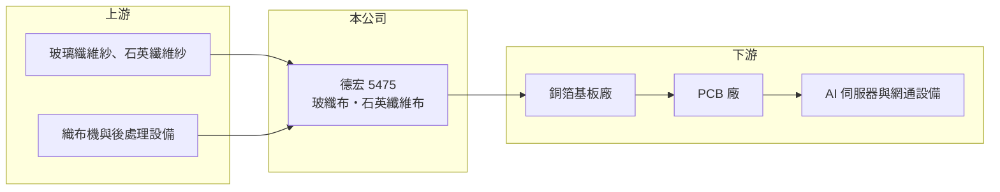

# 5475 德宏

> 上櫃｜[[產業索引-電子零組件業|電子零組件業]]｜上市（櫃）日期 2001/01/16

# 第一章：企業模式與商業藍圖

> [!info] 撰寫說明
> 精簡版，由 Claude 依公開資料整理，架構比照 [[2330台積電]]，資料截至 2026-10-08。來源：櫃買中心開放資料快照（基本資料、2026 年第二季資產負債與損益、本益比殖利率）、Goodinfo 經營績效頁、理財周刊 2026 年報導。公開資料有限。#待校對

德宏工業（以下簡稱德宏）是位於桃園楊梅的玻璃纖維布廠，產品是 [[PCB]] 最底層的材料之一。理解德宏的關鍵在於：它過去多年在一般玻纖布市場虧損，而 AI 伺服器帶動的高階玻纖布與[[石英布]]需求，讓它在 2025 至 2026 年出現明顯轉折。

- **核心業務：** 德宏成立於 1997 年，2001 年在櫃買中心掛牌，主要產品是[[玻纖布]]，並開發石英纖維紗與石英纖維布。依 2026 年的報導，玻璃纖維布約占營收 96.67%。玻纖布由玻璃纖維紗織成，再交給[[銅箔基板]]廠與樹脂、銅箔壓合，是電路板的骨架材料，品質會直接影響電路板的訊號傳輸與尺寸穩定。
- **營收結構：** 營收幾乎全部來自玻纖布，產品別與客戶別比重未查得。2025 年營收 8.76 億元，較 2024 年的 5.52 億元成長約六成，2026 年 1 至 7 月累計營收 10.64 億元、年增約 150%，已超過 2025 年全年。這種爆發式成長來自 [[AI 伺服器]]帶動的高階玻纖布供不應求，而不是一般玻纖布需求轉好。
- **營運據點：** 公司總部與工廠位於桃園楊梅，生產據點細節與織布機台數未查得。玻纖布的產能主要由織布機數量與紗的供應決定，高階布種的良率門檻高，擴產需要時間。
- **長期方向：** 公司的長期方向是從一般 FR-4 用玻纖布，轉向 [[Low-Dk]] 等低介電玻纖布與石英布。石英纖維的二氧化矽含量超過 99%，介電損耗更低，被視為下一代高速運算電路板的材料；依報導，德宏的石英纖維產品於 2025 年第四季進入準備送樣階段。2026 年 7 月董事會另決議辦理[[現金增資]]，資金用途未查得，但通常與擴產或改善財務結構有關。

# 第二章：護城河深度與競爭優勢

德宏過去是一家在成熟材料市場中規模偏小、長期虧損的公司，護城河很淺；現在的機會在於高階布種的供給缺口。

- **競爭優勢：** 高階玻纖布的關鍵在於紗的品質、織布張力控制與後處理技術，客戶（銅箔基板廠）需要長時間驗證，一旦導入，轉換成本不低。德宏若能把石英布與低介電布送樣轉為量產，就能分到這段供給缺口的超額利潤。但目前公開資料無法確認德宏在高階布種的量產規模與客戶認證進度，優勢仍屬「潛在」而非「已證實」。
- **主要對手：** 台灣同業有 [[1802台玻]]、1815富喬、[[1303南亞]]（集團內有玻纖布事業）與 5340建榮；在 Low-Dk 與低熱膨脹（Low-CTE）布種上，日本日東紡長期居領先地位。這些對手的規模多數遠大於德宏，部分具備從玻纖紗到布的垂直整合能力，成本與供應穩定度都占優勢。
- **觀察重點：** 長期最該追蹤的是毛利率能否穩定在兩成以上，以及石英布能否取得客戶認證並量產。德宏 2021 年曾短暫獲利（毛利率 31.1%），隨後又連續四年虧損，顯示一般玻纖布的高獲利只是短暫景氣。若 2026 年的高毛利能延續到景氣下行時仍維持，才代表產品結構真的轉型成功。

# 第三章：財務體質與盈利規模

資料日期：2026-10-08，表格是撰寫當時的快照；最新月營收、毛利率、累計 EPS 由自動排程寫在本筆記的屬性欄位（月營收、毛利率、累計EPS 等）。#待校對

德宏的財務呈現典型「景氣循環材料股」的樣貌：營收與毛利率大起大落，多數年份虧損，2026 年才進入明顯的獲利期。

| 年度 | 營收（億元） | [[毛利率]] | [[營業利益率]] | EPS（元） | [[ROE]] |
|---|---|---|---|---|---|
| 2021 | 19.6 | 31.1% | 21.6% | 3.73 | 58.0% |
| 2022 | 6.70 | -14.4% | -41.2% | -2.71 | -33.9% |
| 2023 | 5.39 | -11.3% | -37.0% | -1.67 | -21.5% |
| 2024 | 5.52 | 2.78% | -25.1% | -1.36 | -19.5% |
| 2025 | 8.76 | 19.4% | -3.04% | -0.16 | -2.4% |

（來源：Goodinfo 經營績效頁；2019 年營收 9.07 億元、EPS -2.32 元，2020 年營收 6.29 億元、EPS -0.49 元。）

- **營收規模：** 2019 至 2025 年營收由 9.07 億元變為 8.76 億元，年複合成長率約 -0.6%（推算），中間 2021 年衝到 19.6 億元後又跌回 5 億多元，波動極大。2026 年上半年營收 8.30 億元，已接近 2025 年全年，代表公司正處於這一輪景氣的上行段。
- **獲利：** 近五年平均 ROE 約 -3.9%（推算），只有 2021 年獲利。2026 年上半年毛利率約 33.4%、營業利益率約 18.0%，稅後淨利約 1.52 億元、EPS 1.19 元，且因為累積虧損可以抵稅，上半年沒有所得稅費用。這種「虧損多年後一次大賺」的型態，是投資這類公司時最需要注意的地方。
- **財務特色：** 依 2026 年第二季資料，總資產約 29.7 億元，股東權益約 10.8 億元，保留盈餘為 -7.69 億元，其他權益約 5.86 億元，每股淨值 8.57 元，低於面額 10 元。非流動負債約 10.6 億元。累積虧損代表公司短期內難以配發現金股利，現金增資則是補充資本的方式。自由現金流是否長期為正未查得。
- **[[ROIC]] 與 [[WACC]]：** 2025 年營業損失約 0.27 億元，ROIC 為負。以 2026 年上半年營業利益 1.49 億元年化、稅率 20% 推算，稅後營業利益約 2.38 億元；有息負債未查得，投入資本以股東權益 10.8 億元到「權益加全部負債」29.7 億元為區間，ROIC 約 8% 至 22%（推算）。WACC 以 CAPM 推估：無風險利率 1.75%、市場風險溢酬 6%、β 假設 1.2（波動大的材料股常見值），權益成本約 9.0%；稅後負債成本假設 2%、負債占四成，WACC 約 6.2%（推算）。2026 年的 ROIC 若能維持，將是多年來第一次明顯高於資金成本，但以 2019 至 2025 年整體來看，德宏長期是毀損價值的。

# 第四章：總體風險與地緣政治

德宏的風險主要來自材料景氣的劇烈循環、高階產品的認證與量產不確定性，以及偏弱的資本結構。

- **產業週期：** 玻纖布屬於標準化程度高的材料，景氣好時供不應求、價格大漲，景氣反轉時大廠擴產與中國低價產能會迅速壓低價格。德宏 2021 年賺錢、2022 至 2024 年大虧，就是典型例子。目前高階布的供給缺口若因同業擴產而補上，獲利可能再次大幅回落。
- **營運風險：** 石英布與低介電布仍在送樣與認證階段，量產時程與良率都不確定。公司規模小，若主要客戶轉單或認證失敗，營收會明顯波動。累積虧損與淨值低於面額，代表財務緩衝有限，需要靠增資補充資本，增資會稀釋原股東權益。
- **其他風險：** 玻纖紗等原料若須外購，原料供應與價格會受上游大廠影響；電力與天然氣成本上升也會壓縮毛利。客戶多為銅箔基板廠，其需求最終取決於 AI 伺服器與網通設備的投資週期。

# 專有名詞解析

## 應用

- **[[AI 伺服器]]**：搭載 GPU 等加速晶片、用於 AI 訓練與推論的伺服器，功耗高，對電路板層數與材料規格要求也高。

## 金融

- **[[現金增資]]**：公司發行新股向投資人募集現金，可補充資本或支應擴產，但會稀釋原股東持股。

## 產業

- **[[PCB]]**：印刷電路板，用銅線路連接電子元件的基板，是所有電子產品的骨架。
- **[[玻纖布]]**：以玻璃纖維紗織成的布，與樹脂、銅箔壓合成銅箔基板，是電路板的骨架材料。
- **[[石英布]]**：以高純度石英纖維織成的布，介電損耗比玻纖布更低，被視為高速 AI 伺服器電路板的下一代材料。
- **[[Low-Dk]]**：低介電常數，指能減少訊號延遲與損耗的材料特性，高速伺服器與網通電路板需要 Low-Dk 玻纖布與樹脂。
- **[[銅箔基板]]**：由銅箔、玻纖布與樹脂壓合而成的板材，是 PCB 的主要原料。

# 核心供應鏈

- 上游：玻璃纖維紗與石英纖維紗供應商，以及織布機與表面處理設備，具體供應商未查得。
- 下游／客戶：銅箔基板廠，代表業者如 [[2383台光電]]、[[6274台燿]]、[[6213聯茂]]（是否為德宏客戶未查得，#待校對），再往下是 PCB 廠與 AI 伺服器、網通設備。
- 同業：[[1802台玻]]、1815富喬、[[1303南亞]]、5340建榮，以及日本日東紡。

## 最新新聞
<!-- news:start（自動產生，請勿手動編輯此範圍） -->
- 2026-10-16 📰 媒體 06:30｜Q布還沒放量，德宏(5475)獲利卻已大幅成長！9月每股賺0.97元｜[鉅亨網](https://news.cnyes.com/news/id/6631714)
- 2026-10-12 🏛️ 重訊 17:29｜本公司有價證券近期多次達公布注意交易資訊標準，故公告 相關訊息，以利投資人區別暸解｜[觀測站](https://mops.twse.com.tw/mops/#/web/t05st01)
- 2026-10-12 📰 媒體 08:51｜營收速報 - 德宏(5475)9月營收3.24億元年增率高達227.61％｜[鉅亨網](https://news.cnyes.com/news/id/6627798)

完整紀錄：[[5475德宏 新聞]]
<!-- news:end -->

## 相關連結
- [公開資訊觀測站](https://mopsov.twse.com.tw/mops/web/t05st03?step=1&firstin=1&co_id=5475)
- [Goodinfo](https://goodinfo.tw/tw/StockDetail.asp?STOCK_ID=5475)
- [Yahoo 股市](https://tw.stock.yahoo.com/quote/5475)
- [鉅亨網新聞](https://www.cnyes.com/twstock/5475/news)
