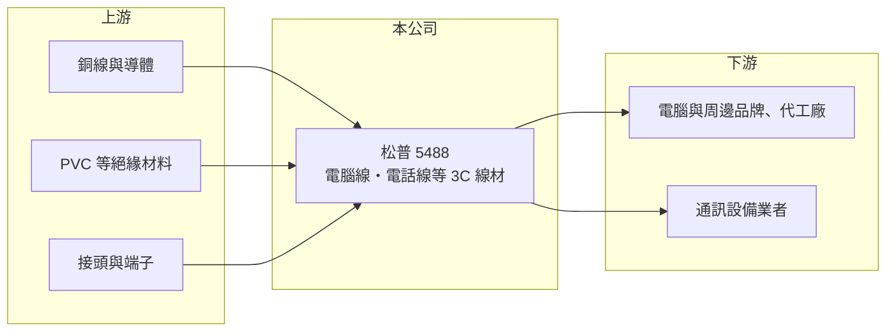

# 5488 松普

> 上櫃｜[[產業索引-電子零組件業|電子零組件業]]｜上市（櫃）日期 2001/03/12

# 第一章：企業模式與商業藍圖

> [!info] 撰寫說明
> 精簡版，由 Claude 依公開資料整理，架構比照 [[2330台積電]]，資料截至 2026-10-08。來源：櫃買中心開放資料快照（基本資料、2026 年第二季資產負債與損益、本益比殖利率）、Goodinfo 經營績效頁、nStock 公司簡介。公開資料有限，產品比重、客戶與生產據點均未查得。#待校對

松普科技（以下簡稱松普）是一家老牌的電子線材廠，主要做電腦與通訊產品使用的連接線。理解松普的關鍵在於：它身處技術門檻不高、價格競爭激烈的線材組裝產業，近年營收規模縮小，獲利長期在損益兩平附近。

- **核心業務：** 松普成立於 1983 年，2001 年在櫃買中心掛牌，依公司登記的營業項目，主要從事電腦線、電話線等 [[3C 產品]]用線的製造與買賣。這類[[連接線]]是把銅線、絕緣材料與接頭組合成可直接使用的連接線，屬於電子產品的周邊配件。產品本身標準化程度高，差異化主要在交期、品質穩定與成本控制。
- **營收結構：** 產品別、應用別與地區別的營收比重公開資料未查得。2025 年營收約 7.7 億元，2026 年 1 至 9 月累計營收約 7.17 億元、年增約 31%，近期有回升跡象。由於產品結構不明，無法判斷回升來自哪一類應用。
- **營運據點：** 公司總部位於桃園龜山，海外生產據點未查得。董事長駱國呈與總經理駱秀勇同姓，經營型態推估為家族企業（推估）。
- **長期方向：** 公開資料未見公司說明明確的轉型方向。線材產業的長期出路通常是往高速傳輸線、車用或工業用[[線束]]等較高規格產品移動，松普是否有類似布局需要查閱年報確認。

# 第二章：護城河深度與競爭優勢

松普屬於規模小、產品標準化的線材廠，護城河相當有限。

- **競爭優勢：** 松普有四十多年的線材製造經驗，與既有客戶的往來關係與品質紀錄，是它能持續接單的基礎。不過電腦線、電話線這類產品技術門檻不高，客戶很容易找到替代供應商，這種優勢不足以支撐較高的毛利率。近七年毛利率大致落在 10% 至 14%，正反映這種處境。
- **主要對手：** 台灣同業包括 [[6290良維]]、[[3023信邦]]、[[8103瀚荃]]、[[6197佳必琪]] 等線材與連接器廠，另有大量中國與東南亞的線材組裝廠。這些對手多數規模更大，產品也已延伸到車用、伺服器與工業應用。松普與它們相比，規模與產品廣度都處於劣勢。
- **觀察重點：** 長期最該追蹤的是營業利益率能否穩定轉正並提升。2019 至 2025 年松普的營業利益率在 -3.6% 到 0.8% 之間，本業幾乎沒有獲利能力。2026 年上半年營業利益率約 3.7%，若能維持並擴大，才代表產品或客戶結構有實質改善。

# 第三章：財務體質與盈利規模

資料日期：2026-10-08，表格是撰寫當時的快照；最新月營收、毛利率、累計 EPS 由自動排程寫在本筆記的屬性欄位（月營收、毛利率、累計EPS 等）。#待校對

松普的財務特徵是：營收規模不到 10 億元而且逐年縮小，毛利率低，獲利長期在零附近，但負債很少。

| 年度 | 營收（億元） | [[毛利率]] | [[營業利益率]] | EPS（元） | [[ROE]] |
|---|---|---|---|---|---|
| 2021 | 11.7 | 13.1% | 0.78% | 0.08 | 0.84% |
| 2022 | 12.1 | 12.0% | 0.76% | 0.20 | 2.07% |
| 2023 | 9.01 | 10.1% | -2.97% | 0.41 | 4.23% |
| 2024 | 8.38 | 11.4% | -2.92% | 0.01 | 0.07% |
| 2025 | 7.70 | 14.0% | 0.73% | 0.11 | 1.09% |

（來源：Goodinfo 經營績效頁；2019 年營收 12.3 億元、EPS -0.43 元。）

- **營收規模：** 2019 至 2025 年營收由 12.3 億元降到 7.7 億元，年複合成長率約 -7.5%（推算）。2026 年上半年營收 4.84 億元，較前一年同期明顯回升，但仍低於 2022 年以前的水準。營收長期萎縮顯示公司在傳統線材市場的份額或產品需求正在下降。
- **獲利：** 近五年平均 ROE 約 1.7%（推算），遠低於資金成本。2023 年營業虧損但 EPS 為正，代表業外收益抵銷了本業虧損。2026 年上半年毛利率約 14.9%、營業利益率約 3.7%，但業外損失與所得稅後，稅後 EPS 僅 0.03 元。
- **財務特色：** 依 2026 年第二季資料，總資產約 14.5 億元，其中流動資產約 12.9 億元，負債僅約 4.3 億元，股東權益約 10.1 億元，負債比約 30%，財務結構保守。保留盈餘約 0.54 億元，相對股本 9.16 億元偏低，配息能力有限，最近一次現金股利每股 0.06 元。
- **[[ROIC]] 與 [[WACC]]：** 以 2025 年營業利益約 0.056 億元（7.7 億元 × 0.73%）、稅率 20% 計算，稅後營業利益約 0.045 億元。有息負債未查得，投入資本以股東權益 10.1 億元到「權益加全部負債」14.5 億元為區間，ROIC 約 0.3% 至 0.4%（推算）。WACC 以 CAPM 推估：無風險利率 1.75%、市場風險溢酬 6%、β 假設 0.8（小型零組件股常見值），權益成本約 6.6%；負債多為營運性負債，假設稅後負債成本 2%、占一成，WACC 約 6.1%（推算）。ROIC 長期遠低於 WACC，代表公司的資本長期沒有創造經濟價值，保守的財務結構只是降低了倒閉風險，並沒有轉化為報酬。

# 第四章：總體風險與地緣政治

松普的風險主要來自產品競爭力不足、營收長期萎縮，以及資訊揭露有限。

- **產業週期：** 電腦與通訊線材需求跟著 PC、網通設備的換機週期起伏，傳統電話線的需求更是長期下滑。若公司沒有切入新的應用，營收可能持續隨舊產品萎縮。線材屬於低價配件，景氣下行時客戶最容易壓價。
- **營運風險：** 本業獲利長期接近零，任何原料上漲或匯率不利都可能讓公司轉為虧損。公司規模小，難以像大型線材廠一樣分散客戶與生產據點。公開資料中查不到主要客戶與產品比重，外部投資人難以評估客戶集中度。
- **其他風險：** 線材主要原料是銅與塑膠，銅價波動會直接影響成本；以美元計價的外銷訂單受新台幣匯率影響。若生產據點在中國，美國關稅政策也可能影響訂單（生產據點未查得）。

# 專有名詞解析

## 應用

- **[[3C 產品]]**：電腦（Computer）、通訊（Communication）與消費性電子（Consumer Electronics）產品的合稱。

## 產業

- **[[線束]]**：把多條電線、端子與連接器組合成一束的組件，用於汽車與設備內部的配電與訊號傳輸。
- **[[連接線]]**：兩端裝有接頭、用來連接電子設備傳輸電力或訊號的線材，例如 USB 線、網路線與電話線。

# 核心供應鏈

- 上游：銅線導體、PVC 等絕緣材料與接頭端子供應商，例如 [[1605華新]] 等銅線材業者（是否為松普供應商未查得）。
- 下游／客戶：電腦與周邊品牌、代工廠及通訊設備業者，具體客戶名稱公開資料未點名（#待校對）。
- 同業：[[6290良維]]、[[3023信邦]]、[[8103瀚荃]]、[[6197佳必琪]]。

## 最新新聞
<!-- news:start -->
<!-- news:end -->

## 相關連結
- [公開資訊觀測站](https://mopsov.twse.com.tw/mops/web/t05st03?step=1&firstin=1&co_id=5488)
- [Goodinfo](https://goodinfo.tw/tw/StockDetail.asp?STOCK_ID=5488)
- [Yahoo 股市](https://tw.stock.yahoo.com/quote/5488)
- [鉅亨網新聞](https://www.cnyes.com/twstock/5488/news)
