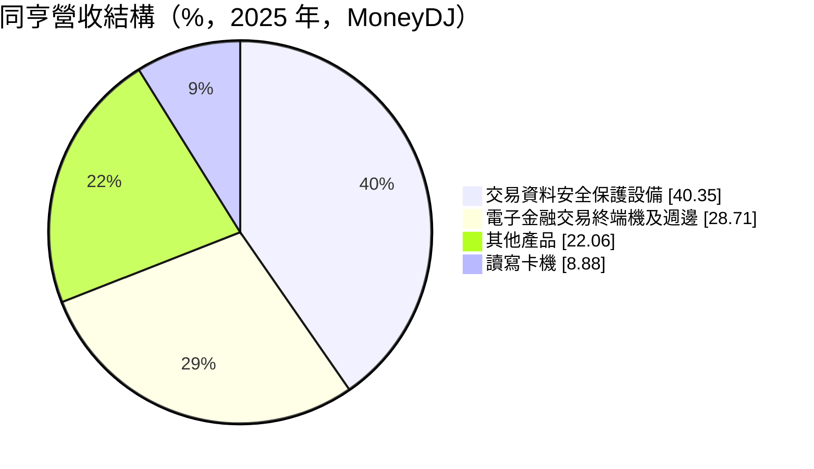
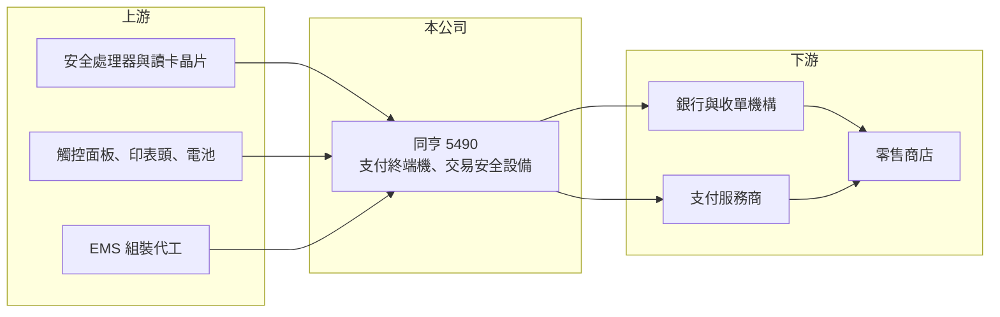

# 5490 同亨

> 上櫃｜[[產業索引-電腦及週邊設備業|電腦及週邊設備業]]｜上市（櫃）日期 2001/05/14

# 第一章：企業模式與商業藍圖

> [!info] 撰寫說明
> 精簡版，由 Claude 依公開資料整理，架構比照 [[2330台積電]]，資料截至 2026-10-08。來源：櫃買中心開放資料快照（基本資料、2026 年上半年財報、每月營收）、Goodinfo 經營績效年度表、MoneyDJ 個股基本資料（2025 年營收比重、歷年股利）。公司營運總部位於香港、2022 至 2023 年虧損原因為記憶或未查得內容。公開資料有限。#待校對

同亨是電子支付終端機與交易安全設備的設計製造商，本章說明它在支付產業中的位置。

- **核心業務：** 同亨設計並銷售刷卡機、感應支付終端機、讀寫卡機，以及保護交易資料的安全設備。支付終端機是商店收款的入口，必須通過國際卡組織的 [[EMV]] 認證與 PCI 安全規範，硬體與加密軟體要一起設計。公司營運總部與研發據點以香港為主（記憶內容，待校對）。
- **營收結構：** 依 MoneyDJ，2025 年交易資料安全保護設備約占 40.4%，電子金融交易終端機及週邊約 28.7%，其他產品約 22.1%，讀寫卡機約 8.9%。安全設備比重最高，代表公司收入不只來自賣刷卡機，也來自金融機構的資安需求。
- **營運據點：** 公司 1997 年成立，2001 年於櫃買中心掛牌，2026 年第二季實收資本額約 9.6 億元。客戶以銀行、收單機構與支付服務商為主（推估），主要市場地區未查得。
- **長期方向：** 全球支付從磁條、晶片卡走向感應、行動與 QR 支付，終端機每隔數年就要因規格與安全標準更新而汰換。這種「標準驅動的換機週期」是支付終端機產業長期需求的基礎，同亨的成長取決於能否在每一輪換機中拿到銀行與收單機構的訂單。

# 第二章：護城河深度與競爭優勢

支付終端機是認證門檻高、但也由少數國際大廠主導的市場，本章分析同亨的競爭位置。

- **競爭優勢：** 每一款支付終端機都要通過 EMV、PCI 等多項認證，銀行導入後還要整合收單系統，因此新進者很難短期進入。同亨長年累積的認證產品與金融客戶關係，是它的主要護城河。交易安全設備則需要密碼學與硬體防竄改設計，技術門檻更高。
- **主要對手：** 國際大廠有 Verifone、Ingenico、中國的百富（PAX）與新大陸，台灣同業有 [[5258虹堡]]。國際大廠產品線完整、全球服務據點多，同亨規模較小，較適合深耕特定區域與利基產品（推估）。
- **觀察重點：** 2022 至 2023 年連續虧損、2023 年營收只剩 7.7 億元，2025 年才回到 15.4 億元並轉為獲利。長期要看營收能否維持在 15 億元以上，以及安全設備這類高毛利產品能否持續放量。

# 第三章：財務體質與盈利規模

資料日期：2026-10-08，表格是撰寫當時的快照；最新月營收、毛利率、累計 EPS 由自動排程寫在本筆記的屬性欄位（月營收、毛利率、累計EPS 等）。#待校對

同亨的毛利率高，但營收受大型標案影響很大，獲利呈現明顯的高低循環。

| 年度 | 營收（億元） | [[毛利率]] | [[營業利益率]] | EPS（元） | [[ROE]] |
|---|---|---|---|---|---|
| 2021 | 15.8 | 36.6% | 10.7% | 1.41 | 7.96% |
| 2022 | 14.0 | 35.0% | 7.73% | -1.79 | -11.2% |
| 2023 | 7.67 | 24.8% | -29.8% | -1.85 | -13.7% |
| 2024 | 13.7 | 34.3% | 2.03% | 0.35 | 2.73% |
| 2025 | 15.4 | 43.5% | 12.7% | 1.69 | 12.2% |

- **營收規模：** 2020 年營收 17.1 億元、2025 年 15.4 億元，五年年複合成長率約 -2.1%（推算）。2026 年上半年營收 8.99 億元、毛利率 43.6%、營業利益率 15.9%、EPS 1.29 元，1 至 8 月累計營收年增約 19%。
- **獲利：** 2022 年本業仍有 7.7% 的營業利益率，但全年 EPS 為負，代表當年有大額業外損失（原因未查得）。2021 至 2025 年平均 ROE 約 -0.4%（推算），受兩年虧損拖累。現金股利在 2022 與 2023 年度停發，之後恢復到 0.35 元與 1.5 元，配息跟著獲利起伏。
- **財務特色：** 2026 年第二季末總資產 19.9 億元、總負債 6.4 億元，負債比約 32%；股東權益 13.5 億元，每股淨值 14.48 元。流動資產 17.7 億元占總資產近九成，資產輕、幾乎不需要重資本支出。
- **[[ROIC]] 與 [[WACC]]：** 2025 年營業利益約 1.96 億元，稅後約 1.56 億元；有息負債未查得、推估極少，以股東權益約 13 億元計，ROIC 約 12%（推算）；2026 年上半年年化約 17%（推算），2023 年則為大幅負值。WACC 以 CAPM 推估：無風險利率 1.75%、市場風險溢酬 6%、β 取 1.0（小型電子股常見值），幾乎無負債，WACC 約 7.75%（推算）。景氣好時 ROIC 明顯高於 WACC，但虧損年度會把累積價值吐回，長期是否穩定創造價值仍待觀察。

# 第四章：總體風險與地緣政治

同亨的風險主要來自支付產業的大廠競爭與訂單集中，本章整理長期風險。

- **產業週期：** 支付終端機需求由規格汰換與銀行採購預算驅動，換機潮結束後營收可能驟降，2023 年營收腰斬就是例子。行動支付與軟體化收款（手機直接當刷卡機）長期可能減少對專用硬體的需求。
- **營運風險：** 單一銀行或收單機構的大型標案占營收比重可能很高，得標與否直接影響全年獲利。國際大廠與中國廠商價格競爭激烈，小廠議價能力有限。
- **其他風險：** 支付安全標準持續更新，研發與認證成本必須持續投入；營收以外幣計價，匯率波動影響獲利；若主要營運在香港，也需面對當地政經環境變化（推估）。

# 專有名詞解析

## 應用

- **[[EMV]]**：由國際卡組織制定的晶片卡與感應支付交易標準，支付終端機必須通過認證才能上市。

## 金融

- **[[ROIC]]**：投入資本報酬率，稅後營業利益除以股東權益加有息負債，衡量本業運用資本的效率。
- **[[WACC]]**：加權平均資金成本，股東權益成本與負債成本依資本結構加權，是 ROIC 必須超越的門檻。

# 核心供應鏈

- 上游：安全處理器、讀卡與感應晶片、觸控面板與熱感印表頭、組裝代工（實際供應商未查得）。
- 下游／客戶：銀行、收單機構與支付服務商，最終用戶為零售商店。
- 同業：[[5258虹堡]]，以及 Verifone、Ingenico、百富、新大陸。

## 最新新聞
<!-- news:start -->
<!-- news:end -->

## 相關連結
- [公開資訊觀測站](https://mopsov.twse.com.tw/mops/web/t05st03?step=1&firstin=1&co_id=5490)
- [Goodinfo](https://goodinfo.tw/tw/StockDetail.asp?STOCK_ID=5490)
- [Yahoo 股市](https://tw.stock.yahoo.com/quote/5490)
- [鉅亨網新聞](https://www.cnyes.com/twstock/5490/news)
