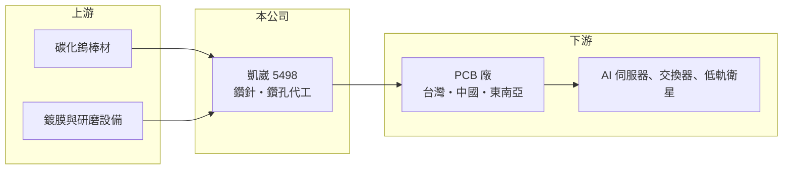

# 5498 凱崴

> 上櫃｜[[產業索引-電子零組件業|電子零組件業]]｜上市（櫃）日期 2001/03/29

# 第一章：企業模式與商業藍圖

> [!info] 撰寫說明
> 精簡版，由 Claude 依公開資料整理，架構比照 [[2330台積電]]，資料截至 2026-10-08。來源：櫃買中心開放資料快照（基本資料、2026 年第二季資產負債與損益、本益比殖利率）、Goodinfo 經營績效頁、理財周刊 2026 年報導、經濟日報 2026 年報導標題。公開資料有限。#待校對

凱崴電子（以下簡稱凱崴）是替電路板廠提供[[鑽針]]與[[鑽孔代工]]服務的公司，位於 [[PCB]] 產業的上游製程端。理解凱崴的關鍵在於：電路板越做越高層、材料越來越硬，鑽孔變成最吃耗材的製程，凱崴的生意就是跟著這個趨勢走。

- **核心業務：** 凱崴成立於 1997 年，2001 年在櫃買中心掛牌，依 2026 年報導，鑽針是核心事業，另提供 PCB 鑽孔代工。電路板需要鑽出大量小孔讓各層線路導通，鑽針就是鑽這些孔的微型刀具，屬於耗材；鑽孔代工則是替產能不足或不想自建鑽孔線的板廠代為加工。兩項業務的共同點是，營收直接跟著 PCB 廠的生產量與板子的規格走。
- **營收結構：** 鑽針與鑽孔代工的營收比重未查得。依報導，主要應用包括層數 30 層以上的 [[AI 伺服器]]電路板、[[低軌衛星]]與 800G 以上的高速交換器。2025 年營收 14.1 億元，2026 年上半年營收 10.3 億元，已明顯超過前一年同期，反映高階板需求帶動的耗材用量增加。
- **營運據點：** 總部位於桃園。依 2026 年報導，公司處分了中國昆山廠的資產（取得現金用於技術升級與資本支出，處分時間未查得），並在泰國設立新廠，鎖定東南亞的 PCB 產業聚落，預計 2026 年全面貢獻產能。鑽針月產能已提升到 2,000 萬支以上。
- **長期方向：** 產業正從傳統 FR-4 材料走向超高層數與低損耗材料，這類材料較硬，鑽針由耐用型轉為高耗材型，用量成倍增加。凱崴採用 CVD 鑽石鍍膜與類鑽碳（DLC）技術提升鑽針硬度與耐磨性，目標是在高階鑽針市場取得份額。產能往泰國移動，則是跟著客戶從中國轉往東南亞的布局。

# 第二章：護城河深度與競爭優勢

凱崴屬於 PCB 產業中的耗材與製程服務供應商，護城河來自製程知識與客戶認證，但規模不大。

- **競爭優勢：** 鑽針雖然單價低，但直接影響電路板的孔位精度與良率，板廠換用新鑽針前需要測試驗證，因此有一定的轉換成本。凱崴同時做鑽針與鑽孔代工，可以從代工現場累積不同板材的鑽孔參數，再回饋到鑽針設計，這是單純賣鑽針的廠商較難取得的經驗。泰國新廠讓它能就近服務外移的台灣板廠。
- **主要對手：** 台灣同業最主要的是 [[8021尖點]]，同樣兼營鑽針與鑽孔代工；中國有金洲精工、鼎泰高科等大型鑽針廠，規模與成本都具優勢。日本也有高階鑽針供應商。凱崴在規模上明顯小於中國龍頭，必須靠高階產品與服務差異化。
- **觀察重點：** 長期最該追蹤的是毛利率能否回到並維持在 15% 以上。2019 至 2025 年凱崴的毛利率在 -3.8% 到 13.8% 之間，2023 年更出現毛利為負，顯示這門生意在景氣低迷時非常脆弱。2026 年上半年毛利率約 15.5%、營業利益率約 6.4%，若高階鑽針比重持續提高，才代表獲利結構真正改善。

# 第三章：財務體質與盈利規模

資料日期：2026-10-08，表格是撰寫當時的快照；最新月營收、毛利率、累計 EPS 由自動排程寫在本筆記的屬性欄位（月營收、毛利率、累計EPS 等）。#待校對

凱崴的財務特徵是：營收規模 10 至 16 億元，跟著 PCB 景氣起伏，過去多年本業獲利微薄，2026 年才出現明顯改善。

| 年度 | 營收（億元） | [[毛利率]] | [[營業利益率]] | EPS（元） | [[ROE]] |
|---|---|---|---|---|---|
| 2021 | 15.8 | 10.9% | 1.79% | 0.18 | 1.87% |
| 2022 | 14.5 | 3.55% | -6.51% | 0.01 | 0.15% |
| 2023 | 10.7 | -3.76% | -17.2% | 0.06 | 0.24% |
| 2024 | 11.6 | 9.21% | -0.81% | -0.01 | 0.05% |
| 2025 | 14.1 | 10.9% | 1.14% | 0.00 | 0.05% |

（來源：Goodinfo 經營績效頁；2019 年營收 12.6 億元、EPS 0.42 元，2020 年營收 12.6 億元、EPS 0.52 元。）

- **營收規模：** 2019 至 2025 年營收由 12.6 億元增至 14.1 億元，年複合成長率約 1.9%（推算），期間在 10.7 億元到 15.8 億元之間起伏。2026 年上半年營收 10.3 億元，若下半年維持，全年有機會創下近年新高。
- **獲利：** 近五年平均 ROE 約 0.5%（推算），幾乎沒有替股東賺到報酬。2022 至 2024 年本業虧損，但 EPS 接近零而非大幅虧損，代表業外收益（性質未查得）抵銷了本業損失。2026 年上半年稅後歸屬母公司淨利約 0.34 億元、EPS 0.18 元，所得稅費用偏高。
- **財務特色：** 依 2026 年第二季資料，總資產約 43.4 億元，負債約 21.3 億元，股東權益約 22.1 億元，負債比約 49%。股本 19.4 億元中包含約 1,734 萬股的[[私募]]股票。保留盈餘約 2.38 億元，最近一次現金股利每股 0.25 元，高於 2025 年的 EPS，配息不完全依當年獲利。自由現金流是否長期為正未查得。
- **[[ROIC]] 與 [[WACC]]：** 以 2025 年營業利益約 0.16 億元（14.1 億元 × 1.14%）、稅率 20% 計算，稅後營業利益約 0.13 億元；有息負債未查得，投入資本以股東權益 22.1 億元到「權益加全部負債」43.4 億元為區間，ROIC 約 0.3% 至 0.6%（推算）。若以 2026 年上半年營業利益 0.66 億元年化，ROIC 約 2.4% 至 4.8%（推算）。WACC 以 CAPM 推估：無風險利率 1.75%、市場風險溢酬 6%、β 假設 1.0（PCB 相關股常見值），權益成本約 7.75%；稅後負債成本假設 2%、負債占四成，WACC 約 5.5%（推算）。即使 2026 年獲利改善，ROIC 仍低於 WACC，代表凱崴要持續提高高階鑽針的獲利，才能真正創造經濟價值。

# 第四章：總體風險與地緣政治

凱崴的風險主要來自 PCB 景氣循環、中國同業的價格競爭，以及海外擴廠的執行。

- **產業週期：** 鑽針與鑽孔代工的需求完全取決於 PCB 廠的產量。PCB 景氣下行時，板廠會先收回外包的鑽孔訂單、壓低耗材採購，凱崴 2023 年毛利轉負就是例子。目前 AI 伺服器帶動的高階板需求旺盛，但這波需求若放緩，耗材用量也會隨之下滑。
- **營運風險：** 泰國新廠在投產初期，折舊與人力成本會先上升，良率與稼動率若不如預期，會拖累毛利。中國鑽針龍頭產能規模大，若擴產搶市，價格壓力會很明顯。高階鑽針需要持續投入鍍膜與研磨技術，研發若落後，就只能留在低價市場。
- **其他風險：** 鑽針主要原料是碳化鎢，原料價格受中國供應影響；外銷以美元計價，受匯率波動影響。東南亞據點則面臨當地勞動法規、電力供應與政策變動的風險。

# 專有名詞解析

## 應用

- **[[AI 伺服器]]**：搭載 GPU 等加速晶片、用於 AI 訓練與推論的伺服器，功耗高，對電路板層數與材料規格要求也高。
- **[[低軌衛星]]**：在距地面約 500 至 2,000 公里軌道運行的通訊衛星群，用於全球寬頻上網，帶動地面接收設備需求。

## 金融

- **[[私募]]**：公司向特定人募集股票或債券，不需公開發行，常用於引進策略投資人或在財務困難時籌資，私募股票有轉讓限制。

## 產業

- **[[PCB]]**：印刷電路板，用銅線路連接電子元件的基板，是所有電子產品的骨架。
- **[[鑽針]]**：在電路板上鑽出導通孔的微型刀具，屬於高消耗耗材，板材越硬、層數越高用量越大。
- **[[鑽孔代工]]**：替電路板廠代為執行鑽孔製程的加工服務，讓板廠不必自建全部鑽孔產能。

# 核心供應鏈

- 上游：碳化鎢棒材供應商，以及 CVD 鍍膜、研磨與鑽孔機設備廠，具體供應商未查得。
- 下游／客戶：台灣、中國與東南亞的 PCB 廠，高階伺服器板代表業者如 [[2368金像電]]、[[3044健鼎]]、[[2313華通]]（是否為凱崴客戶未查得，#待校對）。
- 同業：[[8021尖點]]，以及中國的金洲精工、鼎泰高科。

## 最新新聞
<!-- news:start（自動產生，請勿手動編輯此範圍） -->
- 2026-10-12 📰 媒體 18:51｜營收速報 - 凱崴(5498)9月營收2.35億元年增率高達78.72％｜[鉅亨網](https://news.cnyes.com/news/id/6628393)

完整紀錄：[[5498凱崴 新聞]]
<!-- news:end -->

## 相關連結
- [公開資訊觀測站](https://mopsov.twse.com.tw/mops/web/t05st03?step=1&firstin=1&co_id=5498)
- [Goodinfo](https://goodinfo.tw/tw/StockDetail.asp?STOCK_ID=5498)
- [Yahoo 股市](https://tw.stock.yahoo.com/quote/5498)
- [鉅亨網新聞](https://www.cnyes.com/twstock/5498/news)
